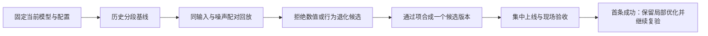
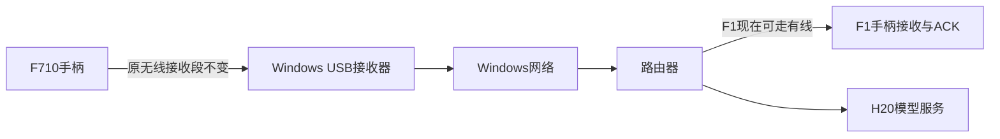

# RLinf可选组件：离线筛选与上线复盘（2026-10-23起）

**11月3日有线已启用，完整RTC shadow请求中位173ms、观测到返回229ms；同权重旧原生同步参考为280／313ms。** 两组零动作、无录制，RTC无暂停；同步与RTC计算路径不同，不将差额当作RTC开关的净收益。完整对照和历史口径见[本轮shadow](#rtc-sync-shadow-20261103)。

同日另一组B1250／局部RLT网络探针中位534／611→154／125ms，主要降低通信等待和长尾；它测的是bootstrap／模拟前缀RPC，不能分别称为完整RTC与原生同步。收益以当时卡顿无线窗口为基准，不代表全天固定倍率，详见[本轮有线对照](#network-wired-20261103)。下一步现场核对运动中的连续RTC与手柄ACK；历史组件优化按各自日期阅读。

## 历史阶段结论（10月23—28日）

**10月28日更新：视觉缓存与当前B／固定actor／特征提取兼容，离线B模型耗时减少约2.3%～6.1%，actor无稳定收益；可以进入版本化部署验收，生产仍关闭。** 详见[缓存轮转与完整预热复核](#cache-rlt-20261028)。头相机关同步减少发布断档但未降低推理总延迟，已恢复原配置、暂不替换，见[相机对照](#camera-result-20261028)。

**整套推理框架目前不替换：NO。** 本轮按现有模型、输入和RTC合同做离线回放与零动作网络实测；近似RTC会改变动作并新增IK拒绝，ApxInf尚缺当前必需的接口，不能仅凭推理更快替换现有底座。

**保留两项局部优化：YES。2026-10-26首次带录制对照中，用户确认B1250完整任务成功。** 同一B模型的稳态客户端总时间中位数232→213ms，采集到返回302→270ms；83次请求全部成功并采纳。收益主要来自模型与图像处理，网络尾延迟未明显改善，IK本次反而多约4ms；一次成功不能证明成功率提高。

**10月26日继续验证：Graph＋无效视觉缓存组合已实现，模型中位再降4.3%，尚未切生产。** 22项保护检查、162组数值对照及72组服务回放通过；相机关闭同步消除了三个80秒窗口内的长发布断档，但真实相机零输出验收遇到一次RTC超时／计划耗尽，暂不切默认。底层原始图像持续到达，异常集中在元数据通道及后续组帧；不能再把元数据重复直接等同于像素重复。完整[本轮新增实验、累计收益与替换表](#optimization-final-20261026)在下文，网络尾延迟仍未解决。10月27日再完成480次零模型QoS对照，关闭QoS没有稳定收益，不替换；随后两分钟小包采样发现本地网关P95约337ms、H20约352ms，排查重点前移到接入链路；H20目录访问已恢复；21:26完成720次热点开／关四窗口对照，关闭无稳定收益，已恢复热点，详见[实测结论](#hotspot-result-20261027)。见[网络优先排查](#network-priority-20261027)。此前夹爪异常与域控中断原因仍未知，保持[事故及取证](#上线中止与现场异常2026-10-23)原结论；本轮没有机器人动作。



## 离线筛选时配置与适用范围（10月23日）

本轮快照为`unified-ab-full-20261023-r1`；四个health身份及28个组件文件哈希核对通过。右单臂父1K/A1250/B1250使用相同输入合同；恢复的旧Full1K仍是三张有效图/state16，**不能启用无效左图优化**。

| 模型 | H20 GPU | H20端口 / F1端口 | 身份尾缀 | 本轮用途 |
|---|---:|---|---|---|
| A1250 | 0 | 8137 / 8152 | ede2bbb7c49d30ed | 本日真实历史分段；缓存回归 |
| B1250 | 1 | 8138 / 8153 | 81444e7071723c1f | 本日真实历史分段；缓存回归 |
| 旧Full1K | 2 | 8160 / 8155 | efe3e5fa54ed0fb2 | 保留三图合同；禁止套用右单臂候选 |
| 右单臂父1K | 3 | 8139 / 8154 | 0ff87ec17ddfae2e | 固定包离线对照；现有`/echo`零模型网络测量 |

共同基线为π0.5、H50、30Hz、5步去噪、D14/S最小16自适应、完整VJP、已有精度保留suffix编译/CUDA Graph及FastArmModel。右单臂保留三图协议槽位，主图/右腕有效，左图mask=false；原始物理state16与8维有效模型状态分开。实验独立使用核验空闲的GPU4/5/6，未启动训练。

## 最新链路分段基线

以下来自**2026-10-23 A两条/B四条已有带电记录**，不是本轮启动机器人。共634请求：632 RPC成功、1 IK拒绝、1通信错误；630计划采纳、2次RTC截止暂停。表中分段采用623次稳态续接成功请求，失败与bootstrap另列，避免将失败记为0或把首次进程开销混作稳态。

<!-- LIVE_TABLE_START -->
| 部分 | P50 ms | P95 ms | P99 ms | max ms |
|---|---:|---:|---:|---:|
| 采集→发请求（观测年龄） | 63.88 | 102.54 | 123.84 | 181.22 |
| 客户端图像处理与封包 | 19.92 | 29.07 | 37.10 | 48.76 |
| 服务端解码 | 5.71 | 6.46 | 9.68 | 14.31 |
| 模型输入预处理 | 3.58 | 4.57 | 4.73 | 5.38 |
| 模型计时字段model_h2d_d2h | 133.68 | 138.75 | 140.73 | 149.54 |
| 受限连续IK | 31.03 | 33.53 | 35.08 | 95.72 |
| 服务端worker排队 | 0.08 | 0.11 | 0.14 | 3.96 |
| 服务handler总计（包含上述子项） | 174.80 | 181.85 | 187.11 | 239.50 |
| RPC往返（包含服务时间） | 207.56 | 245.01 | 275.35 | 659.00 |
| RTT减handler（网络与调度剩余） | 31.97 | 72.03 | 100.50 | 487.71 |
| 客户端请求总计 | 232.21 | 271.43 | 299.87 | 683.91 |
| 采集→返回 | 300.61 | 357.28 | 395.57 | 754.35 |
| 返回→采纳（已采纳请求） | 1.26 | 8.03 | 11.73 | 13.00 |
<!-- LIVE_TABLE_END -->

计时关系：服务解码、预处理、模型与IK包含于服务总时间；服务时间又包含于RPC往返；封包等包含于客户端总时间。`model_h2d_d2h`保留原日志字段名，当前输入H2D实际在preprocess内，模型字段也不是纯GPU前向。采集到发请求是观测年龄，包含采集/等待/调度；起点是主机观测时间，不是校准后的相机曝光时刻。`RTT−handler`是网络、隧道及两端调度的剩余量，**不是单向线速延迟**；分位数不能直接相加。

全部634请求的客户端P50/P95/P99/max为232.30/275.68/424.06/2274.12ms；采集到返回max为2337.20ms。9次bootstrap客户端P50为423.91ms，其中发送到网络子进程P50为143.18ms，不能全部归为模型冷启动。各模型、成功/失败、bootstrap的完整分组见[历史汇总](../../artifacts/20261023-rlinf-offline/network/historical-ab-summary.json)。

两次B长尾已进一步定位：请求193模型133.64ms、IK28.14ms均正常，659.00ms RTT中的剩余487.71ms主要发生在服务器收到整包之前；相邻请求的双端时钟差分给出额外约414ms。请求201客户端等候约2.27s，H20对应模型仍为134.91ms，但开始计算前相对邻居多了约2.17s，缺少该请求的server transport记录，无法继续拆成上传、SSH或事件循环。主控制循环与Pipe回传没有同量级停顿；原客户端未保存具体异常字符串，不能补写成确定的TimeoutError。见[长尾归因](../../artifacts/20261023-rlinf-offline/network/historical-long-tail-attribution.json)。

<!-- FULL_TABLE_START -->
### 恢复旧Full1K：本日另列

本日3条已结束记录共447请求，全部RPC成功、445采纳、零RTC截止暂停；两次未采纳位于结束边界。下面是444次稳态续接；场景与A/B不同，不能据此排名模型。

| 部分 | P50 ms | P95 ms | P99 ms | max ms |
|---|---:|---:|---:|---:|
| 采集→发请求（观测年龄） | 57.06 | 99.16 | 104.97 | 221.28 |
| 客户端图像处理与封包 | 19.67 | 27.46 | 33.44 | 36.97 |
| 服务端解码 | 5.80 | 6.54 | 7.80 | 14.35 |
| 模型输入预处理 | 4.04 | 4.64 | 4.88 | 5.00 |
| 模型计时字段model_h2d_d2h | 126.49 | 137.89 | 139.92 | 141.94 |
| 受限连续IK | 29.50 | 31.97 | 32.65 | 33.22 |
| 服务端worker排队 | 0.07 | 0.10 | 0.12 | 0.50 |
| 服务handler总计（包含上述子项） | 165.46 | 180.25 | 182.88 | 189.09 |
| RPC往返（包含服务时间） | 206.95 | 257.94 | 280.30 | 333.13 |
| RTT减handler（网络与调度剩余） | 37.70 | 89.07 | 115.47 | 152.72 |
| 客户端请求总计 | 231.15 | 282.15 | 311.60 | 404.22 |
| 采集→返回 | 295.94 | 364.39 | 389.76 | 476.40 |
| 返回→采纳（已采纳请求） | 1.16 | 7.64 | 10.09 | 13.07 |
<!-- FULL_TABLE_END -->

## 独立GPU模型分段

父1K A/A基线重复162对输出完全一致。240次稳态请求的policy P50/P95为152.17/154.87ms，其中预处理3.06/3.14、模型124.85/125.31、IK24.81/26.79ms。这里没有实时录制、相机和网络负载，不能拿152ms当成现场端到端延迟。

另做12次CUDA-event诊断，未混入上面的正常计时：

| 模型内部部分 | P50 ms | P95 ms | 解释 |
|---|---:|---:|---|
| prefix总计 | 69.82 | 70.24 | 包含视觉与语言前缀 |
| 其中视觉编码 | 27.79 | 28.21 | 三个图像槽位，包含被屏蔽的左图 |
| 5步suffix前向 | 17.89 | 17.94 | 已有编译与CUDA Graph |
| 5步VJP | 28.10 | 28.14 | 当前完整RTC引导的反向计算 |

prefix占比支持优先查它；VJP虽贵，移除它属于算法改变。CUDA spans有嵌套，另有CPU派发、张量处理和传输，不能把上表逐行相加当模型总时间。

## 模型候选的同条件对照

每种候选使用同checkpoint、同像素/state、同RTC前缀及同显式噪声，交替执行先后顺序。正确性集为18个真实RTC观测×3噪声＝54对，加36个验证集阶段条目×3噪声＝108个bootstrap对。两者分开判定；验证条目可能共享帧，不能称54个独立事件。

<!-- MODEL_TABLE_START -->
| 候选 | policy P50基线→候选 ms | P95基线→候选 ms | raw完全一致 | 新增IK拒绝 | 判定 |
|---|---:|---:|---:|---:|---|
| 无效左图视觉缓存：父1K | 152.90 → 144.23 | 154.91 → 146.24 | 162/162 | 0 | YES，集中验收 |
| 同候选：A1250 | 149.83 → 141.38 | 152.12 → 143.51 | 162/162 | 0 | YES，集中验收 |
| 同候选：B1250 | 148.70 → 140.40 | 150.74 → 142.39 | 162/162 | 0 | YES，集中验收 |
| 近似雅可比I | 151.87 → 114.43 | 154.06 → 116.44 | 108/162 | 1 | NO，新增拒绝 |
| 完整上游approx | 152.79 → 118.04 | 154.93 → 119.27 | 0/162 | 6 | NO，拒绝/释放改变 |
| 精度约束prefix编译 | 150.45 → 128.53 | 153.87 → 132.59 | 0/162 | 0 | NO，输出/释放改变 |
| prefix常量构造调整 | 151.24 → 150.81 | 154.47 → 154.16 | 162/162 | 0 | 不单独采用，收益很小 |
| eager prefix CUDA Graph | 未完成 | 未完成 | 仅54/54 guided通过 | 未评估完整集 | NO，bootstrap转换时CUDA异常 |
| prefix Graph关闭AMP权重缓存：父1K | 152.43 → 138.26 | 154.50 → 140.27 | 162/162 | 0 | YES，集中验收 |
| 同候选：A1250 | 152.39 → 138.66 | 154.62 → 140.78 | 162/162 | 0 | YES，集中验收 |
| 同候选：B1250 | 152.72 → 138.18 | 160.57 → 143.54 | 162/162 | 0 | YES，集中验收 |
<!-- MODEL_TABLE_END -->

计时240对重复使用18个历史`(case, seed)`组合，衡量相同负载的运行波动，不能当240个独立任务。上游approx的延迟只比较双方都成功的212对；其余28个提前IK拒绝的计时仍在原始结果中，不能算作加速。

近似雅可比仅把当前完整VJP中的雅可比替换为单位阵；上游approx则执行固定提交的原始引导算式，保留它的步进顺序、增益与同步行为，再接F1的动作mask/重锚定。前者的108个bootstrap完全一致不能抵消54个guided全部变化；后者bootstrap也有浮点算术顺序差异。它们可能有个别接缝指标改善，但新增拒绝已经不满足等价替换条件。释放指标只看已承诺14步之后、覆盖窗口到32步，不能用被客户端覆盖的原始前14步推断实物松手。

54个真实RTC对照中，近似雅可比新增1次IK拒绝，上游approx新增6次。即使只看双方IK都成功的可执行窗口，前者最大差9.33mm/3.87°/夹爪63.4个百分点，后者76.37mm/12.25°/100个百分点；夹爪已按实际范围裁剪。近似雅可比没有改变本测试的首次开爪阈值计数，但样本中基线只有3个释放窗口，不能据此说夹爪行为不变。prefix编译的两次释放窗口变化发生在验证集bootstrap，并非54个guided。详见[独立结果复核](../../artifacts/20261023-rlinf-offline/review.json)。

缓存只复用**当前模型实例中、像素完全一致、整张被mask屏蔽**的视觉结果，保留全部token和mask形状；主图和右腕每次重新计算。检查dtype、device、autocast、输入改变、mask变为有效、有效/无效图共用Tensor对象、异常恢复，以及训练/启用梯度时拒绝缓存。9项CPU检查通过；模型参数没有梯度写入。缓存随模型实例销毁，不能跨checkpoint复用。

父1K/A1250/B1250最终缓存回归合计486对，全部raw完全一致且零新增拒绝。A/B基线各有3/2个正确性样本IK拒绝，候选保留相同结果；各自240次计时中双方成功226对，表中已采用相同成功集合，不以提前拒绝缩短时间。

### 前缀图捕获的生命周期复验

常量构造调整本身162对完全一致，但policy P50仅151.24→150.81ms，不值得单独切换。其用途是避免prefix内两个临时CPU常量拷贝妨碍CUDA capture，保留原来的浮点计算。

随后原eager Graph确实捕获成功，54个guided对照raw全部一致；在首次转为bootstrap时出现CUDA非法访存，完整异常保留于`model/prefix_graph-r2.log`。这不是“捕获未成功”，不能只报续接阶段的好成绩。

最小改动是在**prefix内部关闭AMP权重缓存**，其余suffix编译/完整VJP保持不变。原实现请求内缓存的BF16权重可能在离开autocast后释放，而捕获图还引用其地址；这是源码与复验支持的机制解释，不声称已定位到确切故障kernel。[NVIDIA CUDA Graph说明](https://docs.nvidia.com/dl-cuda-graph/torch-cuda-graph/torch-integration.html)明确讨论AMP缓存与图捕获的组合约束。

诊断r3的162对全部一致，跨过guided→bootstrap→guided，policy P50 152.34→138.02ms；正确性阶段加过同步定位，计时没有加。最终r4另起进程，从预热、正确性到计时都关闭诊断同步，父1K/A/B各162对全部raw一致、零新增拒绝/释放窗口变化，三个进程退出码均0；各240次计时的双方成功集合分别为240/226/226。11项CPU检查包含正常及异常退出后AMP的dtype、enabled、cache状态恢复。详细跨模式证据见[图捕获复核](../../artifacts/20261023-rlinf-offline/prefix-graph-memory-audit.json)。

独立进程的Torch峰值allocated由A/A基线15.336GiB变为Graph回归15.419GiB，reserved由16.061变为16.426GiB；这是本轮测量，不是生产常驻显存保证。仍需在正式worker生命周期中验收启动、重连与checkpoint切换。

**模型图捕获和无效视觉缓存是本轮分别测过的两个备选，收益不能相加。** 当前graph helper直接绑定原始embed_prefix，运行时再挂缓存不会自然组合；反过来把带`torch.equal`判断的缓存放进capture还涉及同步约束。模型侧先选通过回归且收益更大的前缀Graph，缓存保留为简易备选；传输固定左图与模型Graph的组合端到端收益留给集中验收。两者都只声明本轮测过的右单臂模型，旧Full保持现有模型路径。

因此实施优先级调整为：**先准备前缀Graph与固定无效左图的联合候选；视觉缓存留作备选；approx、prefix编译、LZ4/Zstd和ApxInf本轮不切换；预热共源只作为配置维护。** 前两项保持模型结果不变，能减少计算/传输并增加RTC余量；近似算法的更大提速不足以抵消当前行为退化证据。

## 传输与压缩候选

### 优先项：无效左图固定PNG

不删除三图槽位，保留原图帧号、时间戳和原始录制；仅在已绑定的rightonly合同下，把随后被处理器置零的左图载荷换成固定738字节PNG。父1K真实处理器、统计和tokenizer对18组历史输入的完整image/state/token/mask逐字节一致；实际旧Full合同明确拒绝该候选。

真实F1 ARM→原SSH隧道→H20的`/echo`另用24组A/B历史观测，交错对照共480请求/240对，全部成功，head/right逐对哈希一致。排除预先约定的前5对预热后，235对稳态如下；未调用模型、ROS或动作发布：

| 指标 | 原PNG1 | 固定无效左图 | 结论 |
|---|---:|---:|---|
| 完整请求P50 | 175,120 B | 127,460 B | 减少27.2% |
| ARM封包P50 | 11.02 ms | 10.99 ms | 无稳定墙钟提速，主图仍决定并行耗时 |
| H20 echo PNG解码P50 | 17.67 ms | 12.70 ms | 仍解码三槽，常量左图更便宜 |
| echo客户端总时间P50 | 58.17 ms | 42.08 ms | 配对平均改善13.04ms |
| echo客户端总时间P95 | 241.05 ms | 227.78 ms | 差值置信区间跨0，长尾收益未确认 |

配对平均差95%区间为−20.42至−5.24ms。该区间来自同一链路窗口，存在时间相关性，不能推广成所有时段保证。原始PNG基线另一个早期窗口的RTT P50/P95为34.36/95.95ms，**不能跨窗口与候选比**。echo回复小于1KB，实际模型回复约33KB，且无实时录制/控制负载，因此尚未测得组合候选的真实带电总延迟。

echo与正式推理使用相同PNG unpack入口，但这里的输入、测量时段与负载不同，不能将约5ms解码节省直接从真实A/B的5.71ms解码基线扣掉。详见[配对数据及限制](../../artifacts/20261023-rlinf-offline/network/rlinf-masked-echo-20261023-r1/paired-comparison.json)、[完整输入一致性](../../artifacts/20261023-rlinf-offline/codecs/masked-model-input-equivalence.json)。

### LZ4/Zstd：CPU更快，但本轮不替换

固定上游编码协议，18组实际三图、每机器240轮配对，ARM与6000D都做像素无损往返；H20另将Zstd1/3的标记、字节和像素与固定上游Torch包装＋同一ctypes libzstd backend核对108项，该补充核对不包含LZ4。本次ARM系统Python未装Torch，使用NumPy兼容薄层与已有libzstd，未混装环境；因此该CPU测量不能被称为已集成生产协议。

| 编码 | ARM原图→封包P50/P95 ms | 三图载荷P50 B | 相对PNG1 |
|---|---:|---:|---|
| PNG1 | 10.32 / 12.04 | 157,506 | 当前基线 |
| LZ4 | 7.79 / 8.76 | 276,770 | 增大76% |
| Zstd1 | 8.07 / 9.14 | 240,231 | 增大53% |
| Zstd3 | 8.60 / 9.64 | 216,106 | 增大37% |

这里是图像载荷，不能与上一表含状态/前缀的完整请求混比。CPU节省约2ms不足以证明更大的包在当前无线链路总体更快；本轮没有完成生产协议端到端的LZ4/Zstd对照，结论是**尚不替换**，不是证明它们一定更慢。优先采用减少无效数据的PNG候选，现阶段无需增加另一种编解码协议。

## ApxInf与预热的筛选

**ApxInf：NO。** 固定上游接口未暴露当前完整VJP、每步RTC上下文和无效动作维逐步mask，也没有验过F1权重转换。H50/5步配置校验实际可通过，两张有效图也有部分支持；不能把这些误写成“不支持H50/两图”。本轮停在必要接口门槛，未安装engine、转换权重或给它编造性能数值。详见[接口检查](../../artifacts/20261023-rlinf-offline/apxinf/compatibility.json)。

预热D15/S20与运行D14/S16需要统一配置来源，但**不作为本轮日常提速项**：编译的是固定形状的suffix，D/S不进入编译函数，重锚定后动作仍是`[1,50,32]`。变化发生在编译函数外的引导权重和CPU IK覆盖长度；现有启动已分别预热bootstrap和guided。该项仅做源码分析，未声称GPU测出额外重编译或收益。

## 统一现场验收的范围

离线筛选完成后，保留现有完整VJP和控制/IK合同，把通过的无效图传输与选定的模型前缀优化装成可回退的新版本。集中验收按同模型、同布局、同录制负载比较基线与候选：

1. 真实相机零输出验收：核对合同、启动/切换/重连、缓存失效、完整输入一致、零发布；旧Full三图分支明确禁用。
2. 同一次现场会话比较端到端P50/P95/P99/max、观测年龄、截止错过/拒绝/丢弃计数，并记录夹爪释放和RTC接缝。
3. 覆盖抓取、插入、释放和Home；若任务表现或尾延迟退化，回到原版本。既有Enter/START授权语义保持。

**离线筛选阶段没有切换生产配置或启动机器人动作。** 随后上线尝试的实际状态单独记录于文末，不沿用此历史结论。以上为集中验收清单，不要求每个失败候选都上真机；离线不可证明闭环任务成功率。

## 复现与证据

H20独立run：`/u01/user/runs/f1-toys-rlinf-offline-20261023-r1`。本地汇总产物：[20261023-rlinf-offline](../../artifacts/20261023-rlinf-offline/)。原始逐请求JSONL/CSV、固定噪声哈希、输入清单、代码快照和退出码均保留；冻结release、数据集、checkpoint未改写。

在H20、项目工作目录、现有环境中复现某一候选时，必须先核对目标GPU空闲，并使用新的输出名，避免覆盖证据：

```bash
cd /home/user/projects
export F1_OFFLINE_RUN=/u01/user/runs/f1-toys-rlinf-offline-20261023-r1
export F1_OFFLINE_CODE="$F1_OFFLINE_RUN/code-v6/tasks/F1_ComplexyToys"
export F1_OFFLINE_GPU=5
export F1_OFFLINE_ATTEMPT=prefix-graph-new-recheck
bash "$F1_OFFLINE_CODE/scripts/run_rlinf_offline.sh" prefix_graph_no_autocast_cache \
  > "$F1_OFFLINE_RUN/$F1_OFFLINE_ATTEMPT.log" 2>&1
```

脚本自行验证GPU空闲，输出目录必须不存在。`F1_OFFLINE_BUNDLE`可指定同合同A/B包；默认父1K。将模式改为`inactive_cache`可复验缓存。所有候选仅在此独立Python进程内安装临时hook；退出时不留下服务。

正式网络测试720请求完成且全部成功；附加体积代理试验停止后保留366条原始记录，不计入codec替换验收。服务日志审计1086条本轮tagged请求全部为echo、无动作结果和预测回放；最终控制锁已释放，无遗留基准进程。源码、完整试验限制及场景标签见[网络结论](../../artifacts/20261023-rlinf-offline/network/decision.json)。

结束时四个生产health身份和28个组件哈希与开始时一致，GPU4–7全部释放。完成门槛、范围及候选选择见[机器可读回执](../../artifacts/20261023-rlinf-offline/completion.json)，完整模型计时表可取[CSV](../../artifacts/20261023-rlinf-offline/model-latency.csv)。

首个baseline尝试因tokenizer环境变量缺失而退出，补用既有官方tokenizer后`baseline-r2`完成；最初prefix_compile启动因前一进程退出后GPU利用率采样残留2%而被空闲检查拒绝，未执行模型。随后保留原回执并增加最多10秒空闲复核，内存占用不满足仍立即拒绝。这些失败没有删除或计为性能样本。

<a id="上线中止与现场异常2026-10-23"></a>

## 上线中止与现场异常（2026-10-23）

本节保留首次中止及只读取证的历史事实；其中“停止／暂停”对应当时状态，随后用户明确授权恢复的当前结果见文末，不代表事故原因已确定。

**上线未完成。** 用户报告右夹爪持续开合后突然断电，随后补充“应该是上半身就是域控”，并确认当时没有运行推理或示教；整机断电未确认。已停止相机验收计划，并于07:55:59 UTC停止本轮三个H20候选服务。重启后已查清留存SSH记录中的三类访问来源，并抓到他人电脑当前的Codex可用性探测命令；这尚不能关联到驱动记录的16条右爪命令。系统存在非正常卸载证据，命令发布来源及中断原因仍未知。

公开入口、当前catalog和旧Full组件未切换。旧A／B／父1K进程已在服务切换时停止，随后三个候选也停止，**原三服务尚未恢复**；旧Full服务未动。此状态须先完成事故排查再处理，不自动启动真机、恢复上线或用候选状态冒充已完成验收。

| 时间（UTC；北京时间＋8小时） | 已核实操作／证据 |
|---|---|
| 07:37:34 | F1预检：控制锁空闲，原四服务身份正确；没有运行中的已登记控制客户端，仅既有隧道supervisor |
| 07:42:41–07:44:02 | 新client只暂存到独立release，最小两文件overlay；HIL恢复功能其余文件保留；未激活入口 |
| 07:47:47–07:48:45 | 仅H20 localhost 18137／18138联合回放72组、216请求全部通过；原图Graph及Graph＋固定左图对基线共144次输出精确一致，新增IK拒绝0 |
| 07:49前后 | F1空闲控制锁取得并持有，用于服务切换；此lease不导入机器人控制模块、不发布命令 |
| 07:50:13 | 在GPU3／0／1启动父1K／A／B候选，仅替换H20模型进程；GPU2旧Full未动 |
| 07:50:29 | 独立回放的GPU4／5临时进程清理完成，显存均0MiB |
| 07:52:50 | 用户报告后只读连接F1超时；相机shadow脚本从未执行，也没有发送Enter／START／Home或电源命令 |
| 07:54:20 | H20取证：三个候选均只有4次本地预热回放，没有requests或transport日志；未收到外部模型请求 |
| 07:55:59 | 三个候选PID 2818358／2818362／2818378精确核验后SIGTERM，均退出；没有向F1发控制指令 |

联合回放的24个唯一历史观测为1 bootstrap＋23 guided，三轮共3＋69组；216请求为9 bootstrap＋207 guided，不能与前文模型侧162对矩阵混写。客户端总耗时P50为229.45→209.69ms，请求175,126→127,713B；这是H20 localhost口径，不包含F1 ARM封包和真实F1→H20网络，更不是带电闭环收益。逐请求原件与[联合汇总](../../artifacts/20261023-rlinf-deploy/replay-r2/summary.json)保留。

新服务健康计数与日志共同支持“候选尚未处理外部推理”，但不能替代F1侧的命令发布证据。原四服务最后请求日志写入分别为父1K 06:35:28、旧Full 06:26:06、A 05:49:21、B 05:50:56 UTC；这些是文件写入时间，不应推断成夹爪最后运动时间。用户确认现场未运行推理或示教，异常具体时间仍待补充；在设备可只读访问后保全控制日志、发布源、手柄输入和系统断电记录，不远程重现故障。08:01:15 UTC再做一次boot ID只读连接仍超时，未取得任何重启证据。

证据：[H20日志与health](../../artifacts/20261023-rlinf-deploy/incident/h20-logs-health.json)、[候选停止回执](../../artifacts/20261023-rlinf-deploy/incident/candidates-stopped.json)、[F1连接失败](../../artifacts/20261023-rlinf-deploy/incident/f1_reachability.json)、[客户端操作审计](../../artifacts/20261023-rlinf-deploy/client-operation-audit-emergency-stop.json)、[回放代理时间线](../../artifacts/20261023-rlinf-deploy/incident-local-evidence/timeline.json)。后续恢复须核对这份中止状态，不能直接按旧部署计划继续执行。

### 用户重启后的只读补证

**F1连接已恢复，责任与原因尚不能确定。** 新boot ID及uptime对应北京时间约16:03:18启动；16:05起仅通过SSH读取文件、进程和既有工作台状态，没有启动推理、示教、相机shadow、ROS诊断节点或任何动作。公开入口仍指向原`unified-ab-full-recovery-20261023-r2`。本节全部时间为北京时间（UTC＋8）。

| 已核实事实 | 可得结论与限制 |
|---|---|
| 重启前motor日志15:48:53.926–15:49:13.267有16条`Right Gripper Command`，15:30后没有其他可解析命令记录 | 确有右爪命令日志；无开度值、发布者GID／进程或执行回执，不能还原开合或指认来源 |
| motor原件78,661,605字节，最后730字节为NUL | 完整压缩原件及SHA已保全；可能缺失尾部记录，不能据NUL判断断电原因 |
| 工作台15:30至新开机前没有事件记录 | 没有同期4242动作请求证据；不能排除不经4242的ROS或其他控制源 |
| 系统syslog最后记录15:50:06.212，kernel最后15:50:02.995，随后进入16:03新开机 | 系统记录有中断；留存窗口未见明确关机、OOM、panic或看门狗触发记录，不能因未记录就排除 |
| 新开机出现根分区EXT4孤儿inode恢复，另有FAT分区`nvme0n1p4` dirty-bit | 支持至少有关文件系统此前未正常卸载；不能区分掉电、强制复位、看门狗或其他触发 |
| can0 ACK错误从15:20前后已持续存在，事发前未出现新类型 | 不能将已有CAN错误直接定为本次事故原因；本轮没有修改CAN或驱动配置 |
| 审计可还原SSH会话，但事发窗没有命令执行审计或发布者记录 | 登录、来源地址或同一时间活动不证明发过夹爪指令，不据此归因 |
| 原生手柄／全身控制日志只剩16:09的新启动内容 | 不能借重启后状态补写事发前行为；新gamepad启动缺pygame，也不能反推旧进程是否运行 |
| 16:17:01已有工作台状态：action为空、控制owner为空、命令监听未检测到当时活动 | 只说明本次瞬时只读样本，不证明长期无外部发布，也不能追溯重启前命令 |

上一启动journal确实没有持久化，但独立`syslog`、`kern.log`、`auth.log`和audit文件仍在；已保存事发窗口，不能把journal空结果说成全部系统日志丢失。新旧`dmesg`只有相同的2分钟看门狗配置及正常热保护注册，没有明确复位原因。后续若仍需追到具体发布者，需要能将右爪消息与发布者GID、ROS节点／进程及时间对应的留存证据；当前监听器仅有短期内存记录，重启后无法追溯。本轮未安装新监听服务，也未重现动作。

机器可读结论及原件索引：[重启后取证](../../artifacts/20261023-rlinf-deploy/incident/reboot-20261023/assessment.json)、[系统时间窗清单](../../artifacts/20261023-rlinf-deploy/incident/reboot-20261023/system-window/manifest.json)、[系统日志复核](../../artifacts/20261023-rlinf-deploy/incident/reboot-20261023/system-window-assessment-network.json)。A／B／父1K服务保持停止；联网恢复不等于事故已解决，也不触发自动上线。

### 事发前后谁访问了F1：登录与当前命令补查

**留存SSH记录已定位到三类来源；尚未找到右爪命令与其中某个会话的关联。** 用户确认`.59`是他人曾连接过的电脑，`.52`是自己的电脑；回环来源的公钥精确匹配6000D现有F1部署通道。以下时间均为2026-10-23北京时间，账号全部为`user`。

| 来源与身份依据 | 重启前当日记录（11:05起） | 事发附近与重启后记录 |
|---|---|---|
| `192.0.2.39`；公钥注释`ninon@StopsayingAgent`，用户确认是他人电脑 | 964次公钥登录；15:20–15:50有151次，会话中位1.55秒、登录间隔中位11.81秒 | 异常期间15:48:47、15:48:59、15:49:11等短连；16:03:56后恢复同一公钥访问，截至16:39采集共127次，中间有640秒间隔 |
| `127.0.0.1`；公钥与6000D本机F1专用`.pub`精确匹配 | 170次登录；15:20–15:50有34次 | 15:45–15:50仅一次新登录，为15:49:14的既有控制锁操作；早期还有未捕获关闭的隧道会话，不能以新登录数排除既有连接 |
| `192.0.2.26`；用户确认是自己的电脑 | 11:09:02、14:42:39两次密码登录；未捕获这两次的PAM关闭记录 | 不能据关闭缺失证明事发时仍活跃；重启后16:34连接快照显示该地址访问4242工作台 |

15:20–15:50的185次新登录均已用auth与audit交叉核对账号、来源、公钥、sshd PID和关闭时间。16条右爪日志中5条与`.59`的两个短会话时间重叠，另外11条没有与这185次新登录的会话区间重叠；时间重叠和不重叠均不能代替发布者证据，也不能排除长期后台程序或直接DDS发布。更早4个会话未捕获关闭，分别为6000D通道2个、`.52`密码会话2个。完整来源统计见[当日访问汇总](../../artifacts/20261023-rlinf-deploy/incident/access-investigation/day-summary.json)，逐条对齐见[会话CSV](../../artifacts/20261023-rlinf-deploy/incident/access-investigation/ssh-sessions-1520-1550.csv)和[右爪时间对齐](../../artifacts/20261023-rlinf-deploy/incident/access-investigation/right-gripper-time-alignment.json)。

**当前周期访问的用途取得了直接证据，但不能倒推事发时的命令。** 16:42:30、16:42:42、16:42:54只读采样将`.59`的SSH父进程与`CODEX_REMOTE_PAYLOAD` shell包装器关联；随后16:44:06和16:44:18两次会话的载荷均为输出随机标记、设置搜索路径并执行`command -v codex`可用性检查，没有推理或夹爪指令。只提取了该命令字段，没有执行载荷或保存其他环境字段。当前两次探测不能证明历史964次登录均执行同一命令，也不等于证明他人在运行模型或远程操纵机器人。证据：[当前会话进程链](../../artifacts/20261023-rlinf-deploy/incident/access-investigation/current-periodic-ssh-processes.json)、[当前两次实际载荷](../../artifacts/20261023-rlinf-deploy/incident/access-investigation/current-periodic-ssh-payloads.json)。

继续检查的应用线索没有补齐历史发布来源：事发窗口VSCode agent协议日志只有35次ping及35次回复；ToDesk当日明文日志只有两次开机初始化，未解析其二进制xlog，因此不能据此排除远程桌面访问；shell历史文件最后写入早于事故，且无命令时间戳，其中旧ROS发布命令不能作为本次执行证据。限定时间窗的ROS日志元数据只命中已保全的motor日志，默认位置未找到当日Codex会话日志。事发前本轮进程快照只保留已登记推理相关进程，不能用于排除未知后台程序。补证见[应用日志](../../artifacts/20261023-rlinf-deploy/incident/access-investigation/application-access-logs.json)、[命令日志元数据](../../artifacts/20261023-rlinf-deploy/incident/access-investigation/command-log-metadata.json)。

目前的取证缺口是**历史命令／消息到进程的关联**，并非查不到登录来源：原auth/audit未记录SSH执行载荷，驱动未记录发布者GID或PID，监听器历史未持久化。继续归因需补事发客户端的命令记录、持久进程执行记录或DDS发布来源证据；仅凭某台电脑登录过，不能认定其导致夹爪动作或断电。此次仅做文件与进程读取，未撤销公钥、终止其他会话、修改审计设置或重现动作；上线维持暂停。

<a id="用户授权恢复上线2026-10-23"></a>

## 用户授权恢复上线（2026-10-23）

**局部优化已在17:21上线，真机任务效果尚未验收。** 用户在事故取证后明确要求“继续上线看看之前的优化效果”；据此恢复右单臂A／B／父1K服务，经真实相机零输出验收后切换统一公开入口。没有通过SSH启动带电推理、发送Enter／START、Home或夹爪指令；事故原因仍保留为未知。

重启后重新核对控制锁空闲、无正在运行的已登记推理／HIL、右爪graph无发布端、命令活动安静；这些是采样事实，不证明永久无外部来源。H20 GPU0/1/3空闲且端口空闲，冻结组件哈希通过；17:13:57恢复原候选run，使用独立`startup-resume-r1.log`并保持请求日志追加。GPU2旧Full的PID 2777440、启动参数及健康合同未变。恢复四条原有SSH隧道后，F1端四模型身份核验通过。

| 本轮真实相机验收 | 请求成功／总数 | 观测数 | Graph回放增量 | policy P50 ms | handler P50 ms |
|---|---:|---:|---:|---:|---:|
| A1250，10秒rollout shadow | 18/18 | 293 | 18 | 152.82 | 157.54 |
| B1250，10秒rollout shadow | 18/18 | 296 | 18 | 146.65 | 151.02 |
| 父1K，10秒rollout shadow | 18/18 | 296 | 18 | 128.71 | 132.03 |
| 父1K HIL，等待START 5秒 | 0/0 | 153 | 0 | — | — |

四路均正常退出，`submitted=published=0`、`recording=false`；录制目录身份与`last-session`前后一致。54个请求均为shadow，固定左图PNG为738B、传输合同一致，0推理／IK失败；Graph各从4增至22。HIL仅验证真实反馈、等待START及退出，没有注入手柄事件，不能称HIL策略推理已补验。原始请求SHA、请求编号与policy chunk计数以及P50均独立复核；[逐路回执](../../artifacts/20261023-rlinf-deploy/resume-20261023/shadow/runs/resume-smoke-r1/summary.json)。

上表只表示该短窗口的服务端耗时，包含首请求；不代表与历史现场记录的公平提速对照。shadow没有逐帧journal和录像，未保存完整客户端封包／IPC／RTT／采纳延迟，因此不补造网络或端到端数字。此前离线等价性与收益仍按各自实验口径成立；下一步用B1250现场录制补齐完整链路与任务效果，不能把54次零输出成功写成实物任务成功。

H20三份后续启动入口已绑定冻结候选；17:21:04，F1共享锁下将`inference-current`和三个薄入口切到`unified-rlinf-optimized-20261023-r1`。本地权威catalog同步为该版，四个rollout与父1K HIL共五组公开`--check`全部通过；原现场命令与Enter／START语义保持。两端各保留`unified-rlinf-optimized-20261023-r1-activation-backup`，原三模型服务已停，回退必须成套恢复旧三服务与指针，不能只换指针。切换证据：[H20入口](../../artifacts/20261023-rlinf-deploy/resume-20261023/deployment/h20-activation.json)、[F1入口](../../artifacts/20261023-rlinf-deploy/resume-20261023/deployment/robot-activation.json)、[公开命令复核](../../artifacts/20261023-rlinf-deploy/resume-20261023/deployment/public-entry-checks.json)。

本次另外用既有工作台GET接口采样状态、命令活动和graph端点，直接留存在6000D，没有新增ROS节点或发布器。graph端点GID不是逐消息RMW来源，活动仅有短时间窗，工作台自身输出也会被过滤；该记录只能作为旁证，不能保证今后每条命令均可追责。采样及局限见[只读观察说明](../../artifacts/20261023-rlinf-deploy/resume-20261023/observe/read-only-observation-assessment.json)，部署现状见[机器回执](../../artifacts/20261023-rlinf-deploy/deployment-status.json)。

<a id="onsite-20261026"></a>

## 首次带录制真机前后对照（2026-10-26）

**保留当前局部优化：YES；整框架替换仍为NO。** 用户确认本次“完整任务成功”。B1250的83次RPC全部成功并被采纳，零IK拒绝、RTC超时及保护暂停；同模型稳态客户端总耗时中位数下降8.1%，主机观测采集到返回下降10.6%。模型、封包和服务端解码有改善，IK与网络剩余量没有同步改善。

这是四条旧记录与一条新记录的观察性对照。权重和主要推理参数一致，但场景、轨迹、网络、负载及录制/硬件适配版本并非同条件随机交错；不能把所有差值都归因于两项优化，也不能将一次任务成功归因于提速。此前离线同输入同噪声输出等价的证据仍独立成立。

### 身份、样本与分组

| 项目 | 优化前 | 本次优化后 |
|---|---|---|
| 现场记录 | 2026-10-23的4条B1250 | 2026-10-26 09:43:24开始的一条B1250，北京时间 |
| 模型 | 两侧均为`f1-toys-eef-81444e7071723c1f`，完整version一致 | 同左 |
| 模型/RTC | H50、30Hz、5步去噪、完整VJP，D14/S≥16 | 保持相同；服务通用`execute_steps=20`不能代替客户端RTC参数 |
| 全部请求 | 452：450成功、1 IK拒绝、1通信错误；448采纳 | 83：83成功、83采纳 |
| 主表稳态样本 | 443次非bootstrap成功请求，441采纳 | 82次非bootstrap成功请求，82采纳 |
| bootstrap | 4次首请求＋3次恢复 | 1次首请求，无恢复 |
| 完整任务 | 旧记录未获用户确认完整成功 | 用户明确确认本条完整成功；不据此计算成功率变化 |

本次run为`f1_hil_20261026T014318Z_ea906579`，网络session为`4bbff4cc9a454e02ad4fca0516dbd813`。虽沿用`f1_hil_`目录前缀，运行绑定与事件确认是独立策略powered执行，不是人工HIL恢复验收。授权至最后控制记录44.740秒，随后SIGINT收尾并完整保存。09:32的一条`f1_hil_20261026T013231Z_f2f4f93e`在授权前退出，观测、控制和请求均0；列入清单但不计性能或任务失败。

当前F1装配`unified-rlinf-save-20261023-r1`叠加了HIL自主保存修订，本次powered客户端仍是冻结的`20261023-rlinf-rollout-r1`。H20实际health及83条逐请求记录确认prefix Graph启用、未失败，固定左图合同与PNG SHA一致。B服务Graph回放累计105次对应4次预热＋18次既往shadow＋83次本次请求；本表未混入此前shadow。

### 延迟前后表

单位ms，每格为**P50 / P95**；中位变化为后减前。失败与bootstrap不混入主表，完整分组及P99/max保留在[逐项CSV](../../artifacts/20261026-rlinf-onsite-review/latency-comparison.csv)与[统计JSON](../../artifacts/20261026-rlinf-onsite-review/latency-summary.json)。

| 部分 | 优化前 | 本次 | 中位变化 |
|---|---:|---:|---:|
| 主机采集→发请求（观测年龄） | 62.93 / 103.27 | 62.65 / 69.58 | −0.28 |
| 图像处理与封包 | 20.43 / 29.28 | 16.40 / 22.76 | **−4.04** |
| 服务端解码 | 5.72 / 6.42 | 4.33 / 4.98 | **−1.39** |
| 模型输入预处理 | 3.57 / 4.55 | 4.16 / 4.65 | +0.58 |
| 模型计时字段`model_h2d_d2h` | 133.42 / 137.58 | 112.38 / 112.89 | **−21.03（−15.8%）** |
| 受限连续IK | 30.84 / 33.05 | 34.90 / 37.78 | **+4.07（+13.2%）** |
| 服务端worker排队 | 0.08 / 0.10 | 0.03 / 0.04 | −0.05 |
| handler总计，含上述服务子项 | 173.94 / 180.66 | 156.13 / 160.22 | **−17.81** |
| RPC往返，含服务时间 | 206.68 / 246.23 | 191.44 / 224.65 | −15.24 |
| RTT−handler：网络/隧道/调度剩余 | 32.45 / 73.17 | 37.21 / 73.20 | **+4.76，尾部未改善** |
| 客户端其余开销，总计减封包与RTT | 3.14 / 9.23 | 2.52 / 6.36 | −0.63 |
| 客户端请求总计 | 232.29 / 271.75 | 213.37 / 244.58 | **−18.92（−8.1%）** |
| 主机采集→返回 | 301.54 / 359.13 | 269.63 / 339.09 | **−31.91（−10.6%）** |
| 返回→RTC采纳，仅已采纳请求 | 1.27 / 8.48 | 1.34 / 5.91 | +0.07 |
| 主机采集→RTC采纳，仅已采纳请求 | 303.60 / 360.31 | 271.95 / 340.85 | **−31.64（−10.4%）** |

服务子项嵌套于handler、RTT和客户端总计；各行分位数不能直接相加。`model_h2d_d2h`为历史字段名，当前输入H2D实际包含于preprocess，不能将该模型字段解释为纯GPU计算。主机采集起点不是已校准曝光时刻，RTC采纳不是电机到位；剩余量也不是纯网络或单向延迟。

主机采集到返回P95下降20.04ms（5.6%）；稳态最大值754.35→394.58ms，但旧组更多且运行更长，不能将最大值下降视为罕见长尾已解决。旧443条稳态成功中两次未采纳分别为请求193错过RTC截止和末条结束边界，均保留，没有为优化成绩删去旧超时。旧两次RTC暂停在同一长run的103.75秒、125.13秒发生，本次有效控制不足45秒。

首包仍有明显开销：旧4条首请求客户端P50为439.22ms，本次435.29ms；本次采集到返回473.92ms，其中父进程发送至网络子进程接收173.86ms。样本不足以宣称首包改善，也不能将这一段全部算成模型冷启动。全部请求（含首包与旧失败）的客户端P50/P95为232.50/277.93→214.08/250.30ms；完整细分见统计JSON。

### 图像字节、控制与记录完整性

旧452条及新83条请求均按session_id＋request_id关联服务端，另外核对observation_id及模型身份。以下是主表稳态请求的实际**PNG图像载荷**，不包含状态、RTC前缀、协议字段或网络封装；旧真机整包长度未记录，不能据此声称完整请求包缩小28.4%。

| 图像载荷 | 优化前P50 / P95，B | 本次P50 / P95，B |
|---|---:|---:|
| 三个协议图像槽位合计 | 162,724 / 167,758.5 | 116,450 / 120,304.25 |
| 被模型屏蔽的左腕槽位 | 48,190 / 48,790.8 | 738 / 738 |

图像载荷中位数减少28.4%，主图/右腕中位体积相近，模型仍使用原有效图像。由此可确认减少了传输字节和编解码工作；本次网络/调度剩余P95仍约73ms，不能把之前零模型echo平均省13ms直接套到本次闭环。

本次具体长尾也指向计算之外：请求40/24/66的网络与调度剩余分别125.73/113.35/112.44ms，而模型仍约111–113ms；最后请求83的采集到返回394.58ms中，观测已就绪至发请求等待131.35ms。主图host接收年龄中位55.28→25.56ms、右腕39.31→47.72ms，变化方向不同；优先查真实相机配组和请求调度，不能把这些场次差异全部归因于模型优化。

- 9387条控制记录均成功完成发布，关节命令平均209.94Hz，旧B各条平均188–211Hz，仍在同一范围；30Hz模型网格与实际ROS发布频率分开。发布时间隔P95/P99/max为10.69/12.81/25.41ms，不等于下位受理周期。
- 原始观测1342条，平均29.95Hz；journal无丢失/写入错误，四条流的manifest SHA均匹配。相机左右腕各有4帧因skew丢弃、共4次配组不连续；头相机诊断有34次重复header stamp。已保存观测的callback frame ID未重复或倒退，不能据此证明曝光完全无重复。
- 本次右臂即时submitted−feedback绝对误差P95为1.31°，旧B逐条0.80–1.14°；轨迹/阶段不同且未补偿伺服反馈延迟，既不能声称更准，也不能据此认定优化导致退化。此次未修改IK、滤波、Ruckig或保护。
- 用户反馈是完整任务成功的依据；RPC成功、manifest completed和记录完整本身不证明抓取/插入/松手/回位成功。单条成功不提供可靠的长期成功率或跨布局泛化结论。

### 后续优先级与替换决定

| 优先级 | 决定/下一步 | 对当前任务的帮助 |
|---|---|---|
| 保留 | 前缀Graph＋固定无效左图继续使用；完整VJP、现有IK和D14/S≥16保持 | 已有同输入等价证据，本次真实记录也出现模型、封包及总延迟收益；无需为每个离线候选重复现场操作 |
| P1 | 优先拆网络/隧道/调度长尾和观测等待，先离线或零输出长窗，再合并现场复验 | 网络剩余P95约73ms，观测年龄中位仍约63ms；这是下一步减少尾部延迟的具体目标。无须让机器人任务完成后继续空跑，也不擅改内部网口 |
| P2 | 用本次固定输入、噪声和前缀回放定位IK约4ms增量，分清路径/求解次数与CPU负载 | 避免将不同任务轨迹造成的差异误判为框架退化；保持限位和求解精度，不靠放松保护获得时间 |
| 集中现场 | 同布局重复后再覆盖2–3种布局，按抓取、插入、释放、回位记录结果，并保留持续时间/异常 | 检验任务收益与稳定性，单独统计任务成功率；本次成功不撤销此前释放/布局补数据的依据 |
| 不替换 | 整框架、approx/ApxInf、prefix编译、LZ4/Zstd仍NO；无效视觉缓存仅互斥备选，旧Full不套用左图优化 | 原离线兼容性/数值问题没有被本次成功消除，避免为了更低单次计时改变策略行为 |

上述首次复盘只读取F1/H20既有日志、health及身份，没有再运行推理、shadow、压测或动作；随后用户要求继续后的新增实验见下一节。原始传输清单与SHA、分析脚本及分组产物见[本次证据目录](../../artifacts/20261026-rlinf-onsite-review/)，独立复核见[旧基线](../../artifacts/20261026-rlinf-onsite-review/baseline-review.json)和[行为与用户反馈](../../artifacts/20261026-rlinf-onsite-review/behavior-review.json)。

<a id="followup-20261026"></a>

## 后续：IK离线复现与零动作长窗链路（2026-10-26）

**本轮无需替换IK或重写RTC调度。** 保存的525份模型输出各做三轮纯CPU回放，1575次动作、绝对EEF、硬前缀和求解迭代数均与原件完全一致；新旧IK同机中位差仅0.84ms，明显小于现场4.07ms。新的主要定位对象是F1→H20上传链路与头图到达抖动。

**网络长尾确实仍在，而且不依赖模型计算。** 历史图像按约0.533秒请求间隔连续echo 170.75秒，320/320成功；三次往返279–404ms，主要等待位于服务器收到整包之前，对应采样窗口TCP重传计数增加。没有变更线上算法、网络配置或模型服务，没有新GPU推理、相机订阅或机器人动作；现场批次仍待操作者统一执行。

### 1. IK：固定模型输出，复现相同数值结果

直接使用旧443条、新82条稳态成功请求保存的normalized_actions32、state、held及RTC硬前缀，绑定B1250原归一化统计。在H20既有环境中禁用GPU可见性，采用现有FastArmModel与原ContinuousIK，三轮固定随机顺序交错运行；每轮包含全部525条，不重新采样模型噪声。

| 指标 | 旧现场轨迹 | 新现场轨迹 |
|---|---:|---:|
| 原现场IK P50 / P95，ms | 30.84 / 33.05 | 34.90 / 37.78 |
| 本次同CPU回放 P50 / P95，ms | 24.53 / 25.99 | 25.37 / 26.18 |
| 每请求后缀IK求解次数 | 18 | 18 |
| 原现场迭代总数中位 / 均值 | 55 / 55.86 | 55 / 56.85 |
| 原现场fallback次数 | 0 | 0 |
| 三轮数值回放数 | 1329 | 246 |

优化前后冻结的eef、rtc、kinematics、fast_kinematics及几何配置五份源码SHA完全相同，本次执行的源码也与部署版一致。1575次全部成功，动作数组、absolute_eef及committed prefix逐位一致；每一步迭代次数也完全一致。

同环境轨迹差仍有约0.84ms，说明新旧路径本身存在小幅计算差异；现场较大的4.07ms差距未在交错回放中复现。支持将其余差异继续视为运行时环境/负载因素，**但没有当时CPU频率、调度及GIL采样，不能定为某一个具体原因，更不能把两组中位差相减当作精确因果分摊**。现有证据不支持为此换IK或放宽限位。完整分段、每轮统计和精确比较在[IK回放](../../artifacts/20261026-rlinf-followup/ik-replay/summary.json)。

### 2. 观测：取的是最新已就绪数据，头图交付出现积压

83次请求全部选中了当时最新的已就绪观测，没有发现有新观测可用却仍发旧观测的证据。选择观测到推理worker启动P50/P95/max为1.38/2.19/2.81ms；之前汇总的“观测就绪→请求”不能全部解释为线程排队。

最慢的请求83选择观测1321：选择后1.91ms进入worker；下一条1322直到请求选图后20.47ms才就绪。1322的采集时间跨度149.79ms，其中头图最后到达后仅0.74ms就完成配组。该头图的host callback间隔为157.61ms，而source header仅前进33.37ms，随后头图以约8–11ms间隔连续到达；同期左右腕各因skew丢弃1帧。

这支持定位到**头图打时间戳后到主机消费前的交付积压**，不是模型耗时，也不是已证实的RTC请求队列阻塞。source header尚未标定为曝光时刻，不能由此确定是相机驱动、编码、DDS传输还是CPU调度；也不能通过改写时间戳、偷偷丢训练原帧或放宽新鲜度门槛解决。全条四次配组不连续及所有相机间隔在[归因数据](../../artifacts/20261026-rlinf-followup/attribution.json)。

### 3. 网络：长窗echo复现上传长尾，TCP重传同时增加

使用本次录制中9组真实历史图像，按部署的固定左图协议及三线程PNG路径，经过现有F1→H20 SSH隧道访问B服务`/echo`。持有空闲控制锁避免现场动作同时开始；不导入控制模块、不订阅相机、不调用模型。320次请求历时170.75秒，前10次单列预热，下表统计余下310次。

| 当前链路echo耗时，ms | P50 | P95 | P99 | max |
|---|---:|---:|---:|---:|
| 图像处理及封包 | 10.96 | 11.78 | 12.04 | 12.45 |
| 服务handler | 12.99 | 13.25 | 13.39 | 14.64 |
| RPC往返 | 35.20 | 69.79 | 111.60 | **404.27** |
| RTT−handler，含网络/隧道/调度 | 22.20 | 56.65 | 98.59 | **391.09** |
| 客户端总计 | 46.62 | 81.31 | 122.76 | 415.56 |

echo没有模型/实时录制/控制负载，响应也远小于真实策略回复；上表用于定位链路，不替代上一节真机延迟，也不据此承诺现场可降到47ms。当前echo整请求包中位130,386B，逐请求payload SHA与H20记录320/320匹配。

| 本次长尾，index从0计 | RTT，ms | handler，ms | F1发送开始→H20收齐的条件范围，ms | 所在40请求采样窗口的TCP重传增量 |
|---|---:|---:|---:|---:|
| 124 | 404.27 | 13.18 | 376.07–387.62 | +28 |
| 169 | 279.44 | 13.18 | 252.00–263.55 | +50 |
| 211 | 380.85 | 12.99 | 353.78–365.32 | +34 |

范围假设约171秒内F1/H20单调时钟相对偏差稳定，并利用所有往返区间的非负性得到11.55ms宽的偏差可行区间；**这不是已同步时钟测得的纯单向网络耗时**，还包含SSH交付与事件循环调度。此前真实运行的请求24/40/66也在前段出现相邻请求差分额外66/98/72ms，支持下一步优先查上传方向。

同一H20 SSH连接的累计重传3→115、重传字节1480→157324；增量出现在上述三个长尾采样窗口。没有逐包抓取，SSH还可能承载其他转发流量，不能将每次重传一一归给某个echo包，或断言故障就在AP。只读采样确认无线省电已经off、F1到H20走现有无线出口；本轮没有改省电、路由、内部有线口或SSH参数。完整[echo统计](../../artifacts/20261026-rlinf-followup/echo/summary.json)、[服务端审计](../../artifacts/20261026-rlinf-followup/h20-echo-audit.json)和[完成回执](../../artifacts/20261026-rlinf-followup/completion.json)可追查。

### 4. 决定与集中现场批次

保留Graph＋固定无效左图；不替换IK、不重写RTC调度、不压低D/S。剩余排查重点收窄为上传链路的丢包/乱序/交付等待，以及头图从打戳到callback消费的积压；更细的逐包/发布接收时间证据尚缺，不能声称底层根因已全部修复。有线对照仍按用户此前决定暂缓，不占用机器人内部有线口。

现场集中为一批6条：相同布局重复3条，随后在已有示教范围内分别变化木块、桶、两者组合各1条。使用原B1250命令和自然任务结束；每条完成或失败后按原流程Ctrl+C收尾，再整理下一布局，不为累计时长让任务结束后的机器人空跑。分别记录抓取、插入、释放、回位以及是否介入/暂停；原始日志由代理统一统计，6条也只报告观测成功数，不将其当作可靠的长期成功率。

完整命令仍仅维护在[现场启动与本批次说明](../STARTUP.md#onsite-b1250-batch-20261026)，[空白批次清单](../../artifacts/20261026-rlinf-followup/onsite-batch.csv)尚无现场结果。本轮结束时B模型Graph计数始终105、控制锁已释放、公开入口未变；1575次IK仅为CPU数学调用，320次服务请求全是echo且无动作/预测回放。两个初始化尝试分别因模型短别名与旧benchmark未解析模型级client覆盖而退出，均未发送请求；修正仅在本次独立实验脚本，生产入口未改。

**同日后续调整：**用户指出已有多条固定位置B1250 rollout；实时数据页核对到6条（2条优化运行时、4条旧运行时）。因此先复用存量并在数据备注标注释放拖延与结果，只按缺口补录；本节原“新六条＋位置变化”建议不再作为当前RLT准备的前提，位置覆盖留待V2和后续泛化评估。目录事实与标注口径见[RLT接续说明](../../training/experiments/20261026-rlt-frozen-b1250.md#rlt-existing-rollout-notes)，不将存量6条写成原计划批次已完成。


<a id="link-camera-20261026"></a>

## 继续优化：分片上传对照与相机发布时序（2026-10-26）

**分片限速上传不替换当前发送方式。** 在同一现有SSH链路上完成640次交错echo，输入来自相同9组历史图像；每对交替先后顺序，只改变WebSocket整包发送与16KiB分片／片间1ms。两种方式各320次，前10次合计作为预热后各315次。640次均成功，服务端载荷SHA逐请求全部匹配，全部echo且actions为空。

**本轮还将相机交付拆到DDS发布、接收与回调三个位置。** 相机测试只订阅现有压缩话题并保存时间元数据，不保存图像、不启动模型或动作；结果与替换决定见下文。现有Graph、固定无效左图、IK和RTC继续保留。

### 上传候选：无收益，不上线

| echo指标，ms | 当前整包 | 16KiB／1ms分片 |
|---|---:|---:|
| RTT P50 | 34.18 | 35.31 |
| RTT P95 | 68.30 | 80.26 |
| RTT P99 / max | 101.75 / 130.68 | 100.32 / 144.02 |
| 客户端总计 P50 / P95 | 45.55 / 79.59 | 46.77 / 91.97 |
| RTT >100ms次数 | 7/315 | 4/315 |
| 请求窗口内新增TCP重传段数 | 8 | 4 |

315对配对RTT差（候选减当前）中位+0.83ms；将配对视为独立样本的bootstrap 95%区间为−0.66至+2.00ms，无线条件可能有时间相关性，不能据此严格声明等效。候选P95反而增加约12ms，减少的少量尾部计数不足以抵消这个结果；不替换，也不将这次未出现>200ms写成历史279–404ms长尾已修复。两边均使用相同冻结像素处理与模型合同，生产网络代码未改。

逐请求TCP快照比上轮40请求窗口更细：本轮11次>100ms中9次在请求窗口没有新增TCP重传，说明不能把全部长尾直接归因于TCP重传；仍不能排除Wi-Fi链路层重试、SSH、网络或调度等待。双端短窗恒定偏差假设下，最慢候选233／当前243等待仍主要在服务端收齐前，条件范围分别115.76–125.60／104.86–114.70ms；但407的主要等待在服务返回后，范围70.01–79.84ms。该范围包含隧道／调度，**不是经过同步标定的纯单向网络延迟**。

完整356秒对照、逐请求TCP、服务端审计及哈希检查见[实验统计](../../artifacts/20261026-link-camera-optimization/analysis.json)、[载荷与双端时序核验](../../artifacts/20261026-link-camera-optimization/echo-validation.json)。

### 头图：长尾在DDS发布前，尚未替换相机组件

120秒独立只读探针共收10803帧：头3596、左腕3603、右腕3604。未运行模型或控制，探针自身无publisher，仅订阅现有三路CompressedImage；不订阅大体积raw图，不保存图片。DDS source／received时间戳全部有效，本机wall−monotonic偏差变化不足0.25ms。

| 时序指标，ms | 头图 | 左腕 | 右腕 |
|---|---:|---:|---:|
| header→DDS发布 P50 / P95 / max | 35.66 / 57.45 / 224.27 | 32.12 / 32.40 / 33.87 | 32.19 / 32.43 / 34.45 |
| DDS发布→回调 P95 / max | 1.57 / 4.07 | 0.47 / 2.55 | 0.67 / 2.17 |
| DDS接收→回调 P95 / max | 0.19 / 0.69 | 0.08 / 0.49 | 0.15 / 0.72 |
| 相邻回调间隔max | 221.23 | 35.54 | 35.57 |
| 相邻回调间隔>80ms次数 | 23 | 0 | 0 |
| 重复header次数 | 74 | 0 | 0 |

最长头图间隔的同一对消息，header只前进33.37ms，而DDS发布间隔221.44ms、接收间隔221.27ms、回调间隔221.23ms；最后一帧DDS接收到回调只需0.072ms。**这次复现的停顿在头相机DDS发布前，换Python相机订阅线程不能消除这一段等待。** 这比仅靠原RTC日志的“打戳后到消费前积压”更进一步；不意味着真机高负载下永远没有其他订阅/录制等待。

header未标定为曝光时刻，不能把224.27ms称为准确曝光延迟，也不能据此确定是USB、SDK组帧、解码还是JPEG编码。已确认本机头图publisher为`/camera/head/head`；当前参数查询没有取得响应，**源码默认global不当作现场time_domain实测值**。

本机Orbbec源码显示颜色队列锁覆盖解码、图像发布和点云发布，入队也使用该锁，值得作为后续分段计时位置；目前没有该段的运行时耗时，也没有已加载so与该源码构建的一致性证明，不能宣布该锁就是根因，更不能直接解锁后上线。源码片段与插件SHA保存在[队列证据](../../artifacts/20261026-link-camera-optimization/driver-queue-evidence.json)及[时间戳证据](../../artifacts/20261026-link-camera-optimization/driver-source-evidence.json)。

### 本轮决定及下一步

- **新增替换：无。** 分片发送NO；更换IK、RTC或整个框架仍NO；已部署的Graph＋固定无效左图保留。
- **下一优先项：头相机发布前处理。** 分开记录SDK回调、入队/出队、解码和压缩发布耗时，再对有证据的环节做隔离候选。先核对实际驱动版本与可复现构建，保留当前图像合同；不以降分辨率、改JPEG质量、丢原始训练帧或改时间戳掩盖等待。
- 网络暂保留当前发送；需要继续区分无线链路层重试、SSH交付和返回调度，不能仅凭TCP总重传优化。此前暂缓的有线对照不自行恢复。现场仍按已有6条批次集中验证，本轮没有新增动作验收。

探针r1在首个回调遇到rclpy消息信息实际为dict，r2在采样后的辅助参数查询遇到方法名差异，均退出并释放锁、未发动作；r2未成功保存时间样本，不计入上述10803帧。修正后的r3退出0，先保存元数据再查询参数。DDS旧话题type-hash警告保留在原日志，不隐藏。完整[探针元数据](../../artifacts/20261026-link-camera-optimization/camera-r3/summary.json)、[统计](../../artifacts/20261026-link-camera-optimization/analysis.json)及[验收回执](../../artifacts/20261026-link-camera-optimization/validation.json)均可复查。


<a id="head-instrumentation-20261026"></a>

## SDK分段计时完成：长断档时帧组缺彩色，原版已恢复（2026-10-26）

**用户批准暂停窗口后，已完成120秒真实相机计时并恢复原版。** 稳态颜色转换中位0.88ms、入队到解码0.011ms，均不能解释本轮最长155ms彩色断档。该断档期间SDK回调继续到达，完整回调中连续4次只进入深度处理分支，未进入彩色分支；排查重点进一步上移到彩色输入到达与SDK组帧策略。仍不能区分输入链路延迟和SDK聚合／缓存问题。

**本轮是定位实验，没有新增提速组件上线。** Graph＋固定无效左图继续保留，JPEG／队列／整套推理框架暂无新增替换依据。原厂源码与安装插件未改，最后恢复的头相机已回到原基础服务组，电机／运动学进程身份未变、控制锁释放。启动兼容问题使实际安排超过原先约3分钟估计；失败尝试、恢复与成功采样分开留证，详见后文。

### 准备阶段验收（启动相机前的历史快照）

| 已验收项 | 结果与边界 |
|---|---|
| 可复现基线 | 使用现有编译／链接参数，在独立目录重编译原始单个翻译单元；`.text`、`.rodata`、`.data.rel.ro`三段与安装插件一致。完整文件SHA因安装布局等不同，不宣称逐字节相同 |
| 计时位置 | SDK帧组回调、生产者队列锁等待、入队、颜色解码／转换、逐帧发布、深度／颜色过滤、对齐与点云；事件按线程／对象配对，队列按帧组对象FIFO配对 |
| 插入式补丁 | 删除所有标记的计时插入行后，源码逐字节恢复原件；未改成员布局、队列操作、参数或时间戳 |
| 记录器 | 显式环境变量启用、独占新建文件、不覆盖既有文件；固定内存映射记录，120秒后停止记录，不保存像素。计时本身有开销，尚未测量真实相机开销 |
| ARM离线验收 | 8项通过：4线程80,000事件／40,000完整区间、关闭不写文件、既有文件保留、超时停止、溢出拒绝、未提交事件拒绝、截断拒绝、错对象配对拒绝；均为合成事件 |
| 隔离装配 | 包索引解析指向独立overlay，候选动态库加载成功；实例化相机节点0个，机器人命令0条 |
| 结束核对 | 原源码和插件SHA未变，原头相机launch／容器及电机／运动学进程仍在，控制锁空闲；本轮未写推理入口。结束时入口另已为`unified-b1250-only-20261026-r1`，不把并行部署变化归因于本实验 |

候选及构建在F1的`/home/user/Bruno/offline-tests/head-instrumentation-20261026-r1`，不是厂商安装目录。上表及准备回执只描述相机启动前的状态；随后定向运行与恢复结果以下节为准，不把动态加载成功等同于设备初始化通过。

[构建与二进制段对照](../../artifacts/20261026-head-camera-instrumentation/build-validation.json) · [ARM记录器验收](../../artifacts/20261026-head-camera-instrumentation/native-smoke-validation.json) · [隔离装配回执](../../artifacts/20261026-head-camera-instrumentation/stage-validation.json) · [结束核对](../../artifacts/20261026-head-camera-instrumentation/postflight.json)。完整补丁、事件编号、解析器与测试在同一产物目录。

### 120秒真实计时与替换决定

记录86,493个计时事件，无溢出、未提交事件或未匹配结束事件；截止边界剩2个未闭合发布区间，分别在截止前5.11／3.91ms开始，未补造结束时间。剔除前10秒预热后，3,370个完整SDK帧组回调中3,296个进入彩色分支，74个仅进入深度分支。伴随订阅共18,197条消息（含启动／恢复，不是独立帧数），publisher和机器人命令均为0，未保存像素。

| 驱动阶段，ms | P50 | P95 | max |
|---|---:|---:|---:|
| SDK交付后的帧组回调总耗时 | 0.290 | 0.405 | 10.981 |
| 深度过滤 | 0.060 | 0.081 | 0.622 |
| 生产者获取颜色队列锁 | 0.00028 | 0.00054 | 10.959 |
| 入队到开始颜色解码 | 0.011 | 0.035 | 10.274 |
| 颜色格式转换 | 0.880 | 0.992 | 2.002 |
| 颜色解码总耗时（包含转换） | 1.035 | 1.165 | 2.168 |
| 颜色发布总耗时 | 8.587 | 9.382 | 15.578 |
| 其中image transport发布调用 | 7.376 | 8.103 | 14.348 |

这些区间有包含关系，分位数不可相加；image transport发布包含压缩及发布，不等同于纯JPEG耗时。实际入队深度中位／P95均1、最大2，未见持续排队堆积。帧组回调入口间隔最大38.36ms，而彩色入队间隔最大155.12ms，显示本轮长断档并非整个SDK回调线程停止150ms。

同窗口彩色元数据发布复现4个大于80ms间隔：88.78／89.05／155.17／88.51ms。各间隔中有2／2／4／2个完整回调只进入深度处理分支、无彩色过滤或入队事件；未见回调异常日志。结合源码中`getFrame(OB_FRAME_COLOR)`的条件分支，这支持**SDK交付的部分帧组缺少彩色帧**，而不是彩色转换或压缩处理了150ms。跨各断档彩色设备帧号只增加1；稳态彩色／深度元数据分别有40／34次相邻帧号重复，不能把深度话题仍有频率视为新深度曝光不断。

同帧CameraInfo→压缩发布中位7.75ms，接近原版此前7.75ms；压缩发布→回调中位0.68ms。此处只能确认计时版没有把典型压缩阶段放大到百毫秒，**不能作为配对A/B证明零计时开销或性能提升**，也不能把不同短窗的最大值367→155ms写成优化收益。

决定：本轮不替换JPEG、IK、RTC或整个框架，不以缩队列／改同步参数直接上线。下一步先在SDK聚合前后分别记录彩色原始回调、设备帧号和时间，区分彩色到达停顿与组帧／缓存选择；同步开关仅作为后续单变量候选。当前测点在SDK交付之后，仍未测到曝光或SDK内部聚合耗时。

[分段统计](../../artifacts/20261026-head-camera-instrumentation/capture-analysis.json) · [缺彩色分支核对](../../artifacts/20261026-head-camera-instrumentation/callback-branch-analysis.json) · [完成验收](../../artifacts/20261026-head-camera-instrumentation/completion-validation.json)。计时补丁中的20／21实际位于IMU回调，原事件名称有误；分析使用修正标签的`read_trace_v2.py`，本轮这两类事件均未出现，不拿它们推断图像逐帧耗时。

### 启动偏差、恢复与最终状态

1. 前两次在停相机前退出：分别缺少身份回执、F1内核未提供`task/*/children`。补齐回执并改为读取`/proc/*/stat`的PPid；没有放宽进程身份校验。
2. 第三次已停止原头相机，但SSH会话下的进程不能跨服务边界写入原cgroup，`os.access`可写检查不足以证明迁移权限；临时版和同路径自动恢复均在exec前失败。立即通过用户服务管理器拉起原厂头相机，用留存ROS环境覆盖同机腕相机启动环境，8秒只读订阅收到219张压缩图。此恢复过程超过原先估计，原始失败回执保持`restored=false`，不追改成成功。
3. 第四次先用无ROS短命进程实测用户服务内迁移成功；候选却因overlay遗漏SDK动态`extensions`目录而无法初始化深度处理器。自动恢复原版成功，从停原相机到恢复确认27.71秒；本轮不计入120秒测量。
4. 补上原厂扩展及可执行目录链接，逐文件SHA核对12个扩展文件，原库不改。第五次完整采样成功，从停止原相机到恢复验证135.21秒；原版头图已重新持续更新，候选库不再加载。

最终头相机launch／容器PID为3631416／3632154，均归回原`f1-4242-base-start.service`组；电机867316、运动学867311身份不变。基础服务未停止／重启，临时计时服务在确认cgroup为空后清理。原版源码／安装库SHA保持，推理指针仍为`unified-b1250-only-20261026-r1`，共享控制锁空闲。[最终复核](../../artifacts/20261026-head-camera-instrumentation/final-postflight.json)与每次`run-state.json`、协调日志均保留。

<a id="head-stages-20261026"></a>

## 头相机分段：等待在CameraInfo之前（2026-10-26）

**管理连接恢复后已完成三轮、合计300秒零动作分段采样，尚无新增替换。** 120秒同帧对齐显示，CameraInfo到压缩图发布中位7.72ms、最大10.67ms；主要长尾发生在更早阶段。90秒增加深度CameraInfo后再次复现彩色发布367ms间隔，后段仍小于10ms，不支持把JPEG压缩作为本轮长尾修复重点。

**下一步关注相机输入、SDK组帧同步、颜色转换及队列。** 深度消息虽然继续发布，彩色停顿期间却重复同一header，不能把“深度话题有频率”当作新深度帧持续到达。机器人动作、模型、相机参数及生产入口均未改。

### 120秒：同帧发布时间对齐

7192条消息包含3596条彩色CameraInfo与3596条CompressedImage；3459对header唯一且正向匹配，67组重复header显式排除，无缺失或发布逆序配对。两话题publisher均为当前本机`/camera/head/head`，实际加载的Orbbec插件SHA与此前相同；未声称本地源码与该二进制已完成可复现构建核验。

| 同帧阶段，ms | P50 | P95 | max |
|---|---:|---:|---:|
| header→CameraInfo发布 | 28.82 | 29.07 | 184.11 |
| CameraInfo→压缩图发布 | 7.72 | 8.40 | 10.67 |
| 压缩图发布→探针回调 | 0.91 | 1.54 | 2.83 |

CameraInfo和压缩图各出现12次>80ms发布间隔，最大188.78／188.89ms。表中header尚未标定为曝光时刻；后段包含图像复制、其他发布、JPEG编码及调度，不是纯编码计时。最慢几帧的后段仍约7.5–7.9ms，长等待已在CameraInfo前形成。不同采样窗的188ms与此前221ms不能当成优化收益。

### 90秒：深度话题继续发布，不代表持续新帧

增加轻量深度CameraInfo订阅后共8090条消息：彩色Info2696、压缩图2697、深度Info2697。彩色Info最长发布间隔367.04ms，压缩图366.75ms；同帧Info→压缩图P50/P95/max为7.71/8.31/9.77ms，header→Info最大384.99ms。

5次>80ms彩色间隔期间分别收到2／2／10／2／4条深度Info，**每段内部均只出现一个深度header**。最长367ms彩色间隔中，10条深度Info虽约33ms持续发布，header却不前进；其标记到发布的差值从83.6增至383.9ms。因此仅对比两话题的发布间隔会误导，不能据“深度没一起停”排除共同输入或组帧问题。随后已用设备元数据交叉验证重复帧身份，见下节；未做像素哈希比较，不将header相同单独视为原始像素相同。

实际启动日志确认本次颜色输入为1280×720@30 **YUYV**、深度848×480@30 Y16、time_domain=global、Enable frame sync。由此不能把问题套成MJPEG输入解码慢；也不能凭启用同步就宣判同步逻辑是根因。硬件触发参数告警已保留，尚无它与停顿逐事件关联的证据。

[同帧结果](../../artifacts/20261026-head-camera-stages/stages-analysis.json) · [深度时序](../../artifacts/20261026-head-camera-stages/depth-analysis.json) · [彩色停顿内的深度header](../../artifacts/20261026-head-camera-stages/color-gap-depth-detail.json)。

### 90秒：设备帧序号确认重复帧身份

第三轮订阅已有彩色／深度Metadata，累计13485条消息，其中两路Metadata各2697条。彩色15次、深度32次相邻重复header都对应重复`frame_number`，没有“header重复但帧序号前进”的样本，也没有序号倒退。

6次>80ms彩色Metadata发布间隔为88.43／88.61／155.15／122.06／129.45／155.14ms；各间隔前后彩色帧序号均只前进1，header只前进约33.37ms。同期分别发布2／2／4／3／3／4条深度Metadata，**每个间隔内深度帧序号和sensor_timestamp均完全不变**。这说明重复的是设备帧身份，不只是ROS header不更新；并不等于做过像素哈希比较。

第三轮同帧Info→压缩图P50/P95/max仍为7.75/8.34/9.68ms，压缩后到回调最大2.75ms。三轮共同支持优先排查**输入交付、SDK组帧同步、缓存复用及颜色转换/共享队列**，不支持先更换JPEG组件或推理框架。尚无SDK入队/出队与转换函数的运行时时间，不能把“Enable frame sync”或源码中的队列锁直接定为根因，也不能宣称问题已修复。

本机未安装perf/bpftrace，当前用户不可读uprobe事件接口；本轮未安装系统工具、改内核追踪权限或重启厂商相机来强行补测。下一候选应先准备可复现的SDK入口／队列／转换计时，保持图像合同和原始录制不变；同步开关或驱动候选须在隔离对照中验证后再讨论替换，不能直接切线上。

[设备元数据核验](../../artifacts/20261026-head-camera-stages/metadata-analysis.json) · [当前加载插件及配置日志](../../artifacts/20261026-head-camera-stages/loaded-plugin.json) · [完成验收](../../artifacts/20261026-head-camera-stages/measurement-validation.json)。三轮探针自身publisher与机器人命令均为0，结束后共享控制锁释放，公开入口及相机PID保持。元数据实验首次启动因消息包setup路径不正确而在运行探针前退出，改为已核实路径后成功；不将失败尝试计入300秒或消息数。

### 此前准备与连接中断记录（历史过程，已恢复）

**本次尚无新的实机性能结果或组件替换。** 继续定位时，既有管理入口127.0.0.1:22009拒绝连接，机器人192.0.2.3:22直连超时；这只证明当前访问不可达，不能据此断言机器人关机或域控故障。未启动机器人侧探针、未修改驱动或生产配置。

**本地已完成CameraInfo／压缩图分段探针与分析器，6项合成测试通过。** 恢复连接后，先重新核对控制锁和当前驱动身份，再无动作订阅现有头相机CameraInfo与CompressedImage，计划采样120秒；不订阅raw大图、不保存图像、不调用模型或动作。

已有本机源码片段显示CameraInfo发布发生在图像复制及压缩发布之前；对齐同一唯一header的两条DDS source时间，可以继续划分“CameraInfo之前”和“CameraInfo到压缩图发布”两段。后段仍包含图像复制、其他发布、压缩及调度，不能直接叫纯JPEG编码耗时；前段也不能仅凭间隔就指定SDK或队列锁为根因。该顺序仍需核对实际加载版本，不把源码默认值当现场参数。

分析器使用唯一header配对；重复header、缺帧与发布逆序分别列出，不按最近到达时间强行配对。测试覆盖回调乱序、重复header、缺帧、发布逆序、无效DDS时间和多publisher混入。上述6项都是合成样本的分析逻辑测试，**不计入相机帧数，也不代表候选加速已验收**。探针异常时先保留已采元数据与错误，再清理订阅和释放锁。

[连接检查](../../artifacts/20261026-head-camera-stages/preflight.json) · [探针](../../artifacts/20261026-head-camera-stages/head_stage_probe.py) · [本地验收](../../artifacts/20261026-head-camera-stages/validation.json)。待连接恢复继续这一步，不重跑已否决的分片实验，不改IK、RTC、D/S或图像合同。

### 用户确认开机联网后的接入复核

用户确认F1已开机联网。通过既有Tailscale设备列表找到在线`192.0.2.40`，SSH严格校验其主机密钥与登记F1一致；但已登记的客户端公钥被拒绝，尚未成功登录。6000D上的机器人反向隧道公钥授权仍存在，22009仍未监听，未修改任何授权或网络配置。现有证据不能确定机器人端公钥拒绝或隧道退出原因。

需由现场F1的user终端重连既有`f1-6000d-tunnel.service`并查看状态；该操作仅针对管理SSH隧道，不启动机器人动作或驱动。恢复登录后继续既定相机分段探针。证据见[接入复核](../../artifacts/20261026-head-camera-stages/connection-recheck.json)。

<a id="optimization-final-20261026"></a>

## 继续优化收口：累计收益与新增候选（2026-10-26）

**已上线收益仍以同B1250的真实带录制记录为准：采集到返回中位耗时减少10.6%，其倒数对应响应速度提高11.8%。** 新增缓存组合已完成代码与离线服务验收，但没有混入这张线上表；相机同步候选尚未完成整条链路验收。现阶段不能声称“所有可优化点已完善”，也不能把响应速度等同于实物任务完成速度。

**新增替换决定：缓存组合可以进入下一次集中部署验收；SDK升级不替换；关闭相机同步暂不切默认。** 网络长尾与元数据异常仍在，维持原RTC、IK、D/S和图像合同；本轮全部实验零机器人输出，生产模型与最终相机配置保持原版。

### 从本次优化最初基线到当前已上线版本

口径为10月23日旧B1250的443条、10月26日已确认任务成功B1250的82条稳态成功请求；采纳延迟旧样本441条。不是不同checkpoint比较，也不是相同曝光／噪声的配对实验；各分段分位数不可相加。延迟降幅=(旧−新)/旧，响应速度提升=旧/新−1，二者分母不同。

| 指标，中位数 | 优化前 | 当前线上 | 延迟／载荷下降 | 对应响应速度提升 |
|---|---:|---:|---:|---:|
| 模型计算字段 | 133.42ms | 112.38ms | 15.8% | 18.7% |
| 图像处理与封包 | 20.43ms | 16.40ms | 19.8% | 24.6% |
| 服务端图像解码 | 5.72ms | 4.33ms | 24.3% | 32.1% |
| 服务端合计 | 173.94ms | 156.13ms | 10.2% | 11.4% |
| 客户端请求总耗时 | 232.29ms | 213.37ms | 8.1% | 8.9% |
| 主机采集到返回 | 301.54ms | 269.63ms | 10.6% | 11.8% |
| 主机采集到RTC采纳 | 303.60ms | 271.95ms | 10.4% | 11.6% |
| 图像PNG载荷 | 162,724B | 116,450B | 28.4% | 不适用 |
| 网络／隧道／调度剩余 | 32.45ms | 37.21ms | 反而增加14.7% | 未改善 |
| IK | 30.84ms | 34.90ms | 反而增加13.2% | 未改善 |

请求总耗时P95为271.75→244.58ms，下降10.0%；采集到返回P95为359.13→339.09ms，下降5.6%。网络剩余P95仍约73ms。IK随实际轨迹改变，1575次固定输出回放未见数值回归，不能把现场慢4ms当成更换IK的依据。原始全精度P50/P95及样本口径在[累计比较CSV](../../artifacts/20261026-optimization-final-audit/cumulative-comparison.csv)。

### 新增：前缀Graph与无效左图视觉缓存组合

此前两个模型候选是互斥实现，不能直接把各自收益相加；本轮将缓存准备放到CUDA捕获之外，并在mask、输入像素、dtype、device或autocast变化时重建缓存／Graph。只复用全mask关闭的视图；有效主图／右腕图照常计算，保留全部token槽位、完整VJP与原IK。权重改变直接拒绝，单实例／单worker约束保持，异常恢复临时方法后锁定失败，不静默回退。

通用实现位于`src/f1_toys/inactive_image_reuse.py`及`rtc_prefix_optimization.py`，开关`F1_RTC_PREFIX_MASKED_CACHE=1`依赖已启用的prefix Graph，默认关闭。health显式报告`inactive_image_reuse`，诊断报告hit/reset。本轮只验证当前B1250，不把旧父1K/A的单独缓存验收推及新组合，也不能给三张有效图的旧Full套用。

| 新组合对当前Graph，离线中位 | 基线 | 候选 | 耗时下降 | 口径 |
|---|---:|---:|---:|---|
| 模型计算 | 110.41ms | 105.70ms | 4.27% | 同GPU交错、226组双方成功 |
| policy含预处理与IK | 137.86ms | 133.19ms | 3.39% | 同上 |
| 实际服务模型计算 | 113.31ms | 109.74ms | 3.15% | GPU5/6、本机WebSocket，剔除2组预热 |
| 实际服务客户端总耗时 | 211.59ms | 207.31ms | 2.02% | H20本机，**不是F1网络或带录制现场** |

22项CPU运行时检查通过；54个输入／RTC案例×3个固定噪声共162/162 raw完全一致，2个既有IK失败两边都保留，0新增拒绝、0释放时刻变化。240次计时配对中226次双方成功另列；全样本结果也保留。真实服务72/72组、144请求全部通过，其中3组bootstrap、69组guided；硬前缀、raw、EEF、关节结果与协议均一致，无IK拒绝。缓存命中409次、重建1次，无参数梯度。

首个集成版本遇到视觉输出tuple含`None`的兼容错误，已保留失败日志；修复不可变可选返回值复制并增加回归测试后，r2完成以上验证。实验原型与实际共享源码分别测过，最终收益以r2为准。服务客户端P95未改善（216.24→217.27ms），不把中位减少4.28ms写成所有尾延迟改善。

[完整计时与等价性](../../artifacts/20261026-optimization-final-audit/runtime-combined-r2/summary.json) · [72组服务回放](../../artifacts/20261026-optimization-final-audit/service-replay-r1/summary.json) · [候选CSV](../../artifacts/20261026-optimization-final-audit/candidate-comparison.csv) · [源码快照与开关](../../artifacts/20261026-optimization-final-audit/source-final-manifest.json)。隔离H20候选为`/u01/user/runs/f1-optimization-final-20261026-r1/runtime-candidate-r2`；GPU5/6临时服务已停止，生产GPU1未重启。候选收益不能直接叠加成线上累计提速。

### 相机：同步开关、SDK与底层输入

先做六轮单变量对照：原版→关同步→SDK2.10.6→SDK2.10.6→关同步→原版；每轮10秒稳定、80秒统计。只更换头相机进程的参数或进程级SDK库路径，不改系统包、固件、厂商安装库或基础服务。原SDK为2.7.6；候选172个所用C接口均存在、版本与依赖验证通过。官方[2.10.6发布](https://github.com/orbbec/OrbbecSDK_v2/releases/tag/v2.10.6)中的GMSL元数据修复面向JetPack7.2，F1实机R38.4对应[JetPack7.1](https://developer.nvidia.com/embedded/jetpack/downloads/archive-7.1)，不能仅凭发布说明认定适用。

| 六轮发布间隔，每轮80秒 | >80ms断档次数 | 最大间隔 |
|---|---:|---:|
| 原版，第1轮 | 8 | 189.46ms |
| 关闭同步，第2轮 | 0 | 43.36ms |
| SDK2.10.6，第3轮 | 3 | 155.74ms |
| SDK2.10.6，第4轮 | 2 | 288.39ms |
| 关闭同步，第5轮 | 0 | 37.26ms |
| 原版，第6轮 | 3 | 122.58ms |

SDK候选仍有断档及重复元数据，**不替换**。关同步有明确时序收益线索，但这160秒零断档不证明永不再发生，也不证明曝光到输入的真实年龄下降。

随后在原SDK下，使用只记录成功`VIDIOC_DQBUF`元数据的进程级探针，各测原版／关同步80秒。x86和ARM各4000条并发合成事件通过，透传参数／返回值／errno，原始buffer不改、不读取图像像素；合成设备拦截库只用于测试，未注入真实相机。

| 底层实测，各80秒 | 原版 | 关闭同步 |
|---|---:|---:|
| 彩色图像DQBUF最大间隔 | 35.83ms | 34.09ms |
| 彩色图像sequence／buffer时间戳重复 | 0／0 | 0／0 |
| 彩色元数据DQBUF最大间隔 | 100.26ms | 66.91ms |
| 深度元数据DQBUF最大间隔 | 267.00ms | 200.36ms |
| ROS压缩图回调>80ms间隔 | 7 | 0 |
| ROS压缩图最大回调间隔 | 258.19ms | 37.80ms |
| ROS彩色元数据重复frame_number | 37 | 36 |

原版最长258ms压缩图空档期间，原始彩色与深度图像各到达8帧，但深度元数据仅1条。彩色图像节点`/dev/video18`与深度`/dev/video20`均连续递增；元数据节点`/dev/video19`、`/dev/video21`存在重复、倒退与跳号。证据支持“元数据交付异常与后续同步／组帧造成发布停顿”，尚未定位元数据异常究竟发生在设备、固件、内核或更下层驱动。

**修正此前解释边界：重复设备元数据不等于原始图像重复。** 此前根据ROS frame_number/header所称“重复帧身份”，现应限定为重复元数据；本轮未做原始像素哈希，不能证明或否认曝光画面重复。关闭同步没有修复元数据，不能将更均匀的发布直接宣称为准确的新鲜度。

[六轮分析](../../artifacts/20261026-optimization-final-audit/camera-matrix-analysis.json) · [DQBUF逐通道分析及解析器](../../artifacts/20261026-optimization-final-audit/v4l2-analysis.json) · [原始二进制与恢复回执](../../artifacts/20261026-optimization-final-audit/v4l2-matrix-r1/state.json)。所有候选结束均恢复原相机，电机／运动学进程身份保持。

### 真实输入核验与没有通过的验收

另做原版／关同步各30秒输入采样及最多10秒现有入口shadow。两配置CameraInfo标定完全一致，保存的四张抽样图均为1280×720 RGB，可正常解码，人工图检视野与方向一致；相机输入没有改ROI或模型预处理。原版shadow完成300次观测、18个chunk；候选在155次观测、9个chunk后发生“RTC响应超时或计划耗尽”，由于无人输入立即停止，没有注入Enter继续。

两侧服务端共27次请求全部成功，候选handler为132.82–155.12ms，客户端状态`ik_failures=0`、相机error为空、丢图计数为0。退出异常中的`local input closed while IK paused`是暂停共用文案，**不是本次发生IK拒绝的证据**。没有完整客户端逐请求journal，因此尚不能把超时精确分给上传、下行、IPC或RTC调度，也不能直接归因于关闭相机同步；本轮验收整体仍记失败。

所有shadow `submitted=published=0`、`recording=false`；原件目录与last-session不变。最终原SDK、同步开启恢复，未切任何生产模型开关。保留失败回执，不通过延长RTC覆盖、改D/S、关闭保护或重复直到成功来掩盖它。[输入与两次零输出回执](../../artifacts/20261026-optimization-final-audit/camera-input-validation.json) · [候选失败原回执](../../artifacts/20261026-optimization-final-audit/camera-live-r1/02-sync_off/shadow/receipt.json)。

### 补完有界计时：原版同样出现RTC超时

为区分候选相机与公共链路问题，预先限定原版／候选各最多20秒复测，未放宽D/S或暂停保护。首轮诊断器被站点解释器配置覆盖，未生成新计时，只作为普通shadow证据：关同步29个chunk后暂停，原配置2个chunk后暂停；两者均零输出，不能归为候选独有退化。第二次显式使用系统Python缺少mujoco，在模型推理前失败；修正为原站点虚拟环境并先用`--help`验证后再测。所有尝试及相机自动恢复都保留。

最终两轮**原相机配置、原B1250**使用临时只读诊断入口，不改冻结客户端文件；每个指标最多保留256个数值、一个最慢请求摘要及最后暂停原因，只输出汇总，不保存图像、动作数组、逐帧journal或视频。第一轮2次请求后暂停，第二轮正常完成598次观测、37个chunk；两轮均零提交／发布、无新录制。

第一轮续接请求2的分段（不是最慢bootstrap请求1）：

| 请求2，ms | 实测／按两条样本汇总精确还原 |
|---|---:|
| 客户端总耗时 | 688.79 |
| 图像处理／封包 | 14.79 |
| WebSocket发送调用 | 0.50 |
| WebSocket发送后等待返回 | 670.04 |
| 服务handler | 157.81 |
| 等待返回减handler | 512.23 |
| 观测开始到响应 | 723.09 |
| D14对应截止／实际暂停时刻 | 466.67／466.92 |

服务结果成功、IK未拒绝，但续接赶不上截止线，RTC保护如期触发。发送调用返回仅代表交给缓冲，不能认定上行已完成；512ms仍包含网络、SSH、序列化及调度，不是精确单向延迟。不过它已明显超出模型计算，继续减少4–5ms模型时间无法修复这个窗口。

第二轮37请求客户端P50为230.62ms，WebSocket等待减handler P50/P95/max为67.69/114.38/131.75ms。两轮bootstrap额外包含约157–161ms网络子进程启动，单列为首请求开销，不与稳态模型收益混算；本轮不为优化一次性启动而改通信生命周期。此次不是现场带录制性能对照，也不将后一轮成功抹去前轮失败。

[有界诊断与精确推导](../../artifacts/20261026-optimization-final-audit/rtc-deadline-analysis.json) · [失败轮汇总](../../artifacts/20261026-optimization-final-audit/shadow-timing-original-r3-1/receipt.json) · [成功轮汇总](../../artifacts/20261026-optimization-final-audit/shadow-timing-original-r3-2/receipt.json)。原相机最终PID454917／455693、电机与运动学身份未变，诊断库卸载、控制锁空闲；五个空cgroup临时服务已清理，基础服务未重启。H20只有原GPU1 B1250在线，候选缓存开关未启用。[F1复核](../../artifacts/20261026-optimization-final-audit/final-postflight.json) · [H20复核](../../artifacts/20261026-optimization-final-audit/final-h20.json)。

### 当前YES／NO与剩余边界

| 项目 | 决定 | 当前状态／帮助 |
|---|---|---|
| 前缀Graph＋固定无效左图PNG | YES，保留 | 已上线并有一次完整任务成功；减少模型计算、封包及载荷 |
| Graph＋无效左图视觉缓存 | YES，进入集中部署验收 | 共享源码和隔离服务通过；进一步减少约4.7ms模型计算，默认开关仍关闭 |
| 关闭头相机帧同步 | 暂不切生产 | 三个80秒窗口未见>80ms断档，但元数据问题仍在，真实输入shadow出现RTC超时 |
| SDK2.10.6替换 | NO | 实测未消除断档／元数据异常 |
| 近似VJP、prefix编译、整套框架／ApxInf | NO | 既有数值／行为或接口不兼容证据保持 |
| LZ4/Zstd、分片限速、IK替换、缩D/S | NO | 未证明当前完整链路净收益，或改变既定合同 |

下一步只针对剩余缺口：有界内存计时已完成，续接超时主要耗在等待服务返回；需要按现有网络条件进一步区分无线、SSH及双向交付，不能宣称已修复。此前暂缓的有线对照不擅自恢复，元数据问题需核对厂商针对当前JetPack版本的修复。新缓存与最终通过的相机配置集中做一次带录制现场验收，实际动作仍由用户执行。现场前不能承诺新增候选的端到端百分比，更不能说网络长尾、任务成功率或夹爪／断电事故已解决。


<a id="network-priority-20261027"></a>
## 2026-10-27：优先处理网络长尾，QoS候选不采用

**关闭SSH QoS：NO，本轮不更改生产配置。** 同历史图像交错对照中，中位与P95略差；P99和最大值略低，但仅五次长请求，不能据此认定消除了RTC超时。此次只调用既有`/echo`，没有模型推理、实时相机订阅或机器人动作；它不是新一轮端到端推理成绩。

当前实际出口为`wlan0`，省电已关闭；同一phy还开着另一个频段的热点，检查时没有客户端。热点共存是否导致无线调度停顿尚未证明，不能把它当作事故或延迟根因。下一步继续缩小无线／SSH交付边界，再推进相机及缓存集中验收。

### 配置、协议与全部尝试

F1公共装配仍为`unified-b1250-only-20261026-r1`，生产SSH PID172080及8153→8138转发全程保持。H20本轮使用10月27日RLT工作已启动的新服务，原B1250身份不变，缓存开关为false；这与10月26日报告中的旧进程快照不同。不能将新服务与昨天不同负载下的echo中位差直接归因于网络。

创建两条临时回环SSH转发，均使用原密钥／host-key固定配置、关闭ControlMaster与压缩；唯一预定配置变量是默认`IPQoS=lowdelay throughput`与`IPQoS=none`。实际`ssh -G`已核对；none的配置语义见[OpenSSH文档](https://manpages.ubuntu.com/manpages/jammy/man5/ssh_config.5.html)，不预设性能必然改善。每个方案独立持久WebSocket，按AB／BA交错，合计480请求约268秒；九份历史输入轮转，每对图像哈希和包大小一致。两条TCP连接仍有流级路径／状态差异，属于实验限制。

- 首轮480次因测试器错误要求`actions=[]`而被判失败；服务器合同实际为`actions=null`。服务端480份echo回执确认空动作与成功，原始失败记录保留，不回写成通过，也不混入正式计时。
- 修正后的首次12次预检在启动请求前遇到临时端口TIME_WAIT；已保留失败回执。端口预检设置SO_REUSEADDR后，新的12次预检通过。
- 随后正式480/480响应校验通过，240对有效图像哈希一致；服务端480份请求payload哈希全匹配，均为echo、actions=null且无prediction_replay。剔除最初十次预热后，每侧235次、235完整配对。

### 同一轮网络结果

以下是echo网络往返RTT，包含PNG解码与协议／调度；不包含模型和IK，也不能当作普通同步推理总延迟。

| 指标 | 默认QoS | 关闭QoS | 判断 |
|---|---:|---:|---|
| RTT中位 | 38.40ms | 39.95ms | 候选慢约4.0% |
| RTT P95 | 69.52ms | 71.95ms | 候选慢约3.5% |
| RTT P99 | 109.63ms | 97.21ms | 尾样本很少，不能单独作为切换依据 |
| 最大RTT | 132.33ms | 121.67ms | 两者本轮都未复现此前400–700ms尖峰 |
| >100ms请求 | 3/235 | 2/235 | 不足以证明稳定改善 |
| >200ms请求 | 0/235 | 0/235 | 不证明更长时间或录制负载下不发生 |
| 对应请求窗口TCP重传段数 | 11 | 12 | 未消除重传 |

配对差值“关闭−默认”的中位为+1.49ms；四段时间窗口也未呈现一致P95优势。**保持原QoS，不因较低的单次最大值切换。** 该拒绝是本轮条件下没有足够净收益，不表示此选项在所有网络都无效。

五次>100ms请求的所属SSH连接都没有新增TCP重传；各窗口全接口Wi-Fi重试计数增加7–34，但包含其他流量，不能据此证明这些重试属于当前请求。服务端从收到完整消息到交给发送约14.82–15.19ms，主要等待在服务外。

用非负传输时长和短窗相对时钟偏移近似不变约束，推得两机monotonic偏移区间宽9.59ms。最长132.33ms请求：上行交付约77.72–87.31ms、下行交付约29.88–39.46ms、服务器约15.09ms；另一116.03ms请求上下行都明显等待。这里上下行包括SSH与用户态／内核调度，属于条件边界，不是校准的单向网络测量，不能将全部长尾归为上传或TCP丢包。

### 无线线索、恢复与下一步

实际路由经192.0.2.19、出口wlan0／192.0.2.3；Wi-Fi为5GHz channel36、160MHz、信号约−35dBm。`wlP1p1s0`此时是NAN接口，不能沿用昨天接口名检查省电。ap0热点在同一phy的channel153／80MHz，客户端列表为空；空客户端不等于热点没有无线活动，也不证明共享调度一定冲突。

热点由独立`hostapd-ms.service`管理，而非NetworkManager。只读unit发现启动声明Wants两个CAN相关target，进一步核查两者均为not-found／inactive；不能仅凭名称认定会启动电机。该unit直接执行hostapd，没有ExecStop或PartOf/BindsTo。本轮没有停启热点；共存对照仍需准备可自动恢复的独立测试，覆盖热点接入临时中断和共享无线设备的连接恢复，不改生产隧道或机器人内部网口。现有服务日志窗口无条目，不据此排除驱动层无线事件。有线对照继续按用户原决定暂缓。

所有临时隧道已经退出，测试单元MainPID均为0，控制锁可获得，公共装配和原隧道身份保持；Graph replay_count前后均为4、cache hit/reset均为0。原相机、热点、基础电机服务和生产模型开关未改；两个失败单元保留failed状态作为审计，不代表仍有进程占用。

优先级继续为：①无线交付／调度取证，准备热点共存的可恢复单变量实验；②处理相机元数据与同步组帧，再做真实输入零输出核验；③已通过离线的视觉缓存组合做版本化集中验收。此次没有新增可兑现的线上提速，已确认端到端成绩仍是此前B1250采集到返回中位269.63ms；普通非RTC同步推理尚未单独实测。

[分析与双向边界](../../artifacts/20261027-network-priority/analysis.json) · [480次原始请求](../../artifacts/20261027-network-priority/qos-r2/echo/requests.jsonl) · [收尾核查](../../artifacts/20261027-network-priority/postflight.json)。同目录保留实验脚本、失败尝试、H20回执、热点unit及逐项哈希。


### 同日继续：小包分段采样把排查重点前移到第一跳

**本轮发现明显的接入链路延迟，但尚未实施能改善它的替换。** F1到本地网关与到H20同时出现数百毫秒延迟，二者高度同步；本机回环正常。它支持优先查F1／AP／接入网络共有路径，不能仅凭ICMP把原因定为热点竞争、驱动或某个应用。

本次开始前发现运行环境已变化：公共装配已由另一条RLT工作切至`unified-rlt-gamepad-20261027-r3`；H20本人目录已不可访问，现UID/GID为1005:1005、mode750，当前SSH账号1004不能读／写／进入。既有health仍ready，但不能当作请求可用的证明。本轮没有再次调用已知受影响的echo／推理，也没有重启驻留模型或绕过目录权限。与之前QoS实验使用不同时间窗口，**下面数字不能直接与38ms echo相减或宣称网络因某次改动变慢**。

热点切换预检发现`sudo -n -l`要求密码，当前会话没有可用的免密管理权限；没有索取凭据或改sudo配置。热点未停启。转为不依赖这些权限的独立诊断：持控制锁，同时对回环、网关和H20各发送600个56字节ICMP探测，每路5Hz、约两分钟；每秒只读采样无线统计、TCP状态、softnet与CPU计数，十秒一次读取已有survey数据，不主动扫描或改信道。

| 两分钟ICMP小包 | 本机回环 | 本地网关 | H20 |
|---|---:|---:|---:|
| 返回／发送 | 600/600 | 598/600 | 598/600 |
| RTT中位 | 0.018ms | 93.9ms | 101.0ms |
| RTT P95 | 0.021ms | 337.3ms | 352.3ms |
| RTT P99 | 0.026ms | 515.15ms | 515.0ms |
| 最大RTT | 0.073ms | 851ms | 842ms |
| >200ms次数 | 0 | 105 | 104 |

598组网关／H20样本的估计发包时刻相差不超过50ms，RTT相关系数0.904；其中442组两侧都>50ms。估计发包时刻来自ping返回时间减打印RTT，没有抓包级时间对齐；ICMP有终点响应调度差异，不能将两列分位数相减当作后半程的精确耗时。这里也不是推理总延迟、任务成功率或热点开关A/B结果。

采样期间无线信号中位−36dBm，省电仍关闭。全接口tx retries增加7926、tx failed增加0；重试可一包多次且包含其他流量，不能解释为21%丢包。softnet dropped增加0、time_squeeze增加4；全CPU平均busy约19.6%，采样唤醒迟到最大0.264ms。这些数据没有证明所有局部线程或驱动调度都正常，但不支持将此次现象直接归为全机长时间停顿。

无线背景流量约发送0.376MB/s、接收0.612MB/s；连接快照含用户192.0.2.26的4242与SSH会话，未停止任何会话，也不能凭它们存在就认定是原因。survey仅返回约34–35ms的活动计数，多个采样高度重复，不是覆盖本轮两分钟的累积窗口，因此没有计算所谓信道忙占比。

首个采样尝试因该内核没有`/proc/pressure/cpu`而在开始后退出，子进程已清理；修正为显式缺失指标后，第二轮完整完成，原失败记录保留。前后Graph replay_count均为6、缓存仍关闭；没有模型计算、相机重启、录制或命令发布。三个ping已退出，控制锁空闲；热点仍原PID10858、生产隧道PID172080／start_ticks35472，公共装配未改。

**后续先恢复验证条件，再做单变量实验。** 管理员需恢复H20本人任务目录的预期访问，并由当前RLT维护流程核验真实请求及日志；热点实验需已有授权的管理通道，不要求用户给出密码。已准备“热点开→关→关→开”的四窗口计划，每窗90秒、同历史图像、现有echo；停止热点前必须先验证独立自动恢复，断SSH也能恢复，且当时仍无热点客户端、控制锁空闲。当前只是待执行计划，未配置恢复单元或调用热点开关，也不持久关闭热点。相机与缓存集中验收继续排在网络之后；需要的是管理条件恢复，不是让用户反复跑机器人任务。

[本轮分段分析](../../artifacts/20261027-network-priority/hops-analysis.json) · [H20访问快照](../../artifacts/20261027-network-priority/h20-access-preflight.json) · [热点对照计划](../../artifacts/20261027-network-priority/hotspot-test-plan.json) · [收尾核查](../../artifacts/20261027-network-priority/hops-postflight.json)。原始ping、计数器、两次尝试和解析程序归同一产物目录。


### 当日晚间接续：权限恢复，热点对照已制成一次性入口

**H20权限阻塞已解除，本轮12次echo的客户端响应和服务端写入均复验通过。** 当前目录属主为1004:1004、750，12份请求payload哈希匹配、空动作且没有模型调用；没有重启模型。最新RLT现场／录制进度由STATUS对应段维护，不受本实验替换。

热点开关仍缺本机sudo认证。本轮已将计划实现为固定、可审阅的独立脚本并上传：控制锁占用、有热点客户端、装配／服务／生产隧道身份变化时拒绝；只用当前8153→8138隧道和历史图像`/echo`。四窗为开→关→关→开，每窗180请求、间隔0.5秒，逐窗排除十次预热；每窗复用自己的持久WebSocket，窗间重新建立，SSH隧道全程不改。所有工作进程降为普通user UID/GID1000，root仅负责既有热点unit和临时恢复计时器，不改网络配置、sudo策略或持久启用状态。

基线通过后、停止热点前，脚本先创建并核查独立8分钟恢复timer；正常结束、候选失败或SIGTERM都会尝试恢复，恢复未确认时保留timer。主实验由独立systemd单元执行，最长7分钟、停止宽限30秒；SSH断开不依赖当前终端清理。热点通常在两个关闭窗口内短暂停用约3–4分钟，最终恢复原SSID与路由。失败回执保留，不反复自动重跑。

本地和ARM均通过四项故障注入测试（含十种正常／异常路径），覆盖预检／基线失败不关闭热点、关闭操作失败／两个候选失败／最后基线失败均恢复，以及恢复失败不取消独立timer。它们使用假操作，**不等于实机恢复已验收**；真实12次echo只验证数据链路。当前根实验服务与恢复timer均not-found／inactive，热点仍原PID10858；没有实际执行开关，也没有新提速结论。

F1本机普通user终端的一次性启动命令：

```bash
bash /home/user/Bruno/offline-tests/network-priority-20261027-r1/start_hotspot_test.sh
```

启动器先核对控制器／采样器SHA256，再由本机sudo认证创建独立服务；密码仅在本机终端输入，无需发给Codex。这里需要用户操作的原因是实测`sudo -n -l`返回需要密码，不是新增确认口令或自动审批拒绝。启动后产物归远端`hotspot-matrix-r1/`；未取得实际结果前，不能称热点关闭有效或建议永久关闭。

[一次性控制器](../../artifacts/20261027-network-priority/hotspot_matrix.py) · [启动器](../../artifacts/20261027-network-priority/start_hotspot_test.sh) · [ARM检查及未启动证明](../../artifacts/20261027-network-priority/hotspot-staging-check.txt) · [真实echo与H20写入](../../artifacts/20261027-network-priority/hotspot-preflight-h20.json)。


### 21:02首轮管理员启动：基线前工具路径失败，热点未切换

用户已执行一次性入口，但r1在第一窗、发送第一个echo之前退出。降权工作进程使用精简PATH，没有`/usr/sbin`，计数器调用裸命令`iw`触发FileNotFoundError；先前普通用户预检继承了登录环境，没覆盖这个差异。这是本轮实验脚本的验证遗漏，不是网络／模型失败。

热点未关闭、恢复timer未创建，原hostapd PID10858保持；r1错误和完整源版本保留。采样器现对`iw`与`ss`使用绝对路径，并将预检子进程显式置于与管理员工作进程相同的精简环境。修正后12/12历史图像echo通过、health完整一致，ARM恢复故障注入仍四项通过；未执行模型或机器人动作。

修复版用独立`hotspot-matrix-r2/`、`f1-ap-matrix-20261027-r2.service`和带r2后缀的恢复timer，不覆盖首轮。原一次性启动命令已更新固定哈希，可再次执行同一条命令。尝试通过SSH非交互sudo重启时仍提示需要密码，因此r2尚未启动；需要F1本机再次认证，未修改sudo策略或借用其他账号。热点开关收益仍没有数据，不能给出有效性结论。

[首轮失败原件](../../artifacts/20261027-network-priority/hotspot-matrix-r1/status.json) · [精简环境复验](../../artifacts/20261027-network-priority/hotspot-echo-preflight-r2/status.json) · [修复版待启动状态](../../artifacts/20261027-network-priority/hotspot-staging-r2.txt)。


<a id="hotspot-result-20261027"></a>
### 21:26—21:33热点四窗口完成：关闭热点NO，保持原设置

**关闭热点不作为本次优化采用。** 720次历史图像echo全部通过，关闭后的中位与开启基本相同，P95/P99及最大值并未稳定改善；热点已恢复、实验已退出。此次没有新模型或端到端提速，也没有证明热点是白天卡顿的根因。

r2按“开→关→关→开”完整执行，每窗180请求、约95秒，剔除每窗前十次预热后各170次。四窗180个对应输入位置的观测ID、图像哈希和包大小一致；H20的720份payload哈希／echo成功／actions=null逐项匹配，均没有prediction_replay。模型、采样源、固定左图传输、现有SSH隧道和服务身份全程保持，每窗单独持久WebSocket，不混入首轮路径失败或预检数据。

| 按实际顺序；echo RTT | 中位 | P95 | P99 | 最大 | >100ms |
|---|---:|---:|---:|---:|---:|
| 开启，第1窗 | 31.34ms | 41.13ms | 66.13ms | 67.97ms | 0/170 |
| 关闭，第2窗 | 30.93ms | 35.98ms | 71.18ms | 114.75ms | 1/170 |
| 关闭，第3窗 | 30.70ms | 56.41ms | 68.09ms | 84.59ms | 0/170 |
| 恢复开启，第4窗 | 30.18ms | 40.61ms | 60.06ms | 62.22ms | 0/170 |
| 开启合并 | **30.75ms** | **40.82ms** | **63.28ms** | **67.97ms** | **0/340** |
| 关闭合并 | **30.83ms** | **46.53ms** | **68.73ms** | **114.75ms** | **1/340** |

关闭相对开启：RTT中位约+0.26%、P95约+13.99%，即未提速；这不应解释为热点关闭必然导致14%退化。第2窗P95一度较低，第3窗反而较高，恢复开启后的中位最低，四个顺序窗口支持“没有一致净收益”的决定，不能替代多时段随机重复实验。服务worker中位开启／关闭约14.49／14.52ms；所属SSH请求窗口重传段数为1／0，关闭窗口唯一>100ms请求也不能仅靠TCP重传解释。

四窗均没有>200ms请求，晚间基线已比较平稳，**没有复现白天约300–800ms ICMP或现场1秒以上等待**。白天ICMP与本轮echo协议／负载／时间都不同，不能用跨轮数字宣称“恢复热点修好了网络”，也不能排除热点在其他负载下的影响。后续网络诊断应对准卡顿复现时的接入网络、其他流量和无线调度，当前不再盲改QoS／热点，有线仍按用户决定暂缓。

21:28:11已先建立独立8分钟恢复timer，21:28:14确认停止，21:31:25恢复热点并开始最后开启窗，21:33:00完成全部流程。正常恢复路径实机通过；timer按预期取消，**本轮未故意触发强杀／断线后的timer兜底，不能把这项写成已做实机故障注入**。root实验单元MainPID为0／success，恢复timer inactive，控制锁空闲。

最终ap0仍为原SSID、channel153／80MHz，hostapd新PID2324386；wlan0仍连原BSSID与5180MHz、原192.0.2.19路由，省电关闭。生产SSH PID172080／start_ticks35472未变，公共装配保持`unified-rlt-record-20261027-r1`；health完全一致、Graph replay_count前后43，缓存命中／重建均0。没有模型推理、实时相机采样、机器人命令或新增录制；未持久关闭热点、未修改配置或权限。

结论仍是保留已上线Graph＋固定无效图；网络QoS与热点关闭均不替换。剩余网络长尾需在异常负载时定位；可独立推进相机元数据／同步组帧和已通过离线的视觉缓存集中验收，不能将离线候选收益加成新的现场总提速。

[四窗分析](../../artifacts/20261027-network-priority/hotspot-r2-analysis.json) · [可下载对比CSV](../../artifacts/20261027-network-priority/hotspot-r2-comparison.csv) · [恢复及生产身份核查](../../artifacts/20261027-network-priority/hotspot-r2-postflight.json)。完整原始窗口、根进程回执及H20逐请求日志同目录保留；前面的待启动与失败段落为本轮历史，当前结论以本节为准。


<a id="camera-priority-20261027"></a>
### 热点之后：当前相机45秒零输出基线通过，切换尚未执行

**当前原配置可完成本轮45秒B1250零输出推理；没有新组件上线。** 1348观测、84个策略chunk，零submitted／published、无录制、0次RTC暂停；H20另行核对84/84 shadow_only请求成功。排除第一个启动请求后，83次稳态客户端中位189.24ms、采集到返回242.64ms。这是不同现场状态下的无录制shadow，不能和先前带录制270ms直接相减作为新增提速，也不是非RTC同步推理测量。

| 本轮原配置稳态，ms | P50 | P95 | 最大 |
|---|---:|---:|---:|
| 客户端请求总耗时 | 189.24 | 215.25 | 293.98 |
| 主机采集到返回 | 242.64 | 274.67 | 355.88 |
| 模型计算字段 | 92.32 | 93.28 | 97.70 |
| IK | 38.25 | 39.86 | 41.04 |

有界诊断器现在把首次子进程／建连开销与后续请求分开；每指标最多256个数值，不保存图像、动作或逐帧journal。独立相机观察器仅保存有界发布间隔／时间戳统计与标定，不写图像；其完整结果仍在F1，后续取回遇到三次SSH banner超时（包括一次15秒握手预算）。已读到终端完成回执，但尚未下载observer-summary，不能编造本轮相机断档统计或用此前元数据数值填充。可追溯的本地记录明确标为SSH终端读数，服务侧计时已独立取回。

开始前核对头相机PID277123／组件279180，原SDK库哈希保持；基线结束时，头相机、双腕启动器、motor_ctl／kinematics及腰／整机控制进程身份全保持，录制目录与last-session未变化。本轮没有向机器人发送动作、停止相机或移动生产进程。

**相机切换被自动审批明确拦截，目前待用户确认且F1管理连接不稳定。** 原预检想把立即退出的探针加入头相机既有cgroup；自动审批以“改变生产服务资源归属，未明确授权”为由拒绝，操作未执行。后续只读检查证实头相机本来就在该cgroup，路径归普通user拥有；没有据此绕过拒绝。已在本地准备`camera_switch.py`，范围是先通过基线，再仅头相机关同步／恢复，各45秒shadow，保持基础服务、电机和腕相机不动，并将新头相机进程放回原管理组。该脚本未上传、未执行，明确授权问题已发送；连接恢复后还必须重查PID身份，不直接套用过期快照。

缓存方面，已核对当前H20冻结服务三份源码与本地哈希一致：RLT actor提案临时使用训练一致的eager prefix／suffix，结束后恢复原B路径，跳过B的prefix Graph。因而已有“无效视觉缓存约4.3%”只适用于已测的B路径，不能宣称能减少当前actor阶段等待。当前复合服务仍需要缓存开启后的B→actor→B精确轮转检查，旧B-only回放不能代替；没有改生产开关。资源快照显示GPU0、2–7均有运行任务，本轮没有启动新的GPU进程或挤占其他任务。

[原配置终端读数与边界](../../artifacts/20261027-camera-priority/baseline-console-observed.json) · [H20独立84次回执](../../artifacts/20261027-camera-priority/baseline-h20-receipts.json) · [待授权头相机脚本](../../artifacts/20261027-camera-priority/camera_switch.py) · [当前缓存路径核对](../../artifacts/20261027-camera-priority/cache-source-audit.json)。下一步先恢复F1连接并取得明确cgroup／头相机切换授权，再完成候选真实输入对照；不以本轮基线通过替代候选验收。


<a id="camera-result-20261028"></a>
### 2026-10-28：头相机关同步三窗真实输入通过，暂不替换默认

**本轮结论：关闭帧同步改善相机发布连续性，但没有测出推理总延迟收益，暂不替换默认。** 用户对明确的仅头相机重启／原cgroup操作问题回复“继续”后执行；F1重启后的连接、进程与模型身份重新核对，恢复既有8153→8138隧道。原配置→关同步→原配置，各45秒RTC shadow、各84个策略chunk，共252次；无RTC暂停、无提交／发布、无新增录制或last-session改动。最后已恢复原参数与原cgroup，10个受保护进程身份不变，共享基础服务未重启。

本次补齐了候选真实相机／模型输入下的零输出验收；此前遇到的RTC超时未在本轮复现，不能据此宣称网络长尾已消失。当前仍保留Graph＋固定无效左图、关闭视觉缓存；下一步优先做当前B／actor复合服务下缓存的精确轮转检查，相机保留候选并继续定位元数据异常，不把发布连续性收益写成推理提速。

| 指标 | 原配置① | 关闭帧同步 | 恢复原配置③ |
|---|---:|---:|---:|
| 策略chunk / 稳态请求数 | 84 / 83 | 84 / 83 | 84 / 83 |
| 客户端耗时P50 / P95（ms） | 181.68 / 198.93 | 186.14 / 200.23 | 183.89 / 201.20 |
| 采集到返回P50 / P95（ms） | 246.09 / 292.10 | 250.13 / 303.40 | 247.17 / 302.54 |
| 模型耗时P50（ms） | 91.91 | 92.05 | 92.00 |
| 压缩图回调间隔P99 / 最大（ms） | 55.57 / 486.59 | 35.53 / 46.41 | 48.45 / 189.63 |
| 压缩图>80ms间隔次数 / 间隔样本数 | 6 / 1764 | 0 / 1624 | 7 / 1636 |
| 彩色 / 深度元数据重复帧编号次数 | 29 / 61 | 22 / 35 | 26 / 30 |
| RTC暂停 | 0 | 0 | 0 |

耗时排除每窗首次子进程／建连请求；这是无录制RTC shadow，不是非RTC同步，也不能与此前带录制270ms直接计算新增收益。相机观察区间包括shadow启动与退出开销，所以样本数不同，明确列出分母；每指标只保留有界数值，不保存图像或逐帧journal。色彩／深度CameraInfo尺寸、标定、frame_id三窗完全相同，候选实际日志确认`Disable frame sync`，恢复确认`Enable frame sync`。元数据编号重复不能推断像素帧重复，时间戳到发布的差也不能直接当作真实曝光延迟。

独立收尾检查确认头相机启动器／组件仍存活、原cgroup成员关系正确，控制锁已释放，B1250服务Graph保持开启、缓存关闭。已恢复的相机位于既有基础服务管理组，不随临时测试unit结束而退出；测试unit已正常退出0。本轮只改变运行中的头相机参数，生产源码／SDK／冻结客户端未修改，未向机器人发布动作。

10月27日缺失的完整基线观察器结果也已取回：压缩图>80ms间隔9次／1627个间隔，最大155.23ms；彩色／深度元数据编号重复54／44次。上节“待取回／待授权／连接受阻”是当时事实，本节已解决这些接续条件，不改写旧记录。

[三窗对比JSON](../../artifacts/20261028-camera-priority/comparison.json) · [独立收尾核验](../../artifacts/20261028-camera-priority/final-check.json) · [执行与恢复状态](../../artifacts/20261028-camera-priority/camera-switch-r1/state.json)。脚本、授权范围、重启后进程快照及各窗原始回执同目录保留。**YES：候选零输出验收通过、发布连续性改善；NO：当前证据不足以作为推理提速默认替换。**


<a id="cache-rlt-20261028"></a>
### 2026-10-28：当前RLT v2的缓存兼容通过，收益仅在B路径

**结论：YES，视觉缓存可以进入版本化部署验收；本轮尚未上线。** 已核对当前冻结RLT v2服务源码和固定BC400身份，在独立GPU6复用真实记录与独立验证输入，B→actor→B、特征提取及异常恢复均保持结果一致。B模型中位耗时改善约2.3%～6.1%，收益是几毫秒量级；actor仍走训练一致的eager参考路径，本候选对actor无稳定提速。

原GPU1生产进程、模型身份、源码及缓存关闭状态全程保持；未更新权重、未启动训练、未连接机器人或发布动作。实验GPU6已释放。下一步使用独立版本绑定缓存开启的health合同，完成当前服务／客户端装配与真实输入零输出验收，再集中做带录制现场对照；不能把离线模型比例叠加到已确认线上11.8%响应速度收益。

#### 兼容性证据

- 37项现有CPU保护测试通过，涵盖缓存失效／有效图隔离、Graph、B与RLT共享忙锁和异常恢复。首轮35通过、2项因漏传固定PNG夹具失败；补齐夹具后37通过，两轮日志均保留，生产代码未改。
- 当前固定服务组件`f1-rlt-local-20261027-r2`全部Python源码哈希前后核对一致，实际服务PID856764。使用54个输入／RTC案例、2份固定噪声，108/108组数值对照通过；B前后raw／解码动作、actor动作、H50参考、token和proprio均精确一致。54组特征提取配对也一致。原有2例B IK拒绝两侧一致保留，actor本组0拒绝，无新增拒绝。
- 生产`Server`请求解析和compute入口做6个案例×两配置×B／actor／features／B，共48次调用，均保持身份／C16合同和输出一致；固定左图PNG按现有传输合同验证。该部分是同进程真实服务处理函数，**没有启动WebSocket监听或模拟真机网络**，不将它称为端到端网络验收。
- 两配置分别注入eager参考失败，Graph／suffix钩子都恢复，后续B输出不变。固定BC400的snapshot选择路径已覆盖；未来训练出的actor权重与自动发布流程不在本次范围。
- 为排除同进程切换干扰，再按生产顺序在两个独立进程预热，各12轮B→actor→B，共72次推理。跨进程raw、参考、token及关节结果哈希全部一致；两个进程后续新增编译均为0，无重复编译上限警告。所有对照均使用同一GPU6，未改变GPU1服务。

#### 耗时与边界

| 测量口径，中位数 | Graph基线 | Graph＋缓存 | 变化 |
|---|---:|---:|---:|
| 同进程交替，B模型计算 | 73.52ms | 69.03ms | −6.1%，约4.49ms |
| 同进程交替，B处理总耗时（含IK） | 120.00ms | 115.38ms | −3.9% |
| 同进程交替，actor模型计算 | 206.87ms | 206.93ms | 基本不变 |
| 独立进程生产预热，B模型计算 | 80.56ms | 78.70ms | −2.3%，约1.85ms |
| 独立进程生产预热，B处理总耗时（含IK） | 116.20ms | 113.29ms | −2.5% |

交替对照每配置216个B计时、108个actor计时；独立进程复核每配置24个B计时、12个actor计时。后者顺序运行且样本较少，不能用单个中位差保证线上固定收益；其B模型P95为87.83／89.34ms，没有尾部收益证据。表内处理总耗时不含F1采集、图像打包或网络，与约270ms真实带录制采集到返回不是同一口径。actor独立窗口中位206.34／204.87ms的小幅波动也不能归功于没有参与actor计算的缓存。

**首轮7.85秒异常保留，没有删除或悄悄归入稳态。** 初始对照只用历史guided输入预热，首个heldout bootstrap恰好由候选先执行，模型计时7849.14ms；同一输入后续候选约69ms、基线约73ms。位置与未预热的新路径首次编译一致，但该单条没有直接编译事件追踪，不能定量把全部7.85秒归给编译。随后补跑生产`warm_policy`及actor预热，双配置共用进程出现一次`_apply_rope`重编译上限警告，原生产启动日志未见同类警告；这个中间诊断也保留。

最后采用**每进程只保留一种配置、严格按生产顺序预热**，基线／候选预热约27.36／29.21秒，后续各36次推理零新增编译、无该警告、无秒级长尾；B模型最大88.10／89.62ms。由此补齐的是生产预热顺序下的验收，不能声称运行中无需完整预热或网络长尾已经修复。服务补测第一轮另因回放输入只含两张有效图而缺少左图字段中止；补上既有固定左图PNG后续跑，复用已完成108组证据，不重跑它们补成绩。

[精确兼容与服务回执](../../artifacts/20261028-cache-rlt/result-r2/summary.json) · [分进程预热／输出比较](../../artifacts/20261028-cache-rlt/isolated-comparison.json) · [生产未变与GPU释放](../../artifacts/20261028-cache-rlt/final-production-check.json)。逐项比较、含异常的全量计时、失败脚本／日志及哈希均在同一产物目录。**本轮没有新生产组件替换；B缓存为可部署验收候选，actor加速仍需独立方案。**


<a id="network-wired-20261103"></a>
## 2026-11-03：有线接入与同轮推理延迟对照

接线后、配置前的14:24—14:30（北京时间）只读核对：`enP3p1s0f3`链路为1000Mb/s、Full，仍只有原维护地址`192.0.2.11/24`、无网关。该接口已发现与无线网关同MAC的路由器IPv6邻居，但没有可用IPv4路由；不能将物理carrier当作已经联网。到H20和6000D的实际默认路由仍为`wlP1p1s0 → 192.0.2.19`，现有推理SSH源地址为`192.0.2.3`。内部两个网口没有修改。

### 配置前的无线基线

当前装配为F1 RTC＋局部RLT V43，H20原8138服务PID2346616，F1原8153隧道PID700163。采用真实相机和反馈、当前冻结客户端、`shadow_only=true`，30次B与30次RLT交替；各类首请求保留原始记录、排除出稳态表，故每列29次。B为bootstrap D14/S16，RLT首个bootstrap后使用模拟D6/S8/C16承诺前缀；没有真实动作、路径执行或录制，不能等同现场连续RTC性能。

| 当前无线，毫秒 | B1250 | 局部RLT |
|---|---:|---:|
| 客户端请求中位 | 533.92 | 611.31 |
| 客户端请求P95 | 939.86 | 832.49 |
| 客户端请求最大 | 1021.85 | 918.48 |
| 服务器worker中位 | 133.15 | 107.39 |
| 模型计算中位 | 72.15 | 81.21 |
| 逐请求RPC减worker中位 | 387.41 | 491.85 |
| 观测至回复中位 | 676.50 | 733.38 |

被单列的首个B请求为1622.55ms、观测至回复1701.56ms，原始记录保留；上表最大值仅指排除各类首请求后的稳态样本。

同一真实B图像载荷另做30次echo，各排除首个后中位407.48ms、P95 674.51ms、最大723.34ms。echo不做模型／IK，但仍含解码、SSH和协议调度。之前独立约20秒、每路100次ICMP中，网关中位48.4ms／P95 159.15ms，H20中位63.8ms／P95 177.70ms；均无丢包。ICMP与图像RPC负载和窗口不同，不能将其差值当精确单向时延。

服务器worker排队中位约0.17ms，实时GPU进程核对仅见原推理进程；本轮额外耗时主要在服务外路径。RPC减worker仍包括网络、隧道和客户端调度，尚不能独断某个无线设备是根因。无线信号约−34dBm、协商发送1733Mb/s也没有消除长尾；协商速率不是应用吞吐。

### 无线历史与首次检查边界

今天早先V41原配置两个无线窗口RLT中位239.00／149.90ms、P95 331.32／194.45ms，返回窗仍有非首请求723.14ms最大值。本轮使用新actor1328步／332次Q更新，场景与时间也不同；只能证明当前又出现了严重通信等待，不能把跨窗口差异归为插网线、控制版本或权重变化。在这个配置前阶段尚无有线实测；后续实际切换结果见下节，不能将跨日历史差异作为本轮百分比的分母。

已提出具体切换方案：仅为外接维护网口新增路由器DHCP配置，保留`192.0.2.11/24`及Wi-Fi，优先有线；控制空闲时操作，必要时仅重建本任务空闲推理隧道，重新核对真实源地址／出口再测。初查阶段没有修改网络；随后用户明确确认“配置有线并继续测速”，按下节完成切换。Windows手柄ACK属于另一条路径，推理改善也不能自动视为其200ms watchdog／500ms ACK问题已经解决。

无线基线60次RPC与30次echo完成，命令publisher为0、命令数0、录制目录及last-session前后相同，控制锁已释放；该阶段没有训练准入或模型／网络配置变更。记录使用的探针与完整分项见[本轮产物](../artifacts/20261103-wired-network/summary-before.json)、[实际路由与链路](../artifacts/20261103-wired-network/network-before.json)、[收尾出口与邻居核查](../artifacts/20261103-wired-network/network-postflight.txt)、[逐请求原件](../artifacts/20261103-wired-network/wifi-latency.json)。


### 用户确认后：有线配置与真实出口

仅为外接`enP3p1s0f3`新增`f1-router-wired`配置：DHCP取得`192.0.2.7/24`，保留`192.0.2.11/24`，默认路由metric100；Wi-Fi原`.58`及metric600保留，内部f1／f2地址逐项一致。已持久启用该有线连接的自动连接，未修改全局连通性检测、Wi-Fi配置、ROS驱动、控制代码或模型。`.142`是本次DHCP地址，尚未登记路由器地址保留。

操作持控制锁，NetworkManager只对外接网口建立180秒回退检查点。首轮DHCP已取得地址，但立即核对默认路由尚未收敛，断言触发并成功回退；原失败回执保留。第二轮等待路由稳定后，出口为f3、源`.142`、连通性FULL，网关与H20均通过；独立SSH复核后才解除回退计时。没有为了通过检查修改连通性判据或强制跳过路由核验。

重建本任务空闲推理隧道后，F1→H20连接源为`.142`、PID2363941；管理隧道也已重连为`.142`、PID2440571。H20模型服务未重启，V43及actor1328步／332次Q更新保持；两轮客户端manifest、配置SHA与actor完整身份逐项相同。

保留维护地址不等于无DHCP直连已经验收。当前自动DHCP配置在未来没有DHCP服务器时可能激活失败；原静态维护profile保留，直连笔记本须切回并独立确认。未为本次性能测试重启机器人或拔线。具体连接与恢复入口见[F1-09配置](../../../../F1/docs/connect/F1-09.md)。

### 同一探针，无线→有线

两轮均30个B＋30个RLT、30个echo，各类首请求单列，稳态各29次。模型／actor身份、D/S／模拟前缀、三图处理、相机及采样方法保持；真实图像随时间刷新，不是相同像素回放。无线窗口恰处于严重卡顿期，这不是随机化ABBA试验，也不将本轮倍率视为全天固定收益。

| 指标 | 切换前无线 | 有线 | 相对变化 |
|---|---:|---:|---:|
| B客户端中位 | 533.92ms | 153.70ms | 降低71.21% |
| RLT客户端中位 | 611.31ms | 125.00ms | 降低79.55% |
| B客户端P95 | 939.86ms | 155.72ms | 降低83.43% |
| RLT客户端P95 | 832.49ms | 128.07ms | 降低84.62% |
| B稳态最大 | 1021.85ms | 155.99ms | 仅为本窗最大值 |
| RLT稳态最大 | 918.48ms | 130.74ms | 仅为本窗最大值 |
| B服务器worker中位 | 133.15ms | 130.53ms | 计算基本保持 |
| RLT服务器worker中位 | 107.39ms | 104.60ms | 计算基本保持 |
| B观测至回复中位 | 676.50ms | 201.52ms | 降低70.21% |
| RLT观测至回复中位 | 733.38ms | 170.76ms | 降低76.72% |
| 图像echo中位／P95 | 407.48／674.51ms | 17.13／17.90ms | 无模型／IK的图像往返 |
| 到路由器ICMP中位／P95 | 48.40／159.15ms | 0.300／0.331ms | 每窗100次，均无丢包 |
| 到H20 ICMP中位／P95 | 63.80／177.70ms | 2.015／2.112ms | 每窗100次，均无丢包 |

有线首个B／RLT请求227.02／140.51ms，另列、不混入稳态；所有请求成功。服务器主要计算只改变约2–3ms，数百毫秒改善主要发生在服务外通信路径。网络回路与新TCP连接生命周期同时改变，因此结论是这次实际有线接入方案显著改善，不单独把全部差额归因于某一段物理线缆。

与早先较平稳的无线RLT中位149.90ms相比，本轮125.00ms只减少约16.6%；更重要的变化是当前窗口尾部集中且没有复现此前数百毫秒长尾。仍需长时间与带录制现场确认。Windows仍可能经无线连接F1，手柄ACK／恢复、RTC实际衔接和任务成功率必须现场分别核对，不能用本轮零输出结果代替。

两轮合计120次RPC、60次echo均成功，无动作publisher、无录制变更、无训练准入；未分配新控制V号。完整[前后对照](../artifacts/20261103-wired-network/comparison.json)、[有线逐请求](../artifacts/20261103-wired-network/wired-latency.json)、[有线网络采样](../artifacts/20261103-wired-network/network-wired.json)、[配置确认](../artifacts/20261103-wired-network/network-change-confirmed.json)均已留存。


### 实际传输吞吐（6000D管理通路）

使用既有6000D↔F1反向SSH、关闭压缩，每次16MiB随机内存流、握手后计时、SHA核对；没有落盘载荷。此通路含6000D与反向SSH开销，**不是F1↔H20吞吐，也不是千兆端口的理论容量**。推理、ICMP、吞吐窗口分开执行，未互相叠加压测。

| 方向 | 无线完整样本 | 有线两次 | 有线中位 | 相对本轮无线 |
|---|---:|---:|---:|---:|
| 6000D→F1 | 2.492Mbps | 87.88／122.33Mbps | 105.10Mbps（12.53MiB/s） | 42.18倍 |
| F1→6000D | 5.038Mbps | 282.06／283.34Mbps | 282.70Mbps（33.70MiB/s） | 56.11倍 |

无线90秒总预算内每方向各完成一次，第三次被总时限中断、第四次未开始；回执明确部分完成，没有删去失败或凑齐成功。随后有线四次在约4.65秒窗口内全部完成、哈希一致。样本少，不承诺长期固定42／56倍；该结果与同轮图像RPC改善方向一致。最初F1→H20通过其隧道密钥执行吞吐命令在READY前exit1、未传数据；保留失败回执，没有更改密钥授权，改测已获授权的6000D管理链路。

[无线吞吐原件](../artifacts/20261103-wired-network/wifi-management-throughput.json)、[有线吞吐原件](../artifacts/20261103-wired-network/wired-management-throughput.json)与[最终状态](../artifacts/20261103-wired-network/wired-management-postflight.json)已保存。最终无探针残留、控制锁空闲，实际推理／管理隧道均从有线地址发出，持久连接设置读回通过。尚未进行机器人重启、拔线或真实动作验收。

<a id="rtc-sync-shadow-20261103"></a>

## 2026-11-03：有线完整RTC／原生同步shadow，以及手柄路径

当前有线链路上，完整RTC的稳态客户端请求中位172.89ms，观测到回复229.21ms；同B1250权重的旧原生同步实现参考分别280.26／312.59ms。各跑45秒真实相机零输出shadow，RTC完成84次规划、同步45次；无策略错误、无动作发布、无录制，也没有注入手柄输入。这证明当前短窗口能完成请求与调度，不替代实际运动、带录制或长期稳定性验证。

历史较平稳无线RTC的请求中位181.68–183.89ms、观测到返回246.09–247.17ms，因此相对这类窗口改善约5%–6%／7%。同日网络探针的71%／80%改善针对当时严重卡顿的无线窗口；两者回答的问题不同。原生同步没有同B1250旧无线实测，保留空缺，不以bootstrap或局部RLT数据填充。

### 测量入口、身份与可比边界

生产H20 GPU3的B1250 RTC服务保持，F1走有线源192.0.2.7。正式普通rollout装配中的CLI虽然叫`sync-shadow`，实际上带`--rtc`并使用RTCPolicy／RTCPolicyEngine；不能仅按命令名称判定同步。RTC采用当前装配绑定的冻结普通rollout组件，D14／S最小16／H50、5步去噪、30Hz动作网格保持。普通组件是10月30日冻结客户端，不因装配为V43而虚报成V43局部RLT运行。本轮没有启动需要真实START的RLT状态机。

真正的同步测试在H20空闲GPU4临时启动8139，F1单独转发8157，health确认`f1_eef_sync_v2`、sync=true、rtc=false。两端完整模型身份均为`81444e7071723c1fde8ca397a90f1bdd21868905b51c96252af0c54a3a8669d5`。客户端同一冻结普通组件直接进入不带`--rtc`的原生shadow，预测H50、执行20步、5步去噪、30Hz；没有切换生产endpoint或默认入口。

原生同步仅支持旧原图传输和eager计算；RTC当前有预处理图像、编译及Graph优化，而且带承诺前缀时IK长度不同。同步实验包装器另禁用了服务端动作回放写盘，保留控制台错误及响应计时，未修改冻结源文件。这是**同权重的两套现有实现对照**，不是只变RTC开关的消融，也不能将差额全部归因于调度算法。模型计算中位93.21ms对208.30ms体现了实现差异。

| 指标，首请求单列 | 10月28日原配置无线RTC两窗 | 11月3日有线RTC | 11月3日有线原生同步参考 |
|---|---:|---:|---:|
| 45秒规划次数 | 各84 | 84 | 45 |
| 稳态请求数 | 各83 | 83 | 44 |
| 客户端请求中位 | 181.68／183.89ms | 172.89ms | 280.26ms |
| 客户端请求P95 | 198.93／201.20ms | 188.24ms | 297.29ms |
| 观测到回复中位 | 246.09／247.17ms | 229.21ms | 312.59ms |
| 观测到回复P95 | 292.10／302.54ms | 262.65ms | 345.81ms |
| 模型计算中位 | 本表不混用旧服务分项 | 93.21ms | 208.30ms |
| IK中位 | 同上 | 41.04ms | 31.72ms |
| 本窗暂停／动作发布 | 0／0 | 0／0 | 0／0 |

RTC首请求353.92ms，同步首请求461.89ms，包含客户端首轮启动开销，均没有混入稳态。RTC稳态请求最大192.07ms，同步371.26ms；观测到回复最大359.23／408.99ms。相机图像与姿态随实时观测变化；历史与当前日期、服务实现和负载不同，上表历史只作运行参考，不能给出网线的严格单变量因果比例。

“请求返回173ms”不表示新观测在173ms后就一定影响物理动作。RTC保留约467ms承诺前缀，最小重规划间隔约533ms；本窗84次／45秒约1.87次规划每秒，30Hz动作网格没有改变。原生同步在执行块之间等待下一次计算，当前45次／45秒约1次规划每秒。shadow只模拟执行时钟，没有物理动作生效时刻；本轮未缩D/S、改控制速度、改变保护或部署新版本。

### 手柄不是只有模型通路这一条



网线也可能改善Windows→路由器→F1的手柄数据与ACK路径；F710→USB接收器的无线段没有变化，Windows自身若走Wi-Fi也仍保留那段无线。14:43只读快照未发现Windows到F1的手柄SSH，最新真实sender结束于插线前12:44，因而**尚无有线后手柄ACK实测，也不能声称完全不会改善**。旧条最后一个滑窗ACK中位172ms、P95 312ms、最大469ms，仅为插线前局部统计，不是整条统计或插线后结果。

Windows启动器默认目标仍为192.0.2.3；仅凭这个地址不能确定双向物理网口，因为当前F1返回Windows的路由即使指定源.58也选有线，ARP设置也允许跨接口响应本机地址。后续现场可用启动器已支持的参数明确选择本次有线地址：

```powershell
& "$HOME\DAgger-F1\start_f1_rlt.cmd" --robot-host user@192.0.2.7
```

这是Windows PowerShell现场命令，沿用已安装包、真实START授权及原日志流程；本轮没有远程执行。`.142`为本次DHCP分配，尚未做路由器固定保留。实际手柄改善仍需该现场会话的sender ACK／包龄与重连记录确认。

### 收尾与证据

两次shadow均自然到时退出，录制目录和生产last-session未变，控制锁释放；F1临时8157转发已退出。H20仅停止独立同步实验PID2631624，GPU4回到4MiB且没有计算进程，8139无监听；生产GPU3服务身份和冻结代码哈希未变。RTC准备阶段一次路径生成断言失败、远端脚本尚未存在即exit2，发生在实际测试前，原失败回执保留；后续成功结果没有覆盖失败。普通程序日志中的DDS类型哈希警告同样完整保留，最终策略summary无错误。

- [汇总与可比边界](../artifacts/20261103-wired-network/rtc-sync-shadow-comparison.json)、[RTC完整回执](../artifacts/20261103-wired-network/rtc-shadow/run-45s/receipt.json)、[原生同步完整回执](../artifacts/20261103-wired-network/sync-shadow/run-45s/receipt.json)。
- [原生同步H20启动身份](../artifacts/20261103-wired-network/sync-shadow/launch-manifest.json)、[清理回执](../artifacts/20261103-wired-network/sync-shadow/stop-receipt.json)、[F1最终空闲与出口](../artifacts/20261103-wired-network/shadow-postflight.json)。
- [历史RTC原件与当前比较](../artifacts/20261103-wired-network/rtc-shadow/comparison.json)、[手柄路径只读审计](../artifacts/20261103-wired-network/handset-path-audit.json)。


<a id="wired-preference-budget-20261103"></a>

## 2026-11-03：统一有线优先、延迟预算与40秒任务的含义

用户明确指定所有本任务联网入口有线优先、Wi-Fi只作备用。机器人路由与DNS已经持久配置并独立复核；Windows旧包可通过一次用户环境设置立即采用有线，无需安装尚未部署的新控制协议。工作台入口和候选RTC参数的验收结果在下方继续汇总，当前真实部署仍以STATUS为准。

### 路由、入口和配置边界

外接有线`enP3p1s0f3`维持DHCP、维护地址192.0.2.11和自动连接，IPv4 metric100、DNS priority −100；Wi-Fi维持自动关联，显式IPv4 metric600、DNS priority600，IPv6 metric／DNS priority600。Wi-Fi的autoconnect priority999保留：它只决定该设备选择哪个已保存无线配置，不代表无线比有线的IP路由优先。当前没有可路由IPv6默认出口，不把未来IPv6场景写成已验证。

变更先持控制锁，对两个外接网络设备建立180秒NetworkManager回退检查点，只做在线reapply。独立SSH复核H20、6000D、Windows目标都选有线源192.0.2.7，Wi-Fi备用默认路由仍在，H20原模型health正确；DNS只在有线链路生效，然后解除回退。未断开Wi-Fi、改变内部驱动网口或重启机器人。网线物理断开后的实际恢复、DHCP路由器保留仍未验收；路由自动备用不保证已有TCP连接或控制授权无缝延续。

Windows已有V38／V43读取`F1_SSH_HOST`；[STARTUP的一次性设置](../STARTUP.md#wired-preferred)将其持久设为有线，显式`--robot-host user@192.0.2.3`保留Wi-Fi备用。可审阅的仅配置脚本已上传F1并核对SHA，不包含sender或控制代码，也不启动机器人。6000D未连接Windows执行该脚本，不能把“脚本上传”称为Windows已配置。开发源码另外实现启动前有线→Wi-Fi探测，同会话目标固定；随下次正式包发布，不混入当前已装包的能力描述。

配置[变更前](../artifacts/20261103-wired-network/wired-preference-before.json)、[实际应用](../artifacts/20261103-wired-network/wired-preference-apply.json)、[独立确认](../artifacts/20261103-wired-network/wired-preference-confirmed.json)、[Windows仅配置脚本身份](../artifacts/20261103-wired-network/windows-network-config-manifest.json)分别保留。

工作台也已部署“F1infra 有线主备 V38”：网页主地址与生成的手柄SSH命令为`.142`，`.58`保留同源备用访问；仅站点展示配置支持主备地址，冻结控制profile字节不变。两地址同源校验通过，未知Host与跨地址Origin被拒绝；在持锁空闲状态只重启工作台，未启机器人动作或改推理服务。首次部署前空闲判断误把自己持有的锁当其他控制会话，被断言拦截；修正判断后完成，失败原件保留。详见[工作台部署回执](../artifacts/20261103-wired-network/workbench-wired/deploy-receipt-r2.json)。

### 为什么80%不是整个RTC或任务都快80%

| 同一网络探针，稳态中位 | 卡顿无线窗口 | 有线窗口 |
|---|---:|---:|
| B bootstrap完整请求 | 533.92ms | 153.70ms |
| 其中服务器worker | 133.15ms | 130.53ms |
| RTT扣worker和队列后的逐请求残差 | 387.25ms | 9.38ms |
| RLT完整请求 | 611.31ms | 125.00ms |
| 其中服务器worker | 107.39ms | 104.60ms |
| RTT扣worker和队列后的逐请求残差 | 491.67ms | 7.42ms |

残差均先逐请求相减再求分位，仍包括SSH、编码、调度等服务外开销，并非纯物理网络耗时。可见卡顿窗口的数百毫秒已明显消除；GPU模型和IK本来就不依赖F1无线传输，不能按网速比例加速。

181–184→173ms用的是10月28日较平稳无线的完整RTC与本轮完整RTC，和上表不是同一请求类型、日期或负载。另一种容易误读的指标`network_rtt_ms`是请求发出到响应解码的完整往返，**包含H20推理计算**；当前约157ms不能解释成“有线网络本身还需157ms”。

### 当前生产RTC：时间花在哪里

以下是前一组正式D14／S16有线shadow、83个稳态请求的各组件边际中位及P95。各分位不能直接相加，父项还包含子项；统计不强行拼成一根精确相加的延迟条。

| 组件 | 中位 | P95 | 口径 |
|---|---:|---:|---|
| 模型采样及输出转CPU | **93.21ms** | 94.47ms | 当前最大独立计算项 |
| EEF反变换、连续IK与动作转换 | **41.04ms** | 52.60ms | 第二大计算项；随姿态和新解点数变化 |
| F1准备／打包请求 | 13.66ms | 17.07ms | 客户端处理，不是网线传输 |
| WS等待减handler的逐请求残差 | 12.12ms | 13.62ms | 含网络／SSH、队列、日志、发送及调度，不全是网线 |
| 服务端输入解码 | 4.76ms | 7.44ms | 与模型前处理分别计时 |
| 服务端模型前处理 | 4.41ms | 5.60ms | 包含在policy／worker中 |
| 服务端日志与回放构造 | 2.35ms | 3.03ms | 前一生产服务的既有记录路径 |
| 服务端worker排队 | 0.16ms | 0.17ms | 当前没有显著GPU排队证据 |
| **服务器worker合计** | **146.33ms** | **160.45ms** | 父项，不能再加上模型／IK |
| **客户端请求合计** | **172.89ms** | **188.24ms** | 含打包、往返、解码／校验，不含之后采用检查 |
| **观测开始到结果返回** | **229.21ms** | **262.65ms** | 另含所选观测已存在的年龄；不是物理动作生效时间 |

客户端IPC到子进程／回传中位0.21／0.76ms，发送0.48ms、子／父响应解码0.48／0.45ms，也都有独立原始统计。当前shadow未保留逐请求完整样本，所以不能用229−173创造“观测年龄中位56ms”；这两个独立分位的差只是量级提示。计时从主机采集起点开始，不宣称是相机曝光到动作的全链路时延。实际录制、路径衔接校验、控制线程采用以及执行器反应位于后面，shadow不能覆盖；旧现场两条B请求返回到采用还有约17–19ms中位，但不能直接加到本轮代表已实测。

**补充审计纠正记录范围：** 前一45秒生产RTC shadow确实没有F1录制或动作发布，但H20现役服务的`shadow_only`并不禁止既有`prediction_replay`记录，服务端仍记录归一化动作及帧元数据。因此“无journal”只能描述客户端，不应扩大为端到端。原始证据保留，不删除既有服务日志；新增参数实验改用隔离服务禁用回放写盘，并补同服务基线，生产日志开关保持。

### 原来40秒，现在究竟是多少

**目前没有同布局、同策略、同完成标准的真机前后配对，不能给一个实测的新秒数。** 保持同样动作路径和速度时，关系是：新耗时＝40秒−真正消除的未被RTC重叠的等待＋行为／恢复变化。RTC正常计算期间继续执行旧计划，省下100ms计算不等于每个chunk都省100ms任务时间。

| 条件示例（不是测量结果） | 原来 | 有线后在该假设下 |
|---|---:|---:|
| 40秒已连续执行，没有网络停顿，路径／速度保持 | 40s | 约40s |
| 40秒内含4秒网络等待，若全部消除且其他行为不变 | 40s | 约36s |
| 40秒内含10秒网络等待，若只消除其中6秒 | 40s | 约34s |

现有真实旧日志中，12:42条有11段完整actor重规划→再采用间隔，合计3.278秒，另1段未闭合；12:44条只有一段B重规划→采用0.341秒。这不是40秒基准，也不等同物理静止时间或纯网络时间，不能直接相减后宣布任务速度。ACK恢复、人工接管、碰撞拒绝、轨迹收敛和结果判断也会影响总耗时。

完整分项、逐请求残差算法、两条现场事件配对和源码身份见[延迟预算分析](../artifacts/20261103-wired-network/latency-budget-analysis.json)。

### 同一隔离服务的RTC参数对照：默认保持，候选进入现场评估

在H20独立GPU4上临时加载同B1250权重及当前Graph／预处理图像／固定无效左图／FastArm路径，实验包装器将`Server.log`设为None，禁写动作回放；生产GPU3服务及日志开关不动。F1用单独8157→8139隧道，核验原V43装配和10月30日冻结普通客户端，只在实验argv里覆盖D/S，不写catalog或默认配置。

三组各60秒，顺序D14/S16、D12/S14、D10/S12。新增有界统计记录实际D/S、请求到采用和deadline余量，不保存动作、图像或逐帧journal。这里的基线也在同一GPU4、禁回放服务上重测；不能把此前GPU3的173ms作为这次参数变化的分母。

| 项目 | D14 / S16基线 | D12 / S14候选 | D10 / S12候选 |
|---|---:|---:|---:|
| 承诺前缀 | 466.7ms | 400.0ms | 333.3ms |
| 最小重规划间隔 | 533.3ms | 466.7ms | 400.0ms |
| 实测请求数／60秒 | 112 | 128 | 150 |
| 请求成功／采用 | 112／112 | 128／128 | 150／149 |
| 稳态请求中位／P95 | 181.56／191.93ms | 177.06／186.62ms | 172.76／183.00ms |
| 稳态请求最大 | 194.34ms | 193.91ms | 188.19ms |
| 观测到回复中位 | 265.60ms | 243.23ms | 245.49ms |
| 采用时最小deadline余量 | 267.33ms | 198.59ms | 136.33ms |
| RTC暂停／动作发布 | 0／0 | 0／0 | 0／0 |

D10/S12的最后一个请求成功返回，但60秒自然结束后没有采用，不是deadline失败；其他已采用请求均保持正余量。首请求分别328.52／315.01／326.27ms，单列、不混入稳态。实际D/S没有自适应扩张。请求中位只减少4.5／8.8ms；模型计算约113–114ms保持，新解IK点减少使IK约31.18→28.25→25.05ms。各组不是相同像素回放，也非随机ABBA；不同GPU、姿态和时段的生产分项不能与该表混用。

较短D/S的主要收益是更新从约1.87→2.13→2.50次／秒，允许改写的新动作边界提前约67／133ms。原预留期间机器人本来就在执行旧计划，不是闲等，因此不能把这些毫秒逐块加总成40秒任务的必然节省。D/S改变承诺前缀和续接约束，也会改变闭环动作，不能当作无行为影响的网卡参数。

两组候选在短时静止真实输入下具备进入真机对照的条件；建议先验证较温和的D12/S14，再评估D10/S12。**生产B默认仍D14/S16，局部RLT保持自己的C16／D6／S8及既有预算自适应。** 不能把B的D10或D12直接套给C16。尚未覆盖移动姿态、实际输出、相机动态、录制负载、完整HIL/RLT状态机和手柄链路，所以没有自动切默认或放宽保护。

### 需要现场做什么

需要真机，先用已配置有线的**现行默认参数**完成一条常用短流程。若要专门评估B的RTC，Windows使用原单窗口的`--model stageb1250`固定B1250，保留真实START／原现场授权；默认RLT路线仍可用于实际连贯性验收，但不能把随局部更新变化的actor混作同模型速度对照。现场完整启动、一次性网络配置及日志路径统一见[STARTUP](../STARTUP.md#wired-preferred)。

量化比较时固定方块、起点、相机、模型和完成判据，至少先有2–3条基线；任务时间取首次策略动作到正确插入并释放，Y回位及两秒稳定另计。分别报告任务秒数、成功／人工辅助、RTC保持和迟到累计时间、手柄ACK及重连；所有尝试保留，不只挑最快条。拿到带录制和真实运动的额外开销后，再发布候选做交错对照，不能依据shadow的2.5Hz就宣布任务快33%。

三组完整[比较与身份](../artifacts/20261103-wired-network/rtc-candidates/comparison.json)、[F1收尾](../artifacts/20261103-wired-network/rtc-candidates/f1-postflight.json)及[H20清理](../artifacts/20261103-wired-network/rtc-candidates/server/stop-receipt.json)已保存。独立GPU4回到4MiB，8139／8157均无监听，实验进程组已退出；原GPU3模型、冻结源码、F1装配、生产配置和原录制目录保持，控制锁空闲。隔离服务没有生成回放journal；三组均自然到时退出，没有为了通过验收重跑删去失败。
