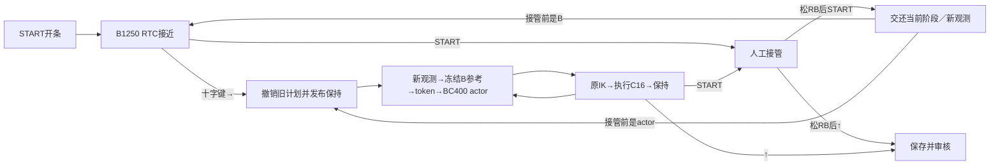

# B1250＋RLT BC400：正式推理接入与异步下一步

**10月27日录制修复已发布，actor近恒定输出的零更新诊断完成。** 新RLT客户端按实际硬件检查首帧；有观测无控制流会明确保存失败，原件保留。旧现场记录仍不可直接入训练buffer，下一步先验一条短记录，再做BC输入／释放监督对照；见[本轮修订](#record-fix-20261027)。

此前首条现场全流程已完成： B→actor→START接管→Y复位→↑保存的事件与反馈闭环通过；actor阶段约43%时间在等待，动作几乎重复同一小模板且没有释放。还发现拆左夹爪后的首条控制记录门槛有缺陷，导致整条逐次控制日志为空，该条缺失不可补造，修复后的现场短条仍待验，见[现场审核](#first-complete-20261027)。

本轮把已有400步小actor接入统一推理入口。B1250和token encoder保持冻结，critic不参与动作选择，也不在采集时更新参数。接入目标是获得可追溯的真机经验；当前actor对释放仍有明显缺陷，工程验收不代表成功率提高。

采用“B1250连续接近→手柄十字键→切换→RLT每次执行16步→等待下一次推理”的局部接入。现有actor从当前观测预测16步，不能直接套入已有RTC的延迟前缀；因此RLT阶段会有推理等待。人工START接管、RB操作和↑保存沿用原HIL入口。

**START／恢复握手修订已部署到正式RLT入口。** 连接在等待START前准备，回中后先等完整往返确认再提示RB，重连不再误判缺少扩展字段，能力协商成功清除旧sender提示。ARM116项、装配58项及正式入口零输出检查通过；真实B／actor提案分别约250／335ms，动作发布为0。网络抖动仍未根治，现场动作闭环待验，见[修复与发布](#start-fix-20261027)。

**首次现场权限故障现已恢复，真实B1250／actor请求复验通过。** H20日志已确认PermissionError导致断连；错误提示修订也已部署，原命令和手柄保持。此前失败发生在B阶段，不能据此判断actor任务效果，见[恢复记录](#permissions-restored-20261027)。

**2026-10-27全手柄版本已完成机器人部署及零输出验收。** START开条B运行，→手动切actor，START人工接管／交还当前阶段，↑保存。用户需更新Windows sender并现场试一条；真实按钮和任务效果尚未验收，完整命令见[STARTUP](../STARTUP.md#rlt-gamepad)。此前连接阻塞、键盘b及暂停状态均为历史阶段，已由本次修订替代。

## 10月27日录制修复发布与actor诊断

**当前装配`unified-rlt-record-20261027-r1`，RLT客户端`20261027-f1-rlt-record-r1`。** 在空闲控制锁内备份并切换；H20只更新持久启动入口，未重启模型、未改权重。原Enter／START／→／RB／Y／↑及Windows sender保持。此次冻结客户端只改`demonstration.py`、`recording.py`、`lifecycle.py`，原B standalone／旧HIL冻结客户端未随之替换；不能把本次RLT录制验收外推到其他入口。

- 录制首帧的完整发布集合由已校验硬件能力决定：双爪仍需joint＋left＋right，单右爪需joint＋right。只有joint的开条竞态仍等待新episode锚点，不接纳不完整首帧；未下发的控制行也不能解除该门槛。
- POWERED记录有观测却control=0时，journal标记`complete=false/status=failed`，原始内容仍保留；保存结果明确失败，不播放“保存成功”。离线audit和保存检查也拒绝旧版同类完整性假阳性。它只是完整性检查，不自动产生训练批准或成功奖励。
- 本地83通过／3跳过，ARM59通过／3跳过（需锁定LeRobot环境的导出检查不在本次范围），装配64通过。新增真实writer＋模拟owner检查覆盖双爪／单爪、连续两条、仅joint竞态、持爪后续帧和空流失败；首次ARM扩展检查缺测试依赖，独立补齐后上述检查通过。
- 新装配真实反馈SHADOW启动、B／actor身份和连接通过，提交／发布0，无新增原件，last-session哈希不变，退出0；随后公共入口`--check`再次通过，锁已释放。**尚未现场录制修复后的powered短条**，shadow不证明实际动作日志已经现场闭环。

清查当前`policy_hil`中4条RLT原件都存在control=0：`075010Z_01895d24`、`075027Z_422875fc`、`094959Z_94230311`及`113017Z_bef41621`（共同日期20261027）。前三条为权限／首请求故障尝试，最后一条含实际执行。原manifest／视频／提案不改写，均不直接入actor／critic replay；缺失实际下发动作不能用反馈或提案补造。范围及各manifest SHA见[最终复核](../artifacts/20261027-rlt-record-fix/final-check.json)。

actor零更新检查复现36次线上输出（CPU最大差`1.79e-7`），发现局部饱和与弱参考响应，同时确认B的这36段参考也全部没有释放。旧数据上并非全局输出塌缩；单改推理缩放没有解决，不能把问题全部归因于样本数量。下一轮需要BC输入处理／释放监督单变量训练，对应[完整诊断与停止依据](../../training/experiments/20261026-rlt-dagger-success.md#actor-constant-20261027)。本轮未训练新actor，Q、RTC和异步均未开启。

发布证据：[验收](../artifacts/20261027-rlt-record-fix/acceptance.json)、[机器人激活](../artifacts/20261027-rlt-record-fix/deploy-robot/robot-activation.json)、[H20入口备份](../artifacts/20261027-rlt-record-fix/deploy-h20/h20-activation.json)。客户端manifest SHA=`0b440ea360e9325ec2a4d6c458f53e08d13f12e0507f6c9123d6b070d1f702c3`；装配SHA=`05fd7b7727b5e273755419cc70e3ca21c9ddbf2d411b060b1de0e455da6a4ab4`。回退可恢复对应`-activation-backup`的旧pointer／入口，不修改机器人姿态、不删除新数据、不重放动作。

## 本次控制与数据合同

- 同一个B1250 GPU进程增加RLT路由，原普通rollout、B1250 RTC-HIL继续保留。选择`rlt400`进入新模式；不是把所有B1250入口静默换成actor。
- 小actor的输入是新观测的`z_rl`、右侧状态和同观测下冻结B的50步参考；输出是原始16步归一化EEF10。它不是在B输出上叠加残差，不平移、不补B尾部。原来的EEF还原、连续IK和机器人发布链路继续使用。
- 切换时递增控制epoch，撤销旧计划和迟到结果；保持目标经过实际发布并留下回执后，再取新图像和状态。发布回执不是机械臂已经静止或到位的证明。
- RLT每个chunk执行约0.53秒，之后保持并重新推理。保留观测、响应、采用、末点发布与保持时间，不能把推理等待从未来训练转移中抹掉。没有新增随意的夹爪覆盖或动作放大。
- START人工接管优先，失联和原有保护仍生效；人工阶段松RB、等夹爪完成后，再START明确交还当前策略。下一条回B；→不跨条排队，手柄B仍是人工滚转。↓暂不评分，↑保存不等于奖励1。
- 原件记录B／actor／human来源、完整模型与actor版本、请求和观测身份、epoch、候选动作及实际提交/发布。候选不等于执行，执行不等于成功。

新轨迹仍属于DAgger／策略HIL；顶层使用RLT组合身份，保留单独的base身份，避免被旧B数据适配器误收。当前reader尚未支持这类含保持区间的复合轨迹，因此本轮形成的是**可审核原件**，还不是自动在线训练buffer。

## 10月26日验收与发布记录（历史快照）

| 层次 | 当前证据 | 能说明什么 |
|---|---|---|
| 客户端 | H20 CPU 250项通过，含真实WebSocket子进程与旧RTC/HIL回归 | 身份、接管取消、保持边界及分条代码通过；不是ARM现场验收 |
| 服务端CPU | 新RLT与旧WebSocket／RTC／Graph相关32项通过 | 两种接口与共享worker回归通过 |
| 首轮GPU | 三个真实离线观测，B前后输出完全一致；token、参考和actor不完全一致 | RLT不能沿用该优化计算路径；保留失败报告，不扩大容差放行 |
| 第二轮GPU | 三个真实离线观测的token／proprio／50步参考／16步actor逐值一致；B前后也完全一致，guided B仍可用 | RLT已恢复训练计算语义，B原路径保留；没有训练更新或机器人输出 |
| 装配与真实接口 | 装配50项通过；真实客户端在隔离18138依次调用原B、RLT、原B成功，RLT为16×16输出 | 模型、prepared pixels、WebSocket和版本身份联通，无机器人输出；临时GPU4服务随后关闭 |
| 机器人 | 部署SSH连接未恢复 | 尚未上传、未切换、未完成真实输入零输出检查 |

首轮token最大绝对差约0.0195–0.0234，参考约0.0073–0.0083，actor约0.0013–0.0028。第二轮已在同一共享模型中临时使用训练时相同eager prefix/suffix，仅用于RLT请求，结束后恢复B已有优化路径；全部对照精确通过。三次服务端预处理＋模型＋IK约231ms，这不包含真实相机、网络和控制等待，不能当作现场总延迟。W&B审计保存在offline记录；本轮没有梯度更新。真实接口首轮因临时启动脚本漏建日志目录失败，补齐后原B→actor→原B全部通过；正式装配本身包含日志目录创建。该loopback使用存储图像和审计时间戳，不是实时相机反馈；一次冷客户端actor约506ms也不能作为稳定现场性能结论。

证据：[GPU精确对照](../artifacts/20261026-rlt-runtime-r1/h20-validation/gpu-audit-r2/report.json) · [真实接口回执](../artifacts/20261026-rlt-runtime-r1/real-service-loopback.json) · [装配回执](../artifacts/20261026-rlt-runtime-r1/assembly-validation.json)。客户端[最终回执](../../../../DAgger/artifacts/20261026-rlt-hil-r1/h20-final/result.json)，任务[源与GPU审计目录](../artifacts/20261026-rlt-runtime-r1)，原actor训练边界见[同版训练报告](../../training/experiments/20261026-rlt-dagger-success.md)。

## 10月27日全手柄部署：已激活，现场效果待验

在用户要求暂停后重新梳理并按“继续”实施。新sender通过ACK能力协商发送→计数；旧B／人工接收端不接收未知字段。连接／重连需先释放再按，重复包、跳号、同时START／RB／Home冲突不能排队触发切换。RLT接收端要求新版sender；仅此模式允许人工START交还，旧B模式不变。actor交还时同样必须保持发布成功后获取新观测，迟到响应按epoch撤销。

发布前网络QoS检查占锁，按用户要求等待；确认其退出及锁释放后才激活，未停止其他任务。H20原B1250与固定head共用GPU1服务；健康检查在新catalog显式增加`inactive_image_reuse=false`，保持严格身份校验。H20持久启动文件、F1公共装配和工作台RLT元数据已切换并备份；不重启工作台、没有新增训练。Windows更新包已放F1，用户电脑安装尚待执行。

| 验收 | 结果与限制 |
|---|---|
| 本地控制 | 101通过，含能力协商、旧包兼容、重复事件、冲突、START双向及新观测边界 |
| F1 ARM | 168通过，复用原Python/依赖，未安装环境 |
| 装配与终端 | 58通过；最终显示区分B RTC和C16，三模式实际health／固定组件检查通过 |
| 真实输入提案 | `PROPOSAL_VERIFIED`，新相机／反馈→16×16动作提案；无命令publisher，没有实物动作 |
| 正式公共入口shadow | 等待真实START，Ctrl+C正常退出；最终789组观测、0策略chunk、0提交／发布，errors为空。未注入手柄输入，因此不能称全程闭环验收 |
| 数据隔离 | 前后83个原始目录及last-session摘要一致；无新录制 |
| 现场待验 | 新Windows sender安装，真实→／START交还／↑保存，一条实际actor表现与数据审核 |

actor仍存在释放漏开的离线证据；此次没有新训练、Q更新或成功率结论。终端丢帧计数仍如实显示，不能由等待START的检查推断运动中的时延或稳定性。工作台默认B路线保留，RLT数据身份已登记；友好标签可能待工作台自然重启后清缓存，不为标签重启服务。

证据统一在[验收摘要](../artifacts/20261027-rlt-gamepad/acceptance.json)、[真实提案](../artifacts/20261027-rlt-gamepad/real-rlt-proposal.json)、[F1激活](../artifacts/20261027-rlt-gamepad/deploy-robot-r3/robot-activation.json)。冻结客户端为`20261027-f1-rlt-gamepad-r2`，最终装配为`unified-rlt-gamepad-20261027-r3`；r1装配仅暂存；r2曾短暂激活并完成零输出检查，r3补齐当前B／actor阶段的持续显示，最终公开入口以r3为准。

## 异步方案：方向正确，需要先补经验合同

用户提出的“推理采集与训练并行，持续把新参数同步回来”与RLT的离线示教＋在线经验方向相符。[RLT原论文](https://arxiv.org/html/2604.23073v1)使用冻结VLA的表征和小策略头进行强化学习。本项目已有固定RLinf源码包含`AsyncEmbodiedRunner`、`AsyncRLTACFSDPPolicy`、actor/rollout/env通信与版本同步，应适配这些实现，不再自建一套通用异步训练框架。具体固定源码审阅见[上游记录](../../artifacts/20261026-rlt-runtime/async-source-review.json)。

后续按以下顺序推进，每一步都有可核对的结果：

1. **先验一条固定actor真机记录。** 核对切换点、实际执行、人工接管、保存和备注；成功、失败、人工中止都保留。首条不以凑数量为目标，也不要求先全部采完V2。
2. **打通新的经验reader。** 将观测、实际动作、行为来源和版本、奖励、下一观测、终止／截断整理为转移；人工复位必须断开，接管的部分chunk不能当完整actor执行。包含保持时间的同步阶段采用明确的变时长语义，不能直接照搬固定`gamma^16`。人工段可做BC，RL目标如何使用须明确。
3. **修复critic监督并做分轮训练。** 保留真实终点0/1，区分终止与人工截断，比较真实终点监督和TD自举的影响。先确认新buffer可重建、训练可恢复、验证不串入训练，再启用Q引导；critic不能仅凭自己给动作更高分证明改进。
4. **接入官方异步runner。** H20 learner持续取已确认经验训练，推理worker继续服务；记录真实rollout、干预、reward来源、buffer占用、参数版本滞后和丢弃原因。W&B监控训练，数据页监督实际结果，两者不可替代。
5. **原子同步完整actor版本。** learner导出完成版本，推理worker先校验并加载，再在明确的请求／chunk边界切换。每条动作绑定生成它的版本，旧响应按epoch作废；不在一次forward或正在执行的chunk里逐层改权重。先支持会话边界，再验收chunk边界。
6. **另行优化连续控制。** 异步训练不等于RTC。若要RLT阶段也连续不断，需要重新定义actor的时域、延迟前缀条件与训练样本，再训练和验收，不能把当前C16输出强行接到D14/S16/H50。

“实时更新”应理解为训练和推理并行、周期性交付完整版本，不能保证每更新一次真机表现就更好。保留固定版本评估、失败与接管率、释放时机和回退版本；先让实际经验可验证，再逐步缩短发布周期。VLA继续冻结可降低计算与调试复杂度，待小头闭环证明有效后再单独讨论是否联合SFT。

## 10月27日首次POWERED：B请求失败，目录权限阻塞

用户反馈没有反应。机器人状态明确为POWERED，START计数与RB输入已接收，仍处于base阶段；故障为`policy_failed:policy identity type mismatch: contract`，现场进程随后退出。没有据此认定actor任务表现差或手柄未接通，失败录制原件保留。

进一步检查H20：SSH账号UID1004仍正确，`/u01/user`属主／组现为`liumouyun`、750，本账号已不能进入模型、环境和日志目录；没有修改属主或放宽权限。已有GPU服务进程仍存活，health仍可返回就绪，但真实相机／反馈只读请求复现`ConnectionClosedError: no close frame received or sent`，没有命令发布器或动作。服务每次请求重新打开该目录下日志，异常路径也写同一日志；权限异常与请求断连吻合。尚无法访问服务日志核对首个服务端堆栈，不能把该推断写成已读取到PermissionError堆栈，也未确定是谁／何时修改权限。

客户端把无身份的失败响应先做contract校验，遮盖了实际网络错误。开发源现对`success=false`且有error的响应明确拒绝并显示“unverified response”，成功响应仍严格校验身份；39项控制／策略回归通过。修订尚未发布，不通过吞掉日志错误、放宽身份或重启服务绕过目录权限问题。

需要管理员恢复`user`本人任务目录的预期访问，再核验模型／日志可读写、真实B bootstrap／续接与actor请求，然后完成错误提示修订的固定版本验收。恢复前不重启仍驻留显存的服务，不要求用户重复rollout。原始请求证据在[只读失败回执](../artifacts/20261027-rlt-first-powered/response-error.json)、[权限快照](../artifacts/20261027-rlt-first-powered/permissions.json)、[现场状态](../artifacts/20261027-rlt-first-powered/robot-status.json)。

### 用户恢复顶层后的复查

用户已以root将`/u01/user`本身恢复为本人属主。随后通过UID1004复查，`runs`及`envs`子目录仍归liumouyun，分别750／700；当前仍无权访问日志、模型与环境。先前只改顶层的操作没有覆盖这些子目录，推理尚未复验。后续修复限定本人目录树、同一文件系统及当前错误属主，不跟随符号链接，不修改权限位或其他用户目录；[证据](../artifacts/20261027-rlt-permission-recovery/after-top-level-chown.json)。

## 10月27日权限恢复及错误提示修订

用户先恢复顶层目录，再将本人目录树中liumouyun属主恢复为xza_000000001。复查UID1004已恢复目录和日志读写；模型进程无需重启。服务端历史堆栈现明确显示B的`compute`和actor的`compute_rlt`都在`write_record`打开`requests.jsonl`时PermissionError，错误处理再次写日志也失败，导致连接断开。此前“权限与断连吻合”的推断由服务堆栈补证确认。

时间证据（北京时间）：15:27真实actor请求成功，15:39装配校验及持久启动写入成功，15:50现场进程在B阶段故障停止。`/u01`根目录属主为UID1005/liumouyun，其ctime为15:44:33；这是范围较大元数据修改的线索，不是操作者／具体chown命令证明。本人子目录ctime已被16:16左右的恢复操作更新，不能再拿它们当原故障时间。需要管理员查看sudo／审计记录才能定责；没有访问或更改对方私人目录。[时间线证据](../artifacts/20261027-rlt-permission-recovery/timeline.json)。

恢复后使用真实相机／反馈、禁止命令发布的探针：B bootstrap有效返回32×16，actor有效返回16×16，两者日志写入完成。只验证请求和动作提案，不冒充机器人执行或完整RTC运动闭环。模型权重、训练参数与GPU进程保持。

客户端固定包只改`src/f1dagger/policy.py`：无身份的失败响应显式显示未验证的网络／服务错误并拒绝；成功响应仍严格校验。39项本地／ARM检查及50项装配检查通过，新客户端`20261027-f1-rlt-errors-r1`和装配`unified-rlt-errors-20261027-r1`在空闲锁下发布并保留回退。Windows sender、手柄流程及runtime路径不变。服务目录恢复属于本账号验证，不能替另一账号宣称其训练／推理正常。

证据：[恢复摘要](../artifacts/20261027-rlt-permission-recovery/acceptance.json)、[B真实提案](../artifacts/20261027-rlt-permission-recovery/recovered-base.json)、[actor真实提案](../artifacts/20261027-rlt-permission-recovery/recovered-actor.json)、[服务堆栈](../artifacts/20261027-rlt-permission-recovery/server-permission-errors.log)。

## 10月27日17:49 START无动作：首请求过期与人工暂停

本次为POWERED，真实START开条成功；首个B bootstrap请求耗时2535.588ms，观测至响应2638.177ms，超过现有2000ms年龄上限，客户端拒绝并保持。事件中的network_rtt为2141.059ms，但服务端计时未通过响应验证、字段为null，不能据此把全部延迟归为网络或GPU。policy_chunks文件为空，阶段始终base，未验到actor效果。

第二次START进入人工接管，随后operator_watchdog进入同条暂停；恢复条件仍是松RB、所有输入回中、等待确认、新RB，START不绕过暂停。末尾接收START计数9→11触发严格计数保护，记录以input_recovery_session_or_sequence_changed中断保存；这条错误发生在同一session，不能称为重连直接造成。随后才出现新session和rlt_sender_update_required，协商瞬态与实际sender版本仍待区分，不能仅凭该提示要求重新安装。

原件f1_hil_20261027T094959Z_94230311含653观测、training_ready=false；程序最终local_stop，读取时PID3877245已不存在。未修改超时门槛、控制代码、服务或模型，也未发机器人动作。下一步拆分首请求长尾，并复查能力协商及暂停恢复；不要求用户反复START重试。机器摘要见[诊断证据](../artifacts/20261027-rlt-start-diagnosis/diagnosis.json)，原始证据保留于F1该episode的journal和现场console。

### 进一步定位：服务端快，链路长尾与恢复提示存在问题

以session、request_id=1、observation_id=652和epoch=1精确匹配H20原始记录：请求成功生成动作，handler为146.97ms，其中模型含H2D/D2H为75.45ms、IK为63.92ms。F1首次网络子进程／IPC161.50ms，首次WS建连305.20ms，WS发送至收齐1835.39ms；扣除handler仍有1688.42ms在传输、隧道、调度及未单独计时的响应工作中，不能全部称为纯网络传播。

修正上一节的计时口径：2638.18ms是在异常关闭连接之后记录的数值，其中父进程解析后约205.77ms包含失败清理；父进程收到解析响应时观测已约2432.40ms，仍明确超出2000ms。因此错误成立，但2.64秒不全是等待模型返回。当前health仅做HTTP身份检查，真正WS子进程与连接在首次infer时建立，这增加约467ms冷启动开销；即使移到START前也不能代替链路稳定性修复。

只读补测每路40个回包：F1→网关平均91.17ms、P95约201ms、最高284ms；F1→H20平均91.60ms、P95约201ms、最高283ms，同序号RTT相关约0.999。该短窗口支持优先查共有接入路径，与此前两分钟采样一致，不足以认定热点共存、驱动、路由器或某个进程为唯一原因。Windows地址不回ICMP不等于手柄电脑断线；未改变网络设置。

人工暂停原件共有187个输入包、17个RB按住包、17次回中确认。第一次RB的关键证据：seq791的回中确认凭据年龄188.85ms；8.23ms后seq795真实RB上升沿仍使用同一凭据，年龄197.08ms虽未超200ms，却早于接收端刚记录的neutral时刻，故被after_ns检查拒绝，随后按住RB不补触发。已用部署冻结源码离线复现。因此“输入已确认→按RB”提示早于完整恢复握手可用，有明确交互时序问题，不应简单归责用户未按步骤操作。第二次RB前也没有稳定的新回中确认；原始日志缺少全部challenge签发记录，不能为每个失败包补造凭据年龄。

另用同一冻结源码复现：首次／重连握手中不带RLT扩展的包设置rlt_sender_update_required，后续扩展字段已被正确识别并锚定，但idle的旧hold_reason不清除，仍显示需要更新sender。该显示不能证明Windows没更新；实际现场前半段policy_switch_id=0已存在。

下一步按依赖推进：先做接入链路单变量对照；客户端将WS准备移到授权前且只做无动作握手；恢复提示要等待neutral之后的新凭据闭环，再显示可按RB，失败应明确提示重新松开；能力协商成功应清除过时sender提示。保留200ms输入保护、2秒观测保护、真实START/RB授权及不重放原则。修改须另做输入／重连零输出验收，本轮仅完成取证和两项离线复现，没有修改或发布控制代码、没有训练或机器人动作。

证据：[逐阶段分析](../artifacts/20261027-rlt-start-diagnosis/analysis.json)、[冻结源码复现](../artifacts/20261027-rlt-start-diagnosis/reproductions.json)；同目录保留原始事件、唯一匹配服务请求、ping原文、复现脚本与SHA清单。

## 10月27日 START／恢复握手修复：已发布，待现场动作验收

正式装配切为`unified-rlt-start-20261027-r1`，RLT客户端`20261027-f1-rlt-start-r1`。仅五个客户端源文件变化；从上一冻结版本定向构建，未混入开发树其他改动。旧包、回退备份与原件保留；H20只更新持久启动入口，没有重启模型或修改权重。Windows sender无需再次更新；START、→、RB、↑含义保持，完整命令仍见[STARTUP](../STARTUP.md#rlt-gamepad)。

- 连接准备：B和actor在等待START之前建立各自的网络子进程与WS连接。空载准备命令只在本地IPC中解释，不向模型发送推理请求、不授予动作权限。真实推理继续使用START／阶段切换后的新观测，所有身份与年龄检查保持。
- 人工恢复：第一次有效回中只提示“正在确认往返通信”；只有回中之后签发的新凭据完成往返且仍在200ms内，才提示“输入已确认，再按RB”。等待期间仅允许仍满足原始新鲜度门槛的松开／中立包保留回中锚点；过早RB、过期包、按住RB不能排队恢复。
- RLT协商：新session首包尚未收到能力ACK时保持并重新锚定，不误作旧sender硬故障；同session异常丢扩展仍按故障处理。idle在成功识别扩展后清除旧sender提示。

为什么此前HIL／DAgger未明显暴露：人工DAgger没有远端模型请求，因而不存在这类模型观测过期；旧HIL和新RLT共享手柄恢复代码，也共享模型WS的首次懒建连行为，二者都有潜在触发条件。本次先因请求长尾进入保护，再在人工阶段遇到输入超时和回中／RB共用旧凭据，暴露了原先验收未覆盖的通信时序。RLT能力协商及旧提示残留则是新增代码的问题。历史未报告不能证明从未发生，不能把所有问题都归到RLT学习或模型变差。

验证边界：本地102通过，1项因缺websockets跳过、1项回环socket因沙箱限制转ARM；ARM完整相关组116通过，含真实回环与WebSocket测试；装配／显示58通过。正式新入口真实相机SHADOW成功完成双连接准备、等待START、Ctrl+C正常退出；原件目录和last-session哈希不变。两个显式禁止创建命令发布器的真实反馈探针返回B32×16、actor16×16，客户端请求分别249.95／335.12ms，观测至响应605.13／890.75ms。单次验收不能证明尾延迟改善幅度或任务成功率。

发布前后校验B／actor健康身份，激活时控制锁空闲，最终公共入口已指新版本并ready。没有机器人动作、在线训练、参数更新、网络切换或保护门槛放宽。下一步现场验证恢复／阶段切换闭环，同时继续独立处理共有接入链路长尾；若网络再次超过保护预算，仍应暂停。

[验收与发布回执](../artifacts/20261027-rlt-start-fix/acceptance.json) · [源码变化清单](../artifacts/20261027-rlt-start-fix/client-delta.json)。同目录保留测试XML、真实提案、正式SHADOW日志、前后入口和两端激活回执。

## 10月27日19:30首条完整现场审核：操作闭环通过，actor停滞及控制日志缺失

用户报告人工介入后完成任务、Y复位、↑结束。录制`f1_hil_20261027T113017Z_bef41621`约79.96秒，客户端为`20261027-f1-rlt-start-r1`、固定BC400、Q更新0。应记为用户报告的人工辅助完成，不是RLT自主任务成功；Y为程序复位，不能算actor学会返回。

| 相对开条 | 已核实事件 |
|---|---|
| 0秒 | START开条、B运行 |
| 17.912秒 | →切actor；撤销旧B计划 |
| 51.498秒 | START人工接管；迟到actor响应随后丢弃 |
| 56.564秒 | 人工候选臂身碰撞风险触发保护，候选被拒绝；不等于实物碰撞 |
| 57.553／57.582／57.668秒 | 回中、新凭据ready、RB恢复，同条继续 |
| 76.309／78.746秒 | Y开始、真实反馈确认复位完成 |
| 79.962秒 | ↑接受并保存，Home后保持约1.217秒 |

Home结束右臂最大关节误差约0.362°、右夹爪反馈0。人工候选暂停约1.104秒，修订后的回中→往返确认→RB流程本次走通。没有模型超时或手柄网络watchdog事件；B请求34与actor请求70在控制权切换后被撤销丢弃，属于预期取消。没有验到START从人工交还actor，因此不将这条称为所有双向手柄分支均验收。

### 为什么慢、为什么没有完成任务

B共34请求，中位213ms；actor共36请求，中位317ms、最大374ms。actor服务端中位263ms，其中冻结B参考／token／小头一并计时的模型段233ms，IK23ms；服务排队约0.12ms，没有模型服务排队堵塞迹象。这次不能沿用上一条2秒通信长尾解释。

actor阶段持续33.586秒，35个计划采用并完成，另1个在人工接管后取消。每段执行中位0.547秒，保持提交至下一段采用中位0.384秒，完整循环中位0.941秒；累计执行19.189秒，其余14.397秒（约43%）在保持／等待或切换。当前C16同步合同没有把推理与执行重叠，体感慢属于已实现调度的局限。每次仍计算冻结B的eager参考和token，不是只运行小actor；这不同于B阶段的Graph＋RTC流水线。

实测反馈的原生右臂FK：actor阶段末端净位移约44.6mm，范围约19.3×40.2×7.4mm，净旋转约9.47°，属于缓慢漂移而非完全静止。36个actor提案在各自输入观测局部坐标中几乎相同：每段末点约4mm，首末提案末点约[-1.497,-3.551,-1.185]mm／[-1.497,-3.553,-1.186]mm；首末整个chunk XYZ RMS差约0.00104mm。预测右夹爪约96.28–98.56，实测96.28–99.81（100为闭合），没有释放。与既有BC400漏开缺陷一致，但近恒定输出究竟来自输入利用不足、训练／归一化还是其它原因，仍需固定观测对照，不能直接宣称已定位训练根因。

### 实质数据缺陷：control流为0

2393个观测、70个模型提案、4317个事件的条数／SHA与journal manifest一致，payload清单2393且drop0；本轮未重新计算图像pack本体SHA。虽然两层manifest显示complete，**control.jsonl为0条**，因此“保存完成”不能等同于可训练或动作溯源完整。

根因已用部署冻结源码最小复现：`DemonstrationRecorder.control()`的first_control门槛硬编码要求joint_command、left_gripper_command、right_gripper_command三个topic。本机器left_gripper_present=false，合法发布只有joint和right_gripper，首条门槛永远不通过，函数静默返回True，后续控制记录全部跳过。不是用户操作、磁盘丢写或网络问题；可能影响同样采用此录制器的单爪schema4人工／HIL分条，需另行审计影响范围，不能无证据推翻旧schema3训练数据。

原件中35个execution_completed和36个hold回执保留实际发布的粗粒度事件；payload只记录观测，没有另一份逐tick动作备份。无法忠实补回缺失的selected／submitted／发布序列，不用实测state或policy提案伪造。保留本条做行为诊断与人工结果审核，暂不进入actor／critic训练buffer。后续即使控制流齐全，也需分离B、actor、人工，排除碰撞暂停和Y程序复位。

下一步优先修硬件感知的首条发布门槛，并在POWERED录制控制流为空时明确报不完整，短条验证后再继续收buffer；随后以本条不同观测检查actor近恒定输出，再研究参考计算优化／连续执行。异步训练框架本身不能修复重复动作、漏开或丢失的控制原件。本轮只读审核及CPU诊断，无代码／服务／参数变更、无机器人动作。

[阶段与延迟](../artifacts/20261027-rlt-first-complete/analysis.json) · [完整性审核](../artifacts/20261027-rlt-first-complete/integrity.json) · [动作与录制门槛复现](../artifacts/20261027-rlt-first-complete/actions-and-recording.json)。同目录保留下载的原始journal和payload清单、复现与分析脚本。

动作诊断仅调用固定原生NumPy DH正运动学；本机未安装SciPy，脚本对未使用的优化／Rotation入口显式设置为调用即报错，不运行IK、不安装依赖。提案局部动作通过原有encode_actions还原；不将其冒充实际下发。
