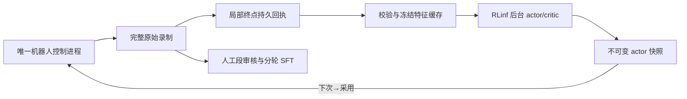

# F1 局部 RLT v2：实现、部署与现场边界

新操作协议已经进入源码：一条完整录制只进入一次局部 RLT，人工 START 交还统一回 VLA，↑关闭局部放置任务，Y 在反馈稳定两秒后封存整条。录制、局部奖励和控制权分别维护，人工纠正同时保留 SFT 与 RL 的用途。

后台复用固定RLinf的AsyncEmbodiedRunner，B1250和token encoder冻结。**10月29日已接入旧DAgger种子、开启Q引导和固定噪声actor，完成常驻训练、恢复、候选切换及真实输入零输出验收。** 软件链路已可用于现场监督在线试用；当前候选未证明优于基线，正式效果由后续真机自主成功率与人工依赖判断，见[本轮验收](#online-q-20261029)。

**10月30日下午已核实真实更新候选被现场采用，但数据接纳出现新堵点。** critic332／Q actor83，四条现场辅助成功使用320步候选；四条原件却因新增人工计算等待来源不被reader识别而未入库。新增训练来自11:21未↑条，密集画面现已确认成功，原失败0应补审并处理历史训练影响。本轮只读核验，未改生产训练、奖励或原件，详见[逐条数据审计](#data-audit-20261030)。此前各版本的“Q关闭”“现场待验”“缺口未修复”保留为当时事实。



## 操作协议

| 操作 | 行为 |
|---|---|
| 等待时 START | 新 episode、新 VLA 起点 |
| 自动时 START | 人工接管，同条继续，局部任务不因此结束 |
| 人工时 START | 始终交 VLA；未确认成功的活动局部任务记失败 |
| VLA 时 → | 本条仅一次进入局部 RLT；锁定 actor 版本 |
| RLT 自主时 ↑ | 成功终止局部任务，撤销旧动作并交 VLA |
| 人工时 ↑ | 成功终止局部任务，继续保持人工 |
| 已使用 RLT 后 → | 拒绝，不排队 |
| Y | 先关闭未完成局部任务，再 Home，反馈稳定两秒后封存 |

↑需要在正确放入、释放并保持后按。正常结束未确认成功记 0；网络、相机、程序等异常记中断待审。后续 Y 不覆盖已有成功。沿用 RB 使能、真实反馈与原 Home 保护；新协议是 `f1_rlt_local_v2`，旧 sender 不得用旧↑语义启动它。

## 已实现的数据与参数合同

- writer 线程落盘并 fsync 局部终点的 journal 字节前缀，生成带 SHA 的回执；完整 episode 可以继续写。上传独立于控制线程。
- replay 校验实际发布动作、反馈、时间及控制归属，按接管边界截断，不将未执行 C16 尾部计入奖励折扣。局部成功末转移为 1，失败为 0，均停止局部自举；无物理 reset。
- SFT 导出和训练索引接受已移除左夹爪的有效性掩码，保留真实右臂反馈。Y 之后的 Home/保持排除。专家资格仍需审核，不把自主动作默认当示范。
- 原件不改写。补标必须绑定源回执 SHA、审核人和局部终点；派生缓存按源、配方和审核版本重新寻址，并替换同 episode 的 replay 视图。
- actor 从既有 BC400 初始化；新目标的 critic 重新初始化。actor 架构不变；critic 额外接收真实执行前缀掩码和时长，避免把 padding 当动作。
- 冻结参考特征通过单套 B1250 服务提供。特征请求只在控制请求安静窗口开始，因此共享 GPU 忙时会延后缓存构建；不会保证在 VLA 连续推理期间立即完成。
- 初始在线配方关闭 Q 引导及权重发布。Q 引导必须绑定经过校准审核的恢复 checkpoint；成功率仍以真机自主成功及人工依赖衡量。
- 快照包含完整 actor、规范化/encoder/base/代码身份和 SHA；加载失败保留原模块。下一次 → 才采用候选，同一局部任务固定版本。
- 有人工转移时，半个 batch 从专家视图采样，其余来自完整 replay；两者共享原件和可追溯转移，不重复制造原始示范。
- replay 最少 32 条转移才更新，最多保留 10000 条；每个新转移累计最多提供 4 次梯度更新预算，避免少量数据无休止重训。这是保守工程上限，不是效果达标标准。

## 验收证据

10月27日候选为 r3，补充了程序退出时将未完成局部段记为中断。10月28日真实 SHADOW 又发现旧启动提示“↑保存”，只修正提示后发布 `unified-rlt-local-20261027-r4`／`20261027-f1-rlt-local-r4`，Windows 协议包仍为 local-r2。r2／r3 候选均未激活，保留冻结文件。候选和回执在 [本轮产物](../artifacts/20261027-rlt-local-v2/)。H20 独立验收目录为 `/u01/user/runs/f1-rlt-local-20261027-r1`。

- 本地最终控制／录制／局部 replay／装配和 SFT 索引合计 181 通过；本地跳过的 4 项真实 LeRobot 回读另在 H20 独立 Python 3.12 CPU 环境全部通过。
- SFT 训练索引掩码：26 通过（包含在上述本地总数）；真实 schema4 有效性掩码、视频和 LeRobot reader 回读通过。
- H20 CPU 数值、快照、推理、局部数据和历史目标裁切最终 46 通过。
- `preflight-final`：合成数据训练两步、保存恢复 actor 输出逐值一致；官方 runner 两步，再恢复到第三步，W&B step 连续。无参数发布，无机器人输出。
- 完整前缀→特征 WS→replay→官方 runner 最终通过：`acceptance-final/acceptance.json`；尚未 Y 封存的两条合成转移进入后台并完成两步更新。首次预检发现的 RLinf 指标张量格式已修复，最终版本包含专家采样和缓存代码身份；恢复至第三步后转移预算仍为 2，没有重复入库增加训练预算。

W&B 当前是 offline，group `10_RLT_Local_Async_B1250`。这些记录没有在线 run 链接；合成验收名称明确带 preflight，不能用于声称真实训练效果。新启动器也单独设置 synthetic job type/tags。

## 部署和启动顺序

1. 已完成：F1连接恢复，相机检查释放控制锁后，上传新客户端与Windows更新包，保留旧release。
2. 已完成ARM和真实观测零发布验收；Windows安装及真实F710按钮仍由现场验证，机器人动作由现场Enter/START授权。
3. 已完成单套H20服务升级与三接口身份检查，base/encoder/BC400权重与端口保持绑定；首次继续固定actor。
4. 数据镜像、后台学习器、SFT审核消费者已启动，`publish_updates=false`。等待一条带↑/Y的新记录，检查原件、局部replay、审核后人工SFT、异常中断和终点时刻。
5. 完成真实输出检查后，在新的快照目录开启发布，并将候选 catalog 的 `allow_boundary_updates` 打开。未通过真实验收前不启用生产actor自动更新。

6000D 数据桥接命令（已在独立tmux运行，不要重复启动；不在机器人控制线程执行）：

```bash
python3 tasks/F1_ComplexyToys/scripts/rlt_sync_raw.py \
  --source /home/user/Artifacts/F1/rlt-local-v2/raw \
  --pull-source f1-09-deploy:/home/user/Bruno/data/hil_data/policy_hil \
  --pull-ssh-config F1-4242/results/pose_task_20260928/ssh_config \
  --destination h20-train:/u01/user/datasets/f1-rlt-local-v2/raw \
  --local-segments-only
```

只镜像具有新协议局部回执的完整 episode，避免重新传输全部历史数据。源机器暂时离线时保留已镜像内容，无 delete；每次消费仍验证完整字节前缀。

H20 后台学习器命令（已运行，不要重复启动；工作目录 `/u01/user/staging/f1-rlt-local-20261027-r1/tasks/F1_ComplexyToys`）：

```bash
CUDA_VISIBLE_DEVICES= WANDB_MODE=offline \
/u01/user/envs/f1-jimu-pi05-v1/bin/python \
  scripts/rlt_async_train.py --config configs/rlt_b1250_local_async.json \
  --run-id f1rltlocal20261028real001
```

人工 SFT 有独立消费者 `scripts/rlt_sft_export.py`：读取已封存原件和审核文件，调用现有 F1 训练索引／reader 适配，可选 `--watch`。它不启动 VLA 训练，不读取未完成 episode，不把 RL 成功标签自动变成人工段审核。

```bash
/u01/user/envs/f1-jimu-pi05-v1/bin/python scripts/rlt_sft_export.py \
  --raw-root /u01/user/datasets/f1-rlt-local-v2/raw \
  --reviews /u01/user/datasets/f1-rlt-local-v2/sft-reviews \
  --baseline /u01/user/datasets/f1_toys_v1_dagger_right_only_20261022/dataset/train \
  --output-root /u01/user/datasets/f1-rlt-local-v2/sft-candidates --watch
```

正式数据训练另用新的 run 身份，不复用合成验收 run。连接 W&B 可用时使用 online；既有离线记录通过 `wandb sync <offline-run-directory>` 同步。不得把只有原件上传或合成训练称为真机在线 RL 已完成。

## 2026-10-28 部署验收

r4 已在空闲控制锁下激活，旧入口保存在各机器装配旁的 `unified-rlt-local-20261027-r4-activation-backup`。H20 GPU1仍只有同一套B1250／BC400服务，新PID856764，8138→F1 8153；机器人公开指针、三种模式身份、166个客户端文件和工作台RLT运行目录均已核对。

- ARM：97通过、4跳过；跳过项是已另在H20通过的真实LeRobot环境测试。虚拟环境未安装pytest，复用系统pytest及正式推理绑定的WebSocket依赖，无系统安装。
- 真实输入：actor返回有限16×16提案；冻结特征返回2048维token、8维proprio、50×10参考动作；两接口版本一致，未创建动作发布者。
- 特征接口第一次紧接actor请求返回`busy`，符合两秒控制安静窗口。等待该窗口后通过；没有修改生产阈值。
- 正式入口SHADOW：新按键提示、真实反馈和双连接准备通过，退出码0，提交／发布0，无新增原件与last-session变化；没有伪造START。
- 自动快照更新和Q引导仍关闭，`/rlt/candidates`暂无latest文件是未发布任何新actor的预期状态。所有旧示范、旧权重和旧原件保持。

本轮证据集中在[部署回执](../artifacts/20261027-rlt-local-v2/deployment-20261028/acceptance.json)、同目录ARM XML、真实提案/特征结果及正式shadow日志。没有现场powered任务验收，不将这些结果作为成功率证明。

### 后台运行与监控

| 机器／会话 | 作用／日志 |
|---|---|
| 6000D `f1-rlt-local-raw-20261028` | 新局部回执及所属原件镜像；`/home/user/Artifacts/F1/rlt-local-v2/raw-sync-20261028.log` |
| H20 `f1-rlt-local-learner-20261028` | 官方RLinf三worker，CPU小头；`/u01/user/runs/f1-rlt-local-v2/learner-20261028.log` |
| H20 `f1-rlt-local-sft-20261028` | 等完整原件及人工审核，独立导出；同run目录`sft-export-20261028.log` |
| H20 `f1-rlt-local-20261028-r1` | 唯一GPU1推理服务；原service目录`startup-local-20261028-r1.log` |

启动核验时新局部回执为0、真实梯度更新为0；官方runner生成了一份step 0初始化快照，`deployment_approved=false`且没有`latest.json`，未影响推理。合成验收数据未混入正式buffer。W&B run `f1rltlocal20261028real001`，group `10_RLT_Local_Async_B1250`，job `online-shadow`，offline目录为`/u01/user/runs/f1-rlt-local-v2/logs/wandb/wandb/offline-run-20261028_092758-f1rltlocal20261028real001`。后续可用已有W&B认证通过`wandb sync <该目录>`同步；当前没有在线链接。第一阶段critic学习真实奖励，actor仅使用局部人工转移的BC信号，Q审核通过前不启用RL目标驱动actor。

停止后台时，在对应机器执行`tmux send-keys -t <上述会话名> C-c`并核对进程退出；这不停止机器人现场控制，不删除原件。不要重复启动同一run。软件回退须先退出现场控制、核对控制锁，恢复备份中的机器人公共入口/指针和H20启动入口，再仅重启本任务服务；Windows sender也成套回退。回退不会恢复机器人姿态或删除新数据。

## 仍需人工与现场证据

F1远程连接、ARM和零输出验收已完成。仍需用户更新Windows sender并采第一条新协议记录，核验真实按钮、Home稳定两秒封存及双路导出。已有BC400仍可能停滞或不松手，本轮没有改善其任务表现的真机证据。

旧九条训练纠正及一条验证纠正已导出松爪前后证据候选，保留源 SHA 和观测 ID。部分夹爪遮挡使新局部终点不能仅由命令时刻确认；审核前不自动奖励或混入新目标训练。原五条自主记录及旧导出均保持不变。


<a id="onsite-fix-20261028"></a>
## 10月28日现场故障、修复候选与声音预览

现场条 `f1_hil_20261028T014106Z_07cc5960` 已保留原件。36 次策略请求包括 31 次 B 与 5 次 actor；7460 条 control 中 VLA 3747、RLT 1053、人工 2660。三段七个右臂关节实测变化均为 0，夹爪反馈变化正常，用户确认手臂确实未动。旧 motor_ctl 日志记录收到关节命令并发送，不能据此证明硬件接收或执行，也不能确定是使能、UDP 接收端还是控制板故障。用户重启并启动基础服务后，零输出启动检查通过，仍须现场验证真实跟随。

Y 崩溃是独立的客户端竞态：撤销旧策略时清空 pending_context，未完成 future 仍在，RTC tick 在核对请求 epoch 之前读取 context。候选先检查请求归属，再访问 context；旧结果到达后仍按原取消路径丢弃。Y／人工交还与 future 成功／失败四种组合修复前均复现，修复后通过。候选本地和 ARM 各 59 项检查通过；重启后首次 shadow 因 motor_ctl 参数服务超时退出，重试 `shadow-result-r2.json` 在等待 START 状态通过，无发布、无新增录制。

候选客户端为 `20261028-f1-rlt-local-fix-r1`，装配 `unified-rlt-local-fix-20261028-r1`，此前已暂存供预览；随后按用户“继续部署”授权激活，现为生产版本，旧 r4 与入口备份保留。新增三声上行 RLT 切入音；交还 VLA 后在新计划就绪时恢复原有两声上行提示。开条／人工接管／整条保存沿用原音；↑不播放整条保存音。模型与 Windows 包没有更换。

后台在发现执行故障前已消费 33 个局部转移（23 个人工），完成 132 步。学习器现已停止，故障条及其训练产物列为待审，不能恢复这批更新作为有效训练；Q 更新为 0，`latest.json` 未发布，线上仍是 BC400。原件镜像及独立 SFT 审核消费者保留。W&B offline run `f1rltlocal20261028real001` 保存真实历史，不删除或伪造这些更新。

[Why&How 按键与声音演示](http://192.0.2.1:4243/?html=f1-rlt-controls) 支持人工辅助成功、自主成功、未评分退出三种播放，以及四键逐步模拟和五种实际 WAV 试听。可切换旧 r4 与已部署新版声音作比较；页面只模拟，不连接机器人。浏览器验证及候选证据集中在[本轮产物](../artifacts/20261028-rlt-local-fix/)。预览后用户已授权部署，下一步为现场执行验收。


### 用户确认后的启用与正式入口验收

已在控制锁空闲时用统一部署器启用 `unified-rlt-local-fix-20261028-r1`，rollout／HIL／RLT 三种入口的文件、合同及在线模型身份全部通过。原 B1250 与 BC400、H20 服务及 Windows 包保持；旧入口备份位于同级 `unified-rlt-local-fix-20261028-r1-activation-backup`，空闲后可回退指针及三个入口文件，不恢复姿态、不重放动作。

通过公开 `start_f1_toys_inference.sh --model rlt400 --shadow --continuous` 完成新一轮正式入口验收：驱动合同通过、相机反馈新鲜、B／actor连接已准备，稳定停在等待START，退出码0，未创建动作发布者，原始录制目录和last-session内容不变。此次没有注入START或执行机器人动作，因此右臂跟随与新Y完整保存仍待现场。已复查H20学习器进程为空，模型服务与SFT消费者继续运行。

完整回执见 [deployment-acceptance.json](../artifacts/20261028-rlt-local-fix/deployment-acceptance.json)、[受控切换](../artifacts/20261028-rlt-local-fix/deploy-robot/robot-activation.json)、[正式入口零输出](../artifacts/20261028-rlt-local-fix/shadow-result-deployed.json)；ARM测试XML和浏览器音效验证同目录保留。当前现场命令和音效语义已更新到STARTUP，Why&How页面标注新版已部署。


<a id="onsite-success-20261028"></a>
## 10月28日10:42：完整封存通过，人工成功补标，replay仍待修

新条 `f1_hil_20261028T024204Z_ab0a159f` 来自单窗口启动器，用户完成后提供终端日志，并明确确认“忘了按上，已经成功”。完整原件审核通过：2129组观测全部有图像，60个策略chunk，14405条控制，3244个事件；journal和三个相机pack在H20的SHA均一致。原件目录中镜像遗留的旧partial不用于训练；封存时rsync短暂报vanished，后续完整目录已追平，没有据此删除原件。

| 相对开条时间 | 事件 |
|---|---|
| 0秒 | B1250开始 |
| 20.256秒 | 唯一一次进入RLT |
| 34.015秒 | 第一次人工接管，继续局部任务 |
| 51.580秒 | 右爪反馈打开 |
| 51.918秒 | 审核选用观测1602：释放后图像，作为补标终点 |
| 58.029秒 | 未按↑直接START交回VLA，原始规则记失败0 |
| 62.015秒 | 第二次人工接管，已经是收尾段 |
| 68.179秒 | Y受理 |
| 69.560秒 | Home反馈完成 |
| 71.571秒 | 稳定约2.01秒后结束整条，封存成功 |

VLA、RLT、人工和Home期间右臂关节反馈均发生变化，已排除本条继续“七轴全部不动”；但此次并未确定此前底层执行故障根因。VLA45请求中位221ms／P95 262ms，actor15请求中位333ms／P95 407ms。actor仍固定BC400，同步C16，用户人工救回不计自主成功。

独立成功审核绑定局部receipt SHA，保留原始失败0；依据用户确认、开爪反馈和51.918秒头／腕图，裁掉之后人工撤离直到58秒交还的尾段。审核已上传H20 `datasets/f1-rlt-local-v2/reviews/`。后续撤离人工段可单独做DAgger审核，不计入局部放置RL；当前尚无该条SFT专家导出批准。

**当时的训练阻塞（已由下方修复替代）：** 原件完整不等于能入replay。现有局部reader在固定C16采样边界使用最近的因果观测；第一个拒绝点，next观测702距边界69.495ms，超过reader的50ms门槛（当时state最大有效年龄约90ms，相机最大约90ms）。全条另有18个camera discontinuity标记，需要逐段审核。该条目前整段拒收，成功补标不绕过这些校验。下一步应修订按实际时间构建转移及断点隔离，不能放宽控制保护、伪造补帧或跨缺口拼接；通过真实数据校验后再决定恢复训练。

H20学习器仍停止在此前故障条132步，当前条没有参数更新，没有新权重发布。SFT消费者仍等独立人工审核。验证、释放图片和review位于[本次现场产物](../artifacts/20261028-single-window/onsite/)，不是新训练结果。


### 10:42条actor动作复查

用户继续反馈actor很差。复查15个actor chunk共240个动作目标，右夹爪命令始终在96.59–98.57（0开／100闭），没有提出松手动作；与人工最终释放才能成功的现场一致。线上仍为原BC400，本条没有训练或权重更新，不能说“新训练后仍差”。这也说明执行链路恢复本身不会改善已知的保守闭爪策略。证据见[本条actor动作核查](../artifacts/20261028-single-window/onsite/actor-action-audit.json)。

数据入训拒收与actor学习质量须分别处理：先修真实时间切片／断点隔离，再在冻结B和encoder条件下做已有释放／持物监督、输入尺度的单变量对照，核对独立验证的漏放与误放。单条成功补标不会自动修复BC400，不能将没有通过验证的新head直接发布到真机。


<a id="replay-success-20261028"></a>
## 10月28日11:11新条、replay修复与↑成功反馈

最新原件 `f1_hil_20261028T031108Z_844ed006` 已完整封存：2173组观测、55个策略chunk、15161条control、3121个事件，原件检查无错误。局部事件明确为 `human_confirmed`、`success`、`reward=1`、`assisted=true`；用户这次确实按中了↑，不需要重复补标。终点观测1903在交还VLA前保存。旧控制台已有“局部放置：成功（人工辅助）”，但没有专用成功音，提示不够明显；这属于反馈缺失，不能说按键未受理。

### 时间切片修复及真实训练验收

保留观测50ms、state250ms、相机200ms和实际发布校验；不放宽新鲜度或伪造插值。reader改为在有效连续观测区间内选择实际时间边界，遇到无效帧／图像断点／超过50ms的观测缺口就拆分；缺口前转移标记truncated，从最后有效端点自举，不跨缺口拼接，也不伪造失败奖励。控制发布断裂或局部终点无效仍拒收整段。动作掩码及折扣使用真实执行长度和时间。

| 数据 | 有效转移 | 连续观测区间 | 质量截断数 | 保留时间 |
|---|---:|---:|---:|---:|
| 10:42，独立审核成功 | 71 | 23 | 22 | 28.933秒 |
| 11:11，原始↑成功 | 48 | 4 | 3 | 23.205秒 |

两条均只在唯一真实成功末转移给1；人工辅助不记actor自主成功。adapter源码身份使旧派生缓存失效，原件不改写。局部replay测试本地12项通过，H20加critic截短动作数值测试共13项通过。

H20独立源码 `/u01/user/staging/f1-rlt-replay-repair-20261028-r1`，独立run `/u01/user/runs/f1-rlt-replay-repair-20261028-r1`。两条真实记录生成冻结特征缓存，从原BC400和新critic完成8次梯度更新、其中2次actor更新，Q引导0次；参数保存再加载的actor输出逐值一致，原导出权重不变，没有发布新actor。**两条均参与此次工程预检梯度，不能把任何一条称为本次留出验证。** W&B为offline run `f1rltrepair20261028a`，group `10_RLT_Local_Async_B1250`，job type `real-replay-repair-preflight`；没有在线监控链接。后续获准联网时可在H20用同环境执行：

```bash
/u01/user/envs/f1-jimu-pi05-v1/bin/wandb sync /u01/user/runs/f1-rlt-replay-repair-20261028-r1/preflight/wandb/offline-run-20261028_114338-f1rltrepair20261028a
```

这是入库、更新和恢复的工程验收，不是actor改善或critic校准证明。持续学习器未重启，旧故障条132步不恢复；推理仍BC400，Q和自动发布关闭。下一步从干净初始权重做释放／持物监督与输入尺度对照，按episode划分并保留独立验证，核对漏放与提前松手，之后再考虑发布；SFT消费者仍需人工纠正专家审核。

### ↑反馈部署与使用

新增 `local_success.wav`，两声880Hz短音（主体0.41秒），复用保存音量，经现有后台音频队列播放。只有已受理的局部成功事件播放，并显示“↑已确认：局部放置成功，奖励1已记录”；人工成功后仍保持人工，START才交VLA。无活动局部任务或健康状态不允许确认时明确显示“↑未受理”，不播放成功音。Y整条保存音保持独立。

新客户端 `20261028-f1-rlt-success-r1`，manifest SHA `0f727cc25102fecf3d320707cbab86bff15be80c3169c8a4923608a8cfa2bdb9`；装配 `unified-rlt-success-20261028-r1` 已在控制锁空闲时激活，模型服务未重启，B1250及BC400权重未改。本地／ARM反馈及局部操作16项通过；正式shadow等待START、零发布且无新增原件，三种模型模式身份检查通过。ARM最初因旧测试fixture不在PYTHONPATH而收集失败，补齐测试依赖后16项全部通过，未改产品依赖。

Windows局部v2 sender无需为此次音效重装；正常结束当前会话，再用既有单窗口入口启动，控制版本应显示 `20261028-f1-rlt-success-r1`。实际扬声器听验留给现场下一次↑，没有远程启动机器人动作。回退保留旧装配 `unified-rlt-local-fix-20261028-r1` 和本次 `unified-rlt-success-20261028-r1-activation-backup`；仅空闲时按既有部署工具恢复入口，回退不会恢复姿态或删除新数据。

[Why&How按键与音效演示](http://192.0.2.1:4243/?html=f1-rlt-controls)已同步新音效。1440／1280桌面、人工成功保持人工、自主成功交VLA、二次接管、单次RLT、失败、Y延迟与iframe音频通过，浏览器无错误。页面仅模拟，不连接机器人。

证据集中在[本轮产物](../artifacts/20261028-replay-success/)：`new-episode-audit.json`、两条`transitions.jsonl`、`h20-preflight/acceptance.json`、`arm-tests-final.xml`、`shadow-result.json`、`deploy-robot/robot-activation.json`及`browser/result.json`。原始现场日志、冻结发布和旧失败证据保留。


<a id="readiness-20261028"></a>
## 10月28日12:12就绪度核查：暂缓V2，先做局部迭代

用户决定先不采V2，以B1250和已有HIL为起点验证局部RLT。实时只读核查：H20 GPU0为其他用户ACT训练（PID848552，约40GiB、采样利用率99%）；GPU1为本任务B1250＋BC400推理（PID856764，约16.4GiB）；GPU2–7采样空闲。当前无本任务actor／critic持续训练进程；八步CPU真实预检已结束。6000D原件镜像tmux及H20 SFT审核消费者仍存在，后者不是SFT训练。生产snapshot目录没有latest.json；没有新actor发布。以上为空闲采样，不表示已分配其他GPU。

源码审阅补充四项恢复条件：

1. `rlt_async_workers.py` 的EnvWorker目前扫描raw_root内全部局部回执，没有故障条排除配置。恢复前必须隔离手臂未实际移动的旧条，保持原件，并建立明确消费规则。
2. 当前 `validation_episodes=[]`，runner评估关闭，F1 workers尚无正式evaluate路径。两条新数据均进入过八步工程预检梯度；不能将它们当该模型的独立验证。新正式实验必须预先划分，持续评估数据不能随后自动回流训练。
3. 完整快照、身份校验和下次→采用已有实现，但 `publish_updates` 当前直接决定deployment_approved，没有基于效果的晋级检查。生产该开关及 `allow_boundary_updates` 均关闭；打开之前需补候选评估记录、晋级及回退验收。
4. 修复后八步使用LocalLearner直接预检，不能等同修复后的真实AsyncEmbodiedRunner持续验收。新run需验证新增入库、去重、恢复、故障隔离和一轮真实边界版本更新。当前Q权重为0，actor仅按模仿目标更新；必须在critic校准后启用Q，才进入奖励指导的actor优化阶段。

当前两个新episode合计约52.14秒有效局部交互；119转移不是119条任务。旧九条纠正仍需按放置／释放终点审核裁切，不能把含撤离的旧711转移直接计入新版有效buffer。当前非重叠C16采样与官方stride2重叠训练窗不同，可做采样对照；增加重叠窗不能当成新增交互时间，更新预算也需同时校准。RLT RTC和SFT专家导出审核仍是独立工作，不把它们全部作为局部迭代的前置条件。

依据[官方项目说明](https://www.pi.website/research/rlt)，以太网案例15分钟有效机器人数据对应约2小时总训练时间；[论文实验设置](https://arxiv.org/html/2604.23073v1)使用已适配任务的VLA及人工纠正，任务间数据需求不同。因此30–60分钟可作为本任务第一轮有效局部交互预算，不能承诺达到该时间就显著改善。先小批有效数据、候选训练和固定评估，再决定扩大；不要求等待V2。


<a id="iteration-20261028"></a>

## 2026-10-28 数据准入、actor对照与异步发布验收

本轮按用户要求完成前三项工程工作，并激活机器人局部边界更新入口。真实交互由用户下一次启动；这次没有发送机器人动作。Q指导未启用，真实策略效果、critic独立校准及连续RTC不属于已通过结论。

### 数据与训练结果

- `f1_hil_20261028T024204Z_ab0a159f`：10:42条，71个有效转移，训练；漏按↑的成功来自用户确认及独立审核，原件不改。
- `f1_hil_20261028T031108Z_844ed006`：11:11条，48个有效转移，开发验证，不入梯度；原始↑人工辅助成功。两条局部区间合计约52.14秒，不是半小时数据。
- `f1_hil_20261028T014106Z_07cc5960`：09:41条右臂不动，明确排除；旧132步学习器不恢复。增加“整段关节反馈完全不变而命令关节变化”的质量隔离，合法的仅夹爪动作不受此规则误排。
- 显式记录绑定原始局部回执SHA，冻结base／encoder身份。未来新条按episode ID哈希约80/20划分训练／验证，结果不影响划分；异常保留待审。先前混用两条的8步工程预检已弃用，当前各试验从干净BC400起点；开发验证已用于挑选门槛和候选，不能宣称全新盲测。

三组从相同BC400出发各训练400步：均匀采样、释放／持物平衡、平衡＋等价输入标准化。后两组未通过发布筛选，均匀组仅早期小步候选通过，增加步数会恶化留出动作。标准化导出折回原网络经数值验证，但未作为生产配置启用。

| 留出人工动作指标 | 原BC400 | 当前通过的3步候选 |
|---|---:|---:|
| 人工动作MSE | 0.0108968 | 0.0108810 |
| 归一化XYZ RMSE | 0.124221 | 0.120229 |
| 归一化夹爪MAE | 0.099988 | 0.078350 |
| 释放召回 | 43/51 | 43/51 |
| 持物误松 | 0/437 | 0/437 |

夹爪误差降低约21.6%，但释放召回未提高，整体动作MSE几乎不变。这不能推出真机放置成功率已经上升。12个日志锚点完整C16原生IK均通过，仅为非退化筛选，不代表所有未来观测安全或可完成任务。旧九条人工数据的经验通过初始BC400继承，尚未全部按本次释放终点重裁。

### 持续运行与发布

正式配方为 [rlt_local_online_20261028.json](../../configs/rlt_local_online_20261028.json)，固定源码在H20 `staging/f1-local-iteration-20261028-r5`；数据清单仍绑定已经冻结的r3清单，代码与清单版本不同是有意的。r5先跑3步实际预检，再从同一run的第3步恢复后台运行。r4为前一版来源字段验收，已停止；r5修正快照继承旧run／recipe／replay字段的问题：父训练信息归入ancestry，新快照另记当前run、代码、数据清单及每条缓存摘要，快照名称也绑定这些来源。旧不可变快照保留。

- W&B正式在线run：[b1250-local-online-r5](https://wandb.ai/robotics-example/f1_complexytoys/runs/f1local20261028online5)，group `10_RLT_Local_Async_B1250`。三组400步对照在group `11_RLT_Local_Actor_Repair_B1250`，run ID为 `f1local20261028trial1-{uniform,balanced,balanced_conditioned}`。
- H20 tmux：`f1-rlt-local-learner-20261028-r5`；run根 `/u01/user/runs/f1-local-iteration-20261028-r1`，实际配置 `online-r5.json`、日志 `online-r5.log`。原件镜像与人工SFT审核消费者继续独立运行；SFT消费者不等于VLA正在训练。
- 每个新训练转移最多4步更新；当前71个转移额度为284步，已达到该步数并等待新数据，重复接收／验证不增加额度。每10步尝试发布，验证失败不改变latest；合格快照另存完整学习器检查点，常规恢复点每25步保存。
- 发布依据同时约束原BC400和当前候选，防止一次次小幅退化累积。快照提供有限性、释放／持物、动作拟合、IK及验证数据身份；下一次→才选择，局部段内固定。新版本未准备好不阻塞人工接管。
- Q开关仍关闭。critic训练终点误差下降不代表独立成功／失败价值排序已通过；开启Q须绑定新目标、冻结特征及具体checkpoint的独立审核。当前actor更新来自BC／参考约束，未利用critic提升策略。

### 部署与验证

H20本轮最终22项检查通过，覆盖数据准入、未来划分、故障隔离、动作切片、学习器保存恢复、候选门槛、原生导出、快照回退和来源字段。装配／终端21项检查通过；ARM正式客户端实际接收候选、拒绝在途换版本通过。真实H20历史图像请求验证同段固定、同段拒绝换版、下一段采用与回退，全程proposal-only，没有机器人动作。

F1激活 `unified-rlt-iteration-20261028-r2`，保留控制客户端 `20261028-f1-rlt-success-r1`，启用 `allow_boundary_updates`。公开入口三种模式身份检查通过，旧入口有备份；正式SHADOW零输出、零新增episode、last-session不变。首次末轮shadow的motor_ctl参数服务超时导致启动失败，动作发布端未创建；复查服务仍在并重试通过，没有增加超时阈值或重启驱动。首轮r2训练源码包漏带运动学配置导致缓存等待，已在r3起改为包含完整src，失败日志保留。

所有逐项回执集中于 [20261028-local-iteration](../artifacts/20261028-local-iteration)，包括三组对照、H20候选报告、实时资源、真实服务版本边界、ARM客户端检查、正式SHADOW初次失败／重试及部署回执。H20 GPU1继续单套B1250服务，小头运行CPU；其他用户GPU任务不触碰，实时资源以回执采样为准。

### 下一次现场怎样验闭环

使用原单窗口入口，启动文字应显示“下一次→采用通过检查的候选，段内固定”。第一条按 `START → VLA搬运 → →局部 → 必要时START纠正 → 放置松手后↑ → 人工时START交VLA → Y`；然后再开一条，在→时核对实际采用版本。后台可在局部段结束后接收数据，不必等Y；实际是否出现新版本取决于训练／验证划分和发布门槛，保持旧合格版本也是正确行为。

→至↑是成功局部段的边界，包含中间的人工纠正，但不是整段无条件入训：只采真实有效动作和终点，质量缺口切断，未执行chunk尾部不补齐。未↑而正常START交还或Y结束是失败0；断网、急停等异常待审。↑后的撤离、回位、程序Home排除出局部RL；经审核的人工收尾可给DAgger。人工辅助成功与自主成功分别统计。

仍待：真实新增episode的端到端持续循环、自主完成率与人工依赖下降、critic的独立校准、旧人工数据重裁和SFT审核。RLT仍同步C16，异步训练接通并不等于连续RTC已完成。


<a id="protection-20261028"></a>

## 2026-10-28 13:18碰撞中断：START／Y诊断与修复

这次使用的确实是新3步候选，局部期间版本固定。碰撞保护发生时仍为RLT策略执行，尚未进入人工接管；保护封存后，后续START变成开新B条，Y则因没有活动录制被拒绝而缺乏提示。用户明确确认右臂已贴近或接触躯干，不能改成无条件人工／Home恢复。

### 原件与因果链

| episode（UTC后缀） | 实际结果 | 录制计数：观测／提案／control |
|---|---|---:|
| `051834Z_ad2e55bc` | RLT 8.732秒，第9段中断，无人工接管 | 899／49／6157 |
| `051909Z_7a46daf0` | 新B条首段再被同组碰撞门拒绝，未进RLT | 12／1／71 |
| `051930Z_2fa8fe73` | 再次新B条首段拒绝，未进RLT | 12／1／69 |

首条局部9计划采纳、8段完整执行，1663条局部control均有完整发布证据；这是发布而非下位受理证明。头权重SHA `22b2ab6dbaa53648a346d4541c88c676cf334bfaad845f4ff40227c06352ef2e`，复合版本 `4a6855e26554bf13175cdab3b741c846a81238096c95f049476426face1c0062`。实测右J6从37.86到47.18度、J7从−8.64到−17.37度；夹爪末值97.82仍接近闭合，没有松手或成功证据。用户“好像有点效果”的观察保留，不能据此推出成功率提升。

首条最后按键的START计数一直为1（开条）；后两次计数2、3对应新B条。全会话console在episode_ready下记录了Y=true，说明Y曾到接收端，不是仅凭用户感觉推断按键丢失。局部结果为 `interrupted/reward=null/terminated=false/truncated=true`，assisted=false。H20收到局部回执，但在prepare前进入pending_review，没有新cache／梯度；学习器仍284步、71训练转移。另两条没有局部任务，也不入局部buffer。

### 纯数组碰撞复现

在机器人既有冻结CollisionGate及相同模型资产上复算32项，未创建ROS节点／发布者。request49第6→7点、alpha=0.95250857的目标净距为−0.00209803m，与现场拒绝的 `arm_R_Link5/body_Link5` 和−0.0021m吻合；第7、第11个原始waypoint也拒绝。同模块随后检查合法selected立即通过，未发现结果黏住。

当前历史配置 `collision_margin=-0.002m`，最后selected/submitted约−0.00038／−0.00036m、最近measured约−0.00166m仍可通过；后两条重启首尾measured也通过。因代理几何还带手臂直径膨胀和末端延伸，负净距不是实体穿透毫米数，检查通过也不能推翻现场接触观察。所以仅增加一次current-pose检查不足以阻止反复新开策略条，本轮保留碰撞事件会话锁存。

50Hz目标门正确拦住了该候选，但不能由此证明250Hz平滑输出与实体运动全程无接触。代理模型、轨迹及真实接触差异列为后续专项，本轮没有调整margin、几何、限位或输出频率。

### 修复、部署与验证

- Y拒绝增加保存中、无录制、硬保护、人工暂停、需松RB／START／↑／→、等待夹爪及按键冲突等具体原因。Y拒绝不改变局部结果，不产生Home授权；同包START＋Y及封存后Y也不再静默。
- RLT碰撞／CoM目标拒绝置 `collision_restart_required`；封存、重复START、长按、sender重连均不清除。START经过已有真实边沿门槛后、创建新episode之前撤销授权并明确拒绝，保留原保护原因。
- 提示要求先退出推理、按现场安全流程恢复姿态，再重新启动；不让Y绕过保护。正常Y收尾后的下一条START仍可用，人工候选被提前拦住后的既有暂停恢复机制不变。
- 本地及ARM各76项针对性检查通过；冻结客户端源代码仅改变 `rlt_hil.py`、`episode_controls.py`、`rtc_hil_feedback.py`。包内另带此前单窗口r2源码变化，本轮没有部署Windows文件。ARM运行环境无pytest，改用预装系统pytest；旧测试跨平台夹具补到独立offline-tests目录，未安装系统依赖或改变生产环境。
- 新客户端 `20261028-f1-rlt-protection-r1`、装配 `unified-rlt-protection-20261028-r1` 已在空闲控制锁内激活并留旧版备份；模型与训练未变。首次SHADOW在motor_ctl参数服务超时前退出、无publisher；重试进入等待START，零输出／零新增录制／last-session不变，随后出现右腕图像过期。此项仍需现场恢复后复核，不能将“零输出检查通过”写成“现在可以动作”。

证据统一在 [20261028-rlt-protection-audit](../artifacts/20261028-rlt-protection-audit)：data-audit、collision-replay、console状态、初次与重试shadow、ARM测试及部署回执。

### 限位／碰撞怎样进入学习：下一版设计，未实施奖励变更

用户指出任务容易接近边界，应区分关节限位、自碰撞和任务几何可达性。先核查→起点和专家完成路径是否留有安全运动空间；惩罚不能创造原本不存在的可行解。人工应在风险前纠正，不能为了采失败而反复触碰。[HIL-SERL官方流程](https://hil-serl.github.io/)也将早期人工介入用于示范解决方式并阻止不期望行为。

建议保留成功1／正常失败0作为初始任务奖励；策略导致的安全终止经过审核后独立标记，系统断网／反馈故障保持中断待审。以后另建近限位／碰撞风险成本，按实际动作时长计算并与成功目标平衡，版本化重建奖励、折扣及critic价值范围。当前Q仍关闭，添加惩罚本身不会改变现在的actor；需要通过新价值校准及候选验收后才可能使用Q指导。

被拦住的提案不等于执行过的动作。应保留提案拒绝及几何证据作为安全标签，实际执行前缀另建合法转移；不能伪造整段C16执行或把拒绝的动作和保持后的观测拼成真实物理转移。本轮原件不改、不自动补成功或失败、不启动新奖励训练。下一步现场安全恢复、复核运行状态，再收接近边界前换姿态完成放置的纠正及独立评估。


<a id="q-safety-20261028"></a>
## 10月28日：预检保护、真实buffer与Q校准收口

**前置保护与新版数据链路已发布；Q引导没有获准启用。** 当前RLT装配为`unified-rlt-preventive-20261028-r2`，客户端`20261028-f1-rlt-preventive-r1`。201项ARM离线、29项H20数值／准入和13项装配检查通过，正式入口SHADOW等待真实START、零publisher、无录制，外部timeout发送SIGINT后正常清理。未执行机器人动作，也没有完成真机避障／恢复验收。

**训练结果明确区分“能拟合”与“能用于控制”。** 三组各800步critic诊断均能拟合训练终点，但独立成功／失败校准未同时通过。新正式学习器已完成356步额度并等待新数据，Q关闭；所有候选继续与当前已批准actor比较，本轮没有替换生产actor。下一步需要现场短条检验保护恢复，并增加／审核独立放置终点覆盖，不能靠反复训练同两条局部训练episode宣布30分钟在线RL已就绪。

### 实现与实机零输出证据

- VLA／RLT动作chunk在推理worker内检查关节点和中点，原RTC承诺前缀单独处理；检查器使用相同冻结MJCF／配置的独立native实例，不共享可变碰撞状态。此采样预检不是连续碰撞证明。
- 新RLT运行时的VLA、actor及人工候选均检查关节／耦合腕约束和碰撞；实际平滑后、发布前再检查。模型间隙必须为正，旧硬门槛不放宽；零间隙是代理几何边界，不是经过标定的实物制动距离。
- 仅当最新有效硬件反馈和保持目标均通过时进入可恢复暂停：撤销旧epoch及在途动作、清空输出缓存。同一episode和未结算局部任务保留；策略需松RB、START接管，再松键回中、等待新ACK后重新RB；人工需松RB回中、新ACK及新RB。
- 当前姿态不安全、真实发布故障／反馈失鲜不能用上述流程绕过，仍中断并锁存。Y不是解除硬保护的按钮。
- 事故回放：最初VLA姿态代理间隙17.04mm；进入RLT时实测代理间隙1.419mm，第一RLT候选中点为−0.093mm，涉及右大臂与躯干，预检会在这条动作执行前拒绝。旧门槛直到第九条候选约−2.1mm才拒绝。不能把负代理间隙直接解释成实体穿透量。
- ARM单次完整碰撞／重心检查中位约3.47ms；新增整段检查在推理线程，实际发布检查仍有开销。250Hz是既有目标，新增保护后的真实运动频率／停止余量尚待现场测量，不能声称无延迟影响。
- 同时修复默认`--mode rlt-hil`把缺省模型名误匹配成无alias模式的问题；原`rlt400`单窗口入口及Windows包不变。

发布、回退、检查及几何回放原件在[本轮产物目录](../artifacts/20261028-rlt-q-safety/)。`deployment-r2/robot-activation.json`含身份校验及回退路径；`robot-shadow-r2.log`记录正式零输出入口。原B rollout／独立HIL冻结客户端未替换。

### 数据准入及恢复结果

| 来源 | 划分 | 有效转移 | 有效交互时长 | 处理 |
|---|---|---:|---:|---|
| 10:42人工成功补标条 | train | 71 | 28.933s | 保留源SHA审核 |
| 13:18接触保护条 | train | 18 | 8.442s | 原件仍interrupted；独立审核为局部失败0，只用实际执行前缀 |
| 11:11人工↑成功条 | validation | 48 | 23.205s | 不入梯度 |

合计137个转移、60.58秒有效局部交互；真正训练交互仅37.38秒，两条episode。不能将窗口数称为任务次数，也不能将验证时长计作训练时长。此前右臂未运动条仍排除。

新reader排除`input_pause_hold`和`input_recovery_anchor`，暂停前转移截断，不跨保持区间拼接、不把保持当专家动作。实际执行长度、真实时间折扣、交还前终点、Home排除与原件只读合同保持。经源哈希核验的三个旧自主失败终点只作为critic锚点，保留两训练／一验证划分；旧成功撤离窗口没有自动重标。训练终点尾段增广只增加同一真实终点的观测起点，不计新增交互或episode，也不进入actor replay。

隔离官方`AsyncEmbodiedRunner`已完成10→20步真实恢复，replay为89训练／48验证；失败条在首轮完成后才到齐，续跑实际读取18个新增转移，更新预算89而非重复累加。补齐恢复时新seed只计一次的测试。隔离快照未发布；第20步动作／IK筛选通过仅针对该次对照基线，不代表胜过生产incumbent。

[异步真实验收W&B](https://wandb.ai/robotics-example/f1_complexytoys/runs/f1qsafetyasync20261028r1)。正式新学习器为`f1local20261028online6`，tmux `f1-rlt-local-learner-20261028-r6`，代码`/u01/user/staging/f1-rlt-q-safety-20261028-r6`，配置和日志`/u01/user/runs/f1-local-iteration-20261028-r6`；旧r5已退出。真实缓存与版本化审核复用隔离验收run的目录，未来补标须写入该配置绑定的reviews目录并绑定源SHA，不能修改原件。

### Q诊断与停止依据

预先声明的诊断门槛为：两个critic头均有限、独立成功终点Q≥0.75、失败终点Q≤0.25、范围[−0.1,1.1]；它不是统计置信区间，更不是真机成功率保证。两种结果各只有一个开发验证终点，重复调参不会使其变成新的盲测。

| 诊断 | 真实终点处理 | 最后独立成功最小Q | 最后独立失败最大Q | 结果 |
|---|---|---:|---:|---|
| r3，800步 | 原终点＋旧失败锚点 | 0.041 | 0.126 | 成功拟合无法泛化 |
| r5，800步 | 同训练episode真实终点尾段增广 | 0.736 | 0.363 | 未通过 |
| r6，800步 | 尾段增广＋按episode近似平衡 | 0.614 | 0.323 | 未通过 |

尾段增广缓解了“训练成功动作含闭→开、验证成功动作已全开”的覆盖差异，但没有解决独立校准。r6训练终点MAE约0.008，验证约0.271；不能再用低训练loss放行Q。r6采样实现有末尾截取造成的轻微不均衡，后续源码已改为逐样本抽episode；未重跑并冒称旧结果来自新实现。

正式r6学习器采用TD＋真实终点锚点，从BC400独立启动并与生产incumbent比较；冻结B／encoder，Q依然关闭。到356步时训练终点MAE约0.0025；对25～350步保存点做零更新独立审核，没有一点同时通过。150步成功最小Q0.752、失败最大Q0.272仍未达标；350步约0.687／0.293。不能为放行而把失败门槛从0.25改到0.30。新增每次候选发布重新核对当前critic的代码及拒绝测试已通过，开启Q的启动审核仍绑定具体checkpoint及特征身份。

W&B：[原终点诊断](https://wandb.ai/robotics-example/f1_complexytoys/runs/f1qcal20261028r3)、[尾段增广](https://wandb.ai/robotics-example/f1_complexytoys/runs/f1qcal20261028r5)、[episode平衡](https://wandb.ai/robotics-example/f1_complexytoys/runs/f1qcal20261028r6)、[正式后台](https://wandb.ai/robotics-example/f1_complexytoys/runs/f1local20261028online6)、[正式critic零更新审核](https://wandb.ai/robotics-example/f1_complexytoys/runs/f1qonlineaudit20261028r6)。结构化结果见`training-results.json`，没有把训练失败或未通过筛选的候选写成已部署改进。

### 下一次现场与更新节奏

先按现有流程恢复无接触姿态，再做一条短的START→VLA→局部RLT→必要时START/RB人工纠正→↑→START交VLA→Y循环，核验预警暂停能恢复、局部回执／buffer有效及新版本采用。不要以故意贴近躯干的方式触发测试；已接触／硬停时按现场安全流程处置，不能反复START/Y。

确认上述短条后才能安排连续采集；需要同时区分“固定／监督actor持续采集并训练critic”与“已启用Q引导的在线RL”。当前是前者。后者仍需审核旧九条放置释放终点或补充独立局部成功／失败覆盖，再做绑定checkpoint的Q-on/Q-off对照。参数更新不按episode一一对应：当前每个新增训练转移最多提供4步额度，每10训练步进行候选同步检查，下一次→只采用已批准候选；同段固定版本，未过筛继续上一actor，critic只在学习器中更新。


<a id="rtc-guard-latency-20261028"></a>
## 10月28日16:53：START后VLA迅速暂停，整段预检耗时回归

**根因是本轮新增预检与RTC期限不兼容，已修复并部署，实际连续执行待复验。** START被受理，VLA真实返回了动作；首段被采用，下一次请求在路径检查完成前触发`rtc_inference_deadline`。这两条没有碰撞拒绝事件，也尚未进入RLT。此前ARM功能测试和等待START的SHADOW未覆盖运行负载下的整段检查时延，不能据此宣布RTC运动链路验收完成。

当前装配`unified-rlt-rtc-guard-20261028-r1`，客户端`20261028-f1-rlt-rtc-guard-r1`，替代上节`preventive`版本。VLA推理返回后只预检第一个新衔接点及其中点；已承诺前缀不重查。后续每个选定目标以及平滑后实际发布命令仍检查原硬保护和正代理间隙；RLT的同步C16整段检查保留，RTC期限未放宽。

| 请求 | 传输及推理返回 | 整段检查 | 结果 |
|---|---:|---:|---|
| 首条bootstrap 1 | 465.6ms | 752.4ms／64样本 | 首计划采用 |
| 首条续接2 | 347.9ms | 380.7ms／36样本 | 超过D14约466.7ms，暂停 |
| 第二条bootstrap 3 | 358.0ms | 648.8ms／64样本 | 首计划采用 |
| 第二条续接4 | 352.7ms | 412.8ms／36样本 | 超时后结果按旧epoch丢弃 |

原件`085346Z_7f16d56c`与`085408Z_4edb6b15`起初成功读取；后续准备计时回放时，F1及H20镜像已没有这两条目录，原因未确定，没有恢复或重建原件。精简时序保存为本轮`incident.json`，计时对照明确改用仍保留的13:18记录中前两条VLA计划，不能称本次原件全链复现。

ARM真实guard加并行保护计算负载的对照中，整段分别约227～239ms／135～156ms，限定衔接检查中位均约7.5ms，最大9.6ms。此为离线计算计时，不含现场所有采集／网络负载，不能保证每次RTC都不超时。203项ARM控制测试通过，另补1项“后续危险目标在发布前仍被拦截”测试，本地及ARM通过；正式入口SHADOW无publisher、未录制，timeout发送SIGINT后完成清理。空闲锁下原子激活、B/actor身份核对及回退记录齐全。

[本轮证据](../artifacts/20261028-rlt-rtc-guard-fix/)含计时、时序摘要、零输出日志和激活回执。B1250、actor、学习器和buffer配方没有因本次RTC修复改变。现场重启原单窗口入口后先只按START验VLA连续执行；通过后再测试局部RLT。不要把该时序中止条标为策略任务失败或补成成功奖励。

<a id="gpu3-20261028"></a>
## 10月28日17:35现场超时与17:49迁GPU3

**唯一B1250／RLT服务已迁到当时空闲的H20 GPU3，普通RTC连续零输出通过。** 本次仅改变推理GPU及装配标识；原8138→F1 8153、控制客户端、B／encoder／actor身份、RTC期限、碰撞保护和学习器保持。GPU1确实与另一用户训练共卡；不能由此把所有历史超时都归为GPU问题。

17:35原件`f1_hil_20261028T093512Z_cbacafe6`有12次真实请求、10次计划采用，连续两次运行分别在请求6和12超时。说明START及VLA返回都工作，并非没有输出请求。第一次超时时响应尚未返回；第二次响应在期限前约14ms返回，但之后19ms衔接检查未完成。整个episode没有进入局部RLT，不作为RLT失败奖励入buffer。

| 现场请求 | RTC预算 | 客户端请求 | 模型计算 | 衔接预检 | 结果 |
|---|---:|---:|---:|---:|---|
| 6 | D14，约466.7ms | 496.4ms | 194.8ms | 21.0ms | 响应晚于期限 |
| 12 | D15，500ms | 482.2ms | 197.9ms | 19.0ms | 响应后预检越过期限 |

预算从`plan_origin_ns`计时，客户端计时另有起点，不能直接将两列相减当完整余量。实际事件及精简请求表已保存，本次没有修改原件。Y拒绝把RTC暂停称为硬保护的提示不准确；源码现已区分，64项相关回归通过，但此GPU迁移保持冻结客户端，提示修订尚未部署。现行恢复需松RB、回中、START明确转人工，再松RB单独Y；硬碰撞仍不能通过此流程解除。

### 资源与发布

迁移前GPU1同时有我们的PID856764（约16.8GB）和另一用户训练PID1550277（约40.9GB），利用率95～100%；GPU3仅4MiB、无计算进程。另一用户训练从15:08启动，未停止或修改。只对身份核对通过的本人旧推理发SIGINT，确认退出后，以原启动器在GPU3重建同一服务。

- 新进程PID1822902，`CUDA_VISIBLE_DEVICES=3`，物理UUID `GPU-7af76ffb-4298-2e98-9452-959b8aab2196`；tmux `f1-rlt-gpu3-20261028-r1`。
- 新装配`unified-rlt-gpu3-20261028-r1`；控制客户端保持`20261028-f1-rlt-rtc-guard-r1`。F1空闲锁下切换公共入口，启动显示GPU3，原命令及Windows sender保持。
- B身份`f1-toys-eef-81444e7071723c1f`，actor身份`f1-toys-rlt-sync-9fde4ada0b512888`；生产latest仍为`actor-000000003-2487f0e751ee-3009d7a6`，没有借迁移替换权重。
- 两端冻结文件、三种运行模式health及回退备份均通过。其他训练／学习器未重启，单卡空闲是本次实时快照，不代表资源预留保证。

### 真实相机零输出与限制

使用已有诊断入口，在独占控制锁下运行45秒普通`rollout sync-shadow`，真实相机、真实WebSocket、D14/S16调度，未注入手柄／START，没有机器人publisher或新增录制。1348次观测、84次有效请求、0次暂停，原始目录及last-session未变；首请求单列，以下83次稳态统计：

| GPU3稳态指标 | 中位 | P95 | 最大 |
|---|---:|---:|---:|
| 模型计算 | 96.8ms | 98.8ms | 100.2ms |
| 服务worker总计 | 146.2ms | 161.2ms | 173.9ms |
| 客户端请求总计 | 256.7ms | 329.3ms | 395.0ms |
| 观测到返回 | 317.7ms | 406.3ms | 464.3ms |

此前故障episode非bootstrap模型中位194.9ms、客户端361.1ms。两次输入及客户端保护负载不同，因此不是严格配对消融，不能声称GPU迁移使整链固定提速某一比例；模型计算明显恢复，网络等待长尾仍存在。

该普通rollout确实运行`real_future`、`pending_context`及RTC期限，但不包含RLT-HIL新增的逐目标／逐平滑输出预检。它证明迁卡后普通RTC接续通过，不证明完整RLT-HIL运动实时性、避障或任务成功。

补充独立诊断`guard_load_probe.py`，9项纯CPU自检通过后，在F1复用当前RLT-HIL冻结客户端和正式ControlLoop／CollisionGate／PolicyPlanGuard运行30秒。仅允许`sync-shadow`，显式禁止transport创建／写入动作端点，不注入START／RB，不运行HIL状态机，不录制；前置衔接、50Hz目标与每次平滑输出后的保护全部实际调用，未修改产品源码或装配。56次推理、55次计划采用（最后一次在时长结束时完成）、0次RTC暂停、0命令publisher／发布。客户端总耗时中位246.5ms、P95 339.1ms；模型中位96.9ms，衔接检查中位17.4ms、最大38.9ms。

**同时暴露保护计算的频率代价，不能只报“通过”。** 30秒内1346次目标检查、5642次平滑输出检查，实际约44.9／188.1Hz；单次发布前保护中位3.41ms，控制周期中位4.35ms、P95 8.86ms、最大23.09ms。约250Hz仍只是目标，当前未达到。此诊断反馈保持物理静止姿态，没有真实命令序列化／硬件跟踪、录制及HIL接管负载，不能替代现场运动。下一步短条确认后评估保护计算隔离与调度优化，不通过删除保护或放宽限位恢复频率。

证据：[20261028-rlt-gpu3](../artifacts/20261028-rlt-gpu3/)中的`after-resource.json`、`incident-events.jsonl`、`incident-summary.json`、`robot-shadow-receipt.json`、`guard-live-30s-report.json`及两端`deployment/`回执。没有为本次推理迁移启动新训练或改写旧W&B结果。

<a id="onsite-20261029"></a>
## 10月29日11:25：完整短条与异步后台故障

**控制和录制正常结束，后续故障修复后本条已形成212步新增训练更新。** 原件`f1_hil_20261029T032541Z_c5a0c2bc`约68.35秒，2045观测、7321条连续实际发布，右臂七轴反馈均有明显变化；没有RTC超时或碰撞拒绝。VLA请求46次，客户端中位228.4ms、最大303.9ms，模型中位98.8ms；GPU3仍仅有本任务推理。

**局部成功不能由整条保存推断。** 所有接收包的`episode_end_id=0`，没有↑；人工START交回按照既定协议记failure／reward0。用户随后明确确认“已经成功，忘了按↑”；已新增源SHA绑定审核，终点选首次松爪后约0.3秒的观测1765（相对43.22秒），两视角原图与右爪反馈0均核对，原始failure事件保持。Y收尾正常，之后待机watchdog不覆盖局部结果。

| 相对开条 | 实际事件 |
|---|---|
| 0秒 | START新条，VLA开始 |
| 18.62秒 | →进入唯一局部RLT，锁定已批准3步actor |
| 34.78秒 | START人工接管，局部保持打开 |
| 48.61秒 | START交VLA，未↑，局部正常失败终止 |
| 54.45秒 | 第二次START人工纠正，已在局部之外 |
| 64.29秒 | Y受理，随后开始Home |
| 66.35秒 | Home反馈到位 |
| 68.35秒 | 稳定2.0078秒，y_home_stable正常封存 |

原始局部边界18.62～48.61秒，含actor及第一次人工纠正；成功补标后的学习终点前移到43.22秒释放后状态，第二次人工、撤离、Home与保持不进入局部RL。四份局部journal前缀SHA与完整原件一致，writer无错误、drop为0。原件`training_ready=false`表示仍需派生审核，不等于保存失败；完整保存也不等于已入buffer。

### RLT等待及Y后提示

actor请求11次，10段执行完成；接管后的旧epoch结果被丢弃，未执行尾段不计交互。十段中位：请求395ms、32个采样点的整C16预检520ms、响应到采用527ms、保持到采用991ms、执行563ms。约64%的完整周期在等待，同步请求与整段ARM预检是主要部分，迁GPU不会消除此项开销。

实际发布均频107.1Hz，间隔中位7.71ms、P95 18.12ms、最大51.46ms；不能用此前零输出188Hz或标称250Hz代表本次真实录制。后续在不减少保护覆盖的前提下评估计算隔离和调度。

Y后console多次`operator_watchdog_before_publication`均不在已正常封存的原件内。结束重置`started=False`后，发布前watchdog仍处理待机超过200ms的输入间隔；反馈文本不看录制阶段，错误地反复称“本条保护中断”。断包有真实证据，问题是阶段归类与提示。应保留HOLD及活动控制watchdog，区分待机／保存与录制中；本轮未部署操控变更。

### 排查时的数据与后台故障

排查初期6000D镜像进程仍在运行。F1原件823,926,698字节，先拉整条再推H20，Y封存改名期间`payload.partial`发生vanished重试，旧镜像保留；H20先有回执及partial文件，不代表完整数据可入buffer。当时有效replay仍89训练／48验证，新条尚无梯度更新；后来最终journal／payload到齐并校验，入训结果见下一节。不能用文件夹存在作为准入。

排查时正式学习器最后指标356步；10月28日19:04日志记录Gloo `10800000ms`超时。空通道长期`await get(async_op=True)`挂起底层recv，线程退出而进程／tmux残留。生产latest仍为`actor-000000003-2487f0e751ee-3009d7a6`，本条实际采用该候选；350步候选human_fit、gripper_improvement、release_response未过，未发布。Q保持关闭。

任务worker源码将两个可能长期空闲的接收循环改为官方`get_nowait()`，空队列每0.5秒重试，真实异常继续抛出，不改RLinf通用层、不造样本。首轮6项新增通信行为及2项准入测试在H20独立CPU目录通过，没有Ray／梯度更新；后续真实Channel验收与部署如下。后台异常的主动健康告警仍需补齐，不能只以进程／tmux存在判断运行正常。

已通过现存actor公开save_checkpoint关键字RPC保全完整356步（初次位置参数调用在Ray签名校验时拒绝，未写入）；新目录recovery-20261029含模型、两个optimizer、RNG、replay额度和incumbent，SHA回执保留。通信源码变化需要可审计兼容迁移，不能放宽全部身份检查或从BC400重刷；同一W&B step不能静默倒退。

### 实际恢复：新53转移，356→568

**本条已经进入训练，最新候选没有替换线上actor。** 三个最终image pack及四份局部journal前缀均通过源SHA核对；成功审核绑定原件、人工辅助身份和观测1765。新派生缓存包含53个train转移，其中19个含人工纠正，保留23.3996秒有效交互；仅最后一次有效转移`reward=1 / terminated=true`。48个验证转移保持不入梯度；人工辅助成功不计actor自主成功。

真实控制序列存在一个51.458ms间隔，command sequence连续、实际发布证据完整。reader保留50ms门槛，将该处切成两个有效区间：前段使用缺口前已有的真实终点观测并标质量截断，后段要求观测采集不早于恢复发布。不拼接缺口、不补未执行动作、不伪造任务失败；前段价值自举只使用缺口前的实际状态。command sequence缺号、无发布证据和错误局部归属仍拒绝。24项reader测试通过，另256组无缺口案例与旧实现逐字段／异常一致。包含其他既有质量边界在内，本条共16处质量切分；成功只归最终有效段。

真实官方Channel在隔离namespace中使用60秒collective timeout，空闲65.48秒后仍恰好收到一次新消息，131次非阻塞查询后队列为空；无模型请求、无梯度、无机器人输出。这验证等待方式不再因空队列挂住长时间Gloo recv，不等于已进行数小时现场耐久测试。

恢复只变更任务worker空队列等待及reader缺口处理。旧356步模型、critic、target、两个optimizer和RNG逐项完全保持；原三个cache共137条转移由新reader重建后逐字段一致，replay tensor文件不变。迁移只允许这两份预声明源码身份变化，recipe、特征身份和数据策略保持，不放宽准入。原checkpoint与旧cache只读，新配置使用新身份目录。

生产学习器已从旧故障进程切至`f1-rlt-local-learner-20261029-r1`，代码位于`/u01/user/staging/f1-rlt-idle-gap-20261029-r1`，续跑目录为`/u01/user/runs/f1-local-iteration-20261028-r6/resume-idle-gap-20261029`。CPU小头训练沿用原W&B run，新条只计一次53个转移的额度：训练replay由89增至142，验证保持48；正式日志357～568共212个独立更新，无错误，预算耗尽后等待新数据。完整568 checkpoint已保存到续跑目录下`checkpoints/global_step_568/actor`，包括learner、incumbent、replay catalog及data budget。

最近560步发布检查仍未通过`human_fit / translation_nonregression / gripper_improvement`。释放召回约0.843，但同一归一化动作评估的平移MAE约0.183（生产基准0.120）、夹爪MAE约0.166（基准0.078）；不能因单项释放改善就发布整体退化候选。生产latest继续为已批准的3步候选，Q更新数仍为0。该对照是离线动作验证，不能解释为真机成功率数值。

W&B API已确认原356→357连续、replay 89→142，同run在线目前到567；官方logger显式step写入未commit，空闲前最后568行尚挂起。真实568指标及完整checkpoint均已保存，后续须在同进程提交尾行，不能造569步或并发启动同run补写。本轮训练状态以三者区分：实际更新完成568、在线监控已验证567、生产actor未更换。

证据在[20261029-latest-rollout](../artifacts/20261029-latest-rollout/)：原始审计、成功review、`h20-complete-data-check.json`、`reviewed-transition-audit.json`、`official-channel-idle-report.json`、`idle-gap-migration.json`、`h20-resume-final-audit.json`、`checkpoint-568-receipt.json`及`h20-candidate-560-evaluation.json`。已有[正式W&B](https://wandb.ai/robotics-example/f1_complexytoys/runs/f1local20261028online6)持续使用。尚未完成的是大原件上传延迟、RLT同步等待、待机watchdog误提示、监控尾行提交及Q校准；本轮未改变机器人操控版本或发送动作。

<a id="demo-joint-20261029"></a>
## 10月29日：旧DAgger局部种子与Q开关对照

**旧九条纠正可以继续作为RLT的起始数据，现已完成局部终点审核、实际转移导出和两组真实训练。** 原来的BC400已经使用过这些纠正，本次将目标从放置后撤离改为放入并松手，排除后续撤离与Home；来源仍标记DAgger，原件、名字、目录与工作台分类没有调整。

**Q分支完成了真实梯度更新，但本次没有带来可上线的改善。** Q开／关两组均增加误松，开启Q的动作误差更大，因此保留线上既有actor。这个结果说明数据和训练路径可用，不代表RLT已达到官方任务效果，也不能将离线释放召回当作机器人成功率。

### 数据来源与审核

用户确定未来按启动方式理解为RLT／DAgger／人工示教；本轮不执行目录重组。同一telemetry可分别派生DAgger专家监督和RLT转移，但各自校验控制来源、实际发布、时间边界、终点与训练／验证归属。

- 九条同场次人工纠正整体保留训练，旧`c70f9627`整体保留开发验证；后者已有选模曝光，不是全新盲测。
- 查看两视角释放画面并重新校验原件、图片包、既有审核SHA及实际动作发布。夹爪反馈0的较早画面仍可见夹持积木，因此未采用“反馈0即成功”；最终使用已松脱的后续帧。
- 第一条的1762帧对应C16起始观测过旧，未放宽50ms门槛；另取已查看且通过时序校验的1765帧。其余终点为3782、5315、7029、8722、10458、12377、13889、15773，验证终点1868。
- 最终得到**179训练／22验证转移**，每条恰有一个成功终点；全部保持原DAgger来源及人工动作标签。原来的268／35包含撤离阶段，不能与本次局部计数互换。
- 冻结B1250与encoder身份一致，复用203份既有观测特征，仅补算20份新终点相关特征；实际动作重新按原归一化编码。此为独立种子张量，**未自动加入常驻learner的142／48 buffer**。

复现实现在`scripts/audit_rlt_demo_seed.py`、`prepare_rlt_demo_seed.py`及`compare_rlt_joint_update.py`。原始全量校验与13项既有人工reader测试通过；所有产物位于[本轮证据](../../training/artifacts/20261029-rlt-demo-seed/)，H20目录为`/u01/user/runs/f1-rlt-demo-seed-20261029-r1`。

### 配对实验与结果

H20 CPU执行，GPU不新增训练占用。两组从同一BC400开始，训练池为179旧人工＋142新局部，验证池为22旧人工＋48新局部；每batch各取32个旧人工和新局部样本，验证不参与梯度。critic另使用已有可追溯终点锚点。

两组各128步仅预热critic、随后128步联合更新；critic每步更新，actor每4步更新，共32次。BC系数5、Q系数开组0.1／关组0；沿用确定性训练以隔离Q系数，尚未验收随机探索采集。首128步所有学习指标逐值相同，两个分支各256步均有限；模型／critic／target保存恢复逐张量一致，Q更新次数分别0／32，没有发布权重或机器人动作。

| 开发验证指标 | BC400起点 | Q关闭 | Q开启 |
|---|---:|---:|---:|
| 旧人工动作MSE | 0.01982 | 0.02671 | 0.02919 |
| 旧人工释放召回 | 0% | 0% | 0% |
| 旧人工持物时误松 | 0% | 2.94% | 4.41% |
| 新局部动作MSE | 0.01090 | 0.01455 | 0.01590 |
| 新局部释放召回 | 84.31% | 86.27% | 86.27% |
| 新局部持物时误松 | 0% | 2.06% | 2.06% |
| 留出成功终点最小Q | — | 0.7290 | 0.7291 |
| 留出失败终点最大Q | — | 0.2150 | 0.2180 |

上表动作指标按真实人工时间步统计，旧／新验证释放步数分别12／51，持物步数340／437；不是episode成功率。Q诊断仅含两个成功和一个失败终点，不能由此声称泛化；此前0.75／0.25属于本项目诊断门槛，并非官方RLT必需条件。本次不推广的直接证据还包括动作误差与误松退化，而非单独依赖Q阈值。

在线记录：[Q关闭](https://wandb.ai/robotics-example/f1_complexytoys/runs/f1demojoint20261029off1)、[Q开启](https://wandb.ai/robotics-example/f1_complexytoys/runs/f1demojoint20261029on1)，group=`12_RLT_Local_Demo_Joint_20261029`，job type=`offline-q-ab`。详细history、数据身份、配对一致性和checkpoint回执已取回证据目录。

### 接续安排

1. 保持已恢复的常驻数据闭环：新增有效训练转移提供更新额度，验证独立；后台本轮568步、线上仍BC400起点的已批准3步actor。
2. 基于现已导出的旧人工种子，优先处理“该松时不松／持物时误松”的冲突，固定数据做释放阶段采样或输入条件的单变量实验；不把再次增加步数当作解决方案，也不反复用同一验证集调到过线。
3. 在动作退化问题解决后，将已审核的示范种子以显式来源合同接入常驻buffer，并单独验收随机探索、Q更新及候选采用。当前离线对照不等于这些线上步骤已完成。
4. 真机继续分别计自主／人工辅助成功；供电事故按现场条件恢复后再执行。RLT同步C16与整段预检等待另行优化，保留原控制保护和手柄语义。


<a id="online-q-20261029"></a>
## 2026-10-29：Q在线试用链路部署与验收

**Q已打开，常驻学习器完成128次critic更新、32次Q引导actor更新，等待新转移；推理已提供这个Q候选。** 这是监督在线试用准入，未证明策略效果提升。用户确认现场允许恢复运动；本轮远程验收均未发布机器人动作。

### 数据与训练

- 新局部replay为142训练／48开发验证；旧DAgger成功纠正单独加载179训练／22开发验证，原始来源、名字、目录保持。旧示范不混入自主成功统计，验证不参与梯度。
- batch一半来自专家池（179旧示范＋59个含人工的新转移），另一半来自142新replay；专家动作的有效时间mask仍用于BC。B1250和token encoder全程冻结。
- 新run从实际部署的3步incumbent actor及已修正目标的568步critic／target／critic优化器启动；actor优化器重置，训练步数从0计，父run和checkpoint不改。不是从父run最新、未部署的actor接续。
- 固定噪声std=0.002（归一化动作空间）、Q权重0.1、BC权重5、actor每4个critic步更新一次；直接复用固定官方RLinf的actor分布与异步runner。F1继续使用已训练的linear XYZ／tanh rotation6D与夹爪适配，没有切换动作参数化。
- 旧数据仅提供一次128步启动额度；每个新增合格训练转移增加4个critic步，验证条不增加额度。无新数据则等待，不反复无限刷旧数据。每16步评估／同步完整快照，失败候选不提供。
- [正式W&B](https://wandb.ai/robotics-example/f1_complexytoys/runs/f1qonline20261029r1)核实在线至128；[真实数据预检与恢复](https://wandb.ai/robotics-example/f1_complexytoys/runs/f1qonlinepre20261029r1)8→12连续、Q更新2→3。分组`13_RLT_Online_Q_20261029`。官方runner日志钩子现在在同一步指标齐全后commit，不制造假步数。

### 候选准入的含义

显式`supervised_online_v1`要求有限值、验证含持物与释放、记录姿态上的IK不退化、critic输出有限；运行时完整碰撞／限位／接管保护保持。此前自定的绝对Q阈值、BC误差与夹爪改善要求保留为诊断，不再伪称官方在线探索前提；旧严格策略仍可使用。

128步候选验证：释放召回0.6508，BC400基线0.6825；夹爪MAE 0.2172对0.1449；误提前释放均为0。critic的2个成功终点最小Q 0.7224，1个失败终点最大Q 0.2800，仍未通过旧校准阈值。样本很少，且该验证集已用于开发。**本轮没有宣称“比base好”，也没有按训练loss自动判断真机进步。** 候选可回退，首条现场仍需监督。

### 部署与证据

| 项目 | 结果 |
|---|---|
| 冻结装配／客户端 | `unified-rlt-online-q-20261029-r1`／`20261029-f1-rlt-online-q-r1`，H20 GPU3仍仅一套B1250服务 |
| Q候选 | `actor-000000128-cd6c3b3e74fa-feacd990`；Q更新32；复合版本`2e2ff68ddefca58dba28da64580ccadc8e34d1a172d27fdee4f90fd4b5640700` |
| 更新时机 | 下一次→采用最新通过软件检查的快照，段内固定；切换基线／最新不重置机器人、不重放命令 |
| ARM | 发布包107项通过；仅覆盖`rlt_policy.py`、`rlt_hil.py`、`rtc_hil_feedback.py`，没有带入其他任务的Home／runtime修改 |
| 真实输入 | 基线RLT、冻结特征端点及Q候选均通过；Q种子从实际服务日志重放，小actor输出最大差0，RNG状态恢复 |
| RTC负载 | 30秒55请求、0次RTC暂停；控制循环约187Hz，不能宣称实际250Hz；无真实运动／录制负载 |
| 正式入口 | SHADOW等待真实START、退出0、发布0、原件与last-session不变；Windows sender及启动命令不变 |
| 反馈修订 | Y因策略故障拒绝时提示先START接管；保存后待机输入断流不再误称本条保护中断，原有HOLD与watchdog保持 |

本地回执位于[本轮产物目录](../artifacts/20261029-rlt-online-q/)：`readiness-audit.json`、`sampling-audit.json`、`rtc-guard-report.json`、`arm-tests.json`、`baseline-real.json`、`q-real.json`及`deploy/`。H20正式run：`/u01/user/runs/f1-rlt-online-q-20261029-r1`；源冻结在staging同名目录。更换GPU服务前核对了唯一旧PID，未触碰其他用户GPU进程。

### 现场下一步和回退

原单窗口启动，START从VLA开始，接近时→进入一次RLT；需要时START接管，正确放置并松手后↑，再START交VLA收尾，Y复位保持两秒封存。**RLT数据是→打开局部段，到↑或其他有效终止的实际执行转移**；人工接管期间局部可继续，↑后的撤离、Home、保持及未执行chunk尾段不入放置replay。正常未↑退出为失败0；异常中断待审，不能自动当失败或成功。

局部回执持久后即可开始镜像与构建，无需等Y；真实大原件目前仍串行镜像，可能晚于下一条入训。新条还可能被固定的独立验证划分选中，因此**不是严格一条更新一次，也不是每次更新保证更好**。先核对首条的真实buffer增量／训练步／下一段版本，再持续采集；后台数据质量错误会保留原件并重试，不凑数。

回退只影响下一局部段：在6000D执行下列命令（不发送机器人动作）；恢复新候选把`baseline`改成`latest`。

```bash
ssh h20-train '/u01/user/envs/f1-jimu-pi05-v1/bin/python /u01/user/staging/f1-rlt-online-q-20261029-r1/scripts/rlt_select_actor.py --registry /u01/user/runs/f1-rlt-online-q-20261029-r1/snapshots --channel baseline'
```

仍独立跟进：真机持续30分钟效果、critic校准、RLT同步C16等待、镜像延迟及全worker健康告警。actor接收故障已有显式检查和健康记录，但不能仅凭tmux／进程存在认定整个数据链路健康。现场确认允许恢复运动不代表本轮已查明电源事故根因。


<a id="y-gripper-20261029"></a>
## 2026-10-29：Y收尾补齐右夹爪

用户现场发现Y没有复位夹爪。根因是既有Home合同主动保留两个夹爪，收尾稳定检查只确认右臂及命令提交，并不要求右夹爪张开。本轮按用户要求，仅改RLT的Y结束流程：**右臂完成原Home路径 → 通过唯一owner发布右夹爪0 → 新鲜反馈达到既有夹爪容差 → 右臂及夹爪共同稳定两秒 → 封存**。

等待夹爪时保持已完成的Home目标，不再次调用已结束的路径规划；使用profile既有夹爪容差和到位超时。过期／非有限／指令前反馈不能认证到位；超时进入原保护处理而不正常封存。左夹爪不改变，原示教与DAgger的Y语义保持。Y之前已经关闭局部任务，张爪和Home不进入放置replay或专家SFT，也不会把正常失败改成成功。

新客户端`20261029-f1-rlt-y-gripper-r1`、装配`unified-rlt-y-gripper-20261029-r1`。从实际冻结旧包定向修改runtime和反馈提示两文件，未带入另一个任务的运行时改动。用户确认退出后，控制锁下激活；模型／学习器未重启。软件验收本地56、ARM100项通过，覆盖未到位不结束、反馈时序、两秒稳定被夹爪偏离打断、张爪超时及旧Home保持行为。实际动作由现场重启原单窗口后验证。

回执：[产物目录](../artifacts/20261029-rlt-y-gripper/)，含`runtime.diff`、`arm-tests.json`、冻结包、装配与激活备份。正式入口零输出已通过：等待真实START、退出0、发布0、原件及last-session不变，结果保存在`shadow-result-retry.json`；该检查不执行Y、不替代实物张爪验收。


<a id="stationary-output-20261029"></a>
## 10月29日：静止接管时序故障、异常封存及START唯一开始

**这次不是限位触发退出。** 北京时间15:00开始的条目，末次START接管后0.6289秒发生输出采样间隔56.701ms，超过既有50ms保护；目标年龄29.669ms。其间20个手柄包RB均为false，没有target_rejected事件。故障前两臂输出disabled，规划位置／目标等于最后发布值，速度和加速度均为零。不能用这些规划状态推断实物安全，恢复仍独立检查真实反馈和保持目标。

新版已激活，可用原单窗口入口重启；RLT不再等待Enter，由真实F710 START开始。真实反馈SHADOW通过，但静止超时恢复与实物Y张爪仍待现场验证；尚不能宣称连续30分钟无故障。56.7ms调度尾延迟源未定因：接管后旧actor路径检查仍执行，并在退出期间记录594ms耗时，可能竞争资源，但没有线程级证据证明因果。

### 原因与修复边界

- 输出层会锁存时序故障，旧底层提示“release both Grips”；F1上层随后无差别抛出RuntimeError，使进程退出，底层恢复逻辑根本无法继续。因此用户不能靠RB挽回这次已退出的会话。
- 新增明确的静止时序异常分类，仅当两臂disabled、有限正向采样超时、目标未陈旧、规划速度／加速度为零、位置／目标保持在最后发布值时成立。运行端还要求RLT恢复协议、人工已接管且RB/Y松开、无Home、此次没有任何topic发布，并独立检查最新物理反馈及保持姿态安全。
- 符合条件则保留同一episode和局部任务，清空旧动作，进入人工暂停；至少200ms输出节奏连续满足原50ms预算后才提示重新RB。通信凭据、回中、新RB边沿、暂停后新反馈及安全锚点校验仍生效。早按或一直按RB不会自动恢复。
- 运动中超时、真实姿态不安全、反馈失效、规划器错误、部分发布失败、策略状态或Home中的故障不走此恢复；50ms保护和碰撞门槛没有放宽。硬停不能靠Y绕过。
- 旧异常收尾把进程status=failed传给两个writer，导致健康writer主动不commit，继而误报两次writer失败。现在将进程异常作为事件和interrupted结算保存，writer独立检查写盘错误／丢帧／计数一致性。真正写盘失败仍留partial，training_ready仍为false。历史原件不改写。

### 这条原件

`f1_hil_20261029T070005Z_4aa1c679`包含1538观测／1538图像组、6037控制记录；两份manifest的writer_error=null、drop_count=0，退出时排队的帧最终已写完。四个journal流、三个图像pack均通过SHA256核验，原件仍留`.partial`。局部段为interrupted／reward=null／truncated=true，不能自动当成功或失败入训；需要独立审核。未把未执行输出补成动作。

### 发布与验收

客户端`20261029-f1-rlt-stationary-hold-r1`，装配`unified-rlt-stationary-hold-20261029-r2`。只在实际start-only冻结客户端上叠加本轮六文件差异，未带入工作区其他Home/runtime修改。r1装配清单哈希引用错误，在入口验收时被阻止；另建r2修正后才激活，旧不可变装配保留。

本地138／ARM138项通过，覆盖静止分类、活动／待执行／非零速度／时钟异常拒绝、同条保留、稳定调度＋新RB恢复、真实writer错误不能伪装正常封存，以及START、局部成功、Home夹爪、通信回归。早先start-only单独ARM包缺Windows测试fixture已在本次完整测试包补齐。

正式公共入口使用真实相机／反馈，等待真实START，零命令publisher、exit=0，无新增原始episode，last-session不变。激活前再次校验B、HIL、RLT服务身份与控制锁；未启动powered进程、未远程运动、未重启模型或改变学习器。原入口下次运行加载新版。

证据位于[本轮产物](../artifacts/20261029-rlt-output-gap/)：`crash-evidence.json`、`raw-integrity.json`、六文件diff、`arm-tests.json`、`shadow-result-r2.json`、`deploy-r2/robot-activation.json`；客户端manifest SHA256为`3d194d538ec4d0acb321553418b7d1cebb0634500b11d3920572b577465cdd95`。


<a id="process-guard-20261029"></a>
## 10月29日15:38复现：补齐策略保持恢复，隔离路径预检

**此次直接退出来自上一版的状态覆盖缺口。** 真实状态为actor／HANDOFF_HOLD／inference_hold，RB和Y均松开；还未进入人工接管。底层正确识别disabled、规划零速度／零加速度、位置与最后发布值一致的静止时序异常，但`pause_stationary_output`只接受HIL_LATCHED，因此返回false，运行端再次抛出原异常。这不是本条限位拒绝，也不是推理请求断线；req35已成功返回，F1正在进行整段预检。

**已部署策略保持恢复与预检进程隔离。** 先保留原硬门槛和真实姿态校验，策略保持超时后要求START接管，再回中、确认输出节奏与通信稳定、新RB恢复；人工保持超时沿用回中、新RB。原单窗口入口不变、无需Enter。软件验收通过，实际运动／录制全负载下的长期稳定性仍待现场短条验证，不能把数值基准当作30分钟真机无故障证明。

### 时序证据与归因

末次成功publish耗21.888ms，随后主循环到下一次sample又耗28.884ms，合计采样间隔50.912ms，超过原50ms保护。该窗口处于32次本地路径检查期间，整段耗562.475ms。两份独立guard没有共用native工作数据；在相同冻结模型与原件输入上进行无ROS／无发布器对照，证实同进程预检线程会增加控制循环耗时。

| 5秒数值窗口，重复两轮 | 控制采样最大间隔 | 说明 |
| --- | --- | --- |
| 单独控制侧检查 | 9.23／9.80ms | 没有后台整段检查 |
| 同进程预检线程 | 21.47／21.62ms | 全部32次检查保持 |
| 独立预检进程 | 9.43／8.66ms | 同样32次检查，与控制分离 |

此前另一双轮线程／yield对照也显示竞争；yield没有消除主要开销，未用于生产。这个数值对照未运行ROS相机、录制及推理，未复现现场50.9ms，因此只能证明并消除已识别的竞争分量，不能将全部现场尾延迟断言为单一GIL原因。后台GPU、网络、actor权重与训练参数没有在本轮修改。

### 最终实现

- `ProcessPolicyPlanGuard`使用spawn创建仅承担数值安全检查的worker，不fork已运行ROS线程，不持有动作发布器。子进程用相同冻结URDF、mapping、限位、初始full22及配置在独立runtime目录初始化。全部32次actor预检、RTC衔接检查和主控制逐目标／逐输出检查均保留。
- 初始化完成才ready；每次返回必须匹配request／epoch／sequence，并核对完整检查数量。碰撞和关节限位保留原异常类型；子进程崩溃、超时、错误身份或不完整回执不批准动作。关闭不等待调用锁，有界回收进程；Ctrl+C由父处理，并拒绝与close同时到达的旧批准回执。
- 静止策略等待与人工保持均覆盖；策略所有权必须经新START交给人工，不能凭RB越过。已有暂停遇到二次时序故障保留原cause、会话、START要求，同时重新计稳定窗口和反馈新鲜度。运动中、Home、真实不安全、硬锁及部分发布故障仍硬停；50ms门槛没有放宽。
- 故障事件增加输入、engine、状态、反馈／保持、目标计算分段耗时及恢复被拒原因，避免以后只留下相同typed异常却无法定位状态分支。

### 本条原件与验证

`f1_hil_20261029T073837Z_1c28557f`已正常提交为中断原件：931观测／图像组、3793控制记录，journal／payload均complete=true，drop_count=0、writer_error=null。说明上一版异常封存修复确实生效；局部仍为interrupted、非成功、不自动入buffer。

最终本地156／ARM156项通过，包括本条HANDOFF_HOLD、POLICY、HIL、二次暂停／新RB、碰撞／限位拒绝、工作进程生命周期及正常按钮回归。使用最终生产ProcessPolicyPlanGuard和真实原件做10秒并发数值检查：22次完整C16，每次32检查；控制采样最大11.03ms、无>50ms，计划检查中位126.26ms／最大130.94ms，限位候选被拒、worker正常回收、未导入ROS。初始化约3.55秒，在等待现场START前完成，不是每段重新启动。

正式入口真实相机／反馈SHADOW通过，等待真实START、exit=0，无命令publisher、无新增episode、last-session不变。r1完成155项后新增关闭竞态检查，未激活；最终另建不可变r2并通过156项后才激活。客户端`20261029-f1-rlt-process-guard-r2`，装配`unified-rlt-process-guard-20261029-r2`，定向五文件差异；模型／学习器／原件保持，回退保留。

证据集中于[本轮产物](../artifacts/20261029-rlt-timing-recurrence/)：`failure-summary.json`、`evidence.json`、`guard-contention-run.json`、`guard-process-run.json`、`actual-process-guard-run.json`，发布回执在`release-r2/arm-tests.json`、`shadow-result.json`、`deploy/robot-activation.json`。最终客户端manifest SHA256：`8f75166049123b99b7389b07aeb3b73daea6953891d25f52f4c43de1047ba131`。

<a id="cue-order-20261029"></a>
## 10月29日：提示音提前与运行门槛审计

**提示晚有两处确定的软件原因：每次WAV增加400ms前置静音，以及交回VLA等到新策略开始后才提示。** 当前已移除RLT逐次静音，改为启动时音频线程预热；开条在writer就绪、对外发布recording状态之前提交提示，交还在操作受理时提示。控制不等待声音结束，也没有新增音频准入条件。

**新版已部署，声音物理起点仍待现场听验。** 本地173／ARM173项和真实输入零动作检查通过；保证的是先提交播放请求，扬声器／aplay启动和线程调度仍可能造成小段延迟。50ms、反馈、碰撞保护保持原值；本轮审计明确还有直接退出分支，没有将“所有故障保留会话”写成已实现。

### 音频实现与发布

- RLT录制与控制阶段共用一个音频owner；声音不再排在终端打印之后。开条、进入RLT、人工接管、交还分别使用原对应音效，响度配置保留。
- 新受理状态撤销旧提示，只有音频worker负责创建／终止自己的aplay。启动预热也可被真实START提示撤销；control线程只进行有界入队及token替换，不等待子进程。
- `local_success`在播放或等待时，紧接着的`resumed`不覆盖它，避免↑自动切VLA吞掉成功音。VLA交还文字仍显示；策略真正就绪时只显示“新RTC策略开始”，不重复播放。
- 保存音仍以writer真实commit为准；音频通知／关闭异常单独记录，不改变writer或动作结果。后台播放超时仅处置音频进程。
- 定向部署四文件：`recording_audio.py`、`rtc_hil_feedback.py`、`demonstration.py`、`cli.py`。基于实际process-guard-r2冻结客户端叠加差异，未带入其他任务的Home/runtime修改；其他模式保留原播放路径。模型、学习器及Windows sender没有修改。

客户端为`20261029-f1-rlt-cue-order-r1`，装配为`unified-rlt-cue-order-20261029-r1`。本地173／ARM173项覆盖无前置静音、早START取消预热、过时提示撤销、成功音保留、慢控制台、音频故障不影响writer，以及原静止恢复／进程保护／按键／Home回归。正式SHADOW使用真实相机和反馈，等待真实START，exit=0、零命令publisher、原episode清单和last-session均不变；没有远程启动运动或试播扬声器。空闲控制锁与B／HIL／RLT身份复核后激活，原单窗口下次启动加载新版。

产物见[本轮目录](../artifacts/20261029-rlt-cue-order/)：四文件diff、`arm-tests.json`、`shadow-result.json`、`formal-shadow.log`及`deploy/robot-activation.json`。客户端manifest SHA256为`091b29ab79d8b6beecfe2775dcf4ca402df5665470fa498779a5b5d18dd75e62`；旧入口保存在装配对应`-activation-backup`，仅空闲时按既有部署工具回退，不恢复姿态、不重放动作、不删除新数据。

<a id="runtime-gates-20261029"></a>
### 当前门槛：检查什么、触发后究竟发生什么

这里依据process-guard-r2冻结控制源码、实际robot-v22 profile及当前装配配置核对；cue-order-r1未改任何下列保护。**停动作、结束局部RL段、封存整条、退出控制进程是四件不同的事。** 不能以“保护暂停”概括全部异常，也不能把后台数据筛选解释为机器人停机。

50ms检查的是本地`ApprovedArmOutput.sample()`两次采样间隔。输出目标250Hz约4ms一次、上游目标采样50Hz约20ms一次；50ms是允许调度间隔的上限，防止控制失去节奏后仍沿陈旧状态推进。它不是GPU推理期限，也不是论文给的RL参数；RLT一次执行C16约533ms、之后等待推理本身合法，但本地保持输出仍须持续运行。数值来自现有控制合同，本轮没有重新完成硬件制动余量认证，不能单凭此值声称实物绝对安全。

| 项目 | 当前值／条件 | 当前实际后果与边界 |
| --- | --- | --- |
| 本地输出采样间隔 | 超过50ms、时间倒退或非有限 | 锁存保持；仅disabled、规划零动态、保持目标与最后发布一致且真实反馈安全的静止情形可同条恢复。运动中及其他不符合条件的分支仍可抛出并退出 |
| 已批准目标年龄 | 150ms | 陈旧目标不能继续用；当前仍有直接抛出／退出分支 |
| 静止时序恢复 | 输出连续健康至少200ms，最新反馈、回中、恢复凭据及新RB边沿 | 保留同条；策略所有者须先START接管，人工所有者直接走回中／新RB；不是自动续跑 |
| 手柄输入年龄 | 200ms | 撤销动作、暂停；人工路径支持新会话握手和新RB恢复，不将所有协议错误视为可恢复 |
| 机器人反馈年龄 | profile 250ms；静止恢复另要求200ms | 陈旧反馈不能当作安全姿态；一般反馈异常仍会抛出并退出，不能按RB绕过 |
| 相机年龄／多图偏差 | 200ms／100ms | 单组无效帧拒绝并等待；丢一帧不直接退出 |
| 持续无可用相机组 | 2秒 | `CameraUnavailable`停止并结束当前整条，后续恢复与进程状态另看具体分支；不能称所有图像故障同条恢复 |
| VLA RTC衔接期限 | 初始D14／30≈467ms，随实测延迟估计动态调整 | 暂停策略、保留完整录制，可START接管；不是50ms输出门槛。发生于开放局部任务时，局部可能标中断 |
| VLA／RLT请求 | 请求timeout及max_age均2秒，另有epoch／身份校验 | 过期／旧epoch结果不得执行；策略暂停，局部任务可能中断，不能自动补成正常失败 |
| 独立路径预检进程 | 初始化45秒、单次检查2秒，回执身份及数量完整 | 初始化失败阻止开动；运行故障不批准动作并暂停策略，guard关闭后本会话不能恢复策略，需重启 |
| 关节／腕耦合／碰撞／重心 | 冻结HAL限位、映射和模型；代理碰撞间隙须为正 | 未来候选被拒且当前实测／保持均安全时同条暂停；实际姿态或最终发布检查不安全仍硬停；Y不能绕过 |
| IK与目标约束 | 任务配置限制速度、步长、目标偏差、奇异值及时间步长 | 不能靠换actor绕过；可恢复候选拒绝与求解器／发布硬异常分别处理；完整数值见冻结配置 |
| Y Home结束条件 | 右臂误差1°、右爪误差5／100；张爪等待3秒；稳定保持2秒 | 未到位不伪装成功；部分HomeStopped保留录制，夹爪超时的target_rejected分支会按中断结束整条 |
| 写盘／采集／发布完整性 | writer错误、队列拒收、control journal错误、部分topic发布、独占输出冲突等 | 仍存在退出分支；收尾尽力保存有效前缀，真实写盘失败保留partial，不能声称全条完整或自动入训 |
| 启动身份／唯一控制锁 | 机器、模型、配置、源版本匹配，唯一动作发布者 | 不满足时拒绝启动，不抢已有控制进程 |
| actor候选准入 | 后台约2秒检查一次；完整快照、特征／动作合同及检查回执；下次→才采用 | 拒绝候选时保留原actor，正常情况下不停止机器人；局部段内不换参数 |
| RL／SFT数据准入 | 来源／边界／实际执行／版本／审核；缺口拆分、异常待审 | 拒绝或隔离训练数据，不应结束机器人控制；后台服务健康需独立监控 |
| 音频播放 | 单次4秒播放上限，仅音频线程执行 | 超时或设备错误只结束音频任务、报告提示问题，不作为控制／录制失败 |

完整IK配置还包括max_dt=0.05s、线速度0.08m/s、角速度约0.349rad/s、目标平移0.2m／旋转约0.349rad、关节速度0.35rad/s／单步0.01rad，奇异值软／硬门槛0.08／0.035；这是当前配方约束，不是本轮新增。物理输出平滑与速度／加速度／jerk限值继续由绑定profile约束，源文件和manifest比聊天摘要更完整。

**后续收口目标：可恢复故障只停止动作，保留控制台和可用记录；无法确认物理状态或发布完整性时继续禁止运动。** 不能通过移除50ms、重复START或伪造有效反馈达成“不退出”。本轮只完成音效修复及全链路分支审计；上述运动超时、反馈、发布、写盘和guard关闭后重启等剩余生命周期行为尚未统一，需要逐类实现和故障注入验证。

<a id="fault-lifecycle-20261029"></a>
## 10月29日：完整故障传播审计——保护动作与退出程序尚未分离

**已确认多处可恢复波动被升级为局部结束、整条封存或控制进程退出。** 根本问题不只是阈值大小：目标生成的多种异常统一变成`target_rejected`，未分类异常又统一交给CLI退出；录制、显示、采集线程和SSH前台会话也有额外耦合。应保留拒绝危险／陈旧动作的条件，同时修正故障恢复范围。

**本轮是实码审计和离线故障注入，尚未实施这些新修复。** 已只读核对机器人当前装配、三个入口及冻结哈希；线上仍为cue-order-r1。没有启动真机动作、断开现场网络、修改阈值或部署新代码。之前音效与静止恢复的通过项依然成立，不能据此推断所有故障都可同条恢复。

### 审计范围与证据强度

实际`inference-current`指向`unified-rlt-cue-order-20261029-r1`，RLT客户端全部清单文件校验一致；普通rollout仍使用`20261023-rlinf-rollout-r1`，普通HIL仍使用`20261023-f1-hil-save-optimized-r1`。同一推理服务不代表三个客户端有相同的故障处理。

产物集中在[故障传播审计目录](../artifacts/20261029-rlt-fault-lifecycle/)：

- `deployment-readonly.json`、`routes-readonly.json`及`deployed-routes/`：只读实际装配／profile／源码身份。
- `io_fault_probe.py/json`：9个合成场景，覆盖251ms反馈、151ms目标、人工IK时间步、相机故障和奇异值参数语义。
- `transport_probe.py`与`transport-probe.json`：8个冻结engine场景，区分策略暂停、局部结束及整条finish。
- `record_guard_probe.py/json`：队列、采集／writer故障、guard永久关闭及已提交后打印失败5个场景。
- `launcher_probe.py`与`launcher-probe.json`：3个假子进程场景，确认sender／终端／SSH寿命耦合。

这些探针导入冻结生产方法，使用明确的模拟I/O，没有ROS或机器人publisher。反馈251ms、目标151ms等使用真实校验方法；相机错误、IKHold等是注入相应故障来验证后续传播，并非实机断流或完整IK求解实验。SSH丢失对远端SIGHUP／封存的影响只做源码推断，没有现场拔网试验。

### 发现的故障升级路径

以下RLT文件行号相对[冻结客户端src](../artifacts/20261029-rlt-cue-order/client-stage/DAgger/src/)；普通入口行号相对本轮取回的`deployed-routes/`。

| 触发／阈值 | 当前实际后果 | 精确路径与需修正的边界 |
| --- | --- | --- |
| 普通VLA当前请求网络失败／2秒超时 | **退出控制进程**；稳态RTC已撤销的旧请求错误会丢弃，并非所有超时都退出 | rollout `rtc.py:114`→`policy_failed:68`→`standalone.py:64,116`显式raise→`cli.py:255`。同类HIL请求错误却走暂停，三个入口不一致 |
| RLT首次手柄watchdog／断线，或actor请求失败 | **进程及整条仍在，局部任务提前结束**；恢复后↑因没有active任务而拒绝 | `rlt_hil.py:170–189`先结束局部，父类`policy.py:399–428`才建立人工可恢复暂停。只有已有input_pause时才豁免，存在顺序缺口 |
| 单次关节／夹爪反馈缺失或超过250ms | **退出控制进程** | `observation.py:267`→`runtime.py:286`未局部捕获→`cli.py:308`重抛；捕获线程同类错误又经`policy.py:172`永久acquisition_error升级。禁止陈旧反馈指导运动应保留，但监管和等待恢复无需随之退出 |
| 已批准目标超过150ms | **退出控制进程** | `robot_io.py:314`→`runtime.py:534`→CLI；撤销旧目标与关闭整个会话应分别处理 |
| 本地输出间隔超过50ms | **严格静止安全情形可同条；其余仍可能退出** | `robot_io.py:319`分类→`runtime.py:504–536`有限恢复。此门槛具有控制安全用途，不应降为纯警告；运动中的停止与监管进程存续仍可解耦 |
| **人工IK还有独立的50ms max_dt** | **局部及整条中断**，进程仍在 | `dagger_core/pink_ik.py:162`抛IKHold→`teleop.py:159`→`runtime.py:466`一律target_rejected→局部结束＋finish。注入dt=51ms对应异常已确认下游结算；应拒绝该步积分、暂停和重新建立参考，不能等同任务失败／结束 |
| 人工参考身体／头变化超过0.5° | **整条中断** | `teleop.py:139`提示release/re-clutch，但实际走同一target_rejected；恢复说明与实际行为不一致。参考变化需重新核验，安全重锚与任务结算应分开 |
| 相机连续2秒无完整同步组 | **局部中断＋整条封存**，进程通常仍在 | `observation.py:313`→CameraUnavailable→采集重试，同时engine disconnect→`policy.py:441`finish；当前不是同条等待相机恢复 |
| 单帧源时间戳缺失／倒退、callback身份错误、解码异常 | **采集线程永久停止，随后进程退出** | `observation.py:338/341/345/362`→`policy.py:172`→B `rtc_hil.py:115`或actor共享tick抛出；需要坏帧隔离及可恢复采集epoch，不可伪造连续帧 |
| **模型不用的左腕相机掉线** | 仍能触发以上中断 | `contract.py:14`和`observation.py:299/330`仍强制三图；策略所需主图／右腕与完整原件可选图尚未解耦。修正必须版本化缺失语义，不用伪造左图填补 |
| 路径预检worker单次2秒超时 | **进程仍在，但策略永久不可恢复** | `policy_safety.py:55,82–100,136–139`超时关闭worker；下一次调用104–106立即closed。当前START交VLA重用坏对象。应保持拒绝未检查动作，在保持状态重新创建并验收worker |
| payload队列256项／192MiB、journal8192项满或写入拒收 | **退出控制进程**，采集错误永久锁存 | `payload_archive.py:93–106`→`policy.py:167–173`→共享tick抛出；control/event拒收由`runtime.py:544–558`或`cli.py:245–248`直接抛出。真实数据缺口须明确隔离，录制健康与控制监管寿命应分开 |
| **两个writer已成功commit，仅“保存成功”打印失败** | **误标writer失败，随后退出** | `demonstration.py:113–135`提交后print→136–144宽泛except设置phase=failed和error。BrokenPipeError不应把完整原件变为写盘故障；探针确认两writer已commit后仍误升级 |
| 局部训练receipt写入／计算失败 | **升级为核心journal失败，随后退出** | `recording.py:50–83`在journal线程处理flush/fsync、前缀SHA及receipt；异常进入`hil_episode.py:190`的writer_error。派生训练回执可重试，不应冒充原始写入失败 |
| 当前RLT的Y Home／右爪超时 | **整条封存为interrupted** | `clearance_home.py:184–199`和`runtime.py:374,450–462`。Y路径不同于一般HomeStopped；前表“部分Home可保留”不能用来声称当前Y可同条重试。到位条件保留，收尾未完成应有明确恢复／结束选择 |
| Windows sender退出或本地终端输出失败 | **启动器主动terminate自己的SSH** | `windows_client/scripts/windows_f1_session.py:139–156`；假进程注入已确认。展示故障扩大成连接故障，与物理动作安全无关 |
| Windows→F1的SSH退出 | **单窗口退出并清理sender，无重连监督** | 同上；`ssh -tt`使用15秒×3保活，F1仅注册SIGINT/SIGTERM，未处理SIGHUP，前台管道绑定终端。因此可能影响正常封存，尚未现场注入。应将监管／日志与终端寿命解耦，失联仍停止运动 |

### 已经合理隔离，或不能仅凭参数名判作硬停

- 手柄sender的50ms socket可写、500ms ACK及1秒连接预算失败会捕获并重连；F1接收端1秒无完整包关闭该连接后继续accept。这些预算与机器人输出50ms、人工IK max_dt50ms是不同条件，不能混为一个门槛。
- VLA RTC衔接deadline及计划耗尽通常暂停；普通rollout也有等Enter恢复路径。问题是其**当前请求失败**另走退出，不是所有RTC超时都会杀进程。
- 相机200ms年龄／100ms偏差的单组拒收、候选actor检查失败、状态JSON更新失败、音效失败及视频派生队列失败，多数已经隔离；其中最终保存提示print的异常升级是单独漏洞。
- `singularity_hard_sigma=.035`实际用于连续降速／增阻尼，并非跌破即退出；sigma=.02探针返回速度scale=.15。20cm／20°相对目标包络已有自动重锚，并非每次触边就结束任务。
- actor候选轮询失败保留旧版本、约2秒后再试；局部边界采用不等待网络。原件上传和学习器是独立进程，本轮未发现其异常直接调用F1退出的链路；共享资源竞争仍可能间接增加延迟。本轮没有重新验收H20训练健康。
- 真实硬限位、碰撞、无效数值、发布所有权冲突或部分topic发布，必须拒绝／停止运动。即便如此，也应明确区分禁止恢复运动与关闭监管进程；不能自动清锁、重发旧命令或只靠RB复活未知状态。

### 统一整改顺序与验收要求

1. **先统一已知故障的分类与生命周期。** 区分性能告警、可恢复动作暂停、数据记录降级和必须锁存的物理／发布故障；消除人工IK时间步、临时反馈、guard超时等被泛化target_rejected／CLI退出的路径。旧动作和旧请求必须失效，恢复用新观测、最新反馈及明确控制授权。
2. **保持逻辑任务，单独标记不可学习缺口。** 首次手柄波动、推理超时、暂失相机不应无条件永久关闭局部任务；恢复后允许人工继续、↑在真实终点结算。暂停前后不跨缺口拼RL transition，不把基础设施异常写成任务失败0。
3. **隔离录制、派生回执和显示故障。** 打印失败不影响已commit状态；receipt可重试补做；队列／写盘故障停止新自动动作，保全已有前缀并显示明确记录状态，不能丢帧后仍称完整或有效训练数据。
4. **解开SSH终端与机器人监管寿命，并统一三个入口。** 断线仍触发运动暂停，重连不自动开动；保留唯一publisher和控制锁。当前RLT专用修复不等于普通rollout／HIL已获同样能力。

每一类需要离线故障注入验证：不执行旧动作、不中断可恢复监管、正确记录缺口、可明确恢复、不会重复结算／重放；然后做真实反馈零输出，最后由现场执行短条。不能仅延长超时、捕获所有Exception后继续运动，或删除保护来达成“程序不退出”。

<a id="fault-recovery-20261029"></a>

## 2026-10-29：故障监督与数据修复已部署，现场短条待验

**本轮已把当前B1250的rollout、HIL、RLT统一到可保留监督的故障生命周期。** 临时故障先撤销动作、保留逻辑任务；未知输出／实际碰撞／原始记录故障仍锁存。记录、训练回执、显示和SSH寿命分别处理；没有放宽碰撞、反馈、动作时序门槛。

**训练从原checkpoint恢复，旧原件不改。** 新切片剔除通用等待并按新边界重采样，局部训练142→127、验证48→47；示范179／22保持，critic128／Q-actor32步及优化器／RNG精确保留。软件和零输出验收已完成，Windows实机重连、运动中故障恢复及新条训练闭环还需现场验证；先一条完整短任务，再连续采集。

### 发布与实现

- 实际客户端：`20261029-f1-rlt-fault-recovery-r2`。从线上cue-order冻结版本叠加本轮差分，共16个文件，未混入工作区其他Home／控制改动。
- 实际装配：`unified-rlt-fault-recovery-20261029-r3`。r1为未激活候选；r2短暂激活后发现装配显示标签沿用旧名，r3只修正装配身份并新增路径／标签一致性检查，客户端仍为已验收r2。所有历史目录只读保留。
- `SupervisedControlLoop`分类处理明确的反馈暂缺／目标过期与其他锁存故障；旧请求epoch、目标和缓存失效。只恢复等待状态，不自动恢复运动。新行为由`f1_fault_lifecycle_v1`显式绑定到记录。
- 首次手柄断流、相机暂缺、策略失败不再提前关闭局部任务；人工积分dt异常和参考变化暂停重锚；Y路径／夹爪超时保留记录并等重新授权。局部成功与整条封存仍独立。
- 路径guard超时后只允许在新的控制授权epoch重建。原本2秒请求／45秒启动预算不变，关闭时阻止新worker泄漏。
- 保存打印及last-session索引失败不改写原件提交状态；派生receipt失败可重试、最终封存再尝试。原始writer本身失败仍禁止继续假装采集正常。
- 独立任务目录解压Ubuntu官方tmux 3.4包，不安装系统包；包SHA及二进制SHA保存于证据。终端与控制监督解耦，手柄watchdog保持。Windows单窗口r3包只更新启动器两文件，用户仍需安装。
- 模型服务继续H20 GPU3；B1250／encoder冻结、actor C16执行模式、RTC参数和运动保护数值保持。独立人工示教与G2发布版本未更改。

### 数据修复与恢复训练

适配器源码变化使派生cache身份失效。最初尝试严格逐字段相等迁移，被真实差异检查拒绝，因此没有把旧张量简单换哈希继续使用；随后按原始发布记录重建。一次冻结特征请求因同时进行普通RTC零输出检查收到busy，停止该构建后在服务空闲时重试，未增加超时或绕过模型身份。

| episode时间标识 | 划分 | 原转移 | 新转移 |
|---|---|---:|---:|
| 10/28 02:42 UTC | 训练 | 71 | 70 |
| 10/28 05:18 UTC | 训练 | 18 | 17 |
| 10/29 03:25 UTC | 训练 | 53 | 40 |
| 10/28 03:11 UTC | 验证 | 48 | 47 |

每个新动作都逐一核对原始`submitted`与发布证据，并确认不属于新增排除的暂停源；成功终点、唯一terminal和奖励总量保持。切断暂停改变了30Hz采样网格，因此一些旧policy采样序号退出、新的真实policy序号进入，不能把差异数量全解释成剔除的等待动作。完整差异见`reader-rebuild-complete.json`，旧缓存仍保留。

新H20源码`/u01/user/staging/f1-rlt-fault-recovery-20261029-r1`只改变`rlt_local_replay.py`。恢复副本位于原Q run下`resume-fault-recovery-20261029-r1/global_step_128`；模型／critic／target／优化器／RNG逐字节比较保持，只更新代码身份和replay清单。既有训练额度历史仍为142，实际resident训练为127，重建不重复记账；没有借修复新增梯度步数。旧启动脚本已备份，新常驻会话`f1-rlt-fault-recovery-20261029-r1`使用原[W&B run](https://wandb.ai/robotics-example/f1_complexytoys/runs/f1qonline20261029r1)，健康状态为waiting_for_new_transitions、step128、q_updates32、budget128，无错误。

### 验收与证据

证据目录：[20261029-rlt-fault-recovery](../artifacts/20261029-rlt-fault-recovery/)。

| 验收 | 结果与范围 |
|---|---|
| 从冻结线上源生成的候选离线测试 | 本地265通过；最终提示路径变更另22通过；ARM最终265通过 |
| 装配／replay测试 | 本地79通过；H20新reader 27通过 |
| 三条B1250路线真实输入SHADOW | rollout／HIL／RLT均准备完成、退出0；无动作publisher，无新增原件／last-session修改 |
| 监督终端断开 | 无机器人测试进程在断开显示后存活，显式Ctrl+C正常退出；真实手柄断网恢复仍待现场 |
| 训练恢复 | 同一W&B在线恢复128／32，127／47＋179／22，健康持续更新；未额外训练 |
| 激活 | 共享控制锁空闲时切换；r3入口身份及三模式模型health通过；未远程发送START或动作 |

更广的开发树测试曾得到702通过、17跳过、18失败：包含本轮旧语义预期、测试fixture缺字段、当前开发配置与固定合同差异及系统Python的WebSocket依赖问题。前两类已处理；发布验收采用从线上冻结源叠加本轮补丁的定向矩阵，不将“全开发树全绿”作为本轮结论，也未为此改动无关配置或系统依赖。

尚未完成：现场新按键／提示音听验，真实运动下故障恢复，新条→buffer→训练→下一次候选闭环；原始三路相机与模型两图依赖解耦，以及相机重启时钟epoch自动迁移。本轮三图缺失保持等待，时钟身份异常及运动中未知输出故障保持锁存；不宣称所有故障都能只按RB恢复。完整[技术路线](../../INFERENCE_RECIPE.md#fault-supervision)和[Windows安装／现场命令](../STARTUP.md#single-window)已同步。


<a id="stutter-data-20261029"></a>
## 10月29日17:54现场：保护暂停与数据有效性

**这条没有因卡顿整条报废，但不能把完整录制全部当作专家示范。** `f1_hil_20261029T095440Z_f445574d`封存3191个观测、12373条控制记录，writer无丢弃和写入错误；局部四份journal前缀SHA和流序列校验通过。相机输入侧仍有丢弃，不能将writer drop=0称作所有相机帧均保留。

用户确认“已经成功，忘了按↑”。独立审核绑定原receipt SHA，原始failure0不改；终点取开爪约0.3秒后的观测3169（开条后90.191秒），右腕图与开爪反馈支持释放，任务成功依据现场用户确认。排除其后人工收尾、VLA撤离及Home，成功为人工辅助，不计actor自主完成。

- 15次拒绝均发生在人工接管阶段，事件为`manual_candidate_collision`，原因为`F1 preventive boundary: nonpositive or unknown clearance`。这证明候选被预防性保护拒绝，不证明15次实际碰撞；目前日志缺少具体pair／clearance，仍需数值复核。
- 另有1次手柄watchdog；16次暂停均在同一条中恢复。没有本条RTC deadline或50ms输出故障退出证据；不能把频繁停顿统称网络故障。
- 自主RLT仍是C16同步执行：6个完成周期，执行中位562ms，保持至采用下个提案中位594ms。这种节奏性等待与人工碰撞候选拒绝是两种问题。
- 按当前reader切开保护暂停、控制权及传感器质量边界；使用实际published动作，未执行候选不入动作监督。成功复审后86条转移，合计33.097秒，73条包含人工动作；唯一终止、奖励总量1。局部原跨度68.595秒，不能把未保留时间全部归为碰撞暂停，观测质量切片等也会减少有效时间。
- 这条按采集前固定的episode哈希规则划入validation。H20自动识别审核并重建缓存，验证总量145→133（47旧＋86新），训练仍127、critic128步／Q actor32步；未将成功条临时挪到训练集，也未用原failure标签训练该条。
- 原件完整不代表SFT专家审核已完成；人工有效动作还需质量审核，反复顶边界、停顿及被拒绝提案不应作为正确示范。

音效方面，当前与紧邻cue-order发布的6个WAV逐字节一致，但用户明确反馈开条／接管音色变化，尚不能仅凭文件相同排除播放路径问题。恢复到`hil_latched`也触发takeover提示的逻辑会在RB恢复时重复通知，后续修正触发条件并核对去除前置静音后的实际听感；本轮未改音频／控制代码。

证据：[本轮原始审计与切片](../artifacts/20261029-rlt-onsite-stutter/)，重点为`slice-audit.json`、`review-consumption.json`和`release-review/3169-*.jpg`。独立审核已放入H20现有reviews目录；冻结原件与原始失败回执保持。当前不建议用反复撞边界的方式凑连续30分钟，应先解决恢复后的有效可运动范围和提示问题。


<a id="manual-step-20261030"></a>
## 10月30日人工接管卡顿：碰撞边界前的IK小步修复

**主要卡顿来自人工目标的前置碰撞拒绝，已按真实记录复现并部署修复。** 17:54条的15次拒绝中，14次为右臂Link5、1次为Link4与body Link5的代理几何边界；并非15次实体碰撞或随机网络断线。当时保持目标与实测姿态仍通过保护，但人工IK领先目标穿过了零间隙边界，反复触发整次暂停／新RB握手。

新版对这类人工候选先尝试同方向的小步，重新验证后才执行；没有可行小步仍沿原暂停与RB恢复路径。保护阈值、关节限位、实测姿态核查及实际输出检查不变，既不允许穿过边界，也不另造自动绕障。现场手感与连续运行仍待操作者验证；RLT的C16同步推理等待未在本轮改为RTC。

### 真实根因与数值边界

| 量 | 15个事件复算范围 |
|---|---:|
| 未执行人工候选的最小代理间隙 | −0.3344～−0.0019 mm |
| 最后已发布目标的代理间隙 | 0.7136～2.5490 mm |
| 当时实测姿态的代理间隙 | 2.4472～4.6333 mm |

以上为冻结MuJoCo代理模型的数值，不是实物间隙测量。每个事件使用记录的实测双臂，加最近先行观测的身体／头部反馈重建；观测年龄保留在证据，不能宣称全22维都是同一瞬间实测。旧错误文本丢掉了具体距离／碰撞对，新异常携带结构化原因和数值，暂停事件保存这些信息。

### 实现与数据

仅局部RLT运行框架中的人工控臂分支尝试缩步，VLA／RLT策略与Home不使用此替代。触发必须是带有限距离和碰撞对的`preventive_collision_boundary`；真正硬碰撞／CoM拒绝、未知距离和关节限位不会进入缩步。

1. 独立检查新鲜物理反馈、最后发布目标和实测姿态均有效安全。
2. 沿本次人工目标与最后发布目标之间的同一关节方向，最多检查1/2、1/4两个候选；仅活动臂缩步，不改变另一臂或人工夹爪意图。每个替代端点及中点均须通过原零间隙保护。
3. 替代候选仍经过正常owner批准、原平滑器和实际发布保护。中点筛查不等于连续路径数学证明，原逐输出保护继续保留。
4. 接受后把IK虚拟参考及输入滤波残留对齐到批准目标，不把候选当成物理反馈，也不清除输出规划器的真实速度／加速度。
5. 无可行替代沿原暂停路径，松RB回中、新RB恢复；实际姿态危险／未知发布状态仍锁存，Y不能绕过。

新事件`manual_candidate_shortened`记录原候选、选中候选、比例、实测、已发布目标及间隙；控制流继续保留candidate／selected／submitted区别。RL采样仍取实际发布动作，原始15次拒绝不补造为成功执行，不改旧原件或缓存。人工数据仍须专家质量审核才能用于SFT。

RB恢复的`safe_hold→hil_latched`不再播放START接管音，由已有恢复提示负责；真正策略→人工仍播放接管音。WAV未改，用户报告的开条／接管音色听感变化尚未单独证实原因，不能将本次去重称作音色已恢复。

### 验收、发布与限制

- 冻结候选本地102／ARM102项通过：正常缩步、反向、无可行小步、未知距离／硬拒绝、当前姿态不安全、记录原候选与实际命令、恢复音去重，以及原故障生命周期回归。初次本地loopback受沙箱限制，重跑原矩阵通过；ARM复用系统pytest，数值试验用既有F1 venv，无依赖安装。
- 15个真实拒绝事件均找到通过检查的半步，端点最小代理间隙0.3446～1.1290 mm。单事件完整保护复算约25.0～25.8ms；这是这些检查的耗时，不是控制周期的压力测试或长期时序保证。
- 真实IK接受安全参考后，零输入下一步最大误差`1.42e-14`度，没有继续追赶被拒绝目标。纯数值进程未导入ROS、机器人输出0。
- 新正式RLT入口真实反馈SHADOW通过，B／actor就绪、等待真实START、退出0，没有命令publisher，原件及last-session身份不变。
- 新客户端`20261030-f1-rlt-manual-step-r1`，装配`unified-rlt-manual-step-20261030-r1`。三条B1250入口身份核对通过，空闲控制锁下切换，旧入口及pointer有备份；没有启动动作或改训练权重。

Windows已安装10/29单窗口r3者直接重开原入口，不必重装或增加Enter。下一条重点看人工接管后的可控性、缩步频率、是否仍触发暂停以及真实发布间隔；没有实机运动验收前，不保证“15次暂停必然变成0次”或连续30分钟稳定。

证据：[本轮回放、测试与部署](../artifacts/20261030-hil-boundary-recovery/)，主要为`guard-replay.json`、`short-step-replay.json`、`arm-system-tests.json`、`shadow-result.json`及`deployment/robot-activation.json`。继承的故障监督见[上一版验收](#fault-recovery-20261029)。

<a id="data-audit-20261030"></a>
## 10月30日新数据、实际训练及效果审计

**闭环真实运行过，但最新四条成功没有进入训练读取链路。** 本次于北京时间10月30日15:56起对机器人、6000D镜像、H20现行缓存、学习器、候选和W&B只读核验。机器人现有13条RLT；6条进入正式局部buffer、4条读取兼容失败、2条中断待审、1条未进入局部RLT。后台332次critic／83次Q actor更新，现场已使用320步／80次Q更新候选；这不是任务效果提高的证明。

**先修数据含义，再扩大训练。** 11:21条实际人工辅助成功但漏↑，已按失败0触发204次critic／51次actor更新；本轮密集帧复核确认放入并释放，应使用视觉审核来源补标并重裁终点。下午四条有原始↑成功，完整性良好，不应删除；reader需适配计算等待来源。此次仅生成审计及审核候选，没有修改生产奖励、缓存、模型、训练进程或删除原件。

### 逐条去向

时间均为北京时间。转移数取当前H20 resident replay，不把整个录制当作一个训练样本；“诊断”数只来自内存兼容复算，尚未进入生产buffer。

| 开条时间 | 短ID | 结果与依据 | 实际用途／建议 |
|---|---|---|---|
| 10/30 15:46:09 | 92e0b968 | 原始↑人工辅助成功 | 读取失败未接纳；保留，固定验证，诊断36转移／9.666秒 |
| 10/30 15:45:07 | 799a07d6 | 原始↑人工辅助成功 | 读取失败未接纳；保留，固定验证，诊断65转移／19.962秒 |
| 10/30 15:44:08 | 4ea544f2 | 原始↑人工辅助成功 | 读取失败未接纳；保留，固定训练，诊断61转移／16.794秒 |
| 10/30 15:42:04 | ea27749f | 原始↑人工辅助成功 | 读取失败未接纳；保留，固定训练，诊断129转移／38.584秒 |
| 10/30 11:22:28 | 10653fbd | 没进入局部RLT；VLA三次期限暂停后退出 | 未入RL；人工仅保持，无实际臂／夹爪纠正。保留小故障证据后可列删除候选，原件约0.467GB；本轮未删 |
| 10/30 11:21:01 | 5fa186f8 | 未↑被自动记失败；密集画面确认人工辅助放入并释放 | 已按失败0训练51转移／22.908秒；视觉审核候选重裁38转移／16.842秒，生产尚未替换 |
| 10/29 17:54:40 | f445574d | 漏↑，此前用户确认成功并有源绑定审核 | 验证86转移／33.097秒，保留；不增加梯度预算 |
| 10/29 15:38:37 | 1c28557f | 输出时序中断，前缀哈希通过 | 未入训；人工纠正约10.72秒、局部约2.52秒且执行完成1段。保留待审，不自动写失败0 |
| 10/29 15:00:05 | 4aa1c679 | 中断／未正常封存，但journal前缀哈希通过 | 未入训；人工纠正约17.55秒、局部约11.80秒且执行完成7段。保留待审，不能因partial删除或自动记失败 |
| 10/29 11:25:41 | c5a0c2bc | 漏↑，此前用户确认人工辅助成功 | 训练40转移／13.596秒，保留 |
| 10/28 13:18:34 | ad2e55bc | 已审核的实际执行失败前缀，原件保留中断 | 训练17转移／4.701秒，保留；失败本身有RL价值 |
| 10/28 11:11:08 | 844ed006 | 原始↑人工辅助成功 | 开发验证47转移／19.854秒，保留；不是全新盲测 |
| 10/28 10:42:04 | ab0a159f | 漏↑，此前源绑定人工成功审核 | 训练70转移／23.540秒，保留 |

当前局部训练178、验证133；另有旧DAgger局部种子179训练、22验证，其来源仍为DAgger。现有178中包含11:21待纠正的51条。历史received_transitions193含重裁前已记账的15条差额，不能把累计额度计数误认为现行buffer大小。71/18/53/48等网页旧数字来自以前审核快照，当前对应70/17/40/47。

### 四条成功为何没有被训练

`manual-compute-r3`把人工计算期间的真实保持发布标为`human_compute_wait`。现行`rlt_local_replay.py`的HUMAN/PAUSED白名单未包含它，抛出`Unpublished, non-local or invalid control inside local task`。H20已有完整镜像；机器人与H20独立复核均确认prefix字节SHA、流序列、实际发布证据和局部身份通过，不是原件损坏或没有传过去。

四条分别含214／82／98／57个此类等待tick；在只读诊断中将该source当PAUSED切断并排除后，能保留129／61／65／36个转移，含人工108／44／51／27个，均保留一个真实成功终点。**不能把等待放进HUMAN来绕过检查，也不能删除原始等待记录。** 固定划分在结果之前确定：前两条训练、后两条验证，不按成功与否临时搬进训练。

兼容修复后可新增190训练／101验证；再将11:21原51条替换成成功重裁候选38条，预计局部buffer为355训练／234验证，旧DAgger179／22保持。新190条本身可提供760次critic更新额度，审核替换不得重复记为全新交互；实际恢复起点与历史预算另需核验。这些均不是已经发生的训练结果。扫描按条捕获错误，坏条不会完全阻塞其他条，但会反复重试；actor健康仍`waiting_for_new_transitions/error=null`，cache的`last-error.json`却持续更新，需要将摄取错误纳入统一健康告警。

### 11:21的漏↑画面审核与训练影响

用户本轮答复“记不清，先看画面待审”，不是用户成功确认。先抽查26～65秒看到释放迹象，随后提取松爪附近密集原图，均核对payload SHA：

| 相对首观测时间 | 观测ID | 可见证据 |
|---|---:|---|
| 55.538～55.610秒 | 2634／2636 | 同一方块夹在两爪之间，位于匹配方孔上方 |
| 55.840秒 | 2643 | 双爪分开，目标方块向孔口下落 |
| 55.910秒 | 2645 | 同一方块清晰位于方孔边框内部 |
| 55.942秒 | 2646 | 方块继续降到盖面以下 |
| 56.012～56.113秒 | 2648～2651 | 孔口清空，双爪分开，随后空爪撤离 |

两次独立视觉审阅一致认为足以确认“放入并松爪”，应标**人工辅助成功／视觉复核确认／原始未↑标签保留**。详见[松爪密集帧](../../training/artifacts/20261030-rlt-data-audit/data/1121-drop-contact.jpg)和[释放后序列](../../training/artifacts/20261030-rlt-data-audit/data/1121-release-contact.jpg)。确认来源不能冒写“操作者补确认”，也不能因为完整录制Home正常就推定成功。

纯内存质量复算采用观测2651（56.113459秒）：图像最大年龄37.76ms、右侧状态最大年龄6.99ms、夹爪0；重裁成功后38转移、16.842秒，其中34转移含人工，恰一个成功终点。已生成[源绑定视觉审核候选](../../training/artifacts/20261030-rlt-data-audit/data/1121-visual-review-candidate.json)，`confirmation_source=visual_audit`、`approved=false/candidate_only=true`，未写入H20正式reviews。候选终点通过机器质量校验不等于生产奖励已经修正。

现行原终点在交回VLA时，包含释放后撤离；补审应绑定原receipt SHA并截到释放后的有效观测，而非只把原终点reward从0改1。原51条已提供204次critic、51次actor更新，320步候选也已真机执行；**改标签/替换缓存不能抹去已经发生的梯度影响**。建议在保留现行run、检查点和部署记录的同时，从未受该错标影响的128步检查点准备独立可追溯对照，按正确审核重新核算额度和W&B身份，再决定候选。此为后续建议，本次未回滚、停止或重启生产。

### 当前学习与效果

H20学习器332步、Q更新83次、预算332，已消耗现有新增训练额度并等待；W&B在线同一run核实`lastHistoryStep=332/state=running`。每16步评估发布一次，所以已发布并在下午四条使用的是320步／80次Q更新，并非332步。原件顶层binding保留BC400启动身份，实际采用应读`rlt_switch_accepted`与plan事件，不能据顶层字段宣称一直在用BC400。

| 同一验证集指标 | BC400基线 | 最新已发布320步 | 解读 |
|---|---:|---:|---|
| 人工动作MSE | 0.0114844 | 0.0114528 | 约改善0.27%，很小 |
| 夹爪MAE | 0.101356 | 0.098599 | 约改善2.72% |
| 释放召回 | 58.9% | 58.9% | 没有改善；不是任务成功率 |
| 验证持物点误松 | 0 | 0 | 此开发集未增加误松，不代表所有现场安全 |

critic最低成功终点Q约0.236、最高失败终点Q约0.095，成功校准仍未通过。候选通过的是有硬保护的监督试用准入，不是自主成功率提升门槛。四条新成功全部有人工参与，不能报actor四次自主成功；当前暂无固定起点、多次独立的Q-on/Q-off真机成功率对照。

### 框架已验收与剩余缺口

本批完整证明：原录制→镜像→合格旧reader数据触发Q更新→不可变候选→下一次→实际采用→真实执行→↑局部成功→Y封存。四条新runtime真实执行10／8／7／4个actor chunk，完整性无writer丢弃或写错；最后一条VLA RTC期限、手柄watchdog均有同条恢复证据。当前采集进程已退出，后台学习器和模型服务在线。

未闭合部分是新runtime等待来源与reader的兼容、漏↑标签审核和训练影响、全worker错误告警与infra审核显示同步。工程方面仍有C16同步等待（约0.56秒执行配0.54～0.58秒等待）、VLA RTC长尾、三相机依赖、运动中输出故障/录制故障/数值worker重建及连续30分钟验收。不能把“运行过闭环”写成“全部数据自动正确入训、持续稳定进化”。

证据目录：[本轮只读审计](../../training/artifacts/20261030-rlt-data-audit/)，包括`data/catalog.json`、`data/raw-evidence.json`、`data/quality/robot-quality.json`、`training/training-audit-summary.json`、`training/h20-admission.json`、`training/resident-episodes.json`、`training/wandb-live.json`及`runtime/runtime-summary.json`。W&B：[正式在线Q run](https://wandb.ai/robotics-example/f1_complexytoys/runs/f1qonline20261029r1)。
