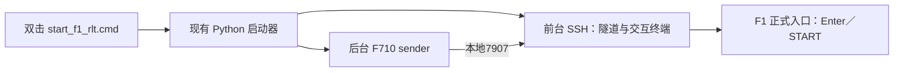

# F1 Windows 单窗口启动

**本页为早期版本记录，当前已由[V36退出与日志修订](20261102-operator-session-V36.md)替代。** V36增加有界退出、真实F1停止状态跟踪和连接日志自动同步，原r1／r2行为及验证保留作历史；现场命令以STARTUP为准。

**今后可以只开一个窗口运行 RLT：隧道和手柄由启动器管理，窗口保留 F1 的推理显示及现场确认。** 本次没有改动模型、录制状态机或手柄协议；只在现有 Windows 客户端增加两个入口文件，三端旧流程保留。

安装包已上传到 F1 下载目录，本地生命周期及端口验证通过。r1已由用户在Windows实际安装并走完F710接管、Y保存和Ctrl+C退出；发现sender早于接收端监听而打印Connection refused。r2已修正启动顺序并提供专用公钥免密码设置，已上传但Windows修订版验收仍待安装。安装与日常命令统一见 [STARTUP](../STARTUP.md#single-window)。

## 生命周期与范围

- SSH 一条连接同时建立 `127.0.0.1:7907 → F1:7906` 转发和 `-tt` 交互会话，仍使用正式 `start_f1_toys_inference.sh`，不自动输入 Enter／START，不保存密码或关闭主机校验。
- 现有 sender 在单独后台进程中运行，采用原 Python、导入路径和50Hz逻辑。所有输出落本地日志；F1 推理窗口继续显示接管和保护提示。
- 新入口文件锁避免重复启动；发现7907占用或旧 sender 存活时拒绝，不复用未知隧道、不终止其他任务。转发真正建立时 SSH 再用 `ExitOnForwardFailure` 核对竞争。
- SSH 正常退出或连接失败后，只清理本次创建的 sender；sender 意外退出时关闭本次 SSH，机器人沿用断网保护。Ctrl+C 等前台 SSH／F1 退出后才清理 sender。
- 后台 worker 用 Windows 只读进程句柄监视启动器退出；窗口异常关闭后退出自身，避免孤儿 sender 继续发输入。异常关闭仍不是正常封存方式，原件是否完整按机器人异常保存结果判定。
- 机器人底座、模型服务器、H20后台训练和旧入口均不重启；此前学习器暂停保持。Windows首次安装仍需人工执行，6000D没有Windows远程会话。

## 验证与回退

本地7项通过：SSH命令和输入约束、真实占用端口拒绝且不停止原监听者、SSH失败清理、sender启动失败不启动SSH、运行中sender退出、Ctrl+C等待远端退出、真实本地子进程清理。最终zip在独立临时目录逐文件校验，通过安装器使用的无启动import probe。

尚待Windows现场验证：PowerShell安装与回退、Win32进程监视和文件锁、后台SDL/F710采样、OpenSSH密码/Enter/Ctrl+C交互及正常保存。没有通过SSH启动powered机器人进行测试。

包为 `20261028-single-window-r1`，仅包含 `start_f1_rlt.cmd` 与 `scripts/windows_f1_session.py`。安装器验证SHA、备份和回退；旧sender文件不覆盖。恢复旧方式只需退出单窗口入口，使用原三端命令；不要同时启动两套。机器回执、测试XML及冻结包见[产物目录](../artifacts/20261028-single-window/)。

## r1现场结果与r2修订

用户10:41安装r1并于10:42完成真实全链路：SSH密码／Enter、后台sender、局部RLT、两次人工接管、Y完整保存和Ctrl+C返回PowerShell。启动阶段的 `channel 2: open failed: connect failed: Connection refused` 均发生于F1接收端监听之前，来源是过早启动的sender尝试通过转发连接7906；运行阶段原件没有断网／暂停／策略失败事件。

r2先启动前台SSH，逐字节转发其真实stdout到当前控制台，密码提示和stdin保持原控制台；检测现有 `F1 POWERED (run): 127.0.0.1:7906; waiting for START;` 或SHADOW对应行后，才创建sender进程。监听marker在IntentServer创建之后打印。不是屏蔽SSH错误，也不以固定等待秒数猜测服务就绪。未知启动失败和断网仍显示。

可选安装参数 `-SetupKey` 会在Windows生成／复用专用Ed25519密钥 `~/.ssh/f1_operator_ed25519`。新专用私钥无口令以满足日常免输入，只留在Windows；仅公钥追加到F1本账号authorized_keys，保留已有条目，并禁止该key的agent/X11转发。只在设置时通过SSH输入原账号密码，不把密码写入脚本、配置或命令。追加后用显式identity及BatchMode验证；验证失败明确报告，启动器仍可回退原密码登录。密钥不要分发给其他电脑。

本地r2八项通过：包括真实子进程延迟到marker才启动、SSH早退不启动sender、异常清理、分片marker、Ctrl+C等待退出，以及公钥追加保留旧key／重复幂等。最终包独立解包和安装probe通过；这是Linux侧逻辑验收，Windows的stdout转发、密钥生成及登录仍待用户更新确认。冻结包和上传回执在[产物目录](../artifacts/20261028-single-window/)，r1保留回退。
