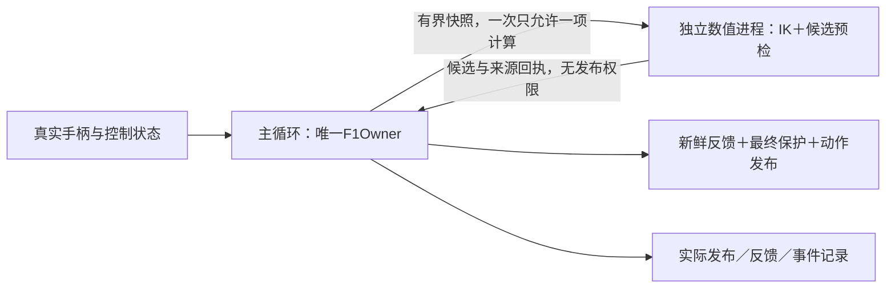

# F1运行链路解耦与终端就绪整改

10月30日先修复了单窗口显示与接收端就绪信号的耦合。截图中的绿色来自tmux状态栏，不表示开始；实时状态证明接收端已完成初始化，但未收到手柄、录制为零。标题中的“选择”提示Windows选择模式，远端终端只有80×24，均需处理。

终端修复和人工慢计算隔离已部署；随后四条实录均封存，本次未再出现候选碰撞拒绝或50ms输出故障，但新增的计算等待来源漏了训练reader兼容，四条都被拒收。最后一条仍有RTC／手柄输入超时暂停；详见[四条实录复盘](20261030-four-rollouts.md)。Windows显示／音色尚待现场确认，不能把软件测试或保存完整称为训练闭环验收。

后续四步修复已完成reader兼容、真实缓存重建、干净128步恢复至1040／260，以及VLA纯时序重规划和非阻塞ACK部署。109项双端、48项装配／显示、真实图像候选边界和正式SHADOW通过，当前等待新版现场新条闭环；原始审计结论按时点保留。观测／录制依赖和RLT连续执行尚未完成，运动中50ms锁存保持，不能将训练异步等同控制连续。

## 已完成：终端与就绪分离

- tmux只保留会话持久性，按本会话关闭status／mouse，不修改其他会话或服务器默认。
- RLT无Enter：创建会话后读取新鲜status，核对PID、start_ticks和pane进程祖先，排除旧文件和其他进程。向SSH直接输出独立ready行后才attach，避免终端重绘打断启动信号。
- Windows临时启用ANSI、关闭QuickEdit选择暂停，保留输入回显、Ctrl+C，退出恢复；初始终端尺寸显式传递。
- 控制台分清接收端可用、真实手柄已连接、START开始和实际策略执行；待机重复提示，不再用英文episode_ready让用户猜。
- HIL仍需Enter的入口立即attach，避免在未连接终端里等待Enter造成死锁。

61项回归检查通过，第一次受沙箱禁止socket影响的一项已在允许本机loopback环境复测通过。三路线模型及客户端身份通过；没有启动机器人动作，没有改变权重或训练。

证据位于[本轮产物](../artifacts/20261030-runtime-decoupling/)，包括console-before.json、deployment-console的上传／激活回执、Windows包及哈希。显示步骤当时保留manual-step-r1，装配为unified-rlt-console-20261030-r1；随后由下节计算隔离版本替代。

## 已完成：人工数值计算与唯一输出owner分离

最终客户端为`20261030-f1-rlt-manual-compute-r3`，装配为`unified-rlt-manual-compute-20261030-r3`；三路线共用固定组件，启动配置显式绑定`manual_compute=process_v1`。r1曾空闲激活，r2仅候选验收；r3补齐计算中参考变化和提交瞬间子进程退出的处理，替代本轮中间版本。旧版本原件保留。

- 数值进程在START前初始化并warmup，无ROS控制端点。主循环不等待IK完成，也不排队执行历史手柄输入；等待初次候选时保持，已有有效候选在原目标有效期内由原平滑器执行。
- 接管／epoch变化、松RB、换边、模式或方向改变撤销旧结果；幅值小变化不机械判过期，以原请求动作与时间记录来源。身体／头部参考变化沿用既有0.5°条件，收到结果前再检查。
- 延用输出目标有效期150ms和人工采样50ms条件，不以刷新旧候选绕过有效期；错误／超时映射为人工参考暂停。子进程崩溃仍可能需要重新启动运行端，不能声称所有计算故障都能RB解除。
- 边界缩步及多候选数值检查移到worker，当前owner仍做新鲜反馈、最终候选和实际输出检查；最终保护拒绝不再在主循环重复跑一轮缩步。
- 事件`manual_compute_selected`记录实际输入序号、原输入轴、请求时间、原候选、选中候选和数值耗时；实际执行仍以owner发布证据为准。Home与局部成功边界不变，没有把计算中的未执行动作当专家数据。

本地89项／ARM89项通过，覆盖慢计算、迟到、释放、反向、新session、参考变化、子进程断开及按键／输出保护回归。最终真实ARM数值探针运行约3秒，主循环取候选最大0.281ms、P95 0.225ms；最终单次保护最大5.951ms、P95 3.960ms。该探针只用历史姿态和零摇杆，不含真实运动、完整图像写盘及驱动发布，不能据此宣称真机250Hz或全部抖动消失。

正式RLT SHADOW初始化、等待、退出通过，真实相机／反馈可用，命令发布0、原件与last-session未变。激活时控制锁空闲，三路线身份一致。证据见acceptance.json、arm-manual-tests-v4.json、arm-manual-numeric-v4.json、shadow-result-r3.json及deployment-manual-r3回执。

## 后续实施顺序与RLinf边界

1. 人工计算隔离已部署，四条真实发布与按键边界已核对；先补`human_compute_wait`暂停语义的reader兼容、版本化缓存与实际入训验收。先前89项控制检查没有覆盖这个新来源到生产replay的集成路径，不能据此宣称数据链路通过。更早漏↑条的视觉审核及历史梯度影响见[全量数据审计](20261027-rlt-local-v2.md#data-audit-20261030)。
2. 针对实录中RTC迟回复和手柄包到达超时，改进保持、旧动作撤销、新鲜观测与人工重新授权的恢复流程；不要把保存同条等同操作不中断。
3. 区分模型必需相机与可选存档相机；录制／上传故障单独报告和暂停自动任务，不能阻塞安全恢复。无有效观测／动作证明的数据不进入训练。
4. 先验收真实驱动保持／停止合同，再决定运动中发布间隔故障的恢复方式。50ms是现有软件检查，不冒称厂商硬限位；不直接删门槛。
5. 优化RTC及局部RLT推理重叠，需要新动作锚点、版本、chunk裁切与数据有效性验收，不能用后台训练已异步来声称动作已连续。

固定RLinf版本为d00fe72060a5aa1554e92fe7bf72846d43d48c1c。其AsyncEmbodiedRunner的worker分工、非阻塞指标读取和权重同步合并可复用；F1高频输出不经过Ray队列。官方[RTC说明](https://rlinf.readthedocs.io/en/latest/rst_source/guides/rtc.html)描述执行与推理重叠，但不是可直接套用的小actor RTC控制器。官方[RLT流程](https://rlinf.readthedocs.io/en/latest/rst_source/examples/embodied/rlt.html)用于训练与推理分工；F1的实际停止距离、碰撞代理和手柄恢复仍需本机验证。

## VLA重规划、接收ACK与学习回执（10月30日晚）

RLT入口显式开启VLA纯时序恢复：策略拥有当前权限且输入健康时，迟到／计划耗尽先撤旧epoch与chunk，owner提交实测保持之后采集新观测，再bootstrap。START转人工、Y、相机／输入／硬件异常撤销该过程；不执行迟到旧suffix，不自动解除硬故障。接收线程改为非阻塞select和有序ACK，不能因ACK写阻塞停收手柄；200ms新鲜度仍有效，历史229ms长尾的发送／网络归因待更多现场证据。

训练端仍复用RLinf异步runner／Channel／Worker，新增独立逐条准入回执，避免actor存活掩盖reader拒收。10条入库、纠正奖励、独立W&B和完整快照恢复已核验；数据页10条审核已同步但不是实时梯度面板。证据、当前版和最后现场验收见[四步实施](20261030-four-rollouts.md#loop-repair-20261030)。
