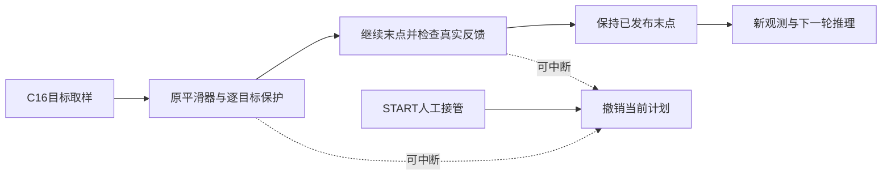

# F1 RTC＋局部RLT V34：执行、数据传输与训练监控整改

**V34 已部署：修复 C16 取样结束就截断平滑轨迹的问题，局部学习包优先传输也已接通。** 最近两条七个动作块均复现了“目标略向下、旧执行却停在向上的中间点”；新执行合同等待原轨迹完成，保留随时人工接管。软件与真实反馈零输出验收通过，真实运动仍需现场短条确认。

**正式学习器保全原状态恢复，W&B 的 736 条缺失真实指标已核实补回。** 动作语义另有明确缺口：旧 critic 学习平滑后命令，actor 输出却是平滑前目标。新语义已实现并完成独立对照，尚未迁移正式训练或部署实验权重；不能宣称全部训练设计已修好，更不能把这次框架修复当作自主成功率提升。

下一步先用短条核对执行末点、START 接管、↑及Y，再按新语义准备独立训练分支及完整缓存／种子／终点迁移。期间完整原件和既有候选保留；不把30分钟连续采集作为已验收结论。

## 1. 执行修复与部署

旧版把 nominal C16 取样耗时约0.53秒当作执行完毕；平滑器仍在路上，随后的实测HOLD截断了剩余轨迹。新状态 `finishing_trajectory` 保持同一末点及采样身份，通过原owner／平滑器／保护继续收尾；确认实际发布和真实关节到位后才进入下一轮观测。不会重放未执行的chunk尾段。

完成条件沿用现有配置：规划器正常到目标、零速度／加速度、发布命令进入原deadband（0.0001度）、反馈满足原1度容差且无输出故障。缺失、非有限或错维证据均不算完成。使用原settle timeout（3秒）；超时暂停策略、保留同条与局部任务，允许START接管，不杀进程、不自动造失败奖励。接管、↑、Y和故障撤销旧计划。正常周期完成后保持最后发布命令，阶段切换仍使用实测锚点。

数值复算两条全部7个真实动作块，继续收尾需额外0.580～0.708秒，原30度/秒、100度/秒²及600度/秒³约束保持。旧边界命令向上约4～5mm，完整目标略向下1.5～1.9mm。数值反馈使用命令代替，只证明规划器可收尾，不能证明电机跟踪、全路径碰撞安全或任务成功；新合同也不意味着RLT更快。

- 本地与F1 ARM各153项控制检查通过，48项装配／显示检查通过。本地首轮6项socket测试受沙箱限制，授权网络后单独20项通过；ARM首次缺离线G2测试依赖，补测试包后通过，不是运行端更改依赖。
- 正式V34真实反馈SHADOW：B／actor连接就绪、等待真实START，命令publisher为0，无新增录制和last-session改动，退出码0。
- 已盘点116个历史release，控制端原最高数字版本V33。新客户端 `f1-rtc-rlt-V34`、装配同名，公共RLT入口已切换；普通rollout／HIL显式旧覆盖保留，不能宣称所有路线都升级。
- 原版本、激活备份、模型权重和原件保留；单窗口命令及真实START授权保持，无Enter、无远程动作。

## 2. 局部数据优先上传

F1后台只读已封存的局部receipt，核对四类journal原始前缀、真实转移和终点，提取所需当前／下一观测JPEG。原图字节与原索引保持，独立manifest记录源身份、审核修订和内容哈希，明确 `archive_complete=false`。局部结束即可构建，无需等Y；完整原件继续沿原通道归档。

| 两条来源 | 有效转移 | 所需观测 | 学习包大小 | 原始包约大小 |
|---|---:|---:|---:|---:|
| 09:14:33 | 85 | 131 | 79,725,225字节 | 680MB |
| 09:15:47 | 99 | 160 | 88,603,584字节 | 674MB |

F1打包服务为低优先级独立进程，6000D镜像每拉完一包立即上传，H20先在隐藏临时目录核对，再原子提交。缺文件、错哈希、越界路径、审核修订不符均不消费；异常不影响机器人控制。

实际验收：两包均到达H20；4次真实特征请求比较原件与学习包，特征最大差0；原件与包返回同一个缓存，重复接收不增加训练额度。首次两包合计冷传输259.15秒，之后13.44／5.79秒是缓存命中重验，不能冒充新条冷传输速度。体积改善已验证，持续实测端到端延迟还需新条；不承诺每条结束立刻换actor。

部署路径：

- F1：`/home/user/Bruno/DAgger-runtime/rlt-learning-priority-V34`，只处理20261102T000000Z起的局部receipt；历史数据仍由原件通道接收。
- 6000D：tmux `f1-rlt-priority-V34`，日志 `/home/user/Artifacts/F1/rlt-local-v2/priority-V34.log`。
- H20：`/u01/user/datasets/f1-rlt-local-v2/priority-V34`；worker优先扫描该目录，按receipt＋审核修订去重。

## 3. 正式训练保全恢复

同一正式run新增 `production-V34-config.json` 与 `start-production-V34.sh`，源码位于H20 `staging/f1-rtc-rlt-V34`。12个缓存使用已经核验的冻结特征重建，所有学习张量逐位相同；划分、奖励、折扣、转移数保持。新完整恢复点仅更新代码／缓存引用身份，model、critic、target、优化器、RNG、incumbent及数据预算均保全，原1776点不改写。

恢复后正式状态为 **1776 critic／444 Q actor更新，等待新有效数据**；局部539训练／234验证，旧DAgger179／22。历史预算累计received=554包含此前15个额度差异，不等于当前539个训练张量。本次迁移、重复包和监控回填均0次新梯度更新。未停止Ray、推理服务、驱动或其他任务。

## 4. 动作语义与四组对照

原合同 `submitted_relative_eef10_v1` 用实际平滑后下发命令训练critic；actor经IK后却作为平滑器输入，直接查询旧Q存在语义差。新候选 `approved_reference_relative_eef10_v1` 使用与真实发布对应的owner批准目标 `selected`，另保留 `submitted`。未执行policy proposal、被拒绝候选不能冒充样本。缺失原始selected证据时拒绝转换，不静默回退。

新合同将实际耗时用于SMDP折扣，不把未来未知执行耗时当作actor可知的Q输入。replay／示范／终点／训练配置必须同一表示，跨表示critic不直接恢复。代码已实现，**正式配置仍保留旧表示**；完整生产迁移及策略效果尚未验收。仅换selected还不能证明chunk决策锚点、部分执行、平滑器内部状态等全部闭环语义已充分解决。

四组独立对照均从BC400初始化，固定数据划分／随机种子／batch，分别256 critic和64 actor更新；B1250和encoder冻结，全部W&B在线，实验权重未部署。共同以留出人工参考目标评估，2498有效时间步（152释放、2346持物），数值如下：

| 分支 | 动作MSE | 释放召回 | 持物误松率 | critic终点MAE |
|---|---:|---:|---:|---:|
| 旧表示BC | 0.014472 | 56.58% | 0.384% | 0.4742 |
| 旧表示BC＋Q | 0.014714 | 59.87% | 0.682% | 0.4732 |
| 新表示BC | 0.014575 | 56.58% | 0.384% | 0.4724 |
| 新表示BC＋Q | 0.014828 | 59.87% | 0.682% | 0.4714 |

BC400同一参考评估MSE为0.014781，释放召回55.92%，持物误松0。新表示Q的加权梯度范数约为BC的15.8%，梯度余弦中位-0.233；旧表示约16.4%、-0.271。**Q确实参与了更新，但释放改善伴随误松，不能宣称带来整体收益。** 这是短程新critic诊断，不是对正式1776或真机成功率的公平胜负结论，不据此宣布新表示无效或直接延长训练。

[正式W&B](https://wandb.ai/robotics-example/f1_complexytoys/runs/f1qcorrect20261030r2)；四组独立run：
[旧BC](https://wandb.ai/robotics-example/f1_complexytoys/runs/f1contractv34-submitted-bc)、[旧Q](https://wandb.ai/robotics-example/f1_complexytoys/runs/f1contractv34-submitted-q)、[新BC](https://wandb.ai/robotics-example/f1_complexytoys/runs/f1contractv34-reference-bc)、[新Q](https://wandb.ai/robotics-example/f1_complexytoys/runs/f1contractv34-reference-q)。实验分类为 `15_RLT_Controller_Contract_V34`／`offline-contract-comparison`。

## 5. W&B恢复与真实历史回填

原relay的CONNECT成功，但后续直连W&B HTTPS收到HTML403；6000D既有loopback7890出站正常。专用relay新增仅限本机的上游CONNECT，原目标允许列表、443端口限制、TLS验证和SSH loopback保持；密钥留在H20安全配置。只重启本人relay，API认证恢复200。

首次 `wandb sync --append` 显示完成，在线历史却仍停1040，因此没有按命令输出认定恢复成功。随后核验原本地二进制1041～1776共736行、无重复；暂停同run生产logger，逐步只回填线上缺失的真实记录，保留源时间和源SHA，标记 `monitor_backfill=true`，未伪造历史系统指标。线上再次查询确认736行齐全、末步1776／Q更新444；退出0后生产logger恢复。同run保持连续，补监控没有重训。

## 6. 验收边界与下一步

1. **已部署**：执行末点合同、局部优先传输、生产完整状态恢复、监控链路与736行回填。纯数据相关41项、H20学习相关55项通过，另有上述控制与装配验收。
2. **需现场短条**：末点真实反馈收敛、实际方向、收尾阶段START立即接管、↑后直接Y、下一段actor身份。旧两条仅用1040，1776可获取不等于已被真机采用。
3. **训练语义仍未生产切换**：需要完成新动作合同的chunk／决策锚点验证、旧种子与真实终点转换、独立critic恢复策略及候选比较，再显式迁移；不能将新表示塞进旧critic继续训并称完成。
4. **不变的未完成项**：RLT推理仍同步等待；相机依赖、运动中输出时序故障等长期框架TODO见任务待办。没有通过这次修复宣称所有暂停／退出路径均已解决。

## 证据

- [前置真实两条审计](20261102-two-rollouts.md)、[数值回放](../artifacts/20261102-framework-repair/endpoint-counterfactual.json)。
- [ARM检查](../artifacts/20261102-framework-repair/arm-tests.json)、[装配激活](../artifacts/20261102-framework-repair/deployment/robot-activation.json)、[正式SHADOW](../artifacts/20261102-framework-repair/shadow-result.json)。
- [首次优先传输](../artifacts/20261102-framework-repair/priority-first-transfer.json)、[真实特征一致性](../artifacts/20261102-framework-repair/priority-feature-parity.json)、[生产迁移快照](../artifacts/20261102-framework-repair/production-final.json)（此旧快照在线仍1040，不能代替补回结果）。
- [四组对照](../artifacts/20261102-framework-repair/contract-comparison.json)、[梯度诊断](../artifacts/20261102-framework-repair/gradient-diagnostics.json)。
- [真实回填及重启结果](../artifacts/20261102-framework-repair/wandb-backfill-result.txt)、[回填后最终核对](../artifacts/20261102-framework-repair/acceptance-after-backfill.json)。
