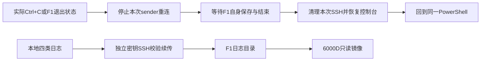

# F1 SSH＋手柄会话 V36：退出恢复与本地连接日志

本版已由[V37终端与音频修复](20261102-session-audio-V37.md)替代。V36现场仅收到启动日志，旧软件验证不代表现场稳定；下文保留当时的实现与证据。

**Ctrl+C后无限等待和sender持续重连已在启动器修复，V36安装包已发布到F1。** Windows需要安装一次；之后同一PowerShell可再次运行原入口。机器人运动控制仍为V34，模型、训练权重和手柄操作协议不变；尚未把Linux侧测试当作Windows现场验收。

**Windows连接日志现在有独立的自动上传通道，6000D镜像已运行。** sender、SSH、启动／退出事件与远端控制台分开保存，断线时本地留存、恢复后按确认偏移补传，不记录密码、私钥、键盘输入或整个环境。后台同步使用专用SSH密钥，安装命令的`-SetupKey`用于准备这一通道。

下一步安装后先在“等待START”时测试Ctrl+C返回、同窗口再次启动，无需动作来验证终端生命周期。后续可以直接从F1／6000D检查日志；首次真实Windows上传、窗口模式恢复与退出手感仍需此次现场验证。

## 根因与证据

旧`supervise`捕获KeyboardInterrupt后只打印“等待F1退出”，继续原循环；没有退出状态、没有等待上限，只要SSH未结束就会保留sender，甚至重启退出的sender。接收端7906关闭后，隧道7907仍可存在，sender反复重连导致SSH不断打印`channel ... Connection refused`。旧CMD失败后还有`pause`，进一步妨碍返回原Shell。

本轮只读复核时截图所示F1接收端PID已退出，status为stopping，对应原件已保存中断前缀；没有通过日志证明当时Windows的每一个残留进程，因此根因证据分为启动器可复现缺陷与现场接收端已退出两部分，不把网络拒绝推断为模型或限位故障。

## 新生命周期

- 本地实际Ctrl+C进入退出状态，停止并回收本次创建的sender，不再重连或重启。
- 独立状态查询只跟随真实READY行关联的run ID，并核对PID、启动时间及F1进程身份。状态stopping／failed时停止sender；PID已结束时释放本次SSH，即使终端显示管道残留也不继续等待。
- 退出请求复用F1既有`finish_session_v1`邮箱，要求当前新鲜状态、同一run／PID／start_ticks及能力声明；读取端再次核验身份和时效。只在本地实际Ctrl+C时申请，不因日志断网自动结束任务，不调用物理Home、不按名字杀进程。
- 请求重复或ACK丢失不重复提交。15秒是本地退出等待预算，不是动作、网络或机器人保存的门槛：到期仅释放本次本地sender／SSH，明确提示远端保存未确认；不强杀F1进程、不将保存未确认写成成功。再次运行可重新连接仍在收尾的F1会话。
- 重复Ctrl+C仍执行本地资源回收，清理期间防止再一次中断跳过finally。控制台输入／输出模式在退出时恢复，CMD不再额外pause。
- 真正网络失联继续由原输入watchdog保护；记录上传失败不参与动作控制判断，也不触发退出。

## 日志路径和同步

每次启动生成随机session ID，本地目录为`%USERPROFILE%\DAgger-F1\runtime\operator-sessions\<session>`：

| 文件 | 内容 |
|---|---|
| launcher.jsonl | 版本、模型、连接对象、进程生命周期、Ctrl+C、同步待补及退出结果 |
| sender.log | 原sender的连接、握手与输入状态输出 |
| ssh.log | OpenSSH的连接／转发诊断，使用`-E`保存，终端合并提示但保留原文 |
| console.log | F1远端显示输出；不采集本地键盘或密码 |

独立SSH使用BatchMode，不弹出后台密码框；每轮最多每文件64KiB，校验SHA和字节偏移，ACK后才更新本地位置。F1仅允许这四个文件、UUID目录，拒绝越界、符号链接、错哈希、改写旧字节；写入fsync后回执。断网、超时和认证失败本地保留，并在恢复或下次启动时继续补旧session。没有免密能力时明确提示本地待补，不能声称已上传。

- F1：`/home/user/Bruno/DAgger-runtime/operator-logs/<session>`。
- 6000D：`/home/user/Artifacts/F1/operator-logs/<session>`。
- 镜像健康：上述6000D根目录`mirror-health.json`；独立tmux为`f1-operator-logs-V35`（镜像组件首次部署身份，Windows最终包为V36）。镜像只读拉取约每10秒一次，不删除远端或本地原日志，不进入RL replay。

首次上传和重复请求已在真实F1执行；6000D生成的明确标注probe日志经F1再回到6000D，SHA一致。**这证明SSH接收／镜像链路，不等于已收到用户Windows新日志**。主通道仍为原单窗口，诊断是后台独立SSH连接，不需要新增手工终端或公开监听端口。

## 发布与验证

最终包：`/home/user/Bruno/DAgger/updates/f1-ssh-session-V36`，含三个文件；安装器验证包和逐文件SHA、备份原件、导入预检并支持失败回退。V35为本轮尚未安装的候选，保留冻结包，由V36补齐“远端仍活着但已在保存”边界；版本登记区分Windows包与仍在线的机器人V34。

25项定向检查通过，包括真实本地子进程、端口占用、Ctrl+C上限、连续Ctrl+C、远端停止／结束但SSH不退出、模式恢复、缺连接保全、重复包、偏移续传、路径／哈希防护、停止请求身份。首次socket测试受沙箱限制，授权测试后通过。干净解包逐文件校验和导入通过；没有伪造START或遥控机器人测试退出。

安装和日常命令以[STARTUP](../STARTUP.md#single-window)为准。遗留故障隔离与训练动作语义迁移仍见任务TODO，本次没有借退出修复宣布RLT整体ready。

## 证据

- [最终25项测试](../artifacts/20261102-operator-session-V35/V36-tests.xml)、[最终上传回执](../artifacts/20261102-operator-session-V35/V36-upload.json)。
- [F1实际接收及重复请求](../artifacts/20261102-operator-session-V35/diagnostic-delivery.json)、[6000D镜像字节校验](../artifacts/20261102-operator-session-V35/mirror-acceptance.json)。
- 原始V35测试／包及后续V36包分别保留，原件和历史版本不改写。
