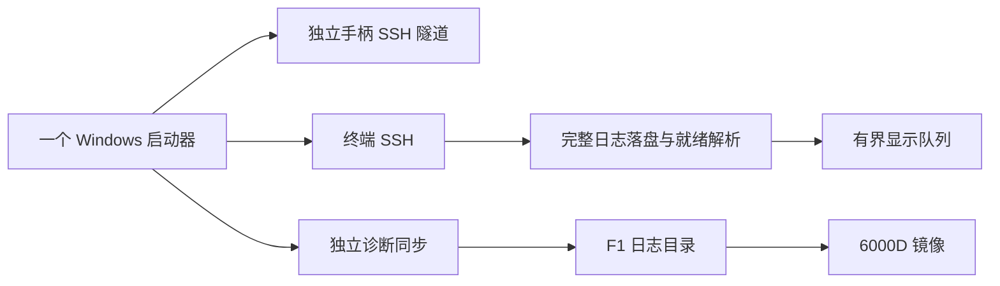

# F1 SSH＋RTC／局部RLT V37：终端卡顿与提示音

Windows显示／日志部分已由[V38修复](20261102-session-unicode-V38.md)替代；机器人常驻音频仍用V37。下文保留V37当时的验收边界。

本次现场 START 已到达机器人，但输入反复失鲜，运行时一直等待恢复手柄控制；没有证据表明这次是碰撞限位。V36 的终端显示、SSH转发与诊断提示存在阻塞耦合，V37已将其隔离。机器人端已更新，Windows安装包已上传，仍须现场安装验证。

提示音继续使用原音色和音量，改为启动时打开并持续保持音频设备。操作受理后，声音数据替换下一块静音，避免逐次创建播放器。音频可用性检查与软件测试通过，但软件提交时间不等于扬声器实际出声时间；是否早于动作须现场听验。

当前只要求短条验收：启动、START、接管、退出、在同一 PowerShell 再启动。尚不能声称网络长尾、连续采集或训练语义问题已全部解决；安装命令统一见[STARTUP](../STARTUP.md#single-window)。

## 现场证据与解释

机器人运行 `f1_hil_20261102T032512Z_6c756009`，episode `f1_hil_20261102T032547Z_e822f115`：

| 证据 | 数值／状态 | 解释 |
|---|---|---|
| START计数 | 7 | 不能说按键没传到 |
| 暂停原因 | `operator_watchdog` | 反复 `input_wait_fresh_packet`／`input_wait_press_rb` |
| 输入到达间隔 | 中位61ms，P99 383ms，最大467ms | 接收链路存在长尾 |
| 发送序列平均间隔 | 20.25ms | 发送器仍按约50Hz生成输入，不能证明无线／SSH准时传输 |
| 接收至控制消费 | 平均3.32ms，最大9.48ms | 此处没有数百毫秒阻塞证据 |
| 阶段 | base，尚未进入局部RLT | 这次暂停不能归因于actor动作或RLT限位 |
| 录制快照 | 已完成2053观测，无writer_error、drop_count=0 | 属于录制期间快照，不替代最终封存或训练准入 |

Windows会话 `5669b902c3384f25bbbad861e74d5732` 只同步了 `launcher_started`，没有后续生命周期／sender日志。V36诊断线程也可能被提示打印卡住；缺少完整Windows证据，不能将具体卡点武断归为PowerShell查询、网络或控制台选择。V37增加逐阶段日志并隔离这些依赖，以便再次发生时直接定位。

## 实现变化

- 手柄转发使用独立 `ssh -N -T`；终端用另一个 `ssh -tt`。仍是一个启动窗口、同一7907本地手柄入口，全部子进程由启动器管理。后台通道使用已配置密钥，不自动输入密码。
- 终端读取先保存原文并解析就绪，再交给有界显示队列。显示阻塞不阻塞就绪／sender启动或SSH读取；队列满只跳过显示重绘，恢复时提示，完整原文保留。
- 诊断线程只写结构化事件，不直接打印到可能卡住的控制台。新增 `transport-ssh.log`，与其余四类日志一样哈希校验、按偏移续传并镜像。
- Windows旧sender检测改用临时文件承接输出与有界进程等待，避免捕获管道等待后代EOF；增加检查开始／完成、端口可用、终端就绪事件。不杀未知进程或占用端口。
- Ctrl+C仍先停止本次sender、请求当前匹配的F1会话结束，再有界清理本次SSH。异常关闭不替代Y成功封存，不触发Home或重放START。
- RLT音频由常驻 `aplay` 输出PCM：16kHz单声道、10ms数据块，申请40ms设备缓冲；空闲输出静音。原WAV、音量、硬件混音器不变；过期提示可取消，音频故障不阻塞控制。
- `F1 AUDIO pcm_submitted`记录软件队列和首块提交的单调时钟。它不是声学测量，不应据此宣称声音必定提前。

没有放宽200ms输入新鲜度或任何碰撞、关节、反馈和唯一输出保护。输入恢复仍须先松RB、摇杆回中，等确认后再按RB；START不能代替这一恢复动作。持续长尾应查独立通道日志，不能靠连续按START解决。

## 部署与验收

V37机器人release从已部署V34逐文件校验后复制，仅更换 `recording_audio.py` 并生成新manifest。旧release与录制只读保留；公共入口已在控制锁空闲时切换，模型及训练参数未改。

验证证据集中在[本轮产物](../artifacts/20261102-session-audio-V37/)：

- 本地46项通信／安装／音频回归通过；阻塞显示仍解析READY、完整保存原文，独立隧道失败清理本次子进程。
- ARM音频3项通过；真实声卡纯静音保持2秒、进程正常回收。未远程启动机器人运动。
- 正式真实反馈SHADOW就绪、正常退出，未生成录制，原有录制目录及last-session保持。
- Windows干净解包导入／哈希检查；五类诊断样本真实上传F1，再到6000D逐文件SHA一致，重复同步不重复追加。此项是开发机样本，不冒充Windows现场验收。

待现场：安装V37，确认真实Windows阶段日志持续同步；START后能执行、手柄到达间隔改善；听验原音色及声音先后；Ctrl+C返回原PowerShell并再次启动。若仍卡顿，直接读取新增传输日志和同条F1输入时序，不要求操作者转抄日志。
