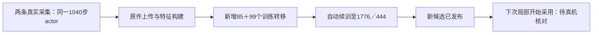

# 11月2日两条RLT：真实续训、动作方向与收尾边界

**两条新录制有效，已自动进入训练并产生新actor。** 两条都收到真实↑，属于人工辅助成功；完整记录正常封存，未复现输入超时、策略超时或碰撞拒绝。两条均使用1040步候选，新增训练完成到1776 critic／444次Q引导actor更新；新候选已可获取，尚无它的真机采用证据。

**上翘是真实运动，已发现执行端的具体偏离。** 七个chunk的计划末点都略向下，但平滑输出尚未跟到末点便按C16时间结束并保持实测姿态；实际反馈逐周期向上累积。先复现并修正执行完成语义，再评价新actor，不把问题全部归咎于训练。固定验证动作误差下降，释放召回未提高，critic仍高估；W&B在线上传403，真实指标留在本地。

“人工纠正→↑→保持人工→Y”是有效的缩短流程：放置RL在↑处结束，后续人工撤离及程序Home不进入该局部buffer。本轮只读核查数据、网络与生产状态，并更新文档；没有启动机器人动作、重启服务、改训练配方或手动推动候选。

## 两条数据逐项核对

所有时间为北京时间，日期为2026年11月2日。

| 项目 | 第一条 09:14:33 | 第二条 09:15:47 |
|---|---:|---:|
| episode后缀 | `011433Z_f600f3f7` | `011547Z_2204fc3c` |
| 实际actor | 1040步／260次Q更新 | 同左 |
| 完整观测数 | 1729 | 1733 |
| 完整控制发布记录数 | 6450 | 6278 |
| writer丢记录／错误 | 0／无 | 0／无 |
| 局部结果 | ↑人工辅助成功 | ↑人工辅助成功 |
| →至终点观测 | 27.85秒 | 28.29秒 |
| 有效训练转移 | 85 | 99 |
| 含人工动作的转移 | 74 | 93 |
| 不含人工动作的转移 | 11 | 6 |
| 保留的有效转移时长 | 22.72秒 | 24.00秒 |
| 终止奖励 | 仅最后一条为1 | 仅最后一条为1 |
| 自动划分 | train | train |

两份receipt对应的四条journal前缀SHA、episode身份与序列连续性全部通过；payload索引及manifest的SHA与整条封存记录一致。使用当前生产reader独立复算得到85／99，和H20实际buffer回执一致；终点观测分别为2404／4566，全部转移位于局部起点与该终点之间。抽取的12张原始主图／右腕图也通过payload逐帧SHA核验，终态图与人工成功标签没有发现矛盾。

数据不是把“→到↑”整段无条件塞入训练。第一条切断64处，第二条78处，其中59／64处名为`protective_pause`，主要是人工计算等待等PAUSED来源；这是reader的边界类别，**不表示发生了这么多次碰撞或操作者可见保护停顿**。观测质量切断另有5／14处；没有跨缺口补动作，也没有将未执行chunk尾段、计算等待或Home冒充人工示范。合法片段仍可训练，碎片化程度作为后续数据效率问题保留。

原件`training_ready:false`是完整示范导出的通用保守字段，不否定已单独验收的局部RL转移。当前证明的是上述184条可进入RLT；并不宣称整条所有画面都已经成为合格VLA专家SFT数据。

## 动作方向与运行时序

轨迹复算使用实际关节反馈、固定的原生DH/FK、记录的躯干姿态及模型坐标变换，与策略候选分开检查。高度为base_link上方向，工具轴仰角是原生法兰+Z轴对水平面的夹角，不是直接拿SDK坐标Z或某个Euler分量当作“向上”。SDK与独立fixture矩阵差约3.6e-10，28对姿态验证坐标旋转；这是模型运动学复算，未额外标定实物夹爪尖端或相机外参。

| 真实反馈变化 | 第一条 | 第二条 |
|---|---:|---:|
| RLT自主段含周期等待 | 6.11秒 | 2.60秒 |
| 自主段法兰升高 | **20.6mm** | **6.0mm** |
| 自主段工具轴仰角增加 | **19.6°** | **6.4°** |
| 人工后续法兰下降 | 69.2mm | 35.1mm |
| 人工后续仰角下降 | 24.6° | 11.5° |

第一条反馈图中橙色为RLT，蓝色为人工，绿色为↑终点；每个橙色台阶对应一个周期的运动及保持，Home未包含：

[第二条轨迹图](../artifacts/20261102-two-rollouts/motion/f1_hil_20261102T011547Z_2204fc3c.png)显示相同方向，但用户更早接管。

**七个chunk的末点都计划相对请求观测下降约1.5～1.9mm**；这些是已转换到关节空间的策略提案，再用同一FK复算。末点index15被采样时，实际下发位置反而比该计划末点高5.2～6.8mm、工具轴仰角高2.9～4.1°，最大关节差5.3～6.1°。此时平滑轨迹的`remaining_s`仍为0.55～0.68秒。

源码对应：[rlt_hil.py](../../../../DAgger/F1/src/f1dagger/rlt_hil.py)在采样时间耗尽、末点经过一次实际发布后就记`rlt_execution_completed`；下一拍[runtime.py](../../../../DAgger/F1/src/f1dagger/runtime.py)执行`hold_measured_right`，冻结当前实测姿态。独立逐行复核确认七次均在13.69～19.54ms后进入该保持，相关四个源码文件与部署SHA一致。因此事件名字里的“执行完成”只证明采样和一次平滑发布完成，**不保证计划末点已物理完成**。`remaining_s`是当拍平滑轨迹的剩余时间，不是可直接硬编码追加的等待常数；七次均为正常`certified_target`，不是限位制动。

已经证实计划与执行偏离，并找到周期结束时截断平滑过程的机制；它与实际向上积累吻合。尚不能量化平滑时序、关节路径及actor自身姿态输出分别贡献多少，需要同一真实chunk的离线完整曲线对照。不能由此宣称actor完全正确，也不应仅靠反转模型Z输出来补偿。

实际动作记录仍是`submitted`及真实反馈，没有把未到达的actor目标冒充已执行动作。旧数据是可追溯的真实交互，人工纠正仍有效；修执行合同不等于必须删除已有buffer或从头训练。

算法层面还有对应影响：critic当前学习的是编码后的实际发布动作chunk，actor的Q项则直接评价未经过执行平滑的模型提案。大幅跟踪偏差会放大两者动作语义及分布的差异，且平滑器的速度／加速度状态不完全体现在模型观测里。因此“真实转移有效、已经入库”不等于“当前actor与执行器的训练合同完全一致”；修复必须连同此点核验。

两条RLT分别完成5个、2个C16采样周期，再由用户在等待下一周期时START接管；不能将它们称为五／两个计划末点已物理到达。没有策略／相机／输入超时、碰撞拒绝或保护暂停事件。第一条开条0.575秒即人工接管、4.028秒交还VLA，这是日志中真实的早期START切换，之后才进入局部RLT，不是无输出故障。

“变快”未被耗时直接支持：旧四条actor请求中位352ms，新两条374ms；周期执行中位0.560→0.555秒，保持到下次采用中位0.554→0.596秒。没有异常暂停可能使体验更顺，但这两条未证明C16本身加速，更不是RLT已接上RTC。

## 异步训练实际走到哪里

| 节点 | 第一条 | 第二条 |
|---|---|---|
| 完整录制结束 | 09:15:31 | 09:16:45 |
| 右腕pack到达H20 | 约09:21:30 | 约09:21:48 |
| 图像特征构建 | 131帧，约33.1秒 | 160帧，约38.3秒 |
| 实际入buffer | 09:22:04，85条 | 09:22:45，99条 |

两条原件pack总量分别约680MB／674MB。本次主要延迟来自原件镜像与pack就绪，曾出现可重试的`right_wrist.pack`缺失，最终均恢复成功；不能把该过期error文件当成仍在拒收。特征构建串行再消耗约71秒。仅凭到达时间不能把这5～6分钟全部归因于物理网络带宽，镜像轮询及文件复制调度也在这段内。

常驻学习器没有重启，本次自动将局部buffer从355／234扩大到539训练／234验证，另有DAgger种子179／22保持。184个新增训练转移按每条4步新增736次critic更新，每4步一次actor更新，共新增184次Q引导actor更新，预算到1776／444。09:22:05～09:24:25完成本批训练、评估与候选导出，约140秒；随后正常等待新有效转移。

新候选是`actor-000001776-b710636bf52b-069a2f54`，head SHA为`2e5c72e85134e8236f64c1bd46052192766a1e1438b1652b908c2287b2365846`。候选端点已提供此版本，**发布不等于真机已经用过**；下次→才按既有合同选择可用候选，一段内固定。两条实际使用的1040步head SHA均为`d84225a57fd7328feb396ffa89739d49d5e5cf85a403746d1c6ca6e8e6091af6`。

## 效果：离线改善，尚未证明自主放置改善

三者比较使用相同256个验证转移（234局部＋22旧示范），其中2498个人工动作步；以下误差为模型归一化口径，不是米或角度。

| 固定验证指标 | BC400 | 本次采集用1040步 | 新1776步 |
|---|---:|---:|---:|
| 人工动作MSE，越低越好 | 0.0133794 | 0.0146619 | 0.0134681 |
| xyz RMSE，越低越好 | 0.113051 | 0.107622 | 0.103017 |
| 夹爪MAE，越低越好 | 0.104601 | 0.103372 | 0.100559 |
| 释放召回 | 55.92% | 55.92% | 55.92% |
| 该检查集误松 | 0 | 0 | 0 |

1776相对1040的综合动作误差下降8.14%、位置误差下降4.28%、夹爪误差下降2.72%；综合动作误差仍比BC400略差约0.66%。这支持“新增人工数据后离线拟合有所改善”，不支持“第二条真机已因刚才训练变好”，两条使用的是同一版本。

critic失败终点最大估值约0.519，独立校准仍未通过；训练batch也出现超过1的Q值。在当前0／1终止奖励和折扣合同下这属于高估迹象，不能用loss下降或者候选通过监督试用检查代替策略可靠性。两条均由人工完成，当前这两条的actor自主成功数仍是0。

W&B生产上传从10月31日05:15:44起出现403与filestream fatal。本轮1041～1776的736个训练step已经从本地W&B二进制记录解码核对，步数连续、真实指标仍在；当前代理返回HTML 403，直连超时，不能直接断言是密钥错误。[原run](https://wandb.ai/robotics-example/f1_complexytoys/runs/f1qcorrect20261030r2)的线上最后step当前不可验证，不将本地留证称为在线同步正常。

## 直接人工收尾是否正确

两条都是：**RLT → START人工纠正 → ↑确认放置成功 → 保持人工并撤离 → Y Home → 张爪到位 → 反馈稳定两秒 → 封存**。↑之后没有交还VLA事件，符合用户缩短采集流程的意图。

第一条↑后5.18秒按Y，第二条7.22秒后按Y；Home分别用约1.84秒／2.24秒到位，再真实稳定2.00秒才保存。右夹爪反馈均为张开0。局部RL早在↑关闭，Home不影响刚才的成功奖励。

人工按↑时本来就保留人工控制，**此时直接按Y，不需要再按START**。再按START会交给VLA。若是RLT自主↑成功，系统会先回VLA，用户希望转人工再Y时才需要START。

## 接下来优先做什么

1. 优先复现七个真实chunk的提案→平滑发布→反馈→周期保持，修正“采样完就算执行完”的合同；比较完整受限执行曲线，重新核验chunk实际长度、接管取消和replay边界。保留硬保护，不用固定多等0.6秒代替完成条件。
2. 执行偏离解决后再在相近起始姿态监督比较1776候选，继续诊断critic高估；不通过删除保护、硬改Z符号或盲目延长同一批训练掩盖问题。未修前不把大量重复上翘采集当作纯策略优化实验。
3. 缩短局部前缀与所需图像pack到达时间，将采集到入库的延迟与推理延迟分开统计；恢复W&B在线传输，补同步已有真实记录。
4. 保留运动中输出时序、录制故障恢复、数值子进程重建及相机依赖的既有TODO；本次两条通过不能替代30分钟连续可靠性验收。

版本命名已按用户要求写入根与任务AGENTS：技术说明＋单调递增V整数，同产品多人共用序列，控制版本与actor训练step分离。旧冻结release不改名；下一次发布先核对已有编号登记，不能凭工作台V31猜控制版本号。

## 证据

- [有效性复算](../artifacts/20261102-two-rollouts/validity/audit.json)、[关键画面哈希](../artifacts/20261102-two-rollouts/validity/frames.json)。
- [1776最终H20状态、入库回执与候选](../artifacts/20261102-two-rollouts/training/final_h20.json)、[固定验证比较](../artifacts/20261102-two-rollouts/training/comparison.json)、[W&B错误时间线](../artifacts/20261102-two-rollouts/training/wandb_failure_timeline.json)。
- [两条原始非图像日志SHA清单](../artifacts/20261102-two-rollouts/motion/source-manifest.json)。原件路径和逐项数值留在artifact，不改写原始录制及历史manifest。
- [轨迹、逐chunk偏差与时序](../artifacts/20261102-two-rollouts/motion/summary.json)、[可复算脚本](../artifacts/20261102-two-rollouts/motion/audit.py)。
- [独立逐行执行边界复核](../artifacts/20261102-two-rollouts/training/execution_boundary.json)、[部署源码身份](../artifacts/20261102-two-rollouts/training/execution_source_identity.json)、[训练／执行动作语义](../artifacts/20261102-two-rollouts/training/execution_interpretation.json)。
