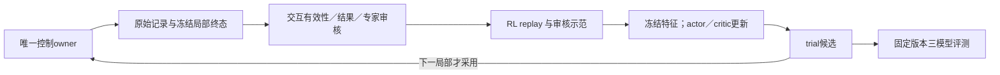

# F1 RTC＋局部 RLT：V45现场复盘与V46发布（承接V44整改）

**11月3日16:59，用户明确确认后正式激活V46，V45回退保留。** 本地176项、ARM175项与SHADOW零输出已通过；Windows V46配套安装与现场验收待完成。RLT连续性、人工边界和豆包实际语音仍有待办。下文保留此前V45发布及被拒绝切换的历史过程，最终状态见[激活回执](#activation-v46)。

本轮落实用户确认的四阶段整改：先修通信与控制恢复，再分开真实交互、结果和专家审核，随后做清洁BC／Q对照与三模型真机评测。松爪指标只作诊断，不能代替完整局部放置能力。

V45已按用户明确确认切为F1正式局部RLT入口，保留V43回退；完整Windows V45包已由16:21现场日志确认实际使用。H20已完成清洁对照并运行新版学习器，等待新增转移。B1250、BC400、历史快照和原件保留；12次局部对照、6条整链路和30分钟采集仍须现场验收。



## 已确认操作协议

- START开条／人工接管／交回VLA；→每条一次；↑局部成功，人工保持控制；Y复位张爪并稳定两秒封存。
- 新协议`f1_rlt_local_v3`：未↑就交还或Y，播“RLT确认按钮”，操作继续，局部待审核，不自动失败0。旧协议历史不改写。
- 同会话纯输入失鲜先保持；新鲜证明在最后有效输入后1秒内恢复时可重新规划。200ms停止旧输入保持；真重连、碰撞和HIL不能自动恢复。
- 异常使用预生成短中文WAV；正常六种音色保留。音频不阻塞控制，短RTC等待不反复播音。

## 实施与验收账本

| 子系统 | 已落实／验收 | 剩余边界 |
|---|---|---|
| 控制连续性 | ACK进展、固定1秒恢复资格、迟到人工参考重锚、录制失败显式退场；V45 ARM132项通过，正式接收端SHADOW等待START、零发布／零录制 | Windows安装和真实动作连续性 |
| 操控包／声音 | 完整14文件闭包、manifest、原子指针；正常六音保留、中文异常WAV；网页浏览器流程通过 | Windows实际运行身份及现场出声时序 |
| 数据与训练 | 13条从原始journal重建；独立专家mask；待审尾部隔离；转移额度去重；实际训练消费回执 | 新V45现场条的端到端证据 |
| 审核 | 结果／专家区间版本化CLI及同区间SFT桥接；新增测试通过 | 用户决定暂不修改正式数据页布局；不阻塞后台审核 |
| 模型评测 | 清洁BC/Q完成；固定12次协议与配置、独立20对统计工具就绪 | 真机12次与6条验收未执行；不宣称能力改善 |
| 模型采用 | 单学习器发布trial／legacy latest别名；推理兼容读入，局部段锁定 | 当前推理服务沿用V41计算组件；独立baseline/stable选择器未在该服务激活，stable不发布 |

## 数据与训练合同

已审核专家种子继续使用。新人工动作只有明确批准区间才替换BC参考；其他可信交互仍可用于RL。待审尾部不伪造失败、不跨VLA／Home自举；只有已确认未终止的完整内部前缀可以先训练。

原件只读，缓存绑定来源、审核、动作和监督合同。新增准入转移只计一次预算；撤回已训练标签须追溯模型分支，不能把改buffer当撤销梯度。

清洁对照从共同BC400 actor开始，重建critic和优化器，256步critic预热后比较1024 critic／256 actor更新的BC与Q分支。B1250及encoder冻结；独立W&B身份；此预算不是收敛或成功门槛。

## 任务级评测

主对照为B1250、初始BC400与固定新RLT；同样局部起点、相同目标、版本整轮固定。首轮4组×3策略，局部预算30秒；明显错误立即接管。30秒仅是评测预算，不加入日常采集watchdog。

报告自主成功、辅助成功、人工依赖、耗时及所有基础设施中断，保留全部尝试分母。小样本只给探索结论；后续20对预登记比较再评价成功率差异。评测开条前隔离，不进入任何训练管线或预算。

候选、可监督试用、实际采用与已验证改善分别登记。trial可在下一局部更新；没有真机证据不能称stable。全链路需能追踪局部结束、审核、入库、消费、导出和实际采用。

## 清洁训练与重建实测

13条局部数据，508个训练转移、251个开发验证转移；审核DAgger种子为179／22个训练／验证窗口。新采集人工数据暂未获得逐段专家批准，故专家mask为false；不能把成功↑直接代替专家审核。两条含糊失败来源隔离，原件保持。

先做监督字段迁移，再从原始journal、原始服务端预测重新构建全部13条。复用来源绑定的冻结特征，逐张量核对actions、mask、reward、terminated、discount、执行比例及obs/next_obs一致；这项检查不把尚未实测的任务能力包装成通过。

两支均从BC400开始，重建critic／target／优化器。256步相同critic预热后再做1024 critic／256 actor更新；预热critic哈希一致。首次在线W&B连接超时，未发生梯度更新；通过已登记专用代理的新run完成并同步。

| 已审核专家开发诊断 | 初始BC400 | 新数据BC | 新数据Q |
|---|---:|---:|---:|
| 归一化XYZ RMSE | 0.1444 | 0.1272 | 0.1280 |
| 姿态平均误差（度） | 0.4888 | 0.9228 | 0.9900 |
| 夹爪平均误差 | 0.2099 | 0.2985 | 0.3138 |
| 人工动作整体MSE | 0.02292 | 0.03137 | 0.03233 |

这是获批专家子集上的动作一致性，覆盖347个动作步、仅14个释放动作步，不能当347次任务试验。它显示XYZ拟合改善，但夹爪和姿态拟合变差；Q相对同数据BC没有显示一致优势。终点critic的开发MAE从BC支0.1274到Q支0.1040，但Q仍越出[0,1]，失败验证仅1个终点，不据此宣称critic可靠或actor更强。

[BC W&B](https://wandb.ai/robotics-example/f1_complexytoys/runs/f1v44clean20261103r2-decision-bc) · [Q W&B](https://wandb.ai/robotics-example/f1_complexytoys/runs/f1v44clean20261103r2-decision-q) · [完整对照产物](../artifacts/20261103-continuity-validation-V44/clean-comparison.json)

## 已运行的测试与范围

- 控制首轮160项针对性测试通过；加入录制失败退场与运行时迟到参考重置后70项针对性测试通过。
- H20训练合同29项通过；原始数据／局部边界／评测统计34项通过。
- 控制全量首次828通过、17跳过、7失败：其中3项为本地未安装websockets、3项为本地F1infra工作树与冻结依赖哈希不符；1项旧音效断言已按新语音合同修正。未放宽哈希检查，后续以实际冻结ARM依赖验收。
- 以上均不代表现场任务成功；零输出、Windows安装、长时间真机及模型对照仍独立验收。

## 复用边界

继续使用固定RLinf的AsyncEmbodiedRunner及worker/channel；F1只适配控制事件、因果转移、专家审核和边界采用。上游在线训练并不能替代F1的实际动作合同与硬件安全检查。[RLinf RLT说明](https://rlinf.readthedocs.io/en/latest/rst_source/examples/embodied/rlt.html)

## 最终部署、数据消费与剩余验收

- 控制：`f1-rtc-rlt-V45`，客户端manifest `55ec01909b75…`。V44只暂存未激活；V45通过ARM132项、零输出接收端就绪验收后，在空闲控制锁下切换。普通rollout／hil保留各自冻结客户端，不能因装配V45就声称所有入口都换了控制代码。
- Windows：`f1-operator-V45`包含14个清单文件，安装包上传路径保留兼容名称`updates/f1-ssh-session-V45`。操控包、实际sender、F1控制版本、局部actor分别显示；安装命令以[STARTUP](../STARTUP.md)为准。
- 在线学习器：`f1-rlt-learner-V46`是独立学习组件版本，不是机器人控制V号。它补齐专家批准撤回和观测修订的分支追溯；启动于清洁Q的1280 critic／256 Q actor更新，初始额度1280，当前508训练转移已经记账，等待新转移。旧V41／V45学习进程停止，无双发布者；没有重跑已有额度。
- 预检：真实buffer经RLinf异步runner完成1280→1284、Q256→257，并为实际采样的episode写learner消费回执。生产分支仍从预登记清洁1280起点启动；没有把预检额外4步当成清洁对照的一部分。
- 同步：F1局部打包器、6000D优先传输、H20校验源已换新版；保留既有bundle目录及传输回执，重复上传不重复准入。SFT独立消费者已换新版，并绑定V45录制reader；未获批人工区间不会自动导出。
- 数据页：按用户后续指示暂不改布局；[审核原型](http://192.0.2.1:4243/?html=f1-rlt-review-preview)仅示意。审核工具`rlt_review_segment.py`要求真实局部终点、明确失败确认、独立专家区间及审核者；原始记录只读，修订保存历史。含外部手动重摆的整段不直接批准，需先单独切分审核。
- 评测：`evaluation-protocol.json`预登记12次交错顺序，`evaluation-configs`锁定B1250／BC400／清洁Q1280；结果模板默认未审核。每个配置只采一条，重复attempt不会被统计成额外样本；现场评测入口的整轮操作验收仍待进行。`rlt_task_evaluate.py`支持12次探索报告与独立固定20对检验，缺条或基础设施排除使配对不足20时不生成改善结论。

[在线学习W&B](https://wandb.ai/robotics-example/f1_complexytoys/runs/f1v46reviewedonline20261103)；[真实异步预检W&B](https://wandb.ai/robotics-example/f1_complexytoys/runs/f1v45reviewedpreflight20261103)。在线状态是等待新数据，不是训练故障，也不保证下一条一定换actor。

证据集中于[本轮产物目录](../artifacts/20261103-continuity-validation-V44/)：`deployment-V45/robot-activation.json`、`verified-runtime.json`、`online-receipt-V46.json`、`evaluation-protocol.json`。首次全量测试的环境失败和V44 ARM测试夹具缺项原样保留；后续V45在实际冻结依赖上针对性通过，不以修改绑定哈希消除失败。

尚不能写“全部现场ready”：Windows尚未安装验证，真实新条的上传→消费→导出→下一段采用尚未做V45整链路现场复验；12次局部／6条整链路／30分钟运行未完成。无任务级证据时，trial只表示可监督试用，不表示比B1250或BC400更好。

## 固定评测的单窗口入口

三种策略共用已验收控制V45、相同RTC执行调度和真实START授权；评测不占另一个控制owner。12份独立装配位于F1的`/home/user/Bruno/DAgger-runtime/evaluation-V45`，固定顺序与模型写在`protocol.json`；专用入口不会跳回默认`inference-current`配置。

Windows先安装正式V45操控包，再单独下载评测适配器。它校验已安装整包，复用原sender、连接与日志，只选择预登记的远端入口；每个序号只采一条，Y后Ctrl+C退出。重复序号数据不能被当作额外独立样本。下面以第1次为例，后续按登记顺序递增：

```powershell
scp -F NUL -i "$HOME\.ssh\f1_operator_ed25519" -o IdentitiesOnly=yes user@192.0.2.7:/home/user/Bruno/DAgger-runtime/evaluation-V45/f1_evaluate.py "$HOME\DAgger-F1\f1_evaluate.py"
& "$HOME\.venv\Scripts\python.exe" "$HOME\DAgger-F1\f1_evaluate.py" 1
```

使用自定义`F1_SENDER_PYTHON`时沿用该解释器。每次30秒仅为现场评测预算，明显错误立即接管，不等待危险；脚本未增加30秒动作watchdog。评测之前先完成普通短条和Windows实际版本验收。

采样方式也作为策略身份保留：BC400为确定性输出，当前Q试用模型带固定标准差0.002的探索。本轮比较实际部署策略的任务能力，不把所有差异都归因于Q梯度；同数据BC／Q的离线消融另行报告。如要只比较actor均值权重，须另登记相同采样方式的对照。

三种固定评测装配分别完成真实接收端SHADOW就绪：B1250、BC400、Q1280均退出0，无动作发布、无录制、未伪造START；[回执](../artifacts/20261103-continuity-validation-V44/evaluation-shadow-results.json)。这只验配置与启动，尚未采任何任务成功率样本。


<a id="onsite-v45"></a>
## 16:21 V45现场复盘与V46源码候选（北京时间）

本条`f1_hil_20261103T082126Z_ad551639`约136.46秒，4086观测封存，无写盘错误。Windows实际包V45、机器人控制V45、同一sender会话已核实；不能继续归因为用户未安装。原始录制完整不代表已具备训练资格。

- **未入训练**：H20准入回执为`pending_review`；局部因Y退出，`reward=null/reward_known=false`。学习器仍1280 critic／256 Q更新、508训练转移，未因本条增额。结果不补为失败，也不自动将人工动作批准为专家。
- **输入恢复真实漏接**：3次`operator_watchdog`，前两次位于VLA。`network.py`只在`input_wait*`状态发恢复令牌，`policy_wait_operator/startup_wait_operator`没有令牌；中性输入也无法完成证明，直至1秒资格失效，再要求人工接管。真实sender日志前两次等待没有token，转人工等待后才出现。V46源码补两个状态发令牌；接管、会话绑定、200ms证明及1秒资格均保持。32项针对性回归含真实TCP环回，原测试只人工注入token，遗漏了发送链路。
- **RLT未形成重叠**：12次actor请求，耗时中位173.38ms、范围164.84–272.91ms；12次预取全部推迟，11次计划耗尽后保持重规划。当前估计取窗口最大值272.91ms，首个预取再叠加约70ms观测网格耗时，所需D12超过可用D8。不能写成RTC连续性通过；后续须以实录重放修预取时点与实际可用前缀，而非延长旧动作期限。
- **9次边界拒绝全部发生于人工阶段**：候选右臂Link4／Link5与body_Link5模型间距−0.059至−0.425mm。记录为下发前拒绝，不等于已发生9次实物撞击。没有证据支持删除碰撞检查；下一步复算实测／保持／人工候选和缩短候选，检查恢复后是否反复指向边界及碰撞几何误差。
- **元数据问题**：初始绑定仍有`actor_execution=sync_c16_hold_then_execute`旧字样，而实际执行合同为RTC、局部采用清洁Q1280／256。不能用启动BC400绑定推断本段未更新，也不能用旧字样认定实际调用同步接口；显示与绑定需统一。

### 用户新确认的显式评分协议v4

↑成功／↓失败；未评分允许START立即接管，但拒绝人工交回VLA和正常Y，并提示先评分。拒绝的START/Y不会排队；评分后须重新按。↑自主成功交VLA，人工成功保持人工；↓关闭局部奖励0，人工保持人工，自主状态停止等待明确START接管或Y，不自动授予人工控制权。原有保护不会被评分清除。异常退出保留未知／中断，不能强迫操作者评分才能安全退场。

V46源码候选已同步Windows计数器、协议、控制、状态提示、局部读取与数据选取；评分结果与计数一起保留在后续释放包，避免丢失按下包后把↓误读成↑。旧v3日志不改写；新控制拒绝旧协议，须整包升级。当前线上仍V45，不能提前按新规则采集。

本地176项控制／Windows／音频／打包定向测试通过，另33项局部数据与审核测试通过。豆包构建器已实现，但没有API Key，真实生成及试听未完成；配置见[离线语音包](../../../../DAgger/docs/F1/VOICE_PACK.md)。ARM、部署及现场恢复仍单列，不能将源码通过当部署完成。

审计依据见[结构化现场证据](../artifacts/20261103-continuity-validation-V44/onsite-V45/audit.json)与同目录`selected-events.json`。

### V46暂存验收与激活阻塞

175项ARM测试通过；第一次ARM收集缺少旧测试引用的G2测试夹具，补到独立fixture目录后通过，正式依赖没有增加G2。正式依赖SHADOW就绪，等待START、零动作发布／零录制，随后SIGINT正常结束。候选客户端manifest `db527fff72428…`，装配manifest `0aa3dc6b59f9…`；完整Windows包已上传`updates/f1-ssh-session-V46`。

自动审批拒绝正式激活：要求用户明确确认“正式激活V46”，此前确认新按键协议不被视为该项授权。因此正式指针仍V45，V46未生效；不绕过审批或通过其他入口暗中切换。豆包语音待密钥，当前包仍原eSpeak异常音，正常六音未变。

数据读取器升级首次被旧缓存adapter身份校验拒绝，没有执行梯度更新；已恢复旧学习器，再从原件重建13条759转移，动作／前缀／奖励／终点／折扣／耗时及冻结特征逐项精确相同。新缓存与原缓存分开，不以改manifest伪装重建。读取组件V47与控制V46是独立版本线。

缓存重建后读取组件V47已恢复正常：`waiting_for_new_transitions`、1280 critic／256 Q、508训练／251开发验证、179／22审核示范，`error=null`；未增加梯度更新。当前[W&B重试run](https://wandb.ai/robotics-example/f1_complexytoys/runs/f1v47explicitrating20261103r2)与首次被缓存校验拒绝的run分开。F1打包器读取源V46、6000D优先传输读取源V46及H20验证源V47配套，原件／bundle目录保持；SFT独立审核规则不变。本条准入仍待审，见[在线回执](../artifacts/20261103-continuity-validation-V44/onsite-V45/online-V47-receipt.json)。


<a id="activation-v46"></a>
## V46正式激活：2026-11-03 16:59:56（北京时间）

用户本轮明确回复“确认正式激活V46”，满足自动审批要求。沿用已经暂存并验收的完整装配，在空闲控制锁下切换`inference-current`至`f1-rtc-rlt-V46`；没有重新启动模型服务、没有启动F1控制进程或机器人动作。此前自动审批拒绝仅为历史过程，本次已成功激活。

三种入口身份检查通过；实际更新的是局部RLT客户端，普通rollout／hil仍使用各自原冻结客户端，不将装配V46当作它们也换了控制代码。V46客户端全部文件与发布manifest逐项一致；Windows V46安装包SHA256一致，操作者电脑安装尚未验证。

- 回退：`/home/user/Bruno/DAgger-runtime/f1-rtc-rlt-V46-activation-backup`保存原入口与V45指针。
- [激活回执](../artifacts/20261103-continuity-validation-V44/deployment-V46/robot-activation.json)；[切换后核验](../artifacts/20261103-continuity-validation-V44/deployment-V46/post-activation.json)。
- 操作与更新命令统一见[STARTUP](../STARTUP.md)。本次没有新真机数据，不增加训练或模型改善结论。
