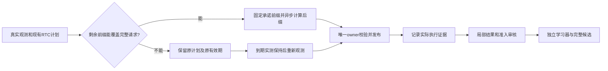

<!-- doc_type: experiment; status: deployed; updated: 2026-11-03 -->

# F1 RTC＋局部RLT V42：现场暂停、时序预算与训练撤回

**V41这条实录没有自动取得人工控制权，但确实存在误导性的接管提示和反复RTC重规划。** 三次VLA候选在碰撞边界前被拒绝，随后均由真实START进入人工恢复；暂停时提前播放接管音，让操作者误以为系统自动进入HIL。V42已部署修正提示及阶段标识，保留候选保护和现场授权。

**RTC问题是实际请求时间装不进剩余承诺前缀，不能只归因于模型慢或无线网络。** V41发请求时仅剩103～140ms，而请求到路径检查完成需要202～319ms；十次有前缀请求全部超时。V42保留跨重规划的实测延迟，并在覆盖允许时增加D；无法容纳时继续现有有效计划，到原期限后保持并重新观测。本轮不能据此宣称连续运动已经流畅。

**这条数据曾进入训练，并已按用户要求撤回。** 它产生27条转移和108次critic／27次Q actor更新；现已恢复干净的1024／256步状态，以独立撤回run等待新数据。V42已通过ARM 219项、正式真实反馈零输出及三模式激活检查；运动连续性与自主能力改善仍未证实。

## 现场事实：暂停不等于接管

审计对象为北京时间11月3日11:01:13开条的`f1_hil_20261103T030113Z_51a391be`，会话为`f1_hil_20261103T030046Z_94c02c14`。时间表以episode开始为零点。

| 时间 | 实际事件 | 含义 |
|---|---|---|
| 16.792s、26.021s、44.155s | 三次VLA候选碰撞边界拒绝 | 候选未发布，进入SAFE_HOLD，未取得人工控制权 |
| 22.432s、34.630s、50.544s | 真实START接管被受理 | 随后回中／RB握手完成才允许人工运动 |
| 61.268s | →进入局部RLT | 建立本条唯一放置任务 |
| 62.339～70.251s | 十次RTC期限重规划 | RLT阶段被错误提示为“VLA响应迟到”；没有自动人工接管 |
| 70.943s | START进入人工 | 局部任务继续 |
| 78.432s | START交回VLA；没有↑ | 按既定操作协议关闭局部，记录辅助失败0 |
| 83.933s | Y开始Home | 不属于局部放置RL |

候选碰撞对均为右臂Link4与躯干Link5的代理几何，计算间隙分别约−0.067mm、−1.055mm、−0.380mm。这是**候选检查结果**，不能据此断言实体已经接触。没有放宽这些距离、路径检查或当前姿态检查。

V42将“策略候选暂停，等待START”与“真实START已经接管”分开提示；只有后者播放接管音。纯时序重规划事件携带`rlt_phase`，显示实际VLA或RLT阶段。人工计算参考间隔异常也不再误报为手柄输入断流。完整时序和提示测试见[控制审计](../../training/artifacts/20261103-v41-onsite-audit/control/audit-summary.json)。

## RTC为什么反复失败

V41局部配置为H16、D6、S8、30Hz。D6名义上提供200ms承诺前缀，但起点是**真实观测对应的计划网格时间**。图像采集、等待、预处理及调度已消耗约60～100ms，不能从RPC发起时重新计200ms。

| 十次有前缀请求 | 最小 | 中位 | 最大 |
|---|---:|---:|---:|
| 请求发起后的真实剩余预算 | 102.8ms | 127.7ms | 140.0ms |
| 客户端RPC完整时间 | 190.3ms | 227.9ms | 305.0ms |
| 请求至路径检查完成 | 202.2ms | 239.2ms | 318.6ms |
| 其中路径检查 | 8.6ms | 9.5ms | 12.1ms |
| 服务worker | 105.4ms | 108.0ms | 112.4ms |

模型计算约80～83ms。服务侧相对稳定，客户端全链路更长且有波动；这批记录支持处理链路与调度预算共同不匹配，不能把RPC与服务的全部差值直接称为Wi-Fi耗时，更不能只凭这些数字判断GPU抢占。十次请求都真实超过剩余预算，不是“future已完成但先检查deadline”的微小竞争。共21次RLT请求中，11次bootstrap采用，10次有前缀请求采用数为0。[逐请求预算](../../training/artifacts/20261103-v41-onsite-audit/rtc/request-budgets.json)

原调度只从成功采用的有前缀请求学习延迟，而且每次重规划都清空估计。这使“所有有前缀请求都迟到”的会话永远回到D6。单纯增加固定D也不够：H16约束`D ≤ S ≤ H − D`使D最多为8，即约267ms；实测完整请求再加观测网格已消耗的时间，仍可能超出覆盖。

## V42的时序实现与边界

1. 对RLT记录最近十次完成请求从提交到worker结束的完整耗时，包含回复后的路径检查。bootstrap和因授权epoch改变而未采用的有效计算均可提供时延样本；取消或异常完成不作为成功耗时样本。该记录没有动作授权。
2. 估计在纯时序重规划后保留。每次预取时加上当前真实计划网格已经消耗的时间及原有一个采样点裕量，计算所需D。VLA原调度不在本次修改范围内。
3. 所需D必须同时满足当前shift、S及剩余H覆盖；当前H16／S8最多D8。可容纳时使用动态D，不移动真实`plan_origin`，不伪造新观测。
4. 已知无法容纳时，本计划仅记一次`rtc_prefetch_deferred`，不发起注定迟到的预取，也不提前取消仍有效的计划。现有owner继续按原保护发布，到原有效期后走已有的实测保持→新观测→bootstrap流程。
5. START、↑、Y、阶段变化及真实故障仍撤销旧epoch、动作和异步结果。保留的只是时延统计，不能续跑旧suffix。硬碰撞、未知发布状态及路径拒绝不使用纯时序自动重规划。

这可以修复重复从过小预算开始的调度缺陷，减少无效预取和过早截断；**覆盖不足时仍会停顿**。接下来需测量真实端到端预算、有效guided采用率和实际保持时长，再决定减少观测／传输耗时或扩大经验证的计划覆盖。不能通过延长旧动作有效期取得表面连续性。

## 数据确实曾入训，撤回不只删除文件

↑是“确认局部成功并关闭该局部”的事件，**不是唯一入训开关**。正常START交回VLA或Y结束前没有↑，局部按既定规则为失败0，校验合格的失败交互也可入RL；断网、硬故障等异常中断保留待审。完整episode的`training_ready=false`不能证明局部RL没有准入。

本条局部产生11条`actor_request`转移和16条`human_future_targets`转移，共27条。学习器从1024 critic／256 Q actor更新到1132／283；按快照周期发布到1120／280。因此只删原始episode不会撤销已经发生的梯度更新。

现已停旧学习器、按episode和source receipt登记排除、移出活动数据入口，并用干净1024／256状态启动独立撤回run。最新只读核对：517条RL训练转移、251条验证转移，人工示范179／22；候选actor权重与干净1024步一致，学习器无错误、等待新转移，旧学习器已退出。历史回执与撤回证据保留，不能把曾经训练过改写为从未训练。

- [撤回验证与27条构成](../../training/artifacts/20261103-v41-onsite-audit/training-retraction-verified.json)
- [最终只读状态与候选权重核对](../../training/artifacts/20261103-v41-onsite-audit/training-retraction-final-readonly.json)
- [独立撤回run：W&B](https://wandb.ai/robotics-example/f1_complexytoys/runs/f1rtc20261103retract51a391be)

F1已通过工作台原有删除事务删除本条及其派生预览／审核条目，原始目录已不存在；视频worker曾占用该条，定向暂停后等待原lease自然过期，再执行删除，随后按原代码和配置恢复。F1优先包与6000D／H20相关镜像移出活动扫描根，仅隔离保留故障取证。没有改lease、绕过控制锁或清理其他录制。[删除回执](../../training/artifacts/20261103-v41-onsite-audit/deletion.json) · [F1最终核对](../../training/artifacts/20261103-v41-onsite-audit/final-f1-deletion-verification.json) · [H20排除与学习器核对](../../training/artifacts/20261103-v41-onsite-audit/final-h20-isolation-verification.json)

## 四步工作到哪里了

| 工作 | 已有证据 | 尚未证明 |
|---|---|---|
| 修复训练动作和时间对齐 | V41新分支使用请求观测、承诺前缀、实际发布前缀和终态；本条实际构建出27条转移 | 用户已拒绝本条，不能作为有效现场成功样本保留；仍需有效新条逐段核对 |
| 独立验证集与重新训练 | 干净1024／256状态可恢复，训练／验证分支独立；旧报告中姿态MAE由2.847°降至1.009° | BC对照为0.729°，释放recall仍为57.51%；这些指标未证明自主放置超过BC |
| RTC推理优化 | 快计算、前缀计划和异步推理已运行；V42修复真实预算与估计丢失 | V41现场0／10有前缀请求采用；V42连续性、时延长尾和人工手感待现场 |
| 异步在线学习闭环 | 本条已真实触发buffer→critic/Q更新→候选发布；撤回链路也已核对 | 闭环运转不代表模型必然进步，仍缺有效连续短条与自主／辅助成功对照 |

V42 ARM、正式零输出与部署已完成，接下来由现场做短条，检查保护暂停提示、真实START接管、RLT预算、↑终点和Y。合格的新数据才能再次增加训练额度；下一次→采用完整可用候选，段内保持版本不变。长期连续采集与自主能力评估不能由单条测试替代。历史数据修正、训练与验证细节仍见[V41统一报告](../../training/experiments/20261102-rlt-rtc-V41.md)。

## 分层验证与部署回执

源码候选修改涉及`rtc.py`、`rtc_hil.py`的调度与事件，以及独立的反馈修复。新增测试覆盖真实观测网格、动态D、不足预算不发RPC、旧epoch仅保留时延、原有效期仍停止；独立审阅确认没有延长旧动作有效期、放宽路径保护或保留旧动作权限。[调度独立审阅](../../training/artifacts/20261103-v41-onsite-audit/control/rtc-independent-review.json)

本地RTC相关六个测试文件共**67通过、2项在导入阶段失败**，两项均因系统Python缺少`websockets`，不能写成69项通过。新增三个预算测试全部通过；反馈专项16项通过。本轮没有安装依赖或向机器人发送动作。[本地测试回执](../../training/artifacts/20261103-v41-onsite-audit/rtc/tests-system-python.json)

正式ARM复用现有依赖跑过15个文件，**219项通过**，涵盖上述网络子进程测试；正式SHADOW到达`prepared_and_waiting`后正常退出，前后episode清单与last-session身份一致，没有创建录制或动作发布者。客户端manifest为`9f6d3117b458c349ffd788f5a11a917c7ffb054aa58355b5c9b464efe6e47f57`。这是安装、反馈和软件合同验证，没有按START驱动真实运动。[ARM回执](../artifacts/20261103-rlt-rtc-V42/arm-result.json) · [正式零输出回执](../artifacts/20261103-rlt-rtc-V42/shadow-result.json)

V42现已激活到`/home/user/Bruno/DAgger-runtime/f1-rtc-rlt-V42`；rollout、HIL、RLT-HIL三种装配均ready，原入口文件与前一部署保留备份。激活没有启动机器人动作。实际入口见[任务STATUS](../../STATUS.md)和[现场入口](../STARTUP.md)。[激活回执](../artifacts/20261103-rlt-rtc-V42/deployment/robot-activation.json)

## 当前提示音演示核对（11月3日）

[Why&How提示音页面](http://192.0.2.1:4243/?html=f1-rlt-controls)先按V42事件和原始WAV更新当前六种声音，删除旧r4方案混排与旧播放时序说明；后续按用户要求加入独立的异常音候选，见下段。保留开始／接管原音色，使用现场53／50软件音量，无RLT逐次400ms前置静音。交VLA声在交还受理时提交；↑成功音优先；候选暂停、RTC重规划和RB恢复不冒充接管声。

演示同时区分辅助成功、正常未确认退出的终止0和异常待审；↓没有评分作用。源码、声音哈希与浏览器验收留在[页面验收目录](../artifacts/20261103-rlt-audio-page-V42)。本次只更新演示与说明，机器人控制和奖励协议仍为已经部署的V42；电脑试听不能证明机器人声学起点早于动作。

### 异常音候选：仅网页试听

候选为0.28秒柔和短音，单独标明“仅网页未部署”，可关闭事件播放或单独试听；原六段WAV逐字节不变。只在进入需要人工处理的异常时提示一次：候选边界暂停、需要RB恢复的人工暂停、硬故障。普通等待、RTC重规划和RB恢复不响；候选暂停后真实START仍使用原接管音，不能把异常声理解为控制权已交给人工。

硬故障示例要求查看原因，不允许START／Y／RB绕过；异常中断保持待审，不因音效自动结算失败0。八项浏览器场景通过、零JS错误，页面HTTP 200；只做网页预览，没有机器人命令或生产音效部署。截图、源哈希和回执见[异常音候选验收](../artifacts/20261103-rlt-audio-page-V42/exception-preview/browser-report.json)。

## 12:42与12:44两条V42现场补证

两条均实际加载V42并在F1完整封存。第一条以人工候选边界暂停为主；第二条的VLA推理超时已经自动恢复，随后因操作输入失鲜暂停。不能把后者归结为同一次推理超时一直没有恢复，也不能据此宣称通信恢复已解决。

| 原件／北京时间 | 实际情况 | 数据后果 |
|---|---|---|
| `45e1338f`／12:42:40 | 6次人工候选碰撞预防拒绝、2次人工参考积分时间步超限；8次都通过RB重新使能恢复同条。RLT有12次计划到期重规划 | F1封存2080观测；局部44.823秒，实际使用1024／256，未↑而Y正常退出，按原协议为辅助失败0 |
| `1acec86e`／12:44:00 | 9.328秒VLA推理衔接超时；9.669秒已采用新bootstrap恢复；9.949秒手柄watchdog暂停。47.471秒真实START交回VLA后，47.989秒再次watchdog | F1封存1541观测；未进入局部RLT，没有生成局部RL转移 |

第一条六次候选碰撞对均为`arm_R_Link5/body_Link5`，预防净距约−0.084～−0.495毫米，拒绝发生在发布之前；这不等同于实物已经碰撞。用户说明现场设置不合适，仍不能据此擅自删除原件、把全部人工段判为无效或补成功标签。询问终点后，用户答复“我忘了应该都是失败的”；保留现有协议失败0，并记录回忆不确定，不升级为人工已确认的失败验证样本。[操作者补充](../artifacts/20261103-v42-two-rollouts/training/operator-outcome-note.json)

第二条request67客户端完整486.10毫秒，当次剩余RTC衔接预算460.26毫秒，超出约25.8毫秒。H20接收至发送152.27毫秒，其中排队0.159、模型92.81、IK42.58毫秒；差余包含链路与客户端处理，不能全部命名为纯Wi-Fi耗时。后台特征提取约44秒后才开始，与两条控制请求没有重叠；GPU3核对仅本任务推理进程，不支持本次抢卡或训练队列阻塞解释。

两次手柄watchdog的实际包龄按事件`invalid_from_monotonic_ns`计算为203.211／204.919毫秒，超过既有200毫秒输入期限。事件落盘时间比收包晚4～11毫秒，不能拿`operator_packet`事件时刻冒充收包时刻。暂停附近F1控制采样最大间隔17.282／17.316毫秒；Windows本地采样最大32毫秒、发送线程取包及本地socket写入最大16毫秒。与此同时ACK中位数从约31毫秒升到约172～218毫秒，12:44:11至12:44:39因最老未确认包超过500毫秒触发六次重连。支持通信路径抖动及主动重连放大恢复负担，不足以定位具体无线设备或链路方向。

现有200毫秒规则负责撤销运动权限，500毫秒规则负责发送端连接重建，两者不是同一门槛。之前的纯RTC超时恢复已在9.669秒实际工作；真实断连、会话改变和运动中操作输入失鲜仍要求明确恢复。后续应先用两端同序号收发／ACK证据定位停顿，再分别验连接存活、消息新鲜度和重新授权；不能通过继续执行过期动作、删除watchdog或把所有短时输入故障自动重放解决。

第一条局部优先包实际保留78转移（6自主决策＋72人工窗口）；6个自主决策和7个人工窗口因缺因果终态或跨边界排除。12:45:28入库后增加312次critic／78次Q更新，学习器1336／334，候选1328／332；两条都没有执行该新候选。H20完整原件镜像仍在传输，已完成的局部优先包独立支撑这次训练。学习发生不代表能力已改善；操作者此次补充没有触发标签重写或新增训练额度。

[控制与Windows时序证据](../artifacts/20261103-v42-two-rollouts/control/) · [训练／H20审计](../artifacts/20261103-v42-two-rollouts/training/audit.md)。此次审计没有修改网络、RTC期限、碰撞边界、数据标签或模型参数；在线学习器按既有授权消费新增合格数据。
