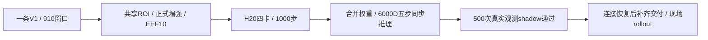

# 单条V1：EEF LoRA训练、恢复与同步推理

2026-10-16（北京时间）。已用用户指定的一条V1完成H20四卡1000步训练，导出最终模型并在6000D加载；500次真实F1观测shadow全部成功，未发送机器人动作。

本轮证明训练和推理链路可用，不能证明任务泛化或插孔成功。F1曾在shadow后断网；随后连接和基础服务恢复，持续取帧复测、同载荷echo、ARM最终客户端验证与现场入口交付已补齐（见末尾补充）。最新状态只维护在 [STATUS](../../STATUS.md)。



## 实际训练

| 项目 | 本次结果 |
|---|---|
| 来源 | `f1_hil_20261014T091553Z_88a4ad17`；保留原数据，不处理新收集数据 |
| 数据 | 910个完整H50窗口、863个不同观测；30Hz，时间配组未修改 |
| 模型 | RLinf `openpi_rlinf` 原生PyTorch π0.5，官方base，3×224、token200 |
| 图像 | A ROI `[.24,.04,.96,1]`；三路有效；训练增强开，推理关闭 |
| 动作 | 右EEF相对xyz3＋rotation6D前两行＋绝对夹爪1；内部32维仅前10维参与loss/带噪输入/采样 |
| 参数 | r32/alpha16/dropout0；196个LoRA叶子＋动作/时间投影完整训练，23,717,920可训练参数 |
| 训练 | H20物理GPU4–7，micro2、global8、累积1；bf16计算/fp32参数 |
| 日程 | AdamW，峰值1e-4、warmup50、1000步；实际cosine下限1e-6 |
| 时间 | 主训练循环及4次checkpoint共16分11秒；热态训练中位0.798s/步 |
| loss | 首50步平均0.682742 → 末50步平均0.025891；最后单步0.033662 |
| 梯度 | 首50步平均2.44466 → 末50步平均0.327317；未见非有限值 |
| 保存 | 250/500/750/1000完整checkpoint；最终模型合并为667张量 |

日程差异：r3 YAML写了min_lr=1e-5，但继承的min_lr_rate=0.01优先，实际floor为1e-6。未改写既有run；后续YAML设min_lr_rate=null。恢复本run时必须保持原日程。

LoRA预检发现末层语言expert Q/O两个叶子没有动作loss路径，初始B始终零；r3正式训练前排除这两个叶子，未放宽检查。最终所有196个B均更新，659个冻结张量逐字节不变，动作投影无效行/列不变。合并前后同输入/噪声fp32最大误差9.54e-7。

图像生产实现与已审阅PNG逐像素核验：9张确定性图＋27张增强图全相同。证据：`artifacts/20261016-v1-eef/service-f1-toys-eef-1000-5step/production-pixels-verification.json`。

## W&B：遗漏、修正与在线核验

本轮最初遗漏W&B，只启用了TensorBoard。主训练和两个预检由真实TB回填；历史GPU利用率没有记录，不能补造。`source_wall_time`保留实际记录时间；W&B `_runtime`属于补录过程，真实训练时间单列 `training_loop_seconds=971`。

- [主训练1000步](https://wandb.ai/robotics-example/f1_complexytoys/runs/f1eef20261016)：API实际读取1000行，step0–999，state=finished；已补齐冻结recipe、代码/数据/模型身份。
- [单卡20步预检](https://wandb.ai/robotics-example/f1_complexytoys/runs/f1eefsinglepre20)、[四卡20步预检](https://wandb.ai/robotics-example/f1_complexytoys/runs/f1eeffourpre20)：各20行。
- [首次恢复诊断](https://wandb.ai/robotics-example/f1_complexytoys/runs/f1eefresume751v1)、[修复后恢复验收](https://wandb.ai/robotics-example/f1_complexytoys/runs/f1eefresume751fix)：原生在线logger，从启动即记录，独立于主训练。

凭据按用户授权从6000D历史Docker卷迁移到H20个人 `.netrc`（0600）。H20公司代理对W&B返回503，已通过6000D限定目的地的TLS CONNECT＋SSH通道验证登录/写入。离线CLI sync曾显示done但API不存在run，随后采用原生online回填并实际核验历史行数，未把CLI提示当最终证据。详见 [W&B运行说明](../../../../infra/h20/WANDB.md)。

## 恢复数据epoch的实际修复

原StatefulDataLoader保存当前epoch内位置，DistributedSampler却不保存epoch；worker的 `_data_epoch` 也未保存。750步已到epoch6/offset66，重启后采样器从epoch0生成另一组顺序，虽然权重/优化器/LR/RNG能加载，同一步loss仍不同。

新增 `data_progress.pt` 保存epoch和offset，加载时先恢复sampler epoch，再恢复loader和RNG。对固定长度F1旧checkpoint按步数、梯度累积和loader长度推导epoch，并核验保存游标；world size改变直接拒绝。这不是通用的跨batch/卡数精确恢复方案。

| 第751步 | 连续训练 | 原恢复 | 修复后恢复 |
|---|---:|---:|---:|
| loss | 0.0248634852469 | 0.0346677154303 | 0.0248634852469 |
| grad_norm | 0.285379648209 | 0.387194246054 | 0.285379648209 |
| LR | 1.68543119798e-5 | 相同 | 相同 |

修复后3项浮点值完全相同，新保存epoch6/offset67。独立r4恢复run验证，不修改r3主训练或其最终权重。证据 `artifacts/20261016-v1-eef/h20-evidence/resume-fixed-verification.json`。

## 单条轨迹诊断，非独立验证集

固定9个窗口，每个2组生成噪声，执行前20步与示教未来目标比较。所有模型使用同一输入；无随机图像增强。该姿态变化较少，保持当前姿态的旋转/夹爪平均误差可能更低，不能只用平均误差推断任务成功。

| 权重/采样 | 位置mm | 角度° | 夹爪0–100点 | IK |
|---|---:|---:|---:|---|
| base / 10步，H20 | 34.84 | 176.93 | 63.63 | 12/18 |
| 250 / 10步，H20 | 12.78 | 3.08 | 4.68 | 18/18 |
| 500 / 10步，H20 | 9.07 | 2.50 | 2.13 | 18/18 |
| 1000 / 10步，H20 adapter | 6.52 | 1.87 | 1.88 | 18/18 |
| 1000 / 10步，6000D merged | 6.47 | 1.88 | 1.87 | 18/18 |
| **1000 / 5步，6000D merged** | **5.87** | **1.78** | **1.94** | **18/18** |
| 保持当前姿态 | 14.59 | 0.97 | 1.11 | 非策略 |

6000D模型计算中位10步179.84ms、5步118.99ms；选择5步作为当前部署默认，尚未编译action expert。尾段夹爪仍有时机误差，单条示教也没有覆盖接触偏差和失败恢复；正式十几条到齐后需按episode划分并重算统计。

## 真实通信与部署边界

6000D GPU1运行合并权重，localhost8096健康检查/WS/echo，F1使用专用SSH反向转发。LoRA已经合并，推理不带adapter额外层。原生FK配置与F1-09安装文件SHA一致；IK只解执行前20步。三图压缩字节上传，ROI/resize只在6000D做一次。RTC明确false并拒绝其请求字段。

500次真实相机/反馈shadow：500/500成功、零控制publisher、没有创建owner、未执行动作。每请求约378KB。排除前5次后的时延如下：

| 项目 | P50 / P95 / P99，ms |
|---|---|
| F1 WS roundtrip | 208.74 / 330.95 / 382.20 |
| 选中观测起点→收到响应 | 403.88 / 525.37 / 566.06 |
| 逐请求RTT−handler | 67.23 / 189.71 / 239.16 |

服务端中位：解码4.59ms、预处理3.51ms、模型116.63ms、IK16.68ms、handler141.38ms。10步30次基线RTT中位363.75ms；不同时间的网络状态变化使它不是严格同载荷A/B。

串行测试脚本每次推理后才取帧，会积压相机队列到既有200ms年龄限制附近；约190ms属于测试采集队列年龄，不能宣称真实运行端必然如此，也没有将相机配组阈值改掉。持续取帧模式已补入benchmark，复测被F1断网阻塞。echo/固定样本对照未完成。观测起点采用主机接收区间，曝光时间未校准；上述不是完整observation→Control延迟。

历史DM0.5/G2的348次网络shadow：WS 183.16/209.02/258.87ms、observation→Control 184.95/211.37/260.69ms、模型135.82/137.61/139.71ms。本轮模型较快但网络尾延迟较高；不同机器人、图像和网络路线，只作参考，不能声称端到端已超越DM。

服务端500条完整原日志在6000D保存，SSH断开前已读取机器人汇总并保存 [核验摘要](../../artifacts/20261016-v1-eef/shadow-500-verified-summary.json)；机器人逐请求原报告待连接恢复取回。

网络子进程客户端已在6000D用最终权重完成10次持久连接往返，左侧保持、身份/shape检查通过。记录样本的float32状态曾无法JSON编码，现显式转Python float；真实ROS float64此前不受影响。ARM实际客户端验证仍待完成。当前只隔离网络进程，并未完成G2全部Control/Policy隔离。

## 路径、版本与复现

| 资产 | 实际路径 |
|---|---|
| H20训练代码 | `/home/user/projects/task-releases/f1-toys-20261016-eef-r3` |
| H20恢复修复 | 同上release根下 `f1-toys-20261016-eef-r4` |
| H20数据 | `/u01/user/datasets/f1_toys_v1_eef_20261016/dataset` |
| H20主run | `/u01/user/runs/f1-toys-eef-lora-20261016` |
| 完整checkpoint | 主run下 `v1_eef_lora/checkpoints/global_step_1000/actor/` |
| H20合并包 | 主run下 `bundle-1000/` |
| 6000D合并包 | 任务下 `artifacts/20261016-v1-eef/bundle-1000/` |
| 模型ID | `f1-toys-eef-ce9519bdcf13e9e9` |
| 合并权重SHA256 | `18c59a1517a097d7fb7cda358da05ed21788c5ee432e971287e60c107a2a7cf3` |
| 原始checkpoint SHA256 | `dab4e257d9a238d1bf38905a97d54ebc06fe40920a09c7feea7471535da16d87` |

复现主训练时，先检查实时资源并在6000D启动W&B链路。H20 Bash（新run目录，不覆盖原run）：

```bash
export F1_TOYS_RUN=/u01/user/runs/f1-toys-eef-reproduction-NEW_ID
test ! -e "$F1_TOYS_RUN"
export F1_TOYS_GPU_INDEX=4,5,6,7
export F1_TOYS_CONFIG=sft_eef_lora
export F1_TOYS_DATASET=/u01/user/datasets/f1_toys_v1_eef_20261016/dataset
export F1_TOYS_EXTRA_PYTHONPATH=/u01/user/envs/f1-toys-augmentation-v1
export WANDB_MODE=online WANDB_ENTITY=robotics-example
export NO_ALBUMENTATIONS_UPDATE=1
mkdir -p "$F1_TOYS_RUN"
bash /home/user/projects/task-releases/f1-toys-20261016-eef-r4/tasks/F1_ComplexyToys/scripts/run_h20.sh \
  actor.optim.min_lr_rate=0.01 \
  > "$F1_TOYS_RUN/console.log" 2>&1
```

r4使用恢复修复，计算路线与r3相同；显式min_lr_rate复现本轮日程。新实验如果采用已修正1e-5下限，应另记recipe，不声称逐值复现。长任务放独立tmux。原生logger默认在线，run链接在console.log。

恢复从对应 `global_step_N` 目录指定 `runner.resume_dir`，保持卡数、micro/global batch与原日程；正常续训设置原 `WANDB_RUN_ID` 和 `WANDB_RESUME=must`。本次750→751验收使用独立run，避免向主run倒写旧step。

当前启动命令与交付缺口见 [现场启动说明](../../inference/STARTUP.md)。十几条新V1到齐后新建数据版本，不直接把本轮统计沿用到更广工作区。


## 连接恢复后的最终验收补充（2026-10-16，北京时间）

用户恢复SSH并在现场启动基础服务后，部署 `20261016-f1-toys-eef-v2`，145文件清单逐项校验；manifest SHA256 `2d18999ebcde318949c6ac93e9e8a1a40a16cb2c215ed7f4828a862cb3db4ec2`，最终config SHA256 `3f36030e07a8a4b39cebf7b4faf927d67ed091118c21dbfc4167444a79dec429`。独立现场入口 `start_f1_toys_policy.sh` 已安装，旧v32数采入口未切换，未执行动作。

ARM `inspect` 和本机 `preflight` 均通过；实际WebSocketPolicy子进程10次请求通过，PID保持不变、左侧保持、真实JointMapping关节限位/腕耦合检查通过，没有创建Control owner。

| 500次测量 | RTT P50 / P95 / P99，ms | 结果 |
|---|---|---|
| 固定相同图片序列echo | 81.83 / 99.84 / 145.73 | 500/500 |
| 固定相同图片序列模型 | 184.99 / 212.81 / 260.58 | 500/500 |
| **持续取帧真实相机模型** | **200.44 / 223.75 / 250.08** | **500/500** |

真实持续取帧观测起点→响应261.70/306.66/324.94ms，观测年龄中位61.02ms，模型中位116.43ms，状态归一化越界0次。相比旧串行测试约190ms队列年龄，持续采集明显减少等待；没有修改相机配组规则或离线训练时序。echo包含解码/协议，不是纯网络；echo和模型顺序测量，不能用两者分位数差声称纯计算耗时。全部测试零动作publisher、零Control owner。

与DM0.5历史G2数据相比，模型计算更快，但本次真实相机RTT约200ms仍高于历史183ms，观测起点→响应约262ms也不能冒充旧observation→Control约185ms。不同路线/图像/运行进程，严格比较还需要相同采集和Control路径。RTC和完整Control/Policy进程隔离仍为后续工作。

原始报告已取回 `artifacts/20261016-v1-eef/f1-evidence/`：`shadow-live-continuous-ready-500`、`echo-recorded-v2-500`、`model-recorded-v2-500`、`actual-arm-client-verification.json`、`final-runtime-preflight.log`；旧串行500次原件也已取回。部署回执 `artifacts/20261016-v1-eef/final-model-deployment.json`。

软件和通信交付完成；现场rollout、接触偏差、插孔成功率尚未验证。启动步骤见 [现场说明](../../inference/STARTUP.md)。


## 现场入口改为独立定时sync（2026-10-16，北京时间）

用户随后明确要求参考G2的一条命令和推理时长，不再通过手柄启动。新增 `sync` / `sync-shadow`；现场Enter授权，`--duration-seconds`默认60秒墙钟（含等待），`--continuous`直到Ctrl+C或故障。参考G2 `scripts/05_powered_sync.sh` 与 `scripts/lib/powered_split_runner.sh` 的参数形式；没有移植其100Hz/运动滤波/动作计数时长。完整命令以 [当前启动说明](../../inference/STARTUP.md) 为准。

实现位于DAgger F1的 `standalone.py`，复用F1PolicyEngine、ControlLoop和F1Owner。公共ChunkPolicy默认仍要求真实操作者输入，只有显式StandalonePolicyEngine关闭这一依赖；不创建IntentServer，不伪造包/心跳。原HIL watchdog、同一owner/锁、碰撞/限位、反馈新鲜度和policy超时保留。独立模式fault直接退出，发布前再查deadline/停止信号。停止关闭自己的端点，不执行Home，不承诺急停级实时响应。

离线测试分两批：48项（新模式、F1 policy/runtime/WS）＋31项（owner、示教、G2共享调度）全部通过；包括无本地授权不输出、无手柄正常请求、计算动作期间到时/Ctrl+C不得发布、模型/相机故障不得自动恢复、非法时长在硬件初始化前拒绝。pytest仅报告仓库既有未知cache_dir配置warning。

冻结F1版本 `20261016-f1-toys-eef-v3-sync`，146文件；manifest `fc983769030b1b3901ee6db37c6ccdb5c75ed65491b31adc15067909f48771e1`。持共享锁部署并备份旧入口至 `/home/user/Bruno/DAgger-runtime/f1-toys-20261016/backups/standalone-20261016T043257.054212Z`。新配置 `config-standalone.json`，v2配置和v32数采入口不变。回执 `artifacts/20261016-v1-eef/standalone-deployment.json`。

实际ARM现场基础服务上运行 `--shadow --duration-seconds 20`，会话 `f1_hil_20261016T043313Z_eb304714`：598观测、21请求/21接受chunk、4563条Control计算记录，全部submitted=null、publications=[]、publication_complete=false；无operator_packet。20.000282867秒触发duration_elapsed，最后一次Control计算完成在deadline前3.57139ms，退出码0、保存完成、training_ready=false。包含真实碰撞/限位/输出计算与6000D模型；不是只有通信echo，也不是实际动作。相机队列有左腕3/右腕2个历史帧丢弃，未放宽现有配组门槛；不能写成零丢帧。

证据已取回 `artifacts/20261016-v1-eef/standalone-shadow-20s/{journal,report.json}`，控制台 `standalone-shadow-console.log`；原始图片仍在F1会话目录。本轮没有远程执行powered。历史500次模型通信结果、checkpoint、训练recipe均不变。
