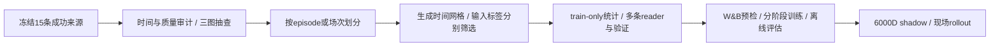

# 15条成功V1：下一轮训练配方讨论

这份文档是待讨论方案，不是已启动的训练。用户随后要求继续预处理并使用八张H20；最新参数统一见[根recipe](../../TRAINING_RECIPE.md)。用户确认“V1正式”15条全部成功、物体和任务相同；分组包含之前单条实验用的1条。原始录制与旧模型保持不变。

建议先完成多条数据质量/时间基线与独立验证接线，再用官方π0.5 base重新做LoRA。保留三图、ROI A、EEF10和训练增强；IK边界问题已列入TODO暂停研究。

## 已核实的数据

15条、17,241组原始观测，录制总时长577.575秒（约9分38秒，含结束保持/复位）。15条journal/payload完整、全部图像包及索引/日志哈希核对通过。任务成功来自用户当轮明确确认，不伪造工作台review状态；“比较基础的数据”作为用户的数据集描述，不当作模型任务指令。

三图必需、过去整组观测、质量阈值保持独立于FPS的技术统计：

| 网格 | 完整H50窗口 | 唯一输入观测 | 说明 |
|---|---:|---:|---|
| 30Hz | 14,756 | 14,245 | 17,273个候选网格点的85.43%；唯一观测占原始82.62%，不能称独立示教 |
| 20Hz | 9,564 | 9,564 | H50首尾跨度2.45秒，30Hz为1.633秒，不能把窗口数量差全部解释为降采样 |

这些统计已生成逐窗口索引，并提出12/3的episode划分；尚未生成正式发布训练集。排除主要来自非人工控制/Home/结束边界及完整未来窗口要求；30Hz中观测过旧拒绝213个起点。不是把所有被排除的点都判成坏采集。

各条观测间隔P99约41.3～60.4ms，最大267.824ms；三图接收时差的逐条中位数16.2～65.7ms、P99 48.3～94.8ms。主图header重复759对，逐对JPEG哈希验证均不同；不能当重复曝光帧删除，也不能将header当已校准曝光时刻。

源清单/逐条哈希/时间与窗口报告：`artifacts/20261016-v1-formal-audit/`。本轮索引统计显式使用三图，未沿用旧 `preprocess_baseline.json` 的双相机候选mask。

## 预处理已经做完与仍需补齐的部分

已实现并在旧单条训练消费：真实时间网格、过去有效观测、观测/未来动作有效性解耦、有效submitted动作标签、Home/epoch/控制来源边界、完整窗口、共享ROI/resize、增强、EEF变换、mask和统计。

2026-10-16补充：15条30Hz时间索引与整组/逐路候选诊断已完成，见[报告](../../DataPrehandle/reports/20261016-v1-formal-time-indexes.md)。

未完成：相机逐路缓存配组的训练/推理统一、曝光时钟校准与有证据的延迟补偿；15条逐阶段ROI/夹爪/插孔画面抽查；正式多条数据发布、按episode划分、train-only统计与独立验证接线。

现有 `prepare_eef.py` 对传入包整体计算统计；新轮须先划分再计算，验证复用训练统计。现有 `build_sft_dataloader(eval_dataset=True)` 明确拒绝单条验证模式，多个路径仅取首个；不能把15个目录直接塞给它并声称已训练15条。应先构建有完整episode来源的统一训练包与独立验证包，再完成验证适配。

## 时间处理建议与边界

先按SOP排查队列配组，再区分传输与源时间戳问题。保持原始30Hz录制；同一套质量门槛做30Hz/20Hz诊断，不能用低频放宽质量阈值。

首个可比较模型建议保留30Hz/H50，但正式发布前必须确认新数据的逐路年龄、接收时差及关键接触阶段可接受。若采用逐路最近过去帧，必须在训练导出和在线缓存同时实现，限定因果可用时间与最大年龄，不能只在离线重配后继续用旧在线整组。未确认的header时钟不用于固定毫秒补偿。

降到20Hz不会自动消除相机相互错位。若后续选20Hz，要同时修改动作播放节奏、H/执行前缀秒数、服务协议和reader；现实现固定30Hz/H50/执行20，不能只改数据FPS。

## 建议的V1训练与推理配方（待确认）

- 划分：约12条训练、3条验证；先按episode/采集场次隔离，并覆盖首/中/末、抓取/插孔阶段，不能随机打散重叠窗口。只有同物体基本场景，验证结论限于此分布。
- 起点：官方已验证π0.5 PyTorch base＋新LoRA；旧单条ckpt保留对照，不默认继续训练，因为新状态/动作统计将变化。
- 继承：LoRA r32/alpha16/dropout0，现有有效投影训练范围；右EEF10、三路图、ROI A、224等比补边、训练随机增强，验证/推理无增强；native FK/IK及容差不变。
- 统计：仅训练split，状态去重观测；验证报告状态饱和、物理越界量和量化精度。验证集不参与归一化估计；不借扩大统计范围掩盖错误来源或异常数据。
- 并行与batch：用户后续明确使用八张H20，建议micro2、累积1、global16；已复查八卡空闲，正式启动前再查。继续独立环境与W&B从第0步监控。
- 预算：先20～50步真实batch/恢复预检；新建议6000步首轮，2000/4000/6000阶段验收。暂定12条训练有11,791窗口，6000×16约8.14轮窗口曝光；不是6000步必然成功，按生成/实机表现选模。只有仍在改善时再讨论追加8000。
- 优化器沿AdamW、lr峰值1e-4、clip1；warmup建议占正式预算约5%，cosine到1e-5，`min_lr_rate=null`。这些属于新run日程，不能用新日程恢复旧单条训练。
- 每250～500步保存并评估：验证FM loss仅辅助；同时看固定噪声生成的EEF位置/旋转、夹爪时机、首步变化、状态越界和IK拒绝率。记录拒绝率不等于重启IK算法研究。
- 推理沿现有5步采样、H50预测/执行20/30Hz同步、RTC占位和有界恢复。选定checkpoint后先离线与真实相机shadow，再由现场执行多轮固定场景rollout，报告成功率/失败阶段，不只报告训练loss。

旧单条1000步约16分钟，只能当参考吞吐；多条读取/验证与checkpoint开销需要本轮预检重测，暂不给精确训练耗时承诺。训练与镜像遵循6000D开发推理、H20数据训练分工。
