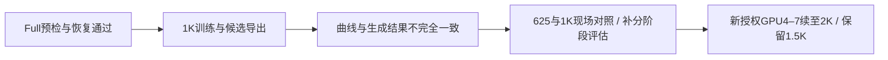

# V1_FullSFT：训练、续训与验收记录

本轮用15条V1从官方base做Full训练，加入自动Home和短窗口监督；1K训练及四个候选已完成。10月21日用户新授权空闲GPU4–7续到2K、保留1.5K，已从完整断点启动；原推理和IK服务保留。

这次续训用于观察原数据继续拟合的变化，不代表已解决孔口泛化与回位失败。读者先看下面续训状态，需要理解选模依据再看[1K复盘](#2026-10-211k完成复盘暂不自动继续2k)和[现场诊断](../../Eval/V1_FullSFT_20261021_ANALYSIS.md)；历史证据保持原样。

本页记录已发生的实验；当前部署及是否续训只看[STATUS](../../STATUS.md)，固定训练参数见[V1_FullSFT](../../V1_FullSFT.md)。日期：2026-10-20，复盘更新2026-10-21，北京时间。



## 2026-10-21 11:33：GPU4–7从1K续到2K

用户明确授权已空闲的GPU4–7用于本次续训，取代此前“4–7不分配”和“等0–3空出再到1.5K”的安排。启动前四卡显存使用均为0MiB，数据盘可用约23TiB；原GPU0/1 Full625/1K与GPU2 IK进程保留。训练rank0–3分别映射物理4–7，仍为四rank，不涉及改变world size的数据游标迁移。

| 项目 | 本次执行 |
|---|---|
| 起点与停止点 | 完整`global_step_1000`恢复至2000；首次1001更新已产生有限loss/梯度 |
| 数据、模型、统计 | 原冻结r1及12/3划分，全参数/global128、micro2×4rank×acc16，未混入新数据 |
| 恢复状态 | Adam抽查step1000；四rank RNG、数据epoch9/offset1258及原2K余弦日程；不重启warmup |
| 保存／验证 | 原125步频率，包含1500与2000；未删除旧checkpoint |
| 导出 | 训练到2K后依次导出1500、2000推理包；不自动部署 |
| 监控 | 同`f1full20261020main1`在线run，组`03_V1_FullSFT`，step从原999连续推进 |
| 后台进程 | tmux `f1-full-resume-2k-gpu4-7-20261021`；11:33:38 CST启动，不依赖IDE |
| 耗时依据 | 原热态10.37秒/步；追加1K含保存/评估预计3小时10分～3小时30分，按本次吞吐再修订 |

启动入口：[resume_v1_full_1000_to_2000.sh](../../scripts/resume_v1_full_1000_to_2000.sh)，只读预检与首批运行回执见[startup.json](../artifacts/20261021-full-resume-gpu4-7/startup.json)。此时尚未完成1500/2000，不把计划导出写成已完成。旧1500方案保留作历史，不能同时运行两个恢复入口。

启动复核已看到1014步，最近热态每步约10.4–11.0秒，loss/梯度有限；在线W&B history已看到新`_step=1010`记录，归组保持正确。按当前速度和既有保存/评估开销，预计1500约13:10–13:20、2K约14:45–15:05（北京时间），仅为共享负载下的初始估算。

H20日志：`/u01/user/runs/f1-toys-v1-full-20261020-r1/continuation-1000-to-2000-gpu4-7-20261021/train-to-2000.log`。同目录pipeline/exit-code与两个export日志记录最终结果；完整checkpoint仍在原run的`train/V1_FullSFT_B128_Home_TimeMask/checkpoints`。W&B：[同一正式run](https://wandb.ai/robotics-example/f1_complexytoys/runs/f1full20261020main1)。

下文“暂不自动继续2K”为11:33之前的历史判断，已被本次用户明确授权更新；过拟合和评估限制仍然成立。

## 2026-10-21：1K完成复盘，暂不自动继续2K

正式run在北京时间10月20日19:28完成最后生成评估并以退出码0结束，W&B状态finished，1000个optimizer update完整写入。250/500/625/1000推理包均已导出；停止点符合原来的1K评估计划。本轮仅分析已有结果，用户随后优先要求部署625和1K到H20比较，没有启动2K续训。

| checkpoint | 末50步训练loss均值 | 固定验证FM loss | 前min(20,L)位置误差mm | 旋转误差° | 夹爪误差点 |
|---:|---:|---:|---:|---:|---:|
| 250 | 0.028415 | 0.074757 | 6.470 | 0.971 | 0.773 |
| 500 | 0.016768 | 0.086082 | 4.439 | 0.766 | 0.540 |
| 625 | 0.014423 | 0.098512 | 4.474 | 0.674 | 0.338 |
| 1000 | 0.009513 | 0.128224 | 3.958 | 0.582 | 0.510 |

验证使用同一288窗口、相同四卡分配和每次重置的固定噪声；其结果从最早的125步0.062534开始，经过250/375/500/625/750/875到1K连续升高。训练loss仍下降，这是明确的过拟合信号；但FM去噪目标误差不等于完整多步采样后物理动作误差，也不是现场成功率。因此不能凭FM把1K判为一定比625差，或将最低的125步直接当成最好policy。

四个生成评估使用相同验证manifest、相同观测起点及两个固定seed；5步采样均20/20前缀IK通过。1K前段平均位置/朝向误差仍改善；完整H50的6个起点位置误差均值250/500/625/1000分别21.960/12.903/12.836/10.485mm。它们是示教观测上的开环预测，不代表闭环或新位置泛化。

### 评估覆盖不足，不能据此宣称学会抓取、释放和回位

现有20个样本实际为10个独立起点×2seed，覆盖3条验证episode。10个起点中4个不足50步（L=11/1/1/2），Home仅1个起点；前min(20,L)的夹爪标签均与当前夹爪一致，保持不动基线的夹爪误差为0。因此这个小样本不能验证抓取闭合、放置释放的切换时机，Home也没有足够独立覆盖。

625→1K的整体前段位置误差下降约11.5%，但人工示教9个起点的均值3.710→3.755mm基本持平；单个Home起点11.352→5.791mm贡献了主要改善。人工起点夹爪误差0.319→0.503点，属于保持值误差变化，不能直接解释为抓持/释放变差。需要补抓取闭合、持物运输、孔口接触、释放、人工→Home转换与回位末端的分阶段固定生成评估。

### 当前建议与资源预算

先比较625与1K的真实完整任务，逐阶段记录稳定抓取、插入释放、回位、首次IK拒绝；不要单用返回有效动作或到达孔上方计成功。当前用户决定先将两个候选接到H20，最新指定D14/S16，并复用已验收的CUDA Graph/完整VJP、原生数学加速及v5三图并行客户端。两个候选必须共用同一推理配置。

暂不直接续至2K。如果1K真实完整任务明显优于625，且扩大后的分阶段评估仍有收益，可先从完整1K断点续至1.5K再判断；保持原2K学习率日程和优化器，不重启warmup。若两者在位置变化或同一任务阶段同样失败，优先补对应数据/纠正，不能认为继续重复15条必然解决。

1K实际累计抽取128,000个窗口，约9.77轮名义曝光；2K约19.54轮，窗口高度重叠，不是新增示教。热态每步中位10.37秒，追加1K纯训练约2小时53分；按本轮保存/验证/导出开销，整体约3小时10分至3小时30分，取决于共享负载。若续训，H20 GPU0/1新推理服务与四卡训练冲突，需另行安排资源，不能同时直接启动四卡训练。

Full 250服务日志另见5个非shadow会话共324个返回请求、未见服务端IK拒绝；未在本轮逐帧审阅真实控制和物理任务结果，不能据此宣称324次任务成功。625/1K的完整任务成功率仍待现场验证。

证据：任务[20261021-full-review](../../artifacts/20261021-full-review/)中的原始训练日志/四份生成报告、W&B完整history、checkpoint-comparison.csv、summary.json及输入SHA；W&B的_step从0开始，本文optimizer步数按_step+1换算。训练核心与validation/dataset实现和冻结r1核对一致。没有修改训练、数据、IK或启动续训。

## 工程验收细节

<details markdown="1">
<summary>按需展开：启动、资源、保存恢复、W&B与复现命令</summary>

## 授权与实际资源

停止前核对本人PID1093268、1092844，均为`f1-toys-20261020-rtc-h20-v4-fastmath/h20_rtc_fast_server.py`，分别服务8137/8138。仅向这两个进程发送SIGTERM，随后GPU0–3显存为0；没有停止其他用户或全局Ray/tmux。

H20 `/u01`剩余约24TiB。新数据传输6,148,017,114字节，数据清单47,647项与代码1,605项逐文件校验通过，旧原件在H20已归档，不重复传输。

## 版本与运行入口

| 项目 | 路径／身份 |
|---|---|
| 冻结release | `/home/user/projects/task-releases/f1-toys-20261020-v1-full-r1` |
| 新数据 | `/u01/user/datasets/f1_toys_v1_home_mask_20261020/dataset` |
| run目录 | `/u01/user/runs/f1-toys-v1-full-20261020-r1` |
| tmux | `f1-v1-full-20261020` |
| 启动脚本 | `scripts/run_v1_full.sh` |
| 配置 | `configs/sft_eef_v1_full.yaml` |
| 物理GPU / batch | 0,1,2,3 / micro2×累积16×4=128 |
| 预检W&B | `f1full20261020pre1` |
| 正式W&B | `f1full20261020main1`（创建与写入以在线核验为准） |

2K学习率日程冻结，正式先运行到1K评估点。保存间隔125，250/500/625/1K阶段结束会导出Full bundle并做固定观测生成评估；未完成阶段不能称为已导出。1K后留下`REVIEW_AT_1000.txt`，不自动延长到50K。

## Full适配与验收

- 新增明确Full参数审核：所有base参数可训练、无LoRA叶子，逐进程保存参数名称/shape/dtype/数量。
- Full导出单独检查base键集合、有限权重、真实更新、无效动作投影保持不变；不套用LoRA冻结权重断言。
- 导出后逐tensor与checkpoint精确比较，加载实际Policy/新prompt/统计，对人工、Home、短窗观测运行5步采样；不连接机器人，不执行IK或发布。
- 预检2步→完整恢复第3步，检查Adam计数和每rank数据游标前进16个microbatch；正式独立从base初始化。
- 16项相关CPU回归通过；Home/时间mask上一轮45项CPU验收继续保留，不能相加宣称61个不重复用例。

首次四卡预检optimizer step约15.03秒，loss0.973、grad norm8.9有限，日志LR2.5e-7。单卡当时约65,917–66,157MiB显存；这是一小步采样，不是正式稳态吞吐或全程峰值。

完整GPU预检已通过：2→3步恢复，Adam计数2→3，四rank数据游标32→48；全部3,353,433,872参数可训练且无LoRA。导出中331个视觉张量、322个LLM/动作专家张量、4个动作投影张量出现实际更新，无效投影维度仍与base完全一致。

导出checkpoint→safetensors逐tensor精确一致，真实Policy/reader输入一致；人工起点0、Home起点1989、49步短窗起点910均完成5步采样，H50/32维有限且后22维恒零。没有机器人发布，不代表任务成功。

[预检回执](../../artifacts/20261020-v1-full-training/preflight-passed.json)、[保存恢复](../../artifacts/20261020-v1-full-training/resume-verification.json)、[导出/输入/采样验收](../../artifacts/20261020-v1-full-training/bundle-verification.json)。北京时间16:11正式W&B run已创建，从官方base重新加载开始；首轮已核验到第7步，约10.2秒/step，loss0.679、grad norm7.34有限；W&B在线写入已确认。实时后续步数见STATUS。

## W&B分类

| Group | 内容 |
|---|---|
| `00_Engineering_Checks` | 六条历史预检／恢复检查，以及本次Full预检 |
| `01_SingleDemo_LoRA` | 历史单条1000步LoRA |
| `02_V1_LoRA` | 原15条V1到50K的LoRA |
| `03_V1_FullSFT` | 本次正式Full128 |

旧八条run通过Public API只改group/job_type/tags；原名称、history、最后step均保留。前后回执：[本地证据目录](../../artifacts/20261020-v1-full-training/wandb-categories/)。

正式run：[W&B监控](https://wandb.ai/robotics-example/f1_complexytoys/runs/f1full20261020main1)；预检：[W&B工程检查](https://wandb.ai/robotics-example/f1_complexytoys/runs/f1full20261020pre1)。网页按Group分组即可区分，预检指标不写入正式run。

## 日常查看

6000D Bash：

```bash
ssh h20-train 'tail -n 10 /u01/user/runs/f1-toys-v1-full-20261020-r1/pipeline.log'
ssh h20-train 'tail -n 5 /u01/user/runs/f1-toys-v1-full-20261020-r1/train-to-250.log'
ssh h20-train 'nvidia-smi --query-gpu=index,memory.used,utilization.gpu --format=csv'
```

预检日志依次为`preflight.log`、`resume.log`、`resume-verification.log`、`export-check.log`、`bundle-verification.log`；`exit-code.txt`只有pipeline退出才写入。原推理未自动恢复，真机运动仍由现场用户启动。

实际安装的RLinf/Transformers scheduler端点核对：0步0，100步2.5e-5，1000步1.4679017636563742e-5，2000步2.5e-6；使用显式`min_lr_rate=0.1`。这是CPU函数端点验收，不是假称已运行到2000步。

</details>
