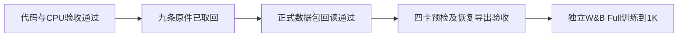

<!-- doc_type: experiment; status: review_at_1000; updated: 2026-10-22 -->

# V1＋DAgger单臂Full：实施与验收

**九条真实纠正和V1的新合同Full已正常完成1K，四份候选推理包与固定生成检查齐全；按计划停止复盘，没有自动续2K。** 本轮从官方base开始，保留V1完整流程监督，只学习九条纠正里的有效人工动作、审核Home与真实停稳。

**10月22日F1连接恢复，5.88GB原件全部取回；训练18,899窗、验证4,084窗均逐样本回读通过。** 新统计仅使用训练来源。源哈希、监督范围和输入版本已绑定；正式计数取代旧候选6,288窗。

训练已释放H20 GPU4–7，0–3四个旧Full服务保留；W&B已保存真实指标。验证loss后期上升、固定生成误差部分改善；现有生成前缀未覆盖夹爪切换，不能据此证明会松手。优先比较新250／1K，详见[训练指标与下一轮评测](../../Eval/V1fullSFT/README.md)。下方开训过程保留为历史证据。参数只维护在[本轮配方](../../V1_DAgger_FullSFT.md)，当前事实看[STATUS](../../STATUS.md)。

## 已实现与边界

| 部分 | 实现与检查 | 尚未验收 |
|---|---|---|
| 单臂输入 | 共享Processor在tokenizer前隔离左侧状态；左腕固定占位且mask=false；普通图像和prepared-pixels一致；训练增强只作用有效图 | eager／编译RTC同噪声隔离已通过；新模型部署及机器人shadow仍待 |
| 九条纠正审核 | 绑定原manifest、用户确认、同场次身份、人工首次有效操作、原生Home完成、真实保持；九份监督清单已生成 | 已取回并回读通过；实际训练收益待评估 |
| 起点与标签 | 初始准备等待不选起点；终点仅选Home完成后前3秒起点；合法未来动作范围保留。合成录制端到端验收通过，短于96窗可用 | 新九条5,797窗已确认 |
| 混采 | 每次global128严格96个V1＋32个纠正；来源内先均匀episode，再均匀起点；各样本loss系数1 | 已实测四rank更新，纠正占比严格0.25；持续观察正式训练 |
| 恢复 | H20生产依赖下检查每rank分片、跨epoch、数据游标及NumPy增强draw／Torch训练RNG续接 | 已通过真实Full两步→第三步、Adam step、数据游标及逐张量导出 |
| 验证 | 保留V1固定288点和旧纠正固定96点；分别报告来源与阶段loss；真实样本数加权，无效同步forward不计分 | 预检验证已写入W&B；正式训练效果待评估 |
| 启动链路 | 独立preflight与正式run，代码/统计/合同身份校验；每125步保存，250/500/625/1000导出与固定输入生成；1K停查 | 预检／恢复／导出／编译隔离全部通过，正式run已开始 |

CPU检查与真实GPU预检分开记录。`check_full_bundle.py`包含实际eager及生产suffix编译/RTC VJP路径的同噪声隔离检查；它在真实两步→第三步恢复之后执行。没有对机器人发布动作。

## 本次测试与资源证据

- H20独立暂存目录、生产训练环境、`CUDA_VISIBLE_DEVICES=""`：`test_mixture_sampler`、`test_right_only`、`test_formal_data`、`test_model_mask`、`test_eef_recipe`，**31 passed / 6.75s**。包含增强RNG恢复和按来源/阶段验证计数。
- 6000D隔离CPU容器：`test_formal_data`及`test_hil_reader_acceptance`，**15 passed / 2.32s**。合成原件明确标为synthetic，不进入真实训练；两种输入合同均跑实际录制→审核→索引→FK→reader。
- 新训练脚本`bash -n`及Python AST语法检查通过。上述为开训前CPU结果；10月22日新增真实GPU验收见下文，不混算。
- 北京时间18:28资源快照：GPU4–7各0MiB，GPU0–3各约17GiB，原PID为1528510、1528515、1563005、1636424；`/u01`剩余23TiB。启动时必须再查，快照不是预约锁。
- W&B现有账号在线认证通过；预检run已在线创建；正式run须在启动后确认。分类：正式`04_RightOnly_FullSFT/train`，预检`00_Engineering_Checks/preflight`。
- 旧V1 Full续训已到2K，退出码0，1500/2000包已导出；末步train loss约0.00274、val loss约0.21。它使用旧合同与旧数据，不能与本轮新统计下loss直接排名，也不证明现场改善。

详细回执与监督清单：[本轮产物](../../artifacts/20261021-v1-dagger-training/)。原始记录、旧数据包与冻结release没有改写。

## 恢复连接后接续

1. 通过既有`f1-09-deploy`只读取回`raw-files.txt`列出的九条原件；先核对完整性与已批准manifest哈希。
2. 运行`prepare_v1_dagger.py`：旧V1冻结12/3、九条同场次全训练、旧首条纠正单独验证；新统计只拟合训练集，生成独立目录并逐样本检查。
3. 用`stage_h20.py`冻结新代码与数据并校验SHA；H20当前`staging/v1-dagger-codecheck`只是CPU检查目录，不是正式release。
4. 新release下执行`run_v1_dagger.sh`。它先检查W&B、GPU4–7和数据身份，再执行两步预检→第三步恢复→Full导出/输入隔离→正式训练。任一检查失败即退出；不停止GPU0–3、不自动发布机器人动作。

本轮用户已授权开训；恢复连接后不需要重新询问同一训练许可。若GPU被别人占用，保留日志并重新协调，不杀未知进程。

## 10月22日真实数据与开训接续

- 原件传输：90个文件、5,875,652,166 bytes，rsync退出码0；九条源manifest及图片逐条通过审计，机器人原件未改写。
- 训练：V1原13,102窗＋纠正5,797窗，共18,899窗，其中1,387个短窗；验证：原V1 3,384＋旧纠正700，共4,084窗，固定评估起点288＋96=384。
- 九条纠正：起点上限筛除185个长终点等待起点，但合法未来动作不截断；真实终点保持继续监督。实际候选与正式范围差别见各条reader-audit，不用候选总数代替新包。
- **松爪监督没有漏掉**：九条指令是单次100→0跳变，按指令起止标注的release阶段为零时长，所以没有独立release起点；共446个有效窗口的未来标签包含开爪转换。训练日志`sample_phase/release=0`不能解释为夹爪不计loss；验证旧首条有独立release阶段点。见[实际标签检查](../../artifacts/20261021-v1-dagger-training/checks/release-supervision-20261022.json)。
- [实际模型输入图](../../artifacts/20261021-v1-dagger-training/checks/first-right-only-inputs-20261022.png)：第一条对孔、松爪前、Home、终点保持四个时刻，ROI保留桶与工作右手；左腕固定占位。此图是实际reader输出，不是生成图片，也不是全9条完整视觉覆盖声明。
- H20冻结：`f1-toys-20261022-v1-dagger-r1`，1,702个代码文件、44,387个数据文件的SHA验证通过；数据在`/u01/user/datasets/f1_toys_v1_dagger_right_only_20261022/dataset`。
- 流水线：`/u01/user/runs/f1-toys-v1-dagger-20261022-r1`，独立tmux `f1-v1-dagger-20261022`；物理4–7，0–3原PID保持。两步预检确认3,353,433,872个可训练参数、有限loss/梯度、实际纠正采样0.25；纯训练第二步约10.7秒，验证384点与保存另计。
- [在线预检run](https://wandb.ai/robotics-example/f1_complexytoys/runs/f1dagger20261022pre1)，归`00_Engineering_Checks`；保存后恢复沿同一run，正式实验另建`04_RightOnly_FullSFT`。

### 预检发现的编译兼容问题

首轮两步训练与恢复到第三步均通过，Adam step及数据游标连续，Full导出逐张量一致；eager实际输入/预测隔离也通过。随后suffix编译遇到Torch 2.7不支持`isinstance(kv_cache, list | tuple)`，流水线按门槛退出，正式run未启动。该问题与旧H20推理启动器中的既有兼容处理相同，不是数据或训练loss失败。

6000D将新核心改成语义等价的`(list, tuple)`，同时让H20启动器兼容新旧核心。原r1及其失败日志保留，r2仅暂存、未运行；最终使用独立r3冻结代码复验，原GPU0–3服务和旧冻结核心不改。新旧源码兼容及AST检查通过，r3已通过完整GPU复验，见下方回执。

### r3四卡预检通过

- [恢复回执](../../artifacts/20261021-v1-dagger-training/checks/r3-preflight/resume-verification.json)：四rank数据游标从32到48个micro-batch，所查Adam step从2到3，保持16次累积。
- [模型回执](../../artifacts/20261021-v1-dagger-training/checks/r3-preflight/bundle-verification.json)：Full导出每张量完全一致；真实human／Home／短窗输入训练与推理一致，生成有限且无效动作维为0。
- 左状态及左腕图扰动、prepared-pixels路径，实际eager模型同噪声预测完全一致；左图256个prefix attention token全部屏蔽。suffix编译的bootstrap和完整guided VJP路径也分别通过同噪声隔离。此处没有宣称新模型CUDA Graph或机器人闭环已验收。
- [汇总](../../artifacts/20261021-v1-dagger-training/checks/r3-preflight/preflight-passed.json)：3,353,433,872参数全部可训练，global128，GPU4–7。第二步纯训练约11.2秒，实际纠正比例0.25；恢复第三步有限loss／梯度。
- [修复版在线预检](https://wandb.ai/robotics-example/f1_complexytoys/runs/f1dagger20261022pre2)，仍归工程检查。r1失败原因与重试ID已补到原W&B summary，历史指标保留。

最终代码为`f1-toys-20261022-v1-dagger-r3`，当前run为`/u01/user/runs/f1-toys-v1-dagger-20261022-r3`，tmux为`f1-v1-dagger-20261022-r3`；r1／r2不作为正式训练版本。冻结发布与当前文档采用相同维护边界，后续当前状态不追写冻结release。

### 正式训练已启动

[正式W&B](https://wandb.ai/robotics-example/f1_complexytoys/runs/f1dagger20261022main1)已核验为running，group=`04_RightOnly_FullSFT`、job_type=`train`，与预检及旧Full分开。北京时间10:05左右初始化完成；最初两步loss约0.777／0.803、梯度范数7.58／6.53，实际纠正占比均0.25，第二步纯训练约10.6秒。这些是启动健康证据，不代表新模型任务能力已提升。

首轮预算仍为1K，完整保存间隔125步，250／500／625／1000导出并生成固定验证样本，到1K停查。按初期吞吐与既有导出开销估计约3–3.5小时，尚未到首个正式checkpoint；旧GPU0–3服务及机器人控制入口未切换。

10:07北京时间复查：正式已完成9次更新，末次loss约0.440、梯度范数2.92，纯训练约10.5秒／步；GPU4–7运行四rank，GPU0–3原四个PID均保留。[启动回执](../../artifacts/20261021-v1-dagger-training/checks/formal-start-20261022.json)与[在线W&B回执](../../artifacts/20261021-v1-dagger-training/checks/formal-wandb-20261022.json)保存可核对指标。

## 10月22日1K完成与评估交接

`exit-code.txt=0`，`REVIEW_AT_1000.txt`确认到达复盘点；125至1000每125步完整断点齐全。250／500／625／1000均已导出并完成固定留出输入生成检查（5步及10步去噪、各36条结果）。四份推理包存在不等于新版RTC已正式部署。

W&B正式run保持`f1dagger20261022main1`，group为`04_RightOnly_FullSFT`；各分段summary、训练尾日志、GPU快照和生成明细统一归档于[Eval本轮证据](../../Eval/V1fullSFT/artifacts/20261022/)。真实指标及局限只汇总在[Full评测与DAgger选模复盘](../../Eval/V1fullSFT/README.md)，不重复维护两张评分表。

下一步补释放切换/撤离/Home边界固定观测检查，再将新模型以明确身份接入统一推理。旧Full1K继续作工作基线；新250验证loss较低、新1K部分生成误差较低，建议优先比较这两端。不自动续到2K，不将旧三图处理器用于新单臂模型。
