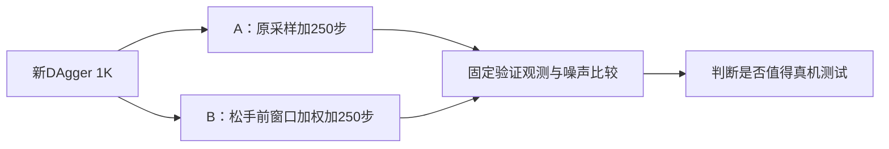

# V1＋DAgger：松手阶段采样对照

**两组已于10月22日20:08全部完成，结论是：阶段采样有局部帮助，但没有找到可直接替换的更好策略。** 原采样继续训练几乎没有改善松手；加强松手前窗口后，部分预测能张开了，但仍偏晚，并出现更早误松的副作用。

**暂不继续堆正式训练步数。** 10月23日用户要求后，A/B已按同一框架接入真机作诊断比较，原1K保留对照；同时推进释放时序审计与小样本拟合。Home尚无改善证据，不能把离线松手率当任务成功率，部署见[验收](../../inference/experiments/20261023-stage-ab-deployment.md)。

当前状态见[STATUS](../../STATUS.md)；下方先给结果，再保留原实验设计与历史启动记录。完整机器结果放[产物目录](../artifacts/20261022-stage-sampling/final)。

## 最终结果（2026-10-23复核）

两组都从同一新DAgger1K断点各训练250步到1250，流水线退出码0，A/B推理包及固定阶段评测齐全。训练各有250次真实更新，V1/纠正始终75∶25；松手临近起点实际占比A为3.46%、B为12.20%，符合设计。训练中位约10.2/10.3秒每步；A/B各约45分钟，含预检、导出、评测整条流水线约1小时48分钟。

以下是固定验证观测上的**离线预测**，每组36次＝12个观测×3个噪声，只有4条独立来源episode；不是36次真机试验。

| 松手指标 | 父1K | A：原采样1250 | B：加权1250 |
|---|---:|---:|---:|
| 应松手，但有效未来窗口内未完全张开 | 18/36 | 18/36 | 9/36 |
| 完全张开时机距专家≤3帧（0.1秒） | 3/36 | 4/36 | 6/36 |
| 比专家提前超过3帧张开 | 0/36 | 0/36 | 3/36 |
| 有符号松手时差均值，未松记窗口末端的下界 | 24.39帧 | 24.25帧 | 16.97帧 |
| 应持物，但H50中预测完全张开 | 7/36 | 9/36 | 9/36 |

B的时机下界在4条episode中3条改善，但“未松18→9”的全部变化集中在一条episode；该条新增松手仍在未来第40–48帧，另一条仍全部未松。因此不能把总体未松数减半解读为普遍解决卡住。

### 防止平均分误导的补充核对

以下为看到结果后的探索性分层分析，原固定面板与预测未改动；不增加新模型采样，也不作为事后编造的预注册门槛。

| 补充指标 | 父1K | A1250 | B1250 |
|---|---:|---:|---:|
| 应持物，前16帧出现完全张开预测 | 0/36 | 0/36 | 1/36 |
| 应持物，前32帧出现完全张开预测 | 2/36 | 2/36 | 4/36 |
| Home前16帧位置误差，只纳入至少16步真实标签 | 31.39mm | 31.82mm | 31.68mm |

全H50的A/B误松数相同，但B更早预测张开；这些是无RTC引导的bootstrap预测，不等同于RTC最终执行误松。Home原面板中包含3个L=1、1个L=5的末尾样本，剔除后仅5观测×3噪声；回位前缀偏差仍在约31mm，没有改善依据。所有模型的bootstrap32步IK均通过，也不能证明回位轨迹正确或不会碰桌。

固定噪声的常规验证flow loss由父1K约0.15762升至A 0.18937、B 0.18926，而各自训练loss继续下降。这支持“盲续没有带来整体验证收益”，不能用B训练loss高于A判断B更差，因为两组抽样分布已不同，也不能仅凭这些loss宣布唯一根因。

### 对下一步的影响

1. 采样配方确实会改变释放行为，但本轮4倍权重没有达到“改善释放且不增加误松”的目标，不把它直接升级成默认recipe。
2. 保留新DAgger1K为对照；B1250可用于少量人工监督的诊断性真机比较，先看持物/对孔/松手/回位四阶段；实验结束时未部署；10月23日随后按用户要求部署A/B，仍由用户现场启动动作。
3. 数据侧优先核对临近帧的插入→松手→撤离时机和输入可辨识性，补稳定的专家恢复及回位停稳。新增schema4适配仍需完成；不盲目增加大量相似数据或把下一轮只设为更多训练步数。

W&B均已`finished`且分组为`05_DAgger_StageSampling`：[A组](https://wandb.ai/robotics-example/f1_complexytoys/runs/f1stage20261022a1)、[B组](https://wandb.ai/robotics-example/f1_complexytoys/runs/f1stage20261022b1)。W&B最后日志step为1249，训练checkpoint为1250，是原runner日志编号口径；两个checkpoint均已保存，不是少训一步。

原始指标：[comparison.json](../artifacts/20261022-stage-sampling/final/comparison.json)；分层复核：[agent-eval-review.json](../artifacts/20261022-stage-sampling/final/agent-eval-review.json)；训练流核对：[training-summary.json](../artifacts/20261022-stage-sampling/final/training-summary.json)。

## 两轮合起来，能归因到哪里

第一轮是V1＋九条纠正、75∶25混采，从官方base重新做单臂Full到1K；第二轮是同一新1K分叉的原采样/阶段加权对照。第一轮同时改变输入合同、训练数据与统计，没有同条件V1-only对照，各checkpoint也只完成一次首轮真机，因此不能认定“DAgger使模型变差”。九条主要是后半程恢复，不等同九条新增完整抓取任务。

已确认的瓶颈是对孔/插入/释放/撤离与回位尚未形成可靠闭环；采样改变能影响松手预测，却没有解决时机判断。部分训练样本也预测偏晚，说明不能只归结为未见场景太多。训练loss下降而验证loss上升提示过拟合倾向；这与短暂关键阶段拟合不足可以同时存在，并不等于训练代码算错，也没有证明模型容量不够。

下一步优先做能区分原因的诊断，而非继续把数量或步数调大：

1. 对少量真实释放事件核对输入画面、状态与已发布夹爪标签的时间对应，分别看应保持夹持/继续对准与应释放的观测；原件完整性通过不等于阶段时序与可辨识性已证明。
2. 再用少量明确成功事件做受控拟合检查，并保留独立事件验证。如果连这些训练事件也学不准，先定位输入处理、监督时序、动作窗口/时间mask、损失各维与优化；如果训练事件能学准、独立事件仍失败，再重点补覆盖和专家动作一致性。这个诊断只检验学习链路，不能当可部署策略。
3. 采集继续围绕完整“对孔→插入→松手→撤离→Home真实停稳”及恢复状态，并保留尚未插入时正确保持夹持/继续调整的监督，避免只增加张爪样本。新schema4先完成导出/reader适配再入训。

上述建议已于2026-10-23获用户同意：A/B部署完成，释放链路审计与小样本拟合按顺序执行。进度以[STATUS](../../STATUS.md)为准，现有A/B结果与父1K对照保留。

## 原实验设计与启动时记录

## 唯一训练变量

B组在每条episode内部，将“当前夹爪≥90，未来有效标签第0–29帧内出现≤10”的观测起点，抽样权重设为普通起点的4倍（0为全开、100为全合）。这是基于专家标签的**松手临近代理条件**，不是视觉插入成功判定；仍监督该起点原有的整段有效动作，不添加提前松手标签。

来源与episode抽样顺序两组完全相同；B只改变episode内起点。每个起点仍有非零概率，保留完整抓取、移动、插入、释放和Home。不是把纠正源比例从25%提高，也不是单独提高夹爪loss。4倍是组内抽样权重，不等于全局松手样本占比乘4；真实占比由冻结清单计算并在W&B记录。

## 冻结设置

| 项目 | 两组共同设置 |
|---|---|
| 父断点 | `f1-toys-v1-dagger-20261022-r3`的`global_step_1000`；不是旧V1 Full1K |
| 数据 | 已冻结的schema3，train18,899、validation4,084；12条V1＋9条纠正训练，3条V1＋旧1条纠正验证 |
| 初始化/恢复 | 同一权重、Adam、LR进度、RNG、数据epoch/游标；A原序列，B在同一游标开始使用加权起点 |
| 训练量 | 两组各250次global128更新，各32,000次窗口抽取；到1250停查 |
| 输入与监督 | 右侧有效状态8维、主图/右腕、ROI A、原随机增强、右EEF10、H50/时间mask、原prompt |
| 混采 | 每global128严格96条V1、32条纠正；来源内episode均匀 |
| 优化 | Full、micro2×4卡×累积16；原2K cosine日程，不重做warmup，不重置优化器 |
| GPU | H20 4–7顺序运行两组；0–3现场推理保持不变 |
| 保存与评测 | 1125、1250保存，125步常规验证；1250额外固定阶段生成评测 |
| W&B | 独立group `05_DAgger_StageSampling`，A/B各新run；预检`00_Engineering_Checks`，父run不接写 |

训练模型代码不改；worker只增加采样比例日志与恢复步数断言。冻结新release，父release、原始数据与既有部署保持只读。新增录制schema4适配是另一项待办，不混入本轮实验。

## 离线评测怎样判断

先冻结验证episode中的观测和3个噪声种子，分别覆盖：即将松手、未来H50不该松手、即将抓取、松手后张爪、Home。松手后阶段由状态时间关系生成代理标签，不能据此声称已精确标注插入/撤离成功。父1K、A1250、B1250使用同一面板与5步去噪，无RTC引导。

重点比较松手提前/延后、有效预测范围内始终不松、持物阶段误松，以及抓取/回位EEF偏差。按阶段、episode看结果，不用整体loss掩盖转换问题。迟迟不松的样本按有效窗口末端计算延迟下界，并单列未松比例，不能丢掉这些失败样本后算均值。三个噪声不是三次独立真机成功试验。

- **B比A好且其他阶段不退化**：支持当前采样分配存在可改善空间，再真机确认。
- **A、B相近且都改善**：更支持增加训练量本身的收益。
- **两组都不改善**：不盲目扩大权重或继续堆步数，回到观测可辨识性、专家策略一致性和覆盖缺口排查。
- **B更早松但也更常误松**：不算成功，说明提高抽样频率有副作用。

已有验证集来自同任务/物体，能检验未参加训练的episode，不代表新的摆放范围泛化。离线生成没有执行环境反馈，最终仍需现场闭环比较。

## 实施与证据

13项采样测试已通过，冻结训练松手临近起点620个；按来源/episode实际抽样，A预期占比3.37%，B为12.08%。独立验证面板54个阶段案例、4个heldout episode、每例3个固定噪声，协议在看新结果前冻结。真实断点1000→1002分叉及1002→1003恢复全部通过；优化器、LR步数、四rank数据游标已核对。启动时A组已进入1001之后更新、B组顺序排队；最终两组均完成，且未用预检1003作为正式父断点。每次预检和训练均在线W&B；正式训练纯计算预计两组共约86分钟，加初始化、验证、导出约1.5–2小时，实时吞吐为准。

实现：[采样器](../../src/f1_toys/sampling.py)、[数据读取](../../src/f1_toys/dataset.py)、[冻结清单](../../scripts/prepare_stage_sampling.py)、[阶段评测](../../scripts/evaluate_stage_sampling.py)、[四卡流水线](../../scripts/run_stage_sampling.sh)。

### 本轮运行记录（2026-10-22，北京时间18:35快照）

- 新release：`f1-toys-20261022-stage-sampling-r3`；新run：`/u01/user/runs/f1-toys-stage-sampling-20261022-r3`。前两次准备被Hydra配置解析检查挡住，未进行训练更新；最终使用与父配方逐项核对的完整配置，失败日志保留。
- [A组W&B](https://wandb.ai/robotics-example/f1_complexytoys/runs/f1stage20261022a1)正在训练，已过1012；B组将在A完成后以独立run `f1stage20261022b1`启动，两者归`05_DAgger_StageSampling`。当前稳定约10.5秒/步，余下两组加评测/保存预计约1.5–2小时。
- [预检W&B](https://wandb.ai/robotics-example/f1_complexytoys/runs/f1stage20261022pre1)归`00_Engineering_Checks`；13项采样测试、真实父游标四rank对照、优化器分叉和恢复回执在产物目录。模型核心文件与父release相同。
- 先冻结验证面板再评估：54个互异观测、3个种子，共162次预测；没有机器人输出。父1K基线已完成，A/B完成后自动导出并在同一面板评估，生成`comparison.json`，不自动替换现场服务。
- Why&How正文、表格与Mermaid浏览器核验通过。额外向W&B上传恢复审计等内部元数据的动作被自动审批拒绝，理由是此类披露授权不充分；相关审计仅本地留证，标准训练指标/分组照常。

### 父1K的固定验证基线

在12个“即将松手”的验证观测×3个噪声中，18/36次预测在有效未来窗口内没有完全张开；只有3/36次的完全张开时刻与专家相差不超过3帧。将未张开的时刻按有效窗口末端计为下界，平均延后至少24.4帧（约0.81秒）。这是离线生成时机误差，不是真机成功率。

在12个“未来H50应继续持物”的观测×3个噪声中，7/36次反而在未来窗口内预测了完全张开。它们可能落在较远的未来，不能等同于实际执行误松，但必须作为B组副作用检查。抓取、松手后及Home的位姿/夹爪误差也已冻结留证；这是开训前基线快照，最终A/B结论见本文开头。
