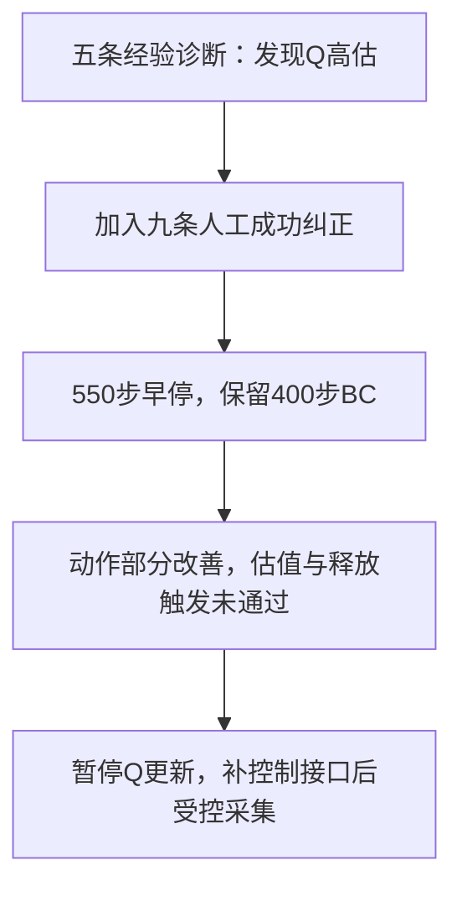

# 冻结 B1250：复用 DAgger 成功纠正的 RLT 试验

**10月27日真实输入复查完成：BC400在线输出可由冻结权重在CPU上复现，未见服务端加载／计算错配。** actor在这次局部状态中近乎固定闭爪小动作，但在旧711个转移上并非全局常数。隐藏层饱和、参考与姿态利用弱，以及释放监督稀少共同构成后续对照方向；没有证明唯一根因。

**当前BC400已经接入真机试用，权重本轮未更新。** B1250和encoder冻结；Q分支仍未启用，录制修复及当前部署见[推理报告](../../inference/experiments/20261026-rlt-runtime.md#record-fix-20261027)。本页早先“未部署”结论适用10月26日离线阶段。

下一轮先做输入处理与释放采样的单变量BC对照，按阶段和独立验证评价，不依据总loss继续加步数。此次两项诊断均为CPU零更新，W&B保留offline记录，详见下节。



<a id="actor-constant-20261027"></a>

## 10月27日真实actor近恒定输出：零更新复查

复用现场会话`cceaf7d236b040de955478ff64233959`的36次请求，每次从H20日志读取实际`z_rl`、8维proprio、B参考动作和actor输出；使用正式导出头在CPU上重放，不重新运行VLA、不更新权重、不连接机器人。35段现场被采用，最后一段在人工接管后取消；这里36次均用于数值诊断。头文件SHA前后一致。

| 证据 | 结果 | 可支持的结论 |
|---|---|---|
| CPU actor与服务日志最大绝对误差 | `1.79e-7` | 排除这一批请求的明显权重加载／forward错配；不是端到端视觉正确性证明 |
| 输入并非恒定 | token、proprio、参考的跨请求平均标准差分别0.02454、0.04530、0.02018 | 不存在全量输入被缓存为同一向量的现象；仍不代表视觉表征足够区分任务阶段 |
| 第一隐藏层`tanh`饱和（绝对值>0.99） | 现场85.72%；旧缓存82.64% | 内部响应被压缩；与早先检查的**输出夹爪tanh**不是同一层 |
| 首层线性项RMS：token／参考／proprio | 6.238／0.537／0.090 | token贡献占主导；仅靠这个比例不能证明应将token去掉 |
| 现场归一化动作跨请求平均标准差 | 0.000364 | 与近固定小模板的真机观察一致 |
| 旧711转移的actor／全局均值基线MSE | 0.01131／0.08399 | 网络并非所有输入都给同一动作；此为全缓存描述统计，含开发验证，不是新增独立测试 |
| 同时刻B参考与actor的前16步 | 两者36/36都没有开爪（以归一化夹爪<0作为诊断阈值） | 不能将此次失败表述为actor删除了B已经正确预测的释放；B参考未被实际执行，不能据此判定B整条任务会失败 |

已有checkpoint对照：现场首层饱和由初始化20.33%变为50步73.43%、100步75.53%、200步83.18%、400步85.72%、550步81.45%。总缓存MSE先降后升，局部输入敏感性没有同步改善。进一步把训练集中133段包含开爪的B参考替换到同一个现场token／姿态，仅3段actor输出出现开爪，支持其参考利用较弱；这是**不物理一致的反事实敏感性检查**，不是成功样本、真实奖励或应该松爪的证据。

将现场token暂缩放0.1可令第一隐藏层饱和归零，但输出跨请求变化反而更小；因此不能把“推理端除一个数”当作修复，也不能断言饱和是唯一原因。当前更准确的诊断是**BC学到了这个局部状态附近的保守闭爪动作，弱参考利用、内部饱和和释放转折欠覆盖均需控制变量验证**。此前释放转折抽样仅2.14%、训练漏开53/54、开发验证2/2仍是有效证据。

下一轮建议保持B与encoder冻结，固定数据、种子和原400步基线，先比较训练集拟合的输入中心化／尺度处理，再单独比较释放转折和未对准持物的平衡采样；先不同时改网络、目标和奖励。处理统计只来自训练集，随新head导出并由服务端同版本消费。按接近、插入、释放、撤离分别检查动作误差、漏开／误开及隐藏层敏感性；开发验证恶化就早停，不用训练loss选择。参考dropout目前50%，另列独立消融，不直接归罪于它。本轮**未实施新训练，也未发布任何缩放／反事实模型**。

证据：[主诊断](../artifacts/20261027-rlt-actor-constant/diagnostic.json)、[checkpoint及反事实对照](../artifacts/20261027-rlt-actor-constant/history.json)。脚本为任务`scripts/diagnose_rlt_actor_constant.py`及同产物目录`checkpoint_probe.py`；完整输入副本留H20本人run下，源请求日志只读。W&B group=`10_RLT_Training_Diagnostics`，job分别`actor-input-evaluation`／`actor-checkpoint-evaluation`，均offline：

```bash
# H20，使用既有训练环境；这些是同步已有日志，不是重训。
wandb sync /u01/user/runs/f1-rlt-dagger-success-20261026-r1/actor-constant-20261027-r1/wandb/offline-run-20261027_202210-v2y5flka
wandb sync /u01/user/runs/f1-rlt-dagger-success-20261026-r1/actor-constant-history-20261027-r1/wandb/offline-run-20261027_202555-t76xd81y
```

## 五条经验的诊断结论

同一批 408 个保存状态交叉比较实际行为动作、B1250 参考、300 步 actor 和 800 步 actor；没有参数更新，没有发送机器人命令。CPU 运行，原 checkpoint 与内存参数哈希不变。[完整诊断](../artifacts/20261026-rlt-stage2/diagnosis-r1/evaluation/report.json) · [W&B](https://wandb.ai/robotics-example/f1_complexytoys/runs/f1rlt2diag20261026r1)

| 留出失败终点的动作 | critic300 双Q | critic800 双Q | 已知结果 |
|---|---:|---:|---|
| 实际执行动作 | 0.208 / 0.313 | 0.576 / 0.624 | 真实目标为0 |
| B参考 | 0.173 / 0.323 | 0.384 / 0.424 | 反事实，未实际执行 |
| actor300 | 0.216 / 0.358 | 0.357 / 0.472 | 反事实，未实际执行 |
| actor800 | 0.306 / 0.342 | 1.039 / 1.037 | 超过回报上界，真实任务结果未知 |

真实终点均正确终止自举，排除了这批数据中终点 mask 直接漏乘的解释。critic800 使用 actor800 下一动作的 TD 目标比固定 B 平均高 0.0312、最大高 0.3878；其留出 TD MSE 为 0.004906，改用固定 B 目标时为 0.012028。低 TD loss 可以来自追随抬高的目标，不能证明估值正确。

从300到800步，位置参考误差3.13→2.64毫米，但rotation6D误差0.01327→0.01875、夹爪误差0.05445→0.06084。总MSE掩盖了分维退化。上述证据足以否定直接采用800步候选；若要进一步区分持续拟合与联合更新的因果作用，仍需要控制变量训练，本轮不把再次重复五条试训作为人工BC的前置门槛。

## 数据与监督范围

- 原五条数据继续保留：四条训练、一条失败开发验证；原缓存的特征、参考和真实行为动作逐张量保持不变。
- 九条旧 Full1K＋手柄成功纠正，来自同一进程，整体进入训练。它们已用于 B1250 前身 SFT，此次用于不同小网络和损失，不是新增独立场景。
- 旧r1成功纠正保留验证：SFT训练0窗、验证700窗，token训练0观测、验证64观测。允许开发检查，不称全新测试。
- 九条纠正作为同一场次整体训练，另一场次旧r1和原自主失败用于开发验证；旧r1曾参与SFT/token验证选模，不能用本轮结果证明跨布局泛化。
- 人工部分仅取审核允许的持物后调整、插入、释放和撤离；原生Home与终点保持不冒充手柄动作。局部成功结束需绑定撤离后的真实观测及既有成功确认，不能仅凭张爪或按Y赋奖。
- 不跨接管、暂停、日志缺口、人工摆放或episode拼接；当前局部成功标准与五条试训一致。
- 使用原始实际下发的16维命令，经同一FK和观测锚点转换到EEF10，再按B统计归一化。重新计算当前B的token和参考动作，保留旧采集模型身份，不把旧模型proposal当当前B参考。

人工段 actor 的模仿目标采用真实人工动作，其他段采用 B 参考；critic学习实际行为动作及后继状态/奖励。整体成功不代表整条混合轨迹都是专家动作，策略失败动作不进入专家模仿目标。[已有纠正审核和SFT配方](../../V1_DAgger_FullSFT.md)

## 训练预算与继续条件

小actor/双Q沿用首轮结构、输出参数化、batch64、学习率3e-4、折扣0.999/30Hz、C16；冻结B和encoder，不继续大模型SFT。小头重新随机初始化，使用新run，不从已高估的800步续训。训练source按segment均匀抽样，10%抽真实训练终点；不抽验证数据。

| 阶段 | 上限与检查 | 更新方式 | 停止规则 |
|---|---|---|---|
| 工程预检 | 2步保存、恢复到3步 | 验证新增人工监督与恢复 | 身份、数值、恢复不一致即停止 |
| 人工动作预热 | 先300，最多600；每50检查 | actor仅模仿，critic固定B下一动作自举 | 300之后连续3次固定专家验证误差不改善即停，保存此前最优 |
| Q分支 | 最多200；每50检查 | 从审核后的BC候选开始，critic每步、actor每4步更新 | 估值和动作持续退化或越界扩大则提前结束；不自动启动 |

600＋200是主训练更新预算，不含2→3步工程检查；actor与critic真实优化器步数分别记录。“步”是梯度更新，不是机器人完成一次任务。最终报告有效转移数及batch曝光量，重复采样不能称新增交互。

第一轮300步已经能明显学习参考动作，而到800步估值恶化，所以本轮选择短检查周期；新增人工目标的收敛情况仍需实测。原论文2000–10000步属于VLA/token阶段，400–1000个episode属于持续交互的在线阶段，均不能直接决定此固定小数据集的预算。[RLT论文](https://arxiv.org/html/2604.23073v1)

## 指标为何有用、不能说明什么

| 指标 | 依据与用途 | 限制 |
|---|---|---|
| 留出专家动作误差 | 与真实人工动作比较，分位置/姿态/夹爪；检查小actor是否学到纠正 | 模仿准确不等于接触成功 |
| 持物阶段预测张爪 | 对真实人工仍持物的步检查预测是否越过开闭中点 | 只是动作分类探针，不是实际掉落概率 |
| 成功/失败终点双Q误差 | 真实终止后不自举，目标由真实0/1奖励和块内折扣确定 | 每类只有很少独立终点，需逐条报告 |
| Q范围和双Q差 | 当前单次成功+1、其余0的折扣回报位于[0,1] | 轻微逼近误差不等于策略必然失败；不靠裁Q制造合格 |
| 固定行为回报 | 完整且连续的已知结果轨迹可提供非自举诊断 | 行为策略的回报一般不等于新actor的Q真值；截断不补零结局 |
| TD loss | 检查拟合自举目标的程度 | 不能作成功率或主要停训依据 |
| 原IK与回读一致 | 检查动作转换、可解性与权重装载 | 不能替代RTC或真机接触验证 |

不把多项指标压成一个分数掩盖误松或终点退化。没有理论保证的绝对loss门槛；每50步、耐心3次是事先约定的运行规则。离线候选即使通过，也只支持准备后续现场对照，不能自动替换原B。

## 实施与证据

数据、预检、主训练和审计均使用独立分类W&B；保留recipe、源码快照、原件与派生哈希、checkpoint、实际更新数和停止原因。原件不改写，推理服务和机器人无动作。

本轮产物目录为[20261026-rlt-dagger-success](../artifacts/20261026-rlt-dagger-success/)。schema3人工适配、真实发布与时间边界检查、人工监督mask和早停等39项检查通过；真实2步保存、同W&B run恢复至3步通过。冻结训练源59文件哈希校验，H20主流水线退出0。

合并后共711个转移、754个源观测：训练558=原自主290＋九条人工268；开发验证153=原自主失败118＋旧r1人工成功35。原408转移的所有张量前缀逐值保持不变。十条人工记录每条恰有一个经核查的局部成功终点，原件不改。[原件与终点核查](../artifacts/20261026-rlt-dagger-success/source-audit/candidates.json) · [合并缓存审计](../artifacts/20261026-rlt-dagger-success/h20/cache/audit.json)

预热实际完成550次actor与550次critic更新。第400步留出专家MSE最好，随后450/500/550三次都没有改善，触发预定patience3；选中权重对应400次更新。按batch64折算，550步约为训练转移数的63倍采样量，实际按segment与终点加权，不能解释为63次新交互。[训练结果与完整历史](../artifacts/20261026-rlt-dagger-success/h20/bc/result.json) · [预检恢复](../artifacts/20261026-rlt-dagger-success/h20/preflight/result.json)

| 第400步候选的开发检查 | 实际结果 | 解释 |
|---|---|---|
| 人工动作MSE | 随机初始化0.310858→0.021131 | 比较随机小actor与训练后小actor，不是机器人成功率 |
| 人工位置平均绝对误差 | 3.008毫米 | 保存状态上的动作误差，不是实测末端跟踪误差 |
| 人工rotation6D平均绝对误差 | 0.013200 | 不能直接当成角度误差 |
| 人工夹爪误差 | 归一化0.135952，对应命令范围6.798个百分点 | 不是物理夹爪开口毫米 |
| 持物步预测张爪 | 0/334 | 同一条保存纠正的动作分类探针，不是334次独立试验 |
| 应张爪步未预测张爪 | 2/226 | 仍存在动作时序误差 |
| 真正释放转折块中的应张爪步 | 训练漏开53/54；验证漏开2/2 | 关键触发仍未学好，不能用后续已张爪状态掩盖 |
| 留出失败终点实际动作双Q | 0.416466 / 0.403363，真实目标0 | 仍高估 |
| 留出成功终点实际动作双Q | 0.385415 / 0.377513，真实目标0.985105 | 低估，且排序反转 |

因此没有启用Q引导更新，也没有产生Q分支run。选中的是人工BC候选，critic不能作为可靠的策略优化依据；新增成功纠正不自动解决估值问题。两个训练失败终点的双Q也仍约0.560/0.558与0.371/0.366，因此不能将本轮问题仅解释为“验证样本没见过”。后续应分别检查终点拟合、表征区分能力和自举目标影响，再决定新的估值实验，不能靠追加步数或单纯裁Q掩盖。

同一条留出人工纠正上，以真实人工动作作共同目标，B参考与400步候选的MSE为0.045286→0.021131，位置平均绝对误差3.274→3.008毫米；但rotation6D误差0.006189→0.013200、夹爪命令误差5.741→6.798个百分点。持物步误松29/334→0/334，漏松仍2/226。该比较只是保存状态上的动作拟合，不是新actor真机成功率；释放转折仍失败，因此不宣称已解决迟迟不松手。

最终CPU审计在16个segment各选开始、释放附近（无释放则中段）、终点，共48个保存状态，对实际动作／B参考／候选的144个计划通过原受限IK；独立实例载入导出权重后actor和critic逐值一致。IK通过仅是离线可解性，控制接口和任务成功仍未验证。导出明确标记`phase=bc`、Q引导更新0、critic不可用于可靠策略优化、`deployment_ready=false`。[候选审计](../artifacts/20261026-rlt-dagger/audit/bc/report.json) · [导出身份](../artifacts/20261026-rlt-dagger/audit/bc/export/manifest.json)

全部训练分类为`09_RLT_Stage2_DAgger_B1250`，预检单列`00_Engineering_Checks`；[缓存W&B](https://wandb.ai/robotics-example/f1_complexytoys/runs/f1rltdagger20261026r1cache)、[预检W&B](https://wandb.ai/robotics-example/f1_complexytoys/runs/f1rltdagger20261026r1pre)、[预热W&B](https://wandb.ai/robotics-example/f1_complexytoys/runs/f1rltdagger20261026r1bc)。

## 400步候选的零更新排查

本轮在CPU读取既有权重和711转移，做输入重建、反事实输入替换和梯度分析；没有创建优化器或修改参数，没有加载大VLA/encoder做新训练，也没有机器人命令。新增诊断使用独立`10_RLT_Training_Diagnostics`分类。在线W&B上传被自动审批拒绝，理由是内部评估指标向外部导出的授权不够具体；改用W&B offline保存，不能称已在线同步。原训练在线run及其历史不变。

### actor：释放触发监督少，当前目标主要推动位置和撤离拟合

303个人工动作块的4,848个采样下发目标逐项回查原始控制日志，经同一FK/归一化重建与缓存完全一致；人工监督mask确实选择真实人工动作，自主段选择B参考。`release_transition`与实际C16内开闭切换完全一致：训练8块、开发验证1块；另一次人工释放跨过被质量筛选排除的缺口，不补造中间动作。

复现冻结随机种子与抽样器，到400步共25,600次抽样，其中释放转折548次，占2.14%；这是确定性重放抽样计数，不是新增交互，也不是历史逐batch日志。在400步当前权重处，用这组采样权重及50%参考dropout的精确期望分解BC梯度：位置项沿总梯度的投影占91.74%、夹爪8.33%；按阶段分解，撤离占76.59%、释放转折2.37%。投影份额可以为负，不是成功率或独立梯度范数占比；这只说明当前局部更新方向，不代表整个训练历史。

| 真正释放转折块 | 原B参考 | BC400 | 含义 |
|---|---:|---:|---|
| 训练仍应持物却预测张爪 | 31/74 | 0/74 | 变得更保守 |
| 训练应张爪却未张爪 | 42/54 | 53/54 | 触发仍未学好，甚至漏开更多 |
| 开发验证应张爪却未张爪 | 2/2 | 2/2 | 没有改善这一转折 |

总体人工训练MSE原B为0.01045、BC400为0.01628；开发验证则为0.04529→0.02113。开发验证总体改善不代表每个维度或训练阶段都改善。去掉参考输入后，训练转折漏开变成54/54、开发验证仍2/2；不能解释为只要去掉B参考即可修好。55个漏开点的tanh导数中位0.584、最小0.312，不支持输出饱和导致梯度消失为主因。释放梯度与总梯度余弦为+0.274，不是释放监督整体反向冲突。

相邻等待与释放块有近似相同关节/token而专家未来动作不同的例子：训练475→476相隔0.533秒，最大右关节变化0.00683°、token余弦0.999985；开发验证695→696也有近似状态。这是当前表征能否辨认释放时机的线索，不能据此证明视觉完全相同或不存在可辨信号。每个观测的B参考噪声种子不同，不能将跨观测参考差异全部归于图像。


图中夹爪0为打开、100为闭合；曲线为保存观测上的预测/记录命令，不是机器人跟踪测量。黑色为人工，黄色B，蓝色BC400，紫色为置零参考的输入消融。[训练释放例](../artifacts/20261026-rlt-actor-release-diagnostic-r3/release-fd0a2c7e-476.png) · [完整数值、梯度与不变性证据](../artifacts/20261026-rlt-actor-release-diagnostic-r3/report.json)

下一轮actor实验应单独核对释放转折的采样/损失贡献，同时保留未对准持物例，继续报告误松与漏松，不能只优化总MSE或只补已张爪后的撤离。是否需要更多历史条件或调整表征，需在同数据单变量对照中判断；本轮未修改训练配方或权重。

### critic：失败确实参与训练，当前梯度未能分别校正成功与失败

711条current/next右侧proprio和14个真实终点的EEF动作重建最大误差均为0；无效模型状态为0、输入拼接布局正确，终点目标确实不含自举。诊断使用保存的target critic与固定B下一动作，所有目标在`no_grad`下固定，没有soft update。新增诊断4项检查通过，参数/文件哈希及GPU服务进程前后不变。[完整报告](../artifacts/20261026-rlt-dagger/critic-diagnosis-r2/evaluation/report.json)

按真实segment/终点抽样器计算，终点合计概率12.81%（专门终点分支10%，普通抽样也可能抽中终点）；其中人工成功9.83%、自主成功1.01%、自主失败1.97%。两条训练失败终点在400步抽样重放中分别出现259和268次，不能解释成失败未参与训练。九条人工训练成功Q约0.73–0.96，而自主训练成功约0.49、训练失败约0.37/0.56，留出人工成功约0.38，存在明显的来源/场次差异，但这本身不能证明网络只记住来源。

| BC400处原始loss梯度比较 | 余弦 | 解释 |
|---|---:|---|
| 全部真实训练终点 vs 非终点TD | +0.496 | 不支持“全部终点监督与TD反向冲突” |
| 按采样概率加权的总梯度 vs 训练失败终点 | -0.934 | 当前整体下降方向会局部损害失败终点拟合 |
| 同一总梯度 vs 留出失败终点 | -0.956 | 留出失败也有同类局部方向；验证梯度只作诊断 |

这是当前权重处的原始梯度，不包含Adam动量/预条件，不能声称已证明未来每一步都会抬高失败Q。终点/非终点加权梯度范数分别0.178/0.274，整体并非只有TD在起作用。下一项因果对照应先只拟合**训练**的真实成功/失败终点，再逐项加回TD，观察同一网络能否分开已知0/1目标；不把验证终点加入训练，不靠裁Q制造通过。[逐组梯度](../artifacts/20261026-rlt-dagger/critic-diagnosis-r2/evaluation/gradient-cohorts.json)

实际critic是2048维token、8维proprio、160维动作直接拼接，首层后才LayerNorm/Tanh。两个Q首层token贡献RMS为3.19/3.49，动作0.464/0.469，本体状态0.0667/0.0633；不能说是动作数值过大淹没token。14终点之间固定其他输入、只交换token时平均Q绝对变化0.171，只换动作0.0666、本体状态0.0111。交换可能构造不真实状态，只说明敏感性，不提供反事实成功标签，也不证明某种归一化必然有效。

token并非逐值相同；终点两两RMSE为0.02635–0.14159。留出成功的token最近训练自主成功，但proprio最近训练失败；留出失败的token最近训练失败，proprio/动作最近人工成功。不同输入组提供混合线索，不能仅凭高余弦把encoder判为表征塌缩。需要上述固定目标拟合与后续单变量对照，区分表征、采样权重和自举的影响。[终点距离与来源](../artifacts/20261026-rlt-dagger/critic-diagnosis-r2/evaluation/terminal-pairwise.json)

## 真机采集不以critic完美为前提

critic用于评价候选动作、提供策略更新方向；固定actor实际执行并接受人工接管，不要求先获得准确critic。RLT原文的经验池包含VLA起始经验、小actor交互与人工介入，随后交替采集和训练。这不保证任意初始actor都适于执行，但不能把离线估值完美当作开始采集的前提。[RLT论文算法与真机流程](https://arxiv.org/html/2604.23073v1)

当前原B1250＋HIL可以继续采集原件：保留自主失败/等待、人工接管后的有效纠正、真实成功或中断。人工接管段单独作为专家动作，不能把同条内B的失败动作自动变成专家标签。新schema4记录已有来源、模型身份、接管边界和实际发布字段；当前自主reader仅接收无接管策略段，人工reader仅实现旧schema3，因此新schema4人工段还需审核适配才能进入训练缓存，尚非自动在线buffer。

**当前400步小actor不能直接装到RTC上，原因是动作时间合同和控制接入未完成。** 它在缓存中学习从当前观测开始的前16点，参考也是新算的无RTC引导B前缀；线上RTC要求保留已承诺的D≥14点，S≥16、H50，所需覆盖为`min(50,max(S,D)+D+2)`，起始即32点。只改前16点仅余2点未承诺；把16点平移14点或补B尾部都会改变训练时的动作时间含义。只扩大输出长度也不能自动解决前缀条件与时间对齐。

保持现有RTC时，应先明确观测锚点、已承诺前缀和真正执行后缀，再决定延迟条件化后缀训练或覆盖足够未来时域的actor训练。还需接通固定版本encoder/head、B→局部actor选择、接管时清理旧epoch与在途动作、实际下发归因和schema4人工reader。当前服务仅执行原B的`Policy.predict_rtc`；离线`RLTReferenceAdapter`只取特征和参考，不调用小actor。

完成上述接口的保存状态、迟到回复、接管取消检查及真实输入零输出检查后，可让固定BC候选在用户现场监督下采集，再按轮审核→训练→下次会话切换版本。首次不依赖失准critic选动作、不在同条中热更新参数；真实运动仍由用户现场Enter/START启动。零输出检查不产生交互转移，也不证明接触/释放成功。小actor当前释放触发仍有明显缺陷，首轮采集需保留这项已知限制；不机械要求补齐某个条数或先改变布局。

控制与数据证据：[`rtc.py`](../../../../DAgger/F1/src/f1dagger/rtc.py)、[`rtc_policy.py`](../../../../DAgger/F1/src/f1dagger/rtc_policy.py)、[`rlt_stage2.py`](../../src/f1_toys/rlt_stage2.py)、[`rlt_replay.py`](../../src/f1_toys/rlt_replay.py)、[`rlt_human_replay.py`](../../src/f1_toys/rlt_human_replay.py)。完整现场操作沿用[三端启动说明](../../inference/STARTUP.md)，此处不提供尚不存在的RLT启动命令。
