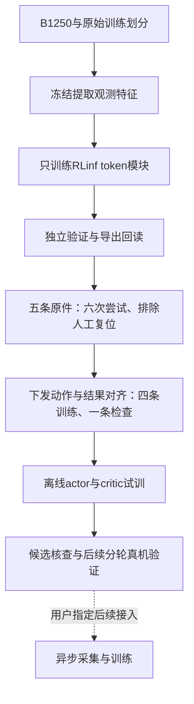

# B1250 冻结 RLT：特征接口与五条记录的离线试训

**2026-10-26：token第一阶段及五条记录的离线actor／critic试训均已完成。** 第一阶段完成特征重建与encoder导出；第二阶段冻结B1250和encoder，训练约214万参数的小网络，完成800次critic更新。当前真机仍使用原B1250，未部署新actor。

**只有用户明确确认的09:43那条成功，其余尝试均未成功；松手不等于正确放入。** 五个原始run拆成六次局部尝试，人工放回积木的区间排除；四个run训练、一个run独立检查。actor对参考动作的拟合改善，但critic出现超出回报上限的估值，尚无任务成功率提升证据；也没有独立成功轨迹用于验证。

**按用户决定，本轮先离线、随后分轮验证，异步框架暂不接入，后续保留接入任务。** 当前不要求再重复普通rollout。下一步先评估候选的动作与价值限制，再完成RTC已承诺前缀／阶段切换等控制适配，才进入现场新actor试跑；V2覆盖并行，部署事实以[STATUS](../../STATUS.md)为准。

后续已按新授权复用九条成功人工纠正：550步早停、保留400步BC候选，Q阶段因critic未通过检查而未启动；见[新数据与停止依据](20261026-rlt-dagger-success.md)。本页保留首轮数据、配方和诊断事实。

## 五条记录的离线actor／critic：2026-10-26

本轮用户明确授权先用现有五条训练，并暂缓异步框架。训练及数据复制已执行，原件、原备注和线上B1250不变；它是冻结底座上的离线小样本pilot，不是在线RL已改善成功率。原论文与RLinf Stage2均支持小头随机初始化；本轮直接复用本地RLinf的三层256宽MLP与双Q实现，未另换一个预训练机器人底座。[原论文附录B](https://arxiv.org/html/2604.23073v1#A2)

### 网络与初始化

| 部分 | 参数量 | 本轮来源和更新范围 |
|---|---:|---|
| actor：三层256宽MLP＋输出层 | 740,256 | 随机初始化；输入2048D token、8D本体状态、16×10参考动作，输出16×10动作 |
| Q1／Q2：各三层256宽、LayerNorm | 各700,929，合计1,401,858 | 随机初始化；输入token、本体状态与候选／行为动作，输出未来回报估值 |
| 实际可训练合计 | **2,142,114** | FP32；actor／critic分别使用Adam |
| target双Q | 1,401,858 | critic的慢更新副本，不额外通过梯度学习 |
| token encoder | 371,286,016 | 来自第一阶段300步导出，冻结 |
| B1250 VLA | 原模型 | 原B1250权重、统计、处理器和prompt，冻结；不是本轮随机初始化 |

RLinf基类还带有41,120个未使用的learned-logstd参数；RLT使用固定噪声，本轮将其冻结，不计入可训练参数。F1归一化xyz有效值可超过[-1,1]，因此输出xyz使用线性参数化，rotation6D／夹爪仍用tanh；不裁掉原动作标签。该F1参数化须与权重一起加载，不能直接套stock Franka配置。

### 原件、结果与分段

[用户确认](../artifacts/20261026-rlt-stage2/operator-confirmation.json)明确：桶全程未挪动，只有“成功！”那条成功，144秒run中把失败的积木放回作为下一次抓取起点。头图／右腕[关键帧](../artifacts/20261026-rlt-stage2/success-contact.jpg)用于核对局部阶段；终点取已确认结果且已撤离的保守观测时刻，不宣称精确找到最早成功时刻。时间以原件首个payload观测的host available时间为原点，不直接套用UI视频时基。

| 原始记录／尝试 | 选定局部秒数 | 结果处理 | 有效转移 | 用途 |
|---|---|---|---:|---|
| 10/26 09:43 | 18–38 | 正确放入并撤离，末转移+1、真实终止 | 37 | 训练 |
| 10/23 13:45 | 18–46 | 松手但放置失败，末转移0、真实终止 | 50 | 训练 |
| 10/23 13:50 | 18–51 | 未松手，中断；有效转移保留，末窗口未通过时不伪造终点 | 60 | 训练 |
| 10/23 13:36第一次 | 18–40 | 放置失败，末转移0、真实终止 | 37 | 训练 |
| 同run第二次 | 60–142 | 仍持物／犹豫后中断，截断可bootstrap | 106 | 训练 |
| 10/26 10:58 | 18–84 | 延后松手但放置失败，末转移0、真实终止 | 118 | 独立检查 |

共408转移、427个不同源观测；训练290、检查118。144秒run的40–60秒整体排除，两个尝试保持同一split。上述局部尝试数不等于独立场景数；只有四个训练run和一个失败检查run，不能声称已验证成功泛化。

全部原始journal、payload索引和图像包按原manifest校验。schema4只要求真实右臂／右爪字段有效，左爪缺失占位不冒充测量；每条转移检查区间内所有原始控制发布，再按30Hz采样submitted动作并经原FK编码成EEF10。暂停／恢复、epoch变化、发布不完整、过旧观测、序列缺口和人工复位不能跨越。ROS下发记录不等于下位机接受／精确跟随的证明；相机使用host接收时间，不宣称曝光同步已标定。

特征与参考动作使用固定B1250和encoder对保存图像重新计算，同一次prefix前向共享token与参考；参考是新生成的五步去噪、无RTC引导动作，不冒充当时实际执行proposal。critic行为动作则来自实际submitted日志。当前缓存用于离线预热和算法验证，接入真机前仍须实现RTC条件、已承诺动作与实际执行归因。

### 训练、监控与验收

前300步actor拟合B1250参考动作，critic以参考动作作下一动作预热；后500步启用`5×BC−0.1×Q1`，critic每步更新、actor每4步更新，共425次actor更新和800次critic更新。双Q最小值构造TD目标，target系数0.005，参考输入dropout0.5，batch64、学习率3e-4、梯度裁剪10。抽样按训练segment均匀，10%从训练真实终点采样；不从独立检查run抽样。

奖励只有正确放入并撤离时+1，其他为0；错误放置为真实终止，中断保留截断语义。折扣按F1 30Hz每步0.999、16步块计算，避免照搬另一控制频率的gamma；本轮没有新增时间惩罚或事后超时失败。配置见[rlt_b1250_stage2_offline.json](../../configs/rlt_b1250_stage2_offline.json)，数据与网络适配见[replay](../../src/f1_toys/rlt_replay.py)、[Stage2小头](../../src/f1_toys/rlt_stage2.py)，运行入口为[run_rlt_stage2_offline.sh](../../scripts/run_rlt_stage2_offline.sh)。

17项针对性检查通过，真实2步→恢复至3步通过，800步流水线退出0，checkpoint重新加载的动作逐值一致。训练进程只加载缓存与小头，未加载VLA／encoder，保证二者不参与本轮梯度更新。完整[数据审核](../artifacts/20261026-rlt-stage2/h20/cache/audit.json)、[训练结果](../artifacts/20261026-rlt-stage2/h20/train/result.json)保留。

| 检查指标 | 初始化 | 300步预热 | 800步候选 |
|---|---:|---:|---:|
| 留出run参考动作MSE | 0.311273 | 0.005203 | 0.003512 |
| 留出run夹爪参考MAE（归一化） | 0.997472 | 0.054451 | 0.060839 |
| 留出run critic TD MSE | 0.005345 | 0.002970 | 0.004906 |
| 留出run最大绝对Q | 0.279566 | 0.376605 | 1.073453 |

actor拟合改善不等于策略更好；critic的TD目标包含自身学到的值，低TD loss也不是成功率。800步部分Q超过稀疏[0,1]回报的上限，不能作为已校准的成功概率或可靠改进依据；夹爪参考误差相对300步也略增。保留预热和最终候选，不自动选择后者上线。

零更新[候选审计](../artifacts/20261026-rlt-stage2/h20/audit/report.json)进一步确认：800步两个训练失败终点的双Q约0.052／0.112、0.046／0.068，成功终点约1.036／1.078；但留出失败终点仍为**0.576／0.624**，未学到可靠的结果泛化。816个Q输出中23个超出[0,1]。每个segment取中段与末段，共12个保存状态，参考／300步预热／800步候选各12/12通过原IK，共36个离线计划；这不检验接触、实时RTC、实际成功或回退能力。

`export/head.safetensors`精确回读通过，[导出manifest](../artifacts/20261026-rlt-stage2/h20/export/manifest.json)绑定父B、encoder、F1参数化及适配源码，明确`deployment_ready=false`。预检优化器step确认为2→3；主训练actor／critic计数为425／800。四个W&B run已确认finished，H20 GPU4–7已释放，唯一推理进程仍是原B1250；见[完成回执](../artifacts/20261026-rlt-stage2/h20/completion.json)与[在线状态](../artifacts/20261026-rlt-stage2/h20/wandb-final-status.json)。

[主训练W&B](https://wandb.ai/robotics-example/f1_complexytoys/runs/f1rlt2offline20261026r1main)、[保存恢复预检](https://wandb.ai/robotics-example/f1_complexytoys/runs/f1rlt2offline20261026r1pre)、[特征缓存](https://wandb.ai/robotics-example/f1_complexytoys/runs/f1rlt2offline20261026r1cache)均在线；正式分类为`08_RLT_Stage2_Offline_B1250`，预检为`00_Engineering_Checks`。零更新候选审计独立记录，不增加训练step。

H20产物根目录为`/u01/user/runs/f1-rlt-stage2-offline-20261026-r1`，包含绑定来源的cache、preflight、train及全部检查点；原始五条保存在`/u01/user/datasets/f1_rlt_five_rollouts_20261026/raw`。训练源码固定于`f1-toys-20261026-rlt-stage2-r1`，本轮不修改线上推理服务或机器人控制入口。后续分轮验证优先；按用户决定，异步runner／权重同步器仅列后续接入，不在本轮启动。

## 已冻结的首轮配方

- 底座：新版右单臂B1250，沿用绑定的处理器、统计、prompt和模型core；模型文件SHA256为`53cd7404314969f6d90a2a352e8daca4f71f60518bec9fdeb3d9a15156dff68b`。
- 数据：原V1＋九条纠正schema3派生包；保留原12条V1＋9条纠正训练、3条V1＋1条纠正验证及source_group隔离。不是新采V2，不导入未经审核的新schema4原件。
- 特征：每训练episode按时间均匀选最多96个锚点，每验证episode最多64个；不按释放标签加权。使用确定性图像处理、完整prefix和原attention mask，保留无效左图位置，但不允许其参与token注意力或重建损失。缓存BF16，不训练动作损失。
- 训练抽样：原示教/纠正75:25，来源内episode均匀、再在选定锚点中均匀；global8、micro2。
- 模块：原RLinf `RLTTokenTransformer`，2048维、encoder/decoder各2层、8头、MLP ratio4、prefix上限1024。沿用实现，不将“一个token”误称为只有2048个训练参数。
- 优化：新AdamW，LR=1e-5、weight decay=0、梯度裁剪1；首轮300步，每50步验证和保存，按验证episode平均重建MSE选checkpoint。它是首次离线pilot，不预先承诺300步足够达到控制要求。
- 冻结：VLA显式`requires_grad_(False)`，缓存期间不创建优化器；token训练进程只读缓存，完全不加载VLA。
- 资源：实时检查后先用H20 GPU4，现有GPU0–3推理服务保持运行。数据、日志与checkpoint留H20。
- W&B：预检单独归`00_Engineering_Checks`，正式归`07_RLT_Frozen_B1250`；提取、训练、离线评估分job，恢复预检保持同run连续step。

可执行配置：[rlt_b1250_frozen.json](../../configs/rlt_b1250_frozen.json)；任务入口：[run_rlt_stage1.sh](../../scripts/run_rlt_stage1.sh)。原VLA文件、既有模型包与线上运行时只读。

## 验证协议与限制

1. 检查原训练/验证episode及source_group不相交；数据、底座和token源码身份固定。
2. 用小尺寸的真实RLinf模块检查无效图像位置/补齐不影响token及loss、重建不向输入特征反传、缓存精度回读、episode抽样和损坏拒绝。
3. 真实特征提取前后同观测、同噪声动作逐值一致，参数无梯度，原文件哈希不变。
4. 真实预检2步保存再恢复到3步，核对优化器step、抽样RNG和encoder探针精确回读；正式训练使用独立新run，不接着预检权重训练。
5. 独立验证报告各episode重建MSE、token变化幅度；最终额外检查token置零/换成其他观测后重建损失的变化，避免只看总体loss而忽略解码器绕过token的可能。
6. 导出encoder sidecar与完整训练checkpoint分开保存；sidecar绑定B1250的bundle身份。重新加载后，缓存token、实时离线提取token与原参考动作需一致。

这些检查不证明物体接触、插入、释放或现场闭环成功。真实在线RL需要实际执行动作、参考动作、奖励、终止/截断、人工接管及时间戳；现有SFT窗口不能直接冒充这一经验库。当前Franka示例不能照搬到F1的EEF10、原RTC硬前缀和受限IK。

## 运行与结果

首轮完整流水线退出0。训练2016帧来自21条episode，验证256帧来自4条独立episode；它们不是2272次独立任务尝试。训练进程只有token模块，共746,764,288个可训练参数，其中encoder为371,286,016；实际峰值显存约14.0GiB，纯更新约0.37秒/步，不含特征提取、验证和保存耗时。全部W&B run已finished，H20 GPU4–7均复核0MiB，原四个推理PID保持，见[完成回执](../artifacts/20261026-rlt/h20/completion.json)。

| 检查 | 结果 | 含义 |
|---|---|---|
| 8项特征/缓存检查＋2项参考接口生命周期检查 | 10项通过 | padding、左图mask、梯度隔离、数据来源、缓存与异常恢复 |
| B1250冻结 | 同噪声动作最大差0，文件哈希不变、VLA梯度0 | 训练没有修改底座 |
| 2步保存→恢复至3步 | optimizer step、抽样RNG、encoder探针通过 | 恢复保持同W&B run连续step；正式训练独立初始化 |
| 验证episode平均MSE | 初始化3.470094；50/100/150步为0.713663/0.539856/0.492573；300步0.408366 | 300步为预定验证点中的最优 |
| 四条验证episode最终MSE | 0.400758、0.415356、0.424895、0.392454 | 改善未仅集中于一条episode |
| token置零／异观测替换 | 0.618287／0.408791 | 重建需要token的整体信号，但样本特异信息的作用须谨慎判断 |
| encoder独立加载 | 缓存与重新提取token逐值一致；原参考动作逐值一致 | 输出token2048D、本体状态8D，版本绑定有效 |
| RTC参考接口 | 3个保存观测×bootstrap/14步硬前缀，共6个对照全通过 | raw、IK关节计划及硬前缀逐值一致；每请求只计算1次VLA prefix |

正式[W&B训练](https://wandb.ai/robotics-example/f1_complexytoys/runs/f1rlt20261026r1main)、[保存恢复预检](https://wandb.ai/robotics-example/f1_complexytoys/runs/f1rlt20261026r1pre)、[独立评估](https://wandb.ai/robotics-example/f1_complexytoys/runs/f1rlt20261026r1eval)均已结束；分类和真实指标保留。后续消融属于零参数更新评估，不续训练步数。

H20产物根目录：`/u01/user/runs/f1-rlt-b1250-20261026-r1`。`cache/`保存带父模型身份的特征；`train/step-000300.pt`保留完整token模块/优化器/RNG；`evaluation/encoder/`是独立encoder sidecar。模型与缓存留H20，6000D只保存[小型报告与验收](../artifacts/20261026-rlt/)。源码分别冻结于`f1-toys-20261026-rlt-r1`、`f1-toys-20261026-rlt-reference-r1`及补充消融版本；原冻结目录不原地修改。

### token是否携带当前观测的信息

补充消融在相同256个验证观测上比较正确token、零token、相隔半个验证集的另一观测token，以及验证token均值。以下为保持训练时原生token精度的r2结果；r1多了一次中间BF16转换，原始记录保留，不用其微小数值差做结论。

| 输入token | 全部有效位置MSE | 首有效视觉位置 | 右腕首位置 |
|---|---:|---:|---:|
| 当前观测 | 0.408366 | 0.708124 | 0.642381 |
| 置零 | 0.618287 | 1.351832 | 0.663918 |
| 换成另一观测 | 0.408791 | 0.729716 | 0.667691 |
| 所有验证token的均值 | 0.408747 | 0.725106 | 0.675796 |

异观测替换使总体误差增加约0.10%，首有效视觉位置约3.05%、右腕首位置约3.94%。token平均逐维标准差0.1015，异观测余弦相似度均值0.9962。这支持“token并非完全常量，且带有一定观测相关信息”，但全序列的自回归教师输入提供了很强的重建线索，不能从总体loss推断RL所需的插入状态已被充分保留。均值token是诊断对照，不用于训练或部署。

完整[分位置结果](../artifacts/20261026-rlt/h20/token-audit-r2/report.json)、[RTC参考对照](../artifacts/20261026-rlt/h20/reference-validation.json)、[保存恢复](../artifacts/20261026-rlt/h20/preflight/resume-verification.json)可追查。评估只运行前向，无新增参数更新；[消融W&B](https://wandb.ai/robotics-example/f1_complexytoys/runs/f1rlt20261026r1audit2)独立归档。

### 后续actor动作范围不能照搬示例

只读核对训练909,437个、验证194,893个有效动作步：训练中归一化xyz分别有13.74%、20.43%、22.62%的标签落在[-1,1]外，验证中为14.21%、16.81%、20.85%。因此直接把RLinf默认tanh输出当F1归一化EEF动作会丢失一部分已示教范围。只读参考保留原normalized EEF10；本轮离线小头已将xyz改为线性输出且不裁标签，在线探索尺度、RTC输出接续仍需专项适配，不能以Franka 7D示例替代。

## 先复用已有记录，在数据页备注标注

**2026-10-26按用户纠正调整：先分析已有B1250固定位置记录，不要求另跑六条、不要求凑齐六次成功，也不要求先变化位置。** 此前建议复用一批六条现场复验，是重复性和布局评估的安排，不应成为RLT准备工作的前置条件；本节取代此前“先跑六条再标注”的口径。固定位置便于集中比较到孔口后迟迟不释放的现象；布局变化归V2覆盖和后续泛化评估，只有已有记录缺少关键阶段、画面或结果时才提出定向补录。

**本节保留进入Stage2前的五条备注核对；后续用户确认、分段与训练以[上方Stage2结果](#rlt-stage2-offline)为准。** 用户删除无效条后剩5条，2条使用`20261023-rlinf-rollout-r1`，3条使用旧运行版本；保持真实checkpoint和运行版本分组，不混算优化收益。以下[备注快照](../../artifacts/20261026-b1250-only/five-rollout-notes.json)及[当时解读](../../artifacts/20261026-b1250-only/rlt-five-record-assessment.json)只记录当时证据，彼时尚未生成reward或批准进入训练，不改写历史JSON。

| 记录（数据页时间） | 已保存的备注要点 | 下一步核查 |
|---|---|---|
| 10月26日10:58 | 约20秒进入相关阶段，75秒才松手 | 20秒的具体含义、物体是否正确放入及安全撤离 |
| 10月26日09:43 | “成功！” | 已有完整成功确认；定位局部起点、实际释放与撤离 |
| 10月23日13:50 | 约20秒到位，一直未松手，操作者中断 | “到位”的物理条件、停止原因、末个可信观测 |
| 10月23日13:45 | 约20秒到盖子上方，41秒松手 | 到盖子上方不证明插入；确认实际放置和撤离结果 |
| 10月23日13:36 | 连续推理两次；首次约33秒松手，第二次约65秒到达后反复调整，抓取位置有问题 | 分别定位两次起止，核对中间整理／复位／人工挪物及各自结果 |

**后续用户已确认只有1条成功，另外3处松手均未成功。** 144秒长run含两次尝试，第一次失败后人工放回积木；本轮已分别划段，并整体排除40–60秒复位区间。不能仅凭同一run就连接成一个RL episode，也不能跨reset构造`next_obs`。

这5条提供长等待、错误放置、人工中止和抓偏后调整的证据，已用于本轮分段核查与离线试训，不继续无目的重复自主rollout。后续若缺同类等待／抓偏状态下的正确恢复，优先采同布局人工纠正，不以继续等到75秒或变化位置替代。

早先[6条目录快照](../artifacts/20261026-rlt/catalog-review-20261026T061028Z/catalog.json)及[当时汇总](../artifacts/20261026-rlt/catalog-review-20261026T061028Z/summary.json)保留历史事实：该次核对为2条新运行版本、4条旧运行版本，仅09:43一条有“成功！”备注，其余为空。此数量和备注状态已由上面的最新5条核对替代；空备注在任何时点都不代表失败。

**数据页的每条记录备注是人工标签入口，保留原备注并追加经回放确认的信息。** 原[空白标注清单](../artifacts/20261026-rlt/onsite-labels.csv)只保留此前计划，不再要求用户另填，也不作为第二份人工标签来源；后续机器索引由备注派生并保留来源。用户可以指出画面或大致时刻，再将其对齐为该条录像时间；无法确认的时刻写“未确认”，不猜时间，也不把整条“成功”自动传播到全部动作窗口。

第一轮局部范围仍建议为持物接近孔口后的对准、放入、释放与安全撤离，回位和完整任务结果另记。备注按下面口径记录，不要求每项都有明确时刻：

| 项目 | 记录方式 |
|---|---|
| 局部开始 | 已持物、接近孔口、准备精细对准的可观察时刻；没有到达则写“未进入局部”，不伪造起止 |
| 认为可以释放 | 可选；写“操作者判断可释放：约某时刻”及依据，明确这是主观判断，不等同传感器确认或奖励真值 |
| 实际释放与结束 | 分别记物体实际脱离夹爪的时刻，以及安全撤离、明确失败或中止时刻；若直到录像结束仍未放手，写“截至结束仍未释放”及可核实的等待区间 |
| 接管、暂停或中止 | 记发生时刻和原因；自主段与人工恢复段分开，人工救成功不算自主完成，手动挪桶或扶物须注明 |

实际成功需核对物体放入、释放和安全撤离，不能仅看张爪命令。已观察到掉块、放错位置等可标具体失败；长等待后人工结束、网络中断或录像结束，先如实标“未完成／中止／截断”。未预先约定时间预算时，不事后套任意超时阈值。**截断不自动生成失败reward，也不自动视为任务终止**；后续构造RL转移时依据真实事件和明确的终止／截断规则处理。

备注是任务定义和数据审核的输入，仍不等于在线RL经验库。本轮已完成五条自主记录的EEF10离线输出与published转移、奖励／终止适配及小头试训；下一阶段仍需在线探索尺度、RTC硬前缀、IK后实际执行归因与现场验收。现有B1250权重和动作入口未改变；回看和标注不要求操作RLT actor，也不将原独立推理入口改成人工接管入口。

若V2得到更稳定底座，重新训练或验证对应token并重新提取缓存；不同底座的token和replay特征不自动混用。本轮不启动V2联合SFT，也不以RLT取代V2覆盖采集。

## 不同采集策略的数据怎样用于后续训练

**不同checkpoint诱发的人工纠正可以聚合，但记录完整不等于所有时段都进入训练。** 采集策略决定机器人到达哪些状态，人工纠正提供这些状态下的专家动作；只要任务、硬件有效性、图像处理和动作含义能够对齐，就不要求采集checkpoint相同。保留模型、运行版本和控制来源，按episode／同场次来源隔离训练与验证，并转换到所选训练合同及训练集统计，不能直接混拼不同统计下的归一化动作。DAgger的依据是聚合策略访问状态上的专家监督，当前人工接管采集并不等同经典DAgger对全部状态标注。[DAgger原论文](https://proceedings.mlr.press/v15/ross11a/ross11a.pdf)

**把合格纠正数据放到官方π0.5 base重新训练，使用动作模仿损失，就是离线SFT；从任务checkpoint继续SFT也一样。** 初始化不同不改变训练类别。项目的V1＋九条纠正已经采用从官方base重新Full训练的做法，未要求从采集数据的父1K继续，见[已有配方](../../V1_DAgger_FullSFT.md)。仅用固定经验库和奖励训练actor／critic才是offline RL；持续收集新执行结果并更新则是online RL。RLT中的off-policy表示可以学习其他行为策略产生的转移，不能因此把它称为offline RL。[RLT原论文](https://arxiv.org/html/2604.23073v1)

用户此前补充部分记录因等待过久被人工中断，现已与[剩余5条的保存备注](#rlt-existing-rollout-notes)对应；随后明确唯一成功与手动放回积木，已据此完成本轮限定范围的离线转移审核。未释放中断仍不能统一标真实失败终止。下面是一般审核用途；本轮五条用于Stage2离线试训，未加入已完成的Stage1，也未用于在线训练。

| 记录类型 | 离线SFT动作监督 | RLT Stage1观测重建 | RLT Stage2经验候选 |
|---|---|---|---|
| 有效人工纠正 | 审核通过的真实submitted动作可用；保留开始纠正时的偏差状态，排除准备等待、失效发布与环境协助 | 有效观测可用 | 有连续实际动作、下一观测与结果时可用；人工标记用于区分纠正目标 |
| 策略自主成功 | 不自动当专家；若以后采用高质量策略自示教，需另审来源、阶段及配方 | 有效观测可用 | 可提供成功转移；整条成功不等于每个动作都获得成功奖励 |
| 策略长等待后人工中断 | 不模仿policy等待；若随后真实人工纠正，单独审核该人工段，不虚构未发生的释放动作 | 有效观测可作为候选，不会因此学会释放动作 | 完整转移可候选；中止原因和终止／截断必须明确，不能把日志结束自动记成失败 |
| 网络、反馈、发布或录制异常 | 排除受影响的监督区间；异常前后合格片段分别审核，不跨缺口拼接 | 仅保留观测本身可信的部分 | 仅保留动作和下一观测均可信、连续的转移；异常区间保留诊断证据 |

当前SFT索引只允许审核范围内的人工来源，以及单独批准的Home；检查`hil_latched`、intervention、epoch、powered和实际发布，遇第一处无效标签就截断连续前缀。短窗剩余位置用时间mask排除，不复制末帧、不跨暂停／复位／下一条episode拼接。失败episode中的合格人工片段可以逐段审核，最终成功也不能使整条混合轨迹都变成专家答案。实现见[监督选择](../../DataPrehandle/build_training_index.py)与[审核绑定的纠正派生包](../../scripts/prepare_hil_correction.py)。

### Stage1与Stage2利用的信息不同

已完成的Stage1从原审核包取有效观测，用冻结B1250提取prefix，新增模块只学习压缩和重建；不使用reward，也不把动作当监督。它不会仅凭“这里等太久”的备注学出该怎样松手。后续若扩大观测来源，需要重新审核输入有效性、冻结来源划分并生成新的缓存版本，当前300步结果不包含这一扩展。

Stage2需要按实际执行构造`观测 → 动作chunk → reward与下一观测`，同时保留终止／截断、实际时间跨度、人工接管、模型身份和参考动作。F1还必须对齐观测锚点、EEF10、RTC已承诺前缀和IK后真正发布的动作，不能拿未执行的policy proposal替代执行记录。若导入其他checkpoint采集的数据，行为动作保留真实来源，token和所需参考动作按本轮固定的VLA／encoder及动作合同生成并核验；不能把旧底座的特征缓存直接混进来。

critic利用真实转移与回报学习动作的后续价值；actor依据critic改进动作，并通过参考动作或人工纠正保持行为约束。只有等待与中断、没有可比较的成功或纠正证据，不能保证RL学会正确释放；单纯复制旧VLA参考动作还可能继续等待。数据页备注用于确认局部起止、真实结果及接管原因，未知结果由操作者回看确认，不能根据录像长度、张爪命令或程序退出推断。

### 从已有记录到在线迭代，再到异步并行

**“用已有数据预热actor／critic，再用新actor收集经验、继续更新”中，首轮离线部分已完成，真机环路尚未接通。** 本轮五个原始run已形成限定分段的408个转移，仍不代表充分数据量；切出重叠窗口不会增加独立任务证据。后续可审核已有人工纠正作为补充来源，本次遵照用户要求只使用这五个run；低训练loss不能自动解释为策略更好。用户明确本轮暂不实现异步框架，后续接入。

首轮建议按下面的分轮流程实现和验收：

1. 本轮已将记录按真实尝试切段，生成可追查的下发动作转移，保留独立run检查；后续人工纠正需另审。
2. 本轮已冻结B1250和token encoder，随机初始化并预热小actor／critic，再做有限Q更新。actor学习参考动作及critic给出的改进方向，critic从真实reward和下一状态学习价值；本轮没有人工动作监督，B1250不继续SFT。
3. 使用明确的actor版本在局部阶段rollout，记录实际动作、参考动作、结果与接管。原B1250仍提供特征与参考动作；critic在训练侧使用，不负责机器人实时动作输出。
4. 把新经验加入旧经验池，继续更新actor／critic，并保持检查点、优化器和数据来源连续。每轮既不清空旧记录，也不从随机权重重新开始。
5. 完成离线与控制接口检查后，同步下一版本actor继续采集；各轮对比局部成功、释放等待、人工介入和完整任务表现。数据缺口和实际效果决定后续采集，不按固定“五条一轮”或默认每轮都会更好执行。

这是分轮进行的在线RL：新策略与环境交互产生新数据，再改进策略。待环路稳定后，采集和训练可异步并行：推理进程用actor副本生成动作，训练进程从经验池更新actor／critic，按配置间隔同步完整策略版本；更新不是发生在每个30Hz控制步上。上引RLT原论文第V节描述了异步采集与off-policy更新；本地[异步runner](https://github.com/RLinf/RLinf/blob/d00fe72060a5aa1554e92fe7bf72846d43d48c1c/rlinf/runners/async_embodied_runner.py)启动环境／rollout后循环训练，按`weight_sync_interval`同步；[actor／critic更新](https://github.com/RLinf/RLinf/blob/d00fe72060a5aa1554e92fe7bf72846d43d48c1c/rlinf/workers/actor/fsdp_sac_policy_worker.py)也有各自更新节奏。

**F1初期建议在episode边界切换actor版本。** 后续若要在chunk边界切换，需先验收RTC已承诺前缀、IK后动作、模型版本和实际转移的对应关系，不能将既有RLinf同步机制视为这些F1约束已自动满足。当前已完成冻结特征、只读参考及五条schema4离线转移／小头试训；在线数据流、F1动作路由、奖励回执和控制切换仍待接通。软件buffer启动门槛只决定程序何时开始采样训练，不保证五条数据足以学好。

### 人工中断如何进入RL

先区分真实任务终止与外部截断。若操作者依明确任务规则确认成功或失败，保存该任务结果及理由；若只是提前结束、网络中断或录像到尾，保留“未完成／截断”，不自动产生失败reward。对非任务终止的部分轨迹，若存在可信末观测，TD可以从该末状态的价值继续bootstrap；不能把reset后重新摆好的状态当作上一条的`next_obs`。没有可信下一观测时，末条转移不能做普通TD，之前的完整转移仍可保留。未来若引入任务时间预算，需先明确统一规则，不能事后任意划一条超时线。[Time Limits in Reinforcement Learning](https://proceedings.mlr.press/v80/pardo18a.html)

### schema4：本轮RLT适配与通用SFT导出分开

本轮[RLT专用离线适配](../../src/f1_toys/rlt_replay.py)已处理这五条自主记录的右侧有效状态／动作、缺失左爪和时间边界，并通过哈希与逐控制检查；不改原件的training_ready字段。通用[原始SFT导出器](../../../../DAgger/F1/src/f1dagger/export.py)仍明确拒绝schema4，[F1 SFT reader](../../src/f1_toys/dataset.py)仍消费已审核派生包；人工HIL专家窗口、混合接管和通用schema4 SFT适配尚未完成。数据页“批准”或增加备注不会自动纳入训练，模型占位不能伪造物理反馈。
