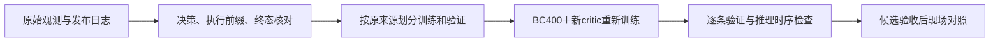

# F1 RLT 决策对齐 V40：数据重建与重新训练

真实局部记录已经按 actor 当时看到的观测、原始输出和实际执行前缀重建，成功终点全部保留。人工纠正及旧 DAgger 示范改为观测之后的目标，不再用锚点时刻的旧命令冒充未来动作。原件和历史权重保留；这是新的训练数据合同，不是给旧缓存换名字。

从 BC400 actor 和全新 critic 出发的两组重训均已完成，各 1024 次 critic 更新、256 次 actor 更新，B1250 和 encoder 冻结。进一步零更新诊断确认：Q 普遍偏好偏转姿态，与 BC 梯度强烈对抗；短片段尾部有 Q 梯度却无 BC 约束，是已定位的训练目标缺口。尚未证明单一修复就能提升自主成功率。新 Q 未发布，生产仍使用 V39 和旧候选。

新增两条已一起处理：第一条未进入 RLT，放置未完成，保留原件但不当成功专家；第二条真实 ↑ 人工辅助成功，按预先划分进入验证，新增 49 个有效转移。计算加速和共享模型交替调用通过离线核对；优先包已适配决策观测，但新数据分支、打包器和计算候选尚未切入生产，连续 C16 RTC 尚未完成。

## 数据与动作含义

新表示为 `decision_prefix_relative_eef10_v1`，继承观测相对右 EEF10、rotation6D 前两行、绝对夹爪及原归一化。与旧 submitted 或仅 selected 的时间窗口不能混训或直接恢复 critic。

- 自主段从 `rlt_plan_adopted` 找到观测与请求，再匹配服务端原始 `prediction_replay`。原始 token、proprio、B 参考动作及 actor 输出逐位核对，不通过关节 FK 逆猜 actor 原输出。
- 被执行的前缀由 owner 成功发布、策略请求与 epoch、插值索引和 selected 对照证明。截断末点保留实际消耗比例，未执行尾段为零 mask；完整候选不自动等于完整执行。
- 下一状态在实际执行之后且在其他控制者接手之前取真实观测。推理／收尾保持的实际时间进入折扣，不把所有转移写成固定 16 步。
- 人工示范取观测之后第一拍至真实终点的已批准目标；跨人工计算等待的旧锚点向后移动到有效观测。无法证明的短片段单独列出排除理由，不能伪造缺失观测。
- 终止结果沿用源绑定审核；原件中 interruption 与事后审核分开保存。局部成功不是 actor 自主成功，Home 和撤离尾段不纳入。

13 条局部记录从 868 个固定时间窗口重建为 719 个转移：517 训练、202 开发验证；其中自主决策 86 个，其余为有效人工窗口。87 个已采用 actor 提案中，1 个 selected 无法与原计划逐项证明一致，明确排除；没有因此丢掉该条的人工成功终点。各条详细数量和原因见 `alignment-audit.json`。

旧 DAgger 示范同步重锚定，179 训练／22 验证保持。critic 辅助终点为 11 训练／1 验证：原始审核失败终点保留，局部训练记录每条只取一个真实终点，旧重叠终点后缀不再当作多个独立结果。

## 验证范围与步数

验证包含四条局部记录、一条独立旧 DAgger 成功记录以及一条旧失败终点；九条同场次 DAgger 训练来源仍整体留在训练侧。跨 local／demo／terminal 检查 episode 不重叠，DAgger 另检查 source group。没有为扩大验证而从训练轨迹随机抽帧，也没有把 V1 全任务窗口直接混入局部验证。

这仍是多次使用过的开发验证，失败覆盖只有一个独立终点，不是新的盲测。报告同时保存按有效动作点加权与逐条等权指标，不能用大量相关帧虚增样本量。

两组各完成 1024 次 critic 更新、每 4 步更新一次 actor。BC 组 Q 权重关闭，Q 组沿用 Q=0.1、BC=5、batch64（局部／旧示范各半）、学习率 1e-4；同 seed、同数据、同初始化，不恢复旧 2192 分支优化器。保存 128／256／512／1024 检查点，有限预算结束后评估，不以 loss 下降自动发布。

W&B group 为 `17_RLT_Decision_V40`，job type 为 `offline-contract-comparison`。两组已正常结束并在线同步：[BC 对照](https://wandb.ai/robotics-example/f1_complexytoys/runs/f1decision20261102v40-decision-bc)、[Q 对照](https://wandb.ai/robotics-example/f1_complexytoys/runs/f1decision20261102v40-decision-q)。新增验证另用 `new-arrival-validation`，没有梯度更新。

## 重训结果：动作对照与 critic 分开判断

以下为原开发验证相同观测、相同人工有效动作点的指标，姿态按解码后的 SO(3) 角度比较。位置 RMSE 是归一化坐标，不能直接读成米或毫米。

| 模型 | 人工动作 MSE | 位置 RMSE | 姿态 MAE | 释放召回 | 持物时误松 |
|---|---:|---:|---:|---:|---:|
| BC400 起点 | 0.01619 | 0.13589 | 0.740° | 52.60% | 0% |
| BC 重训 1024 | 0.01663 | 0.12966 | 0.721° | 52.60% | 0% |
| Q 重训 1024 | 0.01814 | 0.14126 | 3.944° | 52.60% | 0% |

Q 在 128／256／512／1024 步的姿态误差约为 1.60／1.24／1.29／3.94°，并非越训越好。Q 终点校准在 6 个开发终点（5 成功、1 失败）上 MAE 约 0.081，成功最低约 0.775、失败最高约 0.132，已通过当前有限终点筛查；这不证明 critic 在同一状态下能正确排序未见动作，也不保证其动作梯度方向正确。

逐条等权报告中，Q 姿态约 3.83°、BC 约 0.67°；两条来源的释放召回仍为零，不能被合并帧数掩盖。旧 55.92% 与本轮 52.60% 的动作切片和分母不同，不作为性能下降的直接对照。当前可以确认的是“重训后的 Q 更新仍有姿态退化”，不能从这些离线指标推断自主成功率。

## 新增两条与首次留出评估

| 中国时间／来源 | 原件与事件 | 处理结论 |
|---|---|---|
| 16:00:28 · `483db94d` | 完整封存；1946 观测、7106 发布记录；没有进入 RLT | 画面中松爪后积木留在盖板，之后再次夹起，Home 前未完成入孔。保留为失败／恢复诊断；无 RLT 奖励，不自动当专家示范 |
| 16:01:40 · `f018d3c1` | 完整封存；1621 观测、5994 发布记录；3 次 actor 决策，之后人工与真实 ↑ | 局部 21.08 秒，人工辅助成功；重建 3 个自主＋46 个人工转移，按既定规则为验证集 |

两条原件都已到 6000D 和 H20，journal 哈希、完整封存和无写入丢失通过。第一条用户记忆“积木倒了”保留为原话；画面可支持未完成放置，不将倒落具体时刻凭记忆补标。第二条 3 个无法取得接管边界后有效观测的短人工窗口排除，真实成功终点保留。原件及控制事件没有改写。

最终隔离局部数据为 **517 训练／251 验证**，DAgger 仍 **179／22**。新增第二条没有参与这次重训，也不增加训练额度；不能为了表现“又训练了”移动既定划分。它来自相似现场，属于新增轨迹首次评估，不是独立布局泛化测试。

第二条的首次验证共 426 个有效人工动作点，其中 39 个释放点：BC400／BC1024／Q1024 的姿态误差分别为 **0.668°／0.886°／3.649°**，释放召回全部 **76.92%**、持物误松全部 0；位置归一化 RMSE 分别 0.22666／0.21851／0.22734。再次支持 Q 姿态退化，但单条不足以评价真实成功概率。见[新增验证 W&B](https://wandb.ai/robotics-example/f1_complexytoys/runs/f1decision20261102v40-newval)。

画面及源绑定审核：[第一条](../artifacts/20261102-rlt-decision-V40/new-first-review.jpg)、[第一条审核](../artifacts/20261102-rlt-decision-V40/new-first-review.json)、[第二条终点](../artifacts/20261102-rlt-decision-V40/new-second-terminal.jpg)。

## 新数据消费与优先上传

在线适配器按实际采用的 plan，从服务日志查原始 actor 提案，使用完整身份匹配；未写完的尾行留待重试，不补造特征。每个派生缓存保存其使用的原始提案及哈希，服务日志轮转后仍能追溯。

优先包修复为旧窗口与新决策观测的并集：包含原始 actor 查询、人工计算暂停后重新锚定的观测及局部终点。打包版本进入目录修订身份，不把旧包误当新版，仍保持稀疏选图。14 条真实局部包的所需图像齐全；从优先包与完整原件得到的训练张量逐项一致。

真实 `F1ActorWorker._ingest` 已接收 9 条训练／5 条验证，训练额度只计 517 个转移，重复投递和验证数据不增加额度。最终数据与本次实际训练、首次验证所用张量按来源逐项一致；辅助终点允许行排列变化，按 episode／segment／时刻比对，不能把顺序变化误判成数据变化。旧人工记录的命令序号也已与新未来目标同步，保留原序号作为出处。

候选 IK 验证适配了原始 actor 决策记录：它不再要求不存在的 `submitted16` 轨迹，右臂仍从真实观测锚点求解；非执行轴保持在观察值，仅作离线比较，不发布动作。正式 runner、F1 打包进程及快照指针尚未切换，本次没有让错误合同的新梯度混入重训分支。

## 推理优化与 RTC 边界

39 个真实观测覆盖 13 条来源的首末自主决策及终点，同 seed、同 BC400 actor 对照：

| 参考计算路径 | 模型中位耗时 | 对原实现差异 |
|---|---:|---|
| 原训练 eager | 207.6 ms | 基准 |
| 共享 prefix 图、eager suffix | 185.8 ms | 特征与动作逐位一致 |
| 共享 prefix 图及 suffix | 75.6 ms | 不逐位一致；须按物理量核对 |

完整加速候选的最大变化为：平移 **0.0236 mm**、姿态 **0.00130°**、夹爪 **0.0118/100**、解码关节 **0.00351°**，无新增 IK 拒绝。只证明这些真实观测和 BC400 权重的计算近似，不代表任意 actor、网络延迟或完整任务均已验收。

另在 3 个真实观测上做 12 次 VLA bootstrap／guided RTC → 快速 RLT → 原训练特征 → VLA 的交替调用：VLA 输出与解码动作不变，冻结训练特征逐位不变，所有参数保持冻结。新增 `--rlt-reference-compute` 与装配 manifest 双方一致后才能选择快路径，默认仍为旧路径；生产 GPU3 未切换，隔离 GPU4 已释放。

连续 RTC 还需要为小 actor 明确在途动作前缀、观测锚点、延迟、接管取消和执行后缀，并同步到 replay。固定 C16 actor 不具有 OpenPI 扩散模型的前缀引导能力，不能直接套一个 RTC 开关，也不能丢掉前若干步就宣称正确衔接。参考 [RLinf RTC 官方机制](https://rlinf.readthedocs.io/en/latest/rst_source/guides/rtc.html)，下一步是同一动作合同下的连续执行适配与零输出时序验收，不放宽碰撞或输出保护。

## Q 姿态偏转诊断（11月2日追加，零参数更新）

本节使用已完成的 V40 检查点，不再训练，不修改原始标签、线上模型或机器人。原诊断与正交化／多批次复核分别存为 `q-direction-audit/report.json`、`q-direction-confirmation/report.json`；数据覆盖独立复核见 `q-direction-audit/data-coverage.json`。这是同场景观测上的函数与梯度检查，273个输入并非273次独立真机实验。

### 已确认的作用机制

1. **critic 对姿态的排序存在系统性偏好。** 在 Q1024 的273个验证输入上，保持它的平移和夹爪不变，只换回 BC400 的姿态，Q1 全部降低，平均降低0.08754。将两组rotation6D都先正交化、消除数值尺度差之后，Q1仍全部偏好新actor姿态，平均差0.07571，Q2也平均偏好0.05469。这不是仅仅6D表达长短造成的评分差。
2. **实际物理倾斜也能获得较高 Q。** 从正交化的BC姿态出发，仅沿相对坐标轴0转−10°，约95.2%的验证输入Q1上升，平均0.07293；双Q最小值也平均上升0.06059。轴2转+10°也普遍获益。没有给这些假设动作伪造成功／失败标签，也不声称所有不同于BC的姿态都错误；证据说明critic会系统性奖励同向偏转，而不是已经证明这种偏转能放好。
3. **Q 与 BC 梯度强烈对抗。** 16个固定种子、真实随机采样与reference dropout批次上，加权Q／BC参数梯度范数比均值0.840、中位0.885；两者方向余弦均值−0.783。`5×BC−0.1×Q`中的系数不能直接读作“Q只有BC的五十分之一影响”。在固定动作上沿Q梯度作小幅数值探针，验证人工姿态误差从3.900°增至4.179°，Q仍上升；这没有更新网络参数。
4. **未执行尾部缺少 BC 正则。** 真实critic拟合使用mask/fraction；actor查询full C16，而BC loss乘实际执行mask。训练数据上34.3%的姿态Q梯度平方落在mask外，那里该样本的BC梯度为零。真实partial转移本身可以用于off-policy学习，问题是完整候选优化与约束覆盖不一致。
5. **物理等价动作的 Q 表达仍不一致。** rotation6D两行同时缩放0.5，执行端正交化后的旋转不变，但Q1平均改变−0.118（验证）。这需要规范训练与查询的动作表示；已有旧投影对照仍退化，不能把它说成唯一根因。

这些证据解释了为什么“critic终点校准变好，actor却继续偏”：终点拟合只约束少量真实状态／动作；actor会沿critic在其他动作上的梯度优化。Q值没有严重爆炸也可能排序不可靠。把Q1换成双Q最小值不足以解决，两头在上述倾斜探针上都偏好同方向。

### 数据、验证与线上配方的实际边界

| 项目 | 训练 | 验证 |
|---|---:|---:|
| 局部录制 | 9条 | 5条 |
| 局部转移 | 517 | 251 |
| 其中人工／actor | 455／62 | 224／27 |
| 局部真实结果 | 8人工辅助成功、1失败 | 5人工辅助成功 |
| 旧DAgger转移 | 179 | 22 |
| critic辅助终点 | 11 | 1 |

11个训练辅助终点包含上述9个局部终点及2个历史失败，不能当成又增加11次独立尝试。当前14条局部没有自主成功终点；人工救回轨迹仍可用于RL，但不能作为actor自主能力的实证。

不能说full C16完全没有数据：训练人工634条中238条mask长度16，101条末拍fraction大于0.9，另有61个actor完整C16。缺口是来源与终点分布、约束覆盖及Q可靠性，不能只凭“人工fraction不精确等于1”认定数据无效。

14段局部跨度合计7.21分钟，其中训练段跨度4.57分钟；训练转移elapsed合计3.57分钟且包含推理／保持，不是纯动作时间。有效时间和重复采样次数都不能视为独立试验数量，数据量小也不能解释掉已确认的目标缺口。

未发现同一episode跨训练／验证；旧DAgger另有source group隔离。局部按episode哈希划分，邻近场次与位置相关，多次评估后的集合是开发验证集，不能称换布局盲测。动作指标只比较人工有效前缀；critic终点筛查用真实mask/fraction，不能覆盖actor full C16查询的动作排序。新增第二条此前未参与本轮梯度，可用于首次留出检查；反复用于后续调参后也应按开发数据管理。

另确认**离线与正式worker的混合采样不同**：本轮离线为50%旧DAgger＋50%local；正式worker为50%(旧DAgger＋local人工)＋50%local。按本轮规模，两者人工总体比例都约94%，但旧DAgger占比从50%变为约14.1%。现有BC／Q对照内部公平，却不是完整复现正式配方；下一轮应共用同一采样实现和清单。

### 接下来的修复顺序

1. **先统一采样，再补完整动作块的参考约束。** 已确认人工前缀继续学习人工目标；没有人工监督的尾部使用同一观测下冻结B1250的参考，只作为actor正则。critic仍只训练真实执行前缀，不补造尾段执行、下一状态或奖励。比较完整16步均值与保留人工前缀权重、单独添加参考尾损失两种版本，分别记录人工／参考前缀／参考尾损失，避免稀释人工学习。
2. **对 critic 的姿态表示与可靠性单独做对照。** 训练动作与查询动作一致采用执行端旋转映射；固定actor先拟合critic，再逐步加入Q，检查动作排序和分量梯度。当前fresh critic在第一次拟合后就开始推动actor，预热值得测试，但不能用等待更多步代替可靠性证据。固定其他变量，先在128／256步观察已知退化是否复现，再决定是否继续1024步。
3. **保留开发验证，增加实际动作指标。** 同时报告人工有效前缀、完整候选相对参考的物理变化、critic排序、误松与局部结果；后续用新的完整尝试比较BC400／现场旧2192／修正候选的自主完成与人工依赖，不能只凭模仿误差自动选模。旧DAgger可以继续复用；V1如引入须裁到同一局部任务、绑定相同表示并按整条来源隔离，不能把全任务窗口直接加入。
4. **新合同分支与RTC分开上线验收。** 先停止沿用旧动作合同的梯度分支，正式切换可追溯的新buffer／学习器／候选，再做实时采集。计算加速已有真实输入证据；连续RTC仍需在途前缀、接管取消、终态和replay一致性验收。模型能力问题不会靠RTC自动修复。

完整teacher BC的零更新梯度检查只能将Q/BC比均值从0.840降至0.795，冲突仍在，因此不能承诺单改尾部就好。直接将Q也乘历史mask会改变actor优化为事后截断长度的动作价值，该长度可能由人工接管决定，不是部署时已知变量；不把它当作无条件正确修复。

官方RLT使用VLA参考／人工替代目标约束actor，收集交互并进行异步off-policy更新；F1的partial执行、限位恢复与动作表示仍需本地适配验证。核对来源：[RLT论文](https://arxiv.org/html/2604.23073v1)、[RLinf RLT配方](https://rlinf.readthedocs.io/en/latest/rst_source/examples/embodied/rlt.html)。本节没有照抄官方折扣或把论文的训练时间当作本任务收益保证。

## 证据与运行边界

- H20 隔离数据：`/u01/user/runs/f1-rlt-decision-V40`，包括 source index、逐条 manifest、alignment audit 与 integrity report。
- 完整数据一致性检查通过，包含原始 actor 输入输出逐位核对、partial mask／fraction、奖励与终止、折扣及跨管线验证隔离。
- H20 固定 RLinf 源码下的定向回归及本地装配测试通过；测试启动时遗漏固定 core 环境变量曾触发源码混用拒绝，补齐后通过，保留失败与成功回执。这些是软件和真实数据核对，不是真机成功率。
- 训练输出 `comparison-1024`、日志 `training-1024.log`；独立健康／快照目录，`publish_updates=false`。生产学习器和 GPU3 推理未切换。
- 连续执行仍需明确在途前缀、接管取消及同一数据语义；共享图加速候选单独验证毫米／角度／IK 差异及耗时，不能以不逐位一致永久否决，也不能把模型加速叫作已完成 RTC。

主要机器回执位于 `training/artifacts/20261102-rlt-decision-V40/`：`ready-data/{integrity-report,online-admission-report,worker-evaluation-report}.json`、`comparison-1024/comparison.json`、`arrivals-evaluation/report.json`、`compute-physical/report.json`、`compute-shared/report.json`。H20 同名 run 保留完整检查点和源码版本。Q方向诊断已完成，下一步按上节做统一采样与完整参考约束的受控修复；不以增加采集时长或继续同配方梯度代替验证。
