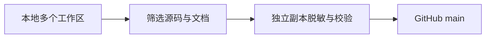

# GitHub 源码快照

2026-11-04：本次更新汇总 Projects、Archive、Libraries 和 Tools 的源码、技术文档、配置模板与依赖身份。当前任务从 [F1 积木](../tasks/F1_ComplexyToys/README.md)和 [HARNESS](../HARNESS/README.md)进入；Artifacts 的部署包和原始产物继续只在本地保存。

上传副本已去除采集数据、训练权重、日志和连接凭据，并将个人目录、现场地址、设备身份替换为示例。这里适合源码审阅与开发恢复；示例地址不能直接连接现场，原发布清单的哈希也不再证明脱敏副本可部署。现有运行目录、原始数据与冻结发布未被修改。



## 目录映射

| 本地工作区 | 本仓库位置 |
|---|---|
| Projects | 根目录中的 F1、DAgger、F1-4242、HARNESS、tasks、infra |
| Archive | DM0.5、g2_robot、Whereweare；专属导航在 workspace/Archive |
| Libraries | PI0.5、third_party；专属导航在 workspace/Libraries |
| Tools | tools/WhyHow、tools/graphify；REA 仅登记上游身份 |
| Artifacts | 不上传部署、交付、运行与审计原件 |

[github.code-workspace](../github.code-workspace)适用于这个合并后的 GitHub 布局。原 projects.code-workspace、f1.code-workspace 保留本机多目录布局的含义。部分历史报告指向已排除的本地产物，不能通过 GitHub 取得。

## 依赖恢复

独立上游保留原远端和固定提交，完整列表见 [upstreams.json](upstreams.json)。OpenPI、RLinf 的未提交源码差异以 [补丁](../third_party/patches/README.md)保存；不向它们的上游仓库推送用户改动。HARNESS 按其锁定清单恢复源码。

```bash
git submodule update --init PI0.5 RLinf third_party/lerobot
git -C PI0.5 apply --check ../third_party/patches/openpi-local.patch
git -C PI0.5 apply ../third_party/patches/openpi-local.patch
git -C RLinf apply --check ../third_party/patches/rlinf-local.patch
git -C RLinf apply ../third_party/patches/rlinf-local.patch
```

## 排除与脱敏边界

排除 API.MD 私密配置、环境密钥、SSH 配置与主机指纹、公私钥、原始录制、数据集、权重、训练输出、机器取证、截图、缓存和交付归档。保留小型回归测试样本、运行提示音、界面图标和源码所需的模型描述；不按 data 或 models 目录名直接删掉源码。

现场地址使用文档示例网段，个人主目录统一为 /home/user，网络设备身份使用合成值，内部域名使用 example.invalid。所有变换只用于上传副本；本次新增提交不改写已有 Git 历史。部署前需使用受控的本地配置与完整原件重新验收。
